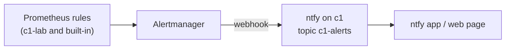

# Get c1's alerts on a phone or in a browser

c1's alerts go from Prometheus to Alertmanager, and from there to **ntfy**, a small push service that runs on c1 (Argo CD app `alerts`). Every alert lands on one topic, `c1-alerts`, formatted by ntfy's built-in Alertmanager template. Whatever subscribes to that topic shows it. Watchdog, the alert that always fires to prove the pipeline works, is not sent to ntfy; it is c1's heartbeat to Healthchecks.io instead ([Know when c1 itself is down](know-when-c1-is-down.md)).

The ntfy page is reachable only from the lab network and the tailnet, through the shared Gateway, and ntfy itself lets nobody in by default (owner's answer 2026-11-12 22:20 UTC, pick 171 in [AGENT-PICKS.md](../../hosts/AGENT-PICKS.md)). The owner reads `c1-alerts` with user `owner` and a password; Alertmanager and Proxmox may only post to it, each with its own token. All three values are made by code into the controller's 0600 secret-source file and reach ntfy through store c1.

## Steps

0. Make and seed ntfy's three values, once per rebuild. On the controller: `ansible-playbook playbooks/ntfy-access.yml` (adds `ntfy-owner-password`, `ntfy-alertmanager-token` and `ntfy-proxmox-token` to `~/.config/central-hub/secret-source.env` if they aren't there; prints none). Then [Seed namespace secret-source](seed-secret-source.md).
   expect: `kubectl -n alerts get externalsecret ntfy-auth` and `kubectl -n monitoring get externalsecret alertmanager-ntfy` show `SecretSynced`; ntfy and Alertmanager are Running. Until then ntfy waits for Secret `ntfy-auth` and Alertmanager for `alertmanager-ntfy`.

1. Open `https://ntfy.apps.c1.prod.<zone>/c1-alerts` in a browser on the lab network.
   Sign in as `owner` with the password from the line `ntfy-owner-password` in the controller's secret-source file.
   expect: ntfy's web page, subscribed to `c1-alerts`. Allow notifications when the browser asks.

2. On a phone, install the ntfy app, then add a subscription. Choose "Use another server", enter `https://ntfy.apps.c1.prod.<zone>`, and use topic `c1-alerts`. When it asks, sign in as `owner` with the same password.
   expect: the subscription appears, empty.

3. Send a test as Alertmanager would, from the controller, with the token on stdin so it isn't in the command line: `sed -n 's/^ntfy-alertmanager-token=//p' ~/.config/central-hub/secret-source.env | sed 's/^/header = "Authorization: Bearer /; s/$/"/' | curl -K - -d test https://ntfy.apps.c1.prod.<zone>/c1-alerts`.
   expect: the message shows on every subscriber within seconds. The same post without the header gets 403, and so does a post as `owner`, who may only read.

4. Check Alertmanager's side: in Grafana, Alerting, then Contact points, or `kubectl -n monitoring get alertmanager`.
   expect: Alertmanager is running. The next firing alert arrives as `[FIRING] <alert name>`, and later `[RESOLVED]`.

## Change it

- **Swap the receiver** (Gotify, email, Matrix and so on): change only `alertmanager.config.receivers` in both `apps/kube-prometheus-stack/values.yaml` and `k8s_observability` `vars/main.yml`. CI's parity check fails if the two differ.
- **Fewer or more alerts:** change the rules (see [Check c1's health](check-c1-alerts-and-dashboard.md)), or add routes to `alertmanager.config.route.routes`.
- **Rotate a password or token:** delete its line from the controller's secret-source file, run `playbooks/ntfy-access.yml` and step 0's seeding again, wait for the ExternalSecrets to refresh (up to an hour, or annotate them `force-sync`), then `kubectl -n alerts rollout restart deploy/ntfy`. For Proxmox's token, run `proxmox-safety.yml --tags notify` too; for Alertmanager's, nothing more (it reads the file at each send).

## Rebuild from nothing

Argo CD makes ntfy and Alertmanager again; step 0 gives them their values. Phones keep their subscription and login, because the URL, topic and password don't change while the controller's file keeps its lines. Messages from before the rebuild are gone.

## If it fails

- **No messages at all:** `kubectl -n monitoring logs alertmanager-kube-prometheus-stack-alertmanager-0` shows the webhook's errors. `kubectl -n alerts logs deploy/ntfy` shows what reached ntfy.
- **The phone shows nothing, the web page does:** the phone isn't on the lab network or the tailnet.
- **401 or 403 in Alertmanager's log:** its token isn't in ntfy's list. Check `kubectl -n alerts get externalsecret ntfy-auth`, then restart ntfy, which reads the list only at start.
- **ntfy or Alertmanager stuck in `CreateContainerConfigError` or `ContainerCreating`:** its Secret isn't there yet; do step 0.
- **The way back:** set `alertmanager.enabled: false` in both values files. Alerts then show only in Grafana again.

## Related

- [Know when c1 itself is down, from a heartbeat outside the lab](know-when-c1-is-down.md)
- [Check c1's health from its dashboard and alerts](check-c1-alerts-and-dashboard.md)
- `hosts/AGENT-PICKS.md` pick 171
