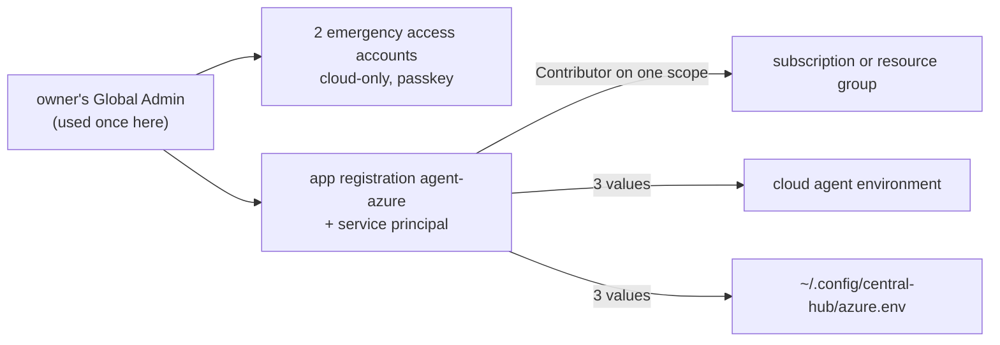

# Give agents their own access to the owner's Azure tenant

Agents should build in Azure and write the runbooks as they go, but they must not sign in as the owner. This runbook makes two things once, with the owner's own admin account: emergency access accounts for the owner, and one service principal for the agents. After that, agents work through `az` with their own identity.



Why a service principal and not a "burner" user account: Azure requires MFA for every user account that changes resources through the portal, CLI, SDKs or REST, with no exception for test tenants; workload identities (service principals, managed identities) are not in scope, and Microsoft says user identities aren't recommended for automation ([Mandatory MFA](https://learn.microsoft.com/entra/identity/authentication/concept-mandatory-multifactor-authentication)). An agent can't answer an MFA prompt, so its login has to be a workload identity.

The name `agent-azure`, the Contributor role and the env variable names are agent picks, not the owner's decisions.

## Before you start

- You can sign in to the Entra admin center as a Global Administrator, with MFA.
- `az version` works on the Mac. Sign in once as yourself: `az login`. ※ This is the only time your own login is used; step 6 makes sure no agent keeps it.
- Decide the scope the agents get: the whole subscription, or one resource group in it. Write it down as `<scope>`:
  - subscription: `/subscriptions/<subscription id>`
  - resource group: `/subscriptions/<subscription id>/resourceGroups/<name>` (create the group first with `az group create`).

Stop if you can't sign in as a Global Administrator: nothing below works without it.

## Steps

1. Create two emergency access accounts in the Entra admin center: cloud-only users on the `*.onmicrosoft.com` domain, each with the Global Administrator role assigned permanently.
   why: if your normal admin account or its MFA fails, these get you back in. Microsoft recommends at least two, cloud-only, never federated or synced, so they don't depend on Keycloak or anything else in the lab ([Manage emergency access accounts](https://learn.microsoft.com/entra/identity/role-based-access-control/security-emergency-access)).
   ※ If the custom domain is ever federated to Keycloak, these accounts are what still works when Keycloak is down.
   expect: two new users under Users, each with Global Administrator.

2. Give each emergency account a passkey (FIDO2) as its sign-in method, different from the method on your daily admin account. Keep the keys apart, not on your phone.
   why: these accounts must pass the mandatory MFA too; Microsoft recommends a passkey or certificate-based authentication for them, not the same method as your daily account ([Manage emergency access accounts](https://learn.microsoft.com/entra/identity/role-based-access-control/security-emergency-access)).
   expect: sign in once with each account and its key; it works without your phone.

3. Exclude both accounts from any Conditional Access policy that blocks or restricts sign-in, if the tenant has any.
   why: a policy that blocks them would lock you out in exactly the emergency they exist for (same page, "Conditional Access considerations").

4. Create the agents' service principal, with a role only on `<scope>`:

   ```sh
   az ad sp create-for-rbac --name agent-azure --role Contributor --scopes <scope>
   ```

   why: `create-for-rbac` makes the app registration, its service principal, a client secret and the role assignment in one step ([Azure CLI service principal](https://learn.microsoft.com/azure/developer/java/sdk/authentication/service-principal)). Contributor can create and change resources in the scope but can't grant roles, so an agent can't raise its own rights.
   expect: JSON with `appId`, `password` and `tenant`. The `password` is shown only now. Don't paste it into any chat.

5. Put the three values where agents run, under these names:

   | From the JSON | Variable |
   |---|---|
   | `tenant` | `AZURE_TENANT_ID` |
   | `appId` | `AZURE_CLIENT_ID` |
   | `password` | `AZURE_CLIENT_SECRET` |

   - Cloud agent sessions: the project's cloud environment settings, as environment variables. New sessions pick them up.
   - The Mac: `~/.config/central-hub/azure.env`, one `KEY=value` per line, then `chmod 600 ~/.config/central-hub/azure.env`.

   why: each place an agent runs reads its own copy. Any agent in those places can read the secret, so what limits the risk is the role's scope (step 4) and that the secret can be removed in one command (see "If it fails").
   expect: `ls -l ~/.config/central-hub/azure.env` shows `-rw-------`. A new file starts as `-rw-r--r--`, readable by every account on the Mac, so the `chmod` is not optional.

6. Sign your own account out of the CLI: `az logout`.
   why: from now on the Mac's `az` must only ever hold the agent's login, so nothing an agent runs acts as you.

7. (Agent) Sign in as the service principal and check what it can reach:

   ```sh
   set -a; . ~/.config/central-hub/azure.env; set +a
   az login --service-principal --username "$AZURE_CLIENT_ID" --password="$AZURE_CLIENT_SECRET" --tenant "$AZURE_TENANT_ID"
   az role assignment list --assignee "$AZURE_CLIENT_ID" --all -o table
   ```

   why: proves the agent's own login works without MFA and shows exactly one role assignment, Contributor on `<scope>` ([Sign in with a service principal](https://learn.microsoft.com/cli/azure/authenticate-azure-cli-service-principal)). The `--password=` form keeps a secret that starts with `-` from being read as a flag.
   expect: one row, `Contributor`, on `<scope>`.

## If it fails

- Lost or leaked secret: `az ad app credential reset --id <appId>` makes a new one and voids the old; then repeat step 5.
- Remove agent access completely: `az ad sp delete --id <appId>` (the role assignment goes with it). Nothing else in the tenant changes.
- Locked out of your admin account: sign in with an emergency account from step 1.

## Afterwards

- The secret from step 4 expires; note its end date (`az ad app credential list --id <appId>`) and reset it before then.
- On 2026-11-09 at 03:33 UTC the owner also gave `agent-azure` **Owner** on the subscription, so agents can assign the roles their code needs (for example the backup signer's data role in `hosts/terraform/azure/backup`). The owner's words: "make you owner for now ... you need to be able to flesh the things out. It does not have a cc" and "just dont charge anything strange. like all we need is this storage account" (2026-11-09 03:32-03:33 UTC). So agents make no other billable resource there without the owner's yes. To go back to Contributor only: `az role assignment delete --assignee <appId> --role Owner --scope <scope>`.
- Each new kind of job (for example an Entra app registration for Keycloak) needs its own Microsoft Graph permission, added by the owner with admin consent, one at a time. Record each one here.
- This secret is a bootstrap step, not the end state. The owner wants no plaintext secret that a person or an agent can read once the infrastructure exists (owner, 2026-11-08 23:42 UTC). The way off it is workload identity federation: a federated identity credential on an app registration trusts an outside token issuer, so nothing in Azure holds a secret (research batch RB-0087, "Workload identity federation"):

  | Who signs in | Token issuer Entra would trust | Replaces |
  |---|---|---|
  | c1 workloads (restic backups first) | c1's service-account token issuer | the short-lived SAS that `agent-azure` signs today |
  | agents | Keycloak, through a client in the realm | `AZURE_CLIENT_SECRET` |

  Both need the issuer's discovery document and signing keys to be reachable by Entra, so this waits on that being built and tested. Azure Arc is the fallback for c1 if federation can't be used.

## Related

- [Use break-glass access](use-break-glass-access.md): the emergency paths for central-hub, c1 and the Proxmox host.
- [D-0025](../decisions/0025-use-keycloak-behind-oidc-for-sign-in-to-lab-apps-on-c1.md): Keycloak for sign-in.
- [D-0030](../decisions/0030-give-cloud-agents-one-github-account-of-their-own.md): the same idea for GitHub, agents with an identity of their own.
