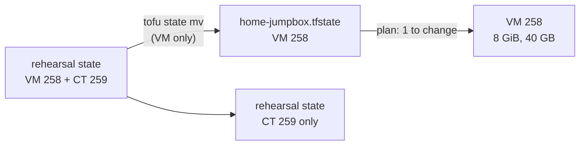

# Grow the jumpbox VM into the agent jumpbox

**Status:** draft, not yet run. Written 2026-11-10 from the code in `hosts/terraform/home/jumpbox`.

The VM was first built by the jumpbox rehearsal kit, whose state also holds the rehearsal's container (CT 259). This runbook moves only the VM's entry into this folder's own state, then grows the VM. The container stays in the rehearsal state, untouched.



## Before you start

- `hosts/terraform/home/jumpbox/home.tfvars` holds the VM's real name (STD-0001), ID 258, its address, and the admin public key. The address and key are the same as the rehearsal's `vm` input; the name is the STD-0001 name, not the rehearsal's, with `memory_mb = 8192` and `disk_gb = 40`. The 8192 is a starting estimate, not a measurement; step 8 replaces it with a measured size.
- `PROXMOX_VE_ENDPOINT` and `PROXMOX_VE_API_TOKEN` are set in the shell.
- Host RAM has room for 4 GiB more: `pvesh get /nodes/<node>/status` shows at least 6 GiB free.

## Steps

1. Copy both state files before touching them.
   why: `tofu state mv` rewrites both files; a copy is the way back.

   ```sh
   cp <rehearsal state> <rehearsal state>.bak-$(date -u +%Y%m%dT%H%M%SZ)
   ```

2. Move the VM's entry into this folder's state.
   why: a moved entry keeps the clone record, so the next plan changes the VM in place instead of replacing it (hosts/AGENT-PICKS.md pick 194).

   ```sh
   tofu -chdir=<rehearsal kit folder> state mv \
     -state=<rehearsal state> -state-out=<folder outside the repo>/home-jumpbox.tfstate \
     proxmox_virtual_environment_vm.j1 proxmox_virtual_environment_vm.jumpbox
   ```

   expect: `Successfully moved 1 object(s).`

3. Take the VM out of the rehearsal kit's code, then plan the kit.
   why: otherwise the kit's next apply would build a second VM 258.
   expect: the kit's plan shows `No changes.` for CT 259.

4. Plan this folder and read the plan.

   ```sh
   cd hosts/terraform/home/jumpbox
   tofu init -backend-config="path=<folder outside the repo>/home-jumpbox.tfstate"
   tofu plan -var-file=home.tfvars -out=jumpbox.tfplan
   ```

   expect: `0 to add, 1 to change, 0 to destroy`, changing `memory.dedicated` to 8192, `disk.size` to 40, the tags, and `name` from the rehearsal's name to the STD-0001 name. Proxmox renames a VM in place, so the name change is not a replace.
   why: Proxmox makes cloud-init's instance-id from a hash of the user-data it generates, and the user-data holds the VM's name (and the user, SSH keys and addresses). So the rename looks like a new instance to cloud-init, which runs its first-boot steps again at the reboot: new SSH host keys, a rewritten `/etc/hosts`. The agent_box role stops that with `manual_cache_clean: true` ([set-up-the-agent-box.md](set-up-the-agent-box.md)); on a VM the role has not run on, expect it, and see "If it fails".
   If the plan says **must be replaced**, stop and apply nothing.

5. Apply the saved plan.

   ```sh
   tofu apply jumpbox.tfplan
   ```

   expect: the VM reboots once to take the new memory, and comes back in under a minute (J run 1: 23 s to connected).

6. Grow the root file system, as the admin user on the VM.
   why: Proxmox grows the disk, not the partition or the file system inside it.

   ```sh
   df -h /
   sudo growpart /dev/sda <root partition number>   # only if df still shows about 20 GB
   sudo xfs_growfs /
   ```

   expect: `df -h /` shows about 40 GB, and `free -m` shows about 7,900 MiB total.

7. Check that Remote Control came back.

   ```sh
   systemctl status claude-rc --no-pager
   ```

   expect: `active (running)`, and the session `jumpbox` is listed at claude.ai/code.

   Then give the OS the same STD-0001 hostname.
   why: Proxmox's VM name and the OS hostname are separate. Remote Control lists the box at claude.ai/code by its OS hostname, which is still the rehearsal's name until this step.
   Run [set-up-the-agent-box.md](set-up-the-agent-box.md): its role sets the hostname from `agent_box_hostname` first. For the hostname alone:

   ```sh
   cd hosts/ansible
   ansible-playbook -i inventories/home/ playbooks/agent-box.yml --tags hostname
   ```

   expect: `hostnamectl --static` on the VM prints the same name as `home.tfvars`.

8. Right-size the RAM from a measurement, once the desktop, Obsidian and the screenshot tool are installed on the VM.
   why: 8 GiB was an estimate (owner's question, 2026-11-10 05:24 UTC). Only a measurement of the real load sets the size.

   ```sh
   free -m                     # at rest: desktop and Obsidian open, no agent work
   vmstat 5 60 > /tmp/ram.log  # during a screenshot run: start this, then run the screenshot job
   ```

   Read the peak used memory from both (`total - available`). Set `memory_mb` in `home.tfvars` to the peak plus 25 %, rounded up to the next 512 MiB, and not under 4096. Plan and apply as in steps 4 and 5; expect `1 to change`, `memory.dedicated` only.
   expect: the two peaks, the new `memory_mb` and the date are recorded in `hosts/AGENT-PICKS.md` pick 194, and this runbook's `outcome` line names the size.

## If it fails

- The plan wants to replace the VM: run `tofu state mv` in reverse to put the entry back into the rehearsal state, and report the plan.
- SSH says the host key changed, after a rename on a VM the agent_box role had not run on: cloud-init ran its first boot again (step 4). Don't accept the new key until you have read it without the network, from the Proxmox host as root, with the VM shut down:

  ```sh
  qm shutdown <vmid>
  losetup -rfP --show "$(pvesm path <disk volume from qm config>)"   # prints /dev/loopN
  mount -o ro,norecovery,nouuid /dev/loopNp<root partition> /mnt
  ssh-keygen -lf /mnt/etc/ssh/ssh_host_ed25519_key.pub
  umount /mnt && losetup -d /dev/loopN && qm start <vmid>
  ```

  expect: the same fingerprint as SSH shows. Then run the agent_box role (it sets `manual_cache_clean`), and redo [set-up-the-agent-box.md](set-up-the-agent-box.md) step 4 if `tailscale status` says it is logged out.
- `growpart` says `NOCHANGE`: cloud-init already grew the partition at boot; go straight to `xfs_growfs /`.

## Exit

`claude auth logout` as user `claude` on the VM, then `tofu destroy` with this folder's state. Nothing else depends on the VM.
