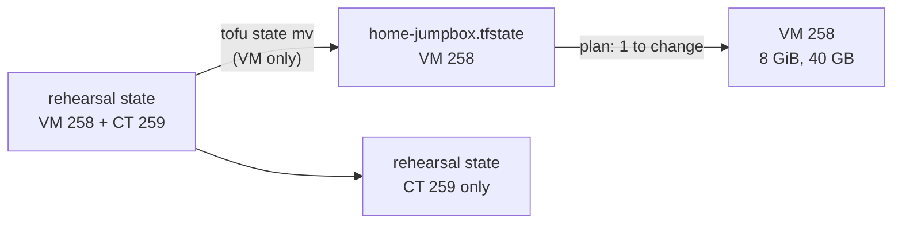

# Grow the jumpbox VM into the agent jumpbox

**Status:** draft, not yet run. Written 2026-11-10 from the code in `hosts/terraform/home/jumpbox`.

The VM was first built by the jumpbox rehearsal kit, whose state also holds the rehearsal's container (CT 259). This runbook moves only the VM's entry into this folder's own state, then grows the VM. The container stays in the rehearsal state until it is deleted ([Delete the rehearsal's container](#delete-the-rehearsals-container)).



## Before you start

- `hosts/terraform/home/jumpbox/home.tfvars` holds the VM's real name (STD-0001), ID 258, its address, and the admin public key. The address and key are the same as the rehearsal's `vm` input; the name is the STD-0001 name, not the rehearsal's, with `memory_mb = 8192` and `disk_gb = 40`. The 8192 is a starting estimate, not a measurement; step 8 replaces it with a measured size.
- `PROXMOX_VE_ENDPOINT` and `PROXMOX_VE_API_TOKEN` are set in the shell.
- Host RAM has room for 4 GiB more: `pvesh get /nodes/<node>/status` shows at least 6 GiB free.

## Steps

1. Copy both state files before touching them.
   why: `tofu state mv` rewrites both files; a copy is the way back.

   ```sh
   cp <rehearsal state> <rehearsal state>.bak-$(date -u +%Y%m%dT%H%M%SZ)
   ```

2. Move the VM's entry into this folder's state.
   why: a moved entry keeps the clone record, so the next plan changes the VM in place instead of replacing it (hosts/AGENT-PICKS.md pick 194).

   ```sh
   tofu -chdir=<rehearsal kit folder> state mv \
     -state=<rehearsal state> -state-out=<folder outside the repo>/home-jumpbox.tfstate \
     proxmox_virtual_environment_vm.j1 proxmox_virtual_environment_vm.jumpbox
   ```

   expect: `Successfully moved 1 object(s).`

3. Take the VM out of the rehearsal kit's code, then plan the kit.
   why: otherwise the kit's next apply would build a second VM 258.
   expect: the kit's plan shows `No changes.` for CT 259.

4. Plan this folder and read the plan.

   ```sh
   cd hosts/terraform/home/jumpbox
   tofu init -backend-config="path=<folder outside the repo>/home-jumpbox.tfstate"
   tofu plan -var-file=home.tfvars -out=jumpbox.tfplan
   ```

   expect: `0 to add, 1 to change, 0 to destroy`, changing `memory.dedicated` to 8192, `disk.size` to 40, the tags, and `name` from the rehearsal's name to the STD-0001 name. Proxmox renames a VM in place, so the name change is not a replace.
   why: Proxmox makes cloud-init's instance-id from a hash of the user-data it generates, and the user-data holds the VM's name (and the user, SSH keys and addresses). So the rename looks like a new instance to cloud-init, which runs its first-boot steps again at the reboot: new SSH host keys, a rewritten `/etc/hosts`. The agent_box role stops that with `manual_cache_clean: true` ([set-up-the-agent-box.md](set-up-the-agent-box.md)); on a VM the role has not run on, expect it, and see "If it fails".
   If the plan says **must be replaced**, stop and apply nothing.

5. Apply the saved plan.

   ```sh
   tofu apply jumpbox.tfplan
   ```

   expect: the VM reboots once to take the new memory, and comes back in under a minute (J run 1: 23 s to connected).

6. Grow the root file system, as the admin user on the VM.
   why: Proxmox grows the disk, not the partition or the file system inside it.

   ```sh
   df -h /
   sudo growpart /dev/sda <root partition number>   # only if df still shows about 20 GB
   sudo xfs_growfs /
   ```

   expect: `df -h /` shows about 40 GB, and `free -m` shows about 7,900 MiB total.

7. Check that Remote Control came back.

   ```sh
   systemctl status claude-rc --no-pager
   ```

   expect: `active (running)`, and the session `jumpbox` is listed at claude.ai/code.

   Then give the OS the same STD-0001 hostname.
   why: Proxmox's VM name and the OS hostname are separate. Remote Control lists the box at claude.ai/code by its OS hostname, which is still the rehearsal's name until this step.
   Run [set-up-the-agent-box.md](set-up-the-agent-box.md): its role sets the hostname from `agent_box_hostname` first. For the hostname alone:

   ```sh
   cd hosts/ansible
   ansible-playbook -i inventories/home/ playbooks/agent-box.yml --tags hostname
   ```

   expect: `hostnamectl --static` on the VM prints the same name as `home.tfvars`.

8. Right-size the RAM from a measurement, once the desktop, Obsidian and the screenshot tool are installed on the VM.
   why: 8 GiB was an estimate (owner's question, 2026-11-10 05:24 UTC). Only a measurement of the real load sets the size.

   ```sh
   free -m                     # at rest: desktop and Obsidian open, no agent work
   vmstat 5 60 > /tmp/ram.log  # during a screenshot run: start this, then run the screenshot job
   ```

   Read the peak used memory from both (`total - available`). Set `memory_mb` in `home.tfvars` to the peak plus 25 %, rounded up to the next 512 MiB, and not under 4096. Plan and apply as in steps 4 and 5; expect `1 to change`, `memory.dedicated` only.
   expect: the two peaks, the new `memory_mb` and the date are recorded in `hosts/AGENT-PICKS.md` pick 194, and this runbook's `outcome` line names the size.

## Give the box a balloon

The box's VM had no balloon device (`floating = 0`), so memory the box once touched never went back to the host. Its footprint grew until a dev rebuild no longer fit beside prod: 8414 MiB free with VM 300 stopped on 2026-11-18 at 03:51 UTC, against a 10240 MiB minimum. `floating = 4096` gives it a balloon. On a q35 machine of version 6.2 or later, Proxmox adds `free-page-reporting=on` to the balloon (qemu-server `src/PVE/QemuServer.pm`). Pages the guest frees then go back to the host, and the host's auto-ballooning may shrink the box down to 4096 MiB when the host runs short. This changes VM 258, so the owner taps it. The apply restarts the box, which ends every session running on it.

On 2026-11-18 this change was made by hand on the host, on the owner's typed order at 04:01 UTC: `qm set 258 --balloon 4096`, then `qm reboot 258`. After that, `qm config 258` showed `balloon: 4096`, and the box came back at 04:01:34 UTC with a `virtio_balloon` device whose free page reporting bit is 1. Its guest then showed 4039 MiB, because the host had shrunk it to the floor. The next dev preflight read 10569 MiB free with VM 300 running. So once this folder's code has `floating = 4096`, step 1's plan shows no change; read it, and apply only if it shows one.

1. Plan this folder and read the plan, as in step 4.

   expect: `0 to add, 1 to change, 0 to destroy`, changing only `memory.floating` from 0 to 4096.
   If the plan shows any other change, or says **must be replaced**, stop and apply nothing.

2. Apply the saved plan, as in step 5.

   expect: the VM reboots once. Proxmox's reboot shuts the VM down and starts it again, which applies pending hardware changes (qemu-server `src/PVE/API2/Qemu.pm`, `vm_reboot`). It comes back in under a minute.

3. Check the balloon on the box.

   ```sh
   ls /sys/bus/virtio/drivers/virtio_balloon/
   ```

   expect: one `virtio<N>` entry. Its features string in `/sys/bus/virtio/devices/virtio<N>/features` has `1` at position 5 (`VIRTIO_BALLOON_F_REPORTING`). The next dev preflight's free memory should be back near the 01:49 UTC reading, 12887 MiB with VM 300 stopped.

## If it fails

- The plan wants to replace the VM: run `tofu state mv` in reverse to put the entry back into the rehearsal state, and report the plan.
- SSH says the host key changed, after a rename on a VM the agent_box role had not run on: cloud-init ran its first boot again (step 4). Don't accept the new key until you have read it without the network, from the Proxmox host as root, with the VM shut down:

  ```sh
  qm shutdown <vmid>
  losetup -rfP --show "$(pvesm path <disk volume from qm config>)"   # prints /dev/loopN
  mount -o ro,norecovery,nouuid /dev/loopNp<root partition> /mnt
  ssh-keygen -lf /mnt/etc/ssh/ssh_host_ed25519_key.pub
  umount /mnt && losetup -d /dev/loopN && qm start <vmid>
  ```

  expect: the same fingerprint as SSH shows. Then run the agent_box role (it sets `manual_cache_clean`), and redo [set-up-the-agent-box.md](set-up-the-agent-box.md) step 4 if `tailscale status` says it is logged out.
- `growpart` says `NOCHANGE`: cloud-init already grew the partition at boot; go straight to `xfs_growfs /`.

## Delete the rehearsal's container

The owner chose to delete CT 259 (tap of 2026-11-18 00:00:40 UTC). It has had no job since VM 258 became the agent box. VM 258 and every other guest stay as they are.

**From the agent box (host job `ct259-destroy`).** The host job `guests` says whether it is there (`proxmox-host.sh check guests` prints `guests found: container 259; VM 258` while it exists; measured 2026-11-21 00:5x UTC). The job `ct259-destroy` (`playbooks/proxmox-ct259-destroy.yml`) deletes it. Its guards: the container's config must carry the tags `jumpbox` and `rehearsal`, be unprivileged and have no mount point, and VM 258 must be there before and after. A delete is a step the standing go covers (D-0061), so it runs the way the box's other host jobs apply:

```sh
sudo -n -u hostops /usr/local/libexec/agent-box/proxmox-host.sh check ct259-destroy
sudo -n -u hostops /usr/local/libexec/agent-box/proxmox-host.sh apply-recorded ct259-destroy <check hash>
```

expect: the check prints `1 changed` for the delete task; the apply needs a reviewer pass and a go recorded for that commit and hash, and then `guests found:` no longer lists container 259. The Mac's kit state still holds the container; empty it with `tofu state rm` on the Mac when convenient, or leave the kit, whose folder was already kept (step 5).

**On the owner's Mac (the original way, no longer needed).** The agents' Proxmox tokens have no right on CT 259, so this ran on the owner's Mac, which holds the kit's state, the `iac@pve!apply` token and root SSH to the host. An agent lane runs it there on the owner's typed line.

1. Check that it is the rehearsal's container, and that the kit's state holds nothing else.

   ```sh
   ssh root@<proxmox host> 'pct config 259' | grep '^tags:'
   tofu-jumpbox.sh init
   tofu -chdir=<rehearsal kit folder> state list
   ```

   expect: the tags include `jumpbox` and `rehearsal`, and `state list` prints exactly one line, `proxmox_virtual_environment_container.j2`.
   If `state list` prints anything else, such as `proxmox_virtual_environment_vm.j1`, stop: the kit's destroy deletes everything in its state, and that VM may be VM 258.

2. Sign the container out of the tailnet and out of Claude Code, so no device or login is left behind.

   ```sh
   ssh root@<proxmox host> "pct exec 259 -- sh -c 'systemctl disable --now claude-rc; su -s /bin/sh claude -c \"/home/claude/.local/bin/claude auth logout\"; if command -v tailscale >/dev/null; then tailscale logout; fi'"
   ```

   expect: the output of each command, and no error from `pct`. A command that is missing in the container is reported, not a stop; step 5 covers what it leaves.

3. Delete it with the kit.
   why: the kit's state then holds nothing, so no later apply of the kit can build CT 259 again. Proxmox drops the container's ACLs with it.

   ```sh
   tofu-jumpbox.sh destroy
   ```

   expect: `Destroy complete! Resources: 1 destroyed.`

4. Check.

   ```sh
   ssh root@<proxmox host> 'pct status 259; qm status 258'
   ```

   expect: `pct` says the container does not exist, and `qm status 258` prints `status: running`.

5. Clear what is left outside the host.
   - Tailnet: a device that step 2 did not sign out goes offline. If it carries a tag that the agent box's daily cleanup removes, the cleanup removes it after its days offline ([set-up-the-agent-box.md](set-up-the-agent-box.md), "Remove old tailnet devices"), and `tailnet-cleanup plan` lists it first.
   - DNS: if the private records file names the container, remove that record and apply the DNS stack.
   - Claude Code: its Remote Control registration shows offline, and its line on the temporary-access register closes.
   - The kit: its state is empty. The kit's folder and `tofu-jumpbox.sh` stay on the Mac until the owner removes them.

## Exit

`claude auth logout` as user `claude` on the VM, then `tofu destroy` with this folder's state. Nothing else depends on the VM.
