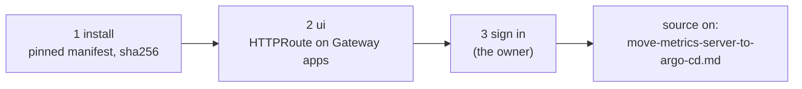

# Install Argo CD on c1

**Status:** draft. Written on 2026-11-08 from the header of `playbooks/k8s-gitops.yml` and [hosts/ansible/README.md, Argo CD web UI on c1](../../hosts/ansible/README.md#argo-cd-web-ui-on-c1). Argo CD was installed on c1 by this playbook; this order has not been replayed from an empty cluster.



## Before you start

- The inventory has `k8s_gitops_engine: argocd` ([D-0023](../decisions/0023-use-argo-cd-as-the-gitops-engine.md)), `k8s_gitops_ui_route: false` and `k8s_gitops_source_enabled: false`.
- For step 2: `k8s_gateway_https` is `true` and `kubectl -n gateway get secret apps-tls` exists ([Issue c1's app certificate](issue-c1-app-certificate.md)).

## Steps

Run from `hosts/ansible/`.

1. Install Argo CD.

   ```sh
   ansible-playbook -i inventories/home/ playbooks/k8s-gitops.yml --tags install --check --diff
   ansible-playbook -i inventories/home/ playbooks/k8s-gitops.yml --tags install
   ```

   why: the upstream install manifest is fetched and checked against the sha256 in the role's `vars/main.yml`; nothing holds a git credential and nothing writes to git (Activation gate items 3 and 4, [AGENTS.md](../../AGENTS.md#activation-gate)).
   expect: `kubectl -n argocd get pods` all Running.

2. Serve the web UI. Set `k8s_gitops_ui_route: true` in the inventory, then:

   ```sh
   ansible-playbook -i inventories/home/ playbooks/k8s-gitops.yml --tags ui
   ```

   why: TLS ends at the Gateway with the wildcard certificate, so the owner opens Argo CD by name with no port-forward. The run stops if the HTTPS listener isn't programmed.
   expect: the run's proof from a node: the name resolves to the Gateway, HTTPS returns 200 with Argo CD's page, plain HTTP returns 301.

3. The owner signs in and changes the admin password.
   why: nothing in the code reads `argocd-initial-admin-secret`; signing in stays with the owner. Sign-in through Keycloak comes with PR #69's `argocd` client and the c1 GitOps work.
   expect: the owner is signed in.

4. Stop here on a rebuild until the add-ons and apps are installed. Turning on the source is step 1 of [Move metrics-server on c1 from Ansible to Argo CD](move-metrics-server-to-argo-cd.md).
   why: each component moves from Ansible to Argo CD one at a time, with auto-sync off until its diff is clean (spec `2026-11-c1-apps-under-argo-cd`).

## If it fails

- Step 1's checksum fails: upstream changed the file at that URL. Never update the sha256 without reading why; pin the new release by STD-0003 in a PR.
- To remove the UI: set `k8s_gitops_ui_route: false` and run the `ui` tag; it deletes both routes and puts `server.insecure` back.

## Afterwards

Set `last-tested`. The `argocd` CLI over this name needs `--grpc-web`.

## Related

- [Rebuild the home lab from bare metal](rebuild-home-lab-from-scratch.md).
- [D-0023](../decisions/0023-use-argo-cd-as-the-gitops-engine.md), [D-0027](../decisions/0027-let-c1-read-central-hub-before-the-activation-gate.md).
- [Spec: Move c1's apps and add-ons under Argo CD](../specs/2026-11-c1-apps-under-argo-cd.md).
