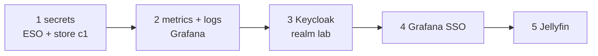

# Install c1's add-ons and apps with Ansible

**Status:** draft. Written on 2026-11-08 from each playbook's header and [hosts/ansible/README.md](../../hosts/ansible/README.md). Each part was installed on c1 by its playbook; this order has not been replayed from an empty cluster.

This is how c1's add-ons and apps get installed today. The target state is that Argo CD owns them ([Spec: Move c1's apps and add-ons under Argo CD](../specs/2026-11-c1-apps-under-argo-cd.md)); the `move-*-to-argo-cd.md` runbooks hand each one over after this.



## Before you start

- `kubectl get storageclass` shows `local-path (default)`: Prometheus, Loki, Grafana and Jellyfin keep their data on claims, and the observability role stops without a default StorageClass.
- `k8s_gateway_https: true` and Certificate `gateway/apps` is Ready: every route here attaches to the HTTPS listener.

## Steps

Run from `hosts/ansible/`, each first with `--check --diff`.

1. Secrets layer: External Secrets Operator and the one ClusterSecretStore `c1`.

   ```sh
   ansible-playbook -i inventories/home/ playbooks/k8s-secrets.yml --tags eso
   ansible-playbook -i inventories/home/ playbooks/k8s-secrets.yml --tags store
   ```

   why: apps read secrets through ExternalSecrets that name store `c1`; the store reads only namespace `secret-source`, and no secret value comes from this repository ([hosts/ansible/README.md](../../hosts/ansible/README.md#what-it-builds), row `k8s-secrets.yml`).
   expect: `kubectl get clustersecretstore c1` shows `Ready`.
   note: the playbook says to seed `secret-source` by hand from the password manager. Since 2026-11-08 the lab's private values live in files on the controller instead (see the rebuild runbook's table); what goes in `secret-source`, and from where, is not written down yet.

2. Metrics and logs, then Grafana's route and the proof.

   ```sh
   ansible-playbook -i inventories/home/ playbooks/k8s-observability.yml --tags metrics_server,metrics,logs
   ansible-playbook -i inventories/home/ playbooks/k8s-observability.yml --tags route,proof
   ```

   why: metrics-server for `kubectl top`, kube-prometheus-stack and Grafana in `monitoring`, Loki and Alloy in `logging` ([hosts/ansible/README.md, Metrics and logs on c1](../../hosts/ansible/README.md#metrics-and-logs-on-c1)); every part is an agent pick.
   expect: the proof shows `kubectl top`, Prometheus's targets and Loki log lines from `kube-system`; `https://grafana.apps.c1.prod.<zone>/` answers.

3. Sign-in: the Keycloak operator, its database, Keycloak and realm `lab`, then its route.

   ```sh
   ansible-playbook -i inventories/home/ playbooks/k8s-identity.yml --tags operator,secrets,database
   ansible-playbook -i inventories/home/ playbooks/k8s-identity.yml --tags keycloak,route
   ```

   why: one sign-in for lab apps over OIDC ([D-0025](../decisions/0025-use-keycloak-behind-oidc-for-sign-in-to-lab-apps-on-c1.md)). PR #69 changes this role: realm `lab` becomes all code, with every password and client secret in the git-ignored `inventories/home/identity.env`, and runbook `set-up-lab-sign-in.md` replaces this step once it merges.
   expect: the realm's OIDC discovery document answers at `https://sso.apps.c1.prod.<zone>/realms/lab/.well-known/openid-configuration`.

4. Grafana signs in through Keycloak. Set `k8s_observability_grafana_sso: true` in the inventory, then:

   ```sh
   ansible-playbook -i inventories/home/ playbooks/k8s-observability.yml --tags metrics,proof
   ```

   why: Grafana gets a "Lab sign-in" button; users with the realm role `admin` become Grafana Admins ([hosts/ansible/README.md, Sign-in on c1](../../hosts/ansible/README.md#sign-in-on-c1)).
   expect: the owner signs in to Grafana with "Lab sign-in" and sets a new password when Keycloak asks.

5. Jellyfin.

   ```sh
   ansible-playbook -i inventories/home/ playbooks/k8s-jellyfin.yml
   ```

   why: c1's first app with data that survives a pod restart ([hosts/ansible/README.md, Jellyfin on c1](../../hosts/ansible/README.md#jellyfin-on-c1)).
   expect: `https://jellyfin.apps.c1.prod.<zone>/health` answers. Run Jellyfin's setup wizard at once: until then anyone on the lab network who reaches the name can run it. PR #64's `move-jellyfin-to-argo-cd.md` makes that first-run setup code.

## If it fails

Each playbook is safe to run again. Removing a Helm release keeps its volumes (reclaim `Retain`); Grafana's claim belongs to its release and goes with it ([hosts/ansible/README.md, Metrics and logs on c1](../../hosts/ansible/README.md#metrics-and-logs-on-c1)).

## Afterwards

Set `last-tested`. Then turn on the off-box backups (`back-up-c1-off-box.md`, PR #68), and move each component under Argo CD, starting with [Move metrics-server on c1 from Ansible to Argo CD](move-metrics-server-to-argo-cd.md).

## Related

- [Rebuild the home lab from bare metal](rebuild-home-lab-from-scratch.md).
- [hosts/AGENT-PICKS.md](../../hosts/AGENT-PICKS.md): the picks behind every add-on here.
