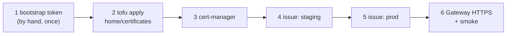

# Issue c1's wildcard app certificate

**Status:** draft. Written on 2026-11-08 from [hosts/terraform/README.md](../../hosts/terraform/README.md#homecertificates-the-cert-manager-token), [hosts/ansible/README.md, Certificates on c1](../../hosts/ansible/README.md#certificates-on-c1) and the header of `playbooks/k8s-certs.yml`. The by-hand form is [Build a single-node kubeadm cluster by hand](build-kubeadm-cluster.md#10b-certificates-for-app-names-home-lab), step 10b.

This is the public certificate for app names. The lab CA for hosts and internal names is a separate path: `create-lab-root-ca.md` and `restore-c1-intermediate-ca.md` (PR #65, D-0028 proposed).



## Before you start

- On the control plane, `kubectl -n gateway get gateway apps` shows the Gateway programmed ([Build c1 with Ansible](build-c1-with-ansible.md) step 3).
- Secrets at rest are on: the `issue` tag stops otherwise.
- The inventory has `k8s_certs_acme_email`, `k8s_certs_cloudflare_token_file` (for example `~/.config/central-hub/cloudflare-dns01-token.txt`), `k8s_certs_issue: false`, `k8s_certs_issuer: letsencrypt-staging` and `k8s_gateway_https: false`.

## Steps

Set every switch in the filled-in inventory, never with `-e`: a later run without it removes what it made.

1. If `~/.config/central-hub/cloudflare-bootstrap-token.txt` doesn't exist, make the bootstrap token in the Cloudflare dashboard by hand, once.
   why: Cloudflare has no API call that makes the first token ([hosts/terraform/README.md, The bootstrap token](../../hosts/terraform/README.md#the-bootstrap-token) has the exact template and scope).
   expect: the file exists, mode 0600.

2. Make cert-manager's DNS-01 token with OpenTofu.

   ```sh
   cd hosts/terraform/home/certificates
   tofu init -backend-config="path=$HOME/.local/state/central-hub/home-certificates.tfstate"
   export CLOUDFLARE_API_TOKEN="$(cat ~/.config/central-hub/cloudflare-bootstrap-token.txt)"
   tofu plan -var-file=home.tfvars -out=certificates.tfplan && tofu apply certificates.tfplan
   unset CLOUDFLARE_API_TOKEN
   ```

   why: the token has only Zone / DNS / Edit and Zone / Zone / Read on the one zone, and expires after 90 days; the apply writes it to the inventory's token file. The state file holds the token in plain text, so it stays 0600 under `~/.local/state/central-hub/`.
   expect: the token file exists, mode 0600.

3. Install cert-manager.

   ```sh
   cd ../../../ansible
   ansible-playbook -i inventories/home/ playbooks/k8s-certs.yml --tags certmanager
   ```

   why: cert-manager by Helm from the chart file checked against its SHA-256, with Gateway API support.
   expect: `kubectl -n cert-manager get pods` all Running.

4. Ask Let's Encrypt staging first. Set `k8s_certs_issue: true` in the inventory, then:

   ```sh
   ansible-playbook -i inventories/home/ playbooks/k8s-certs.yml --tags issue
   ```

   why: staging has much higher rate limits, so a mistake in the DNS-01 setup costs nothing.
   expect: `kubectl -n gateway get certificate apps` shows `Ready=True`, issued by the staging CA.

5. Switch to prod. Set `k8s_certs_issuer: letsencrypt-prod`, then run step 4's command again.
   why: only a prod certificate is trusted by browsers and by the nodes' trust store.
   expect: `Ready=True` again, issued by Let's Encrypt's prod CA.

6. Turn on HTTPS at the Gateway and prove it. Set `k8s_gateway_https: true`, then:

   ```sh
   ansible-playbook -i inventories/home/ playbooks/k8s-gateway.yml --tags gateway
   ansible-playbook -i inventories/home/ playbooks/k8s-certs.yml --tags smoke
   ```

   why: the Gateway gets its HTTPS listener with Secret `apps-tls`, and the nodes open tcp 443; every app route after this attaches to that listener.
   expect: the smoke run calls an echo app over HTTPS from the host, then deletes it.

## If it fails

- The challenge never finishes: `kubectl describe challenge -A`. The usual causes are a token without access to the zone, or a resolver that can't see the TXT record.
- To undo: set `k8s_certs_issue: false` and run the `issue` tag; it removes the token Secret, the issuers and the Certificate (the issued Secret stays). Set `k8s_gateway_https: false` and run `k8s-gateway.yml --tags gateway` to drop the HTTPS listener.

## Afterwards

Set `last-tested`. The token rotates only when someone applies `home/certificates` within 14 days of its expiry, then runs the `issue` tag again ([hosts/terraform/README.md, Rotation](../../hosts/terraform/README.md#rotation)); nothing runs that on a schedule yet.

## Related

- [Rebuild the home lab from bare metal](rebuild-home-lab-from-scratch.md).
- [D-0021](../decisions/0021-use-gateway-api-on-cilium-as-the-way-in-for-web-traffic.md): the Gateway.
