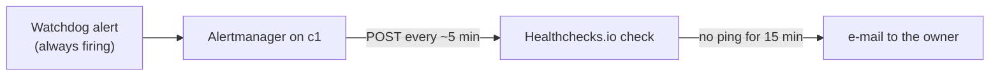

# Know when c1 itself is down, from a heartbeat outside the lab

c1's alerts reach the owner through ntfy on c1 ([Get c1's alerts on a phone](get-c1-alerts-on-your-phone.md)). If c1, its network or the house's internet is down, nothing on c1 can say so. So c1 sends a heartbeat out instead: Prometheus's **Watchdog** alert always fires, and Alertmanager sends it about every 5 minutes to a check on **Healthchecks.io**, outside the lab. When the pings stop, Healthchecks.io mails the owner by itself (owner's answer 2026-11-12 22:21 UTC; pick 213 in [AGENT-PICKS.md](../../hosts/AGENT-PICKS.md)).

The ping URL is kept as a secret: anyone who has it can ping the check and hide an outage. It reaches Alertmanager the same way ntfy's token does: the controller's 0600 secret-source file, store c1, ExternalSecret `alertmanager-heartbeat`, read as `url_file`.

## Steps

1. Make a free account at Healthchecks.io (plan "Hobbyist": 20 checks, no card).
   why: the check must live outside the lab, or it goes down with c1.
   expect: an empty project.

2. Add a check named `c1`. Set **Period** 5 minutes and **Grace Time** 10 minutes. Keep the e-mail integration on.
   why: Alertmanager sends about every 5 minutes (route `group_interval` 1m, `repeat_interval` 4m); the grace covers a missed send or a restart.
   expect: the check shows "new", with a ping URL `https://hc-ping.com/<uuid>`.

3. Copy the ping URL into the controller's secret-source file, `~/.config/central-hub/secret-source.env`, as one line: `healthchecks-ping-url=` followed by the URL. Open it in a text editor; don't paste the URL into a chat.
   why: the file is the only place it lives ([Seed namespace secret-source](seed-secret-source.md), "The file on the controller").
   expect: the file has the line, and it is still mode `600`.

4. [Seed namespace secret-source](seed-secret-source.md).
   expect: `kubectl -n monitoring get externalsecret alertmanager-heartbeat` shows `SecretSynced`, and Alertmanager is Running. Until then Alertmanager waits for Secret `alertmanager-heartbeat`, so no alert is sent.

5. Wait 5 minutes, then look at the check.
   expect: "up", with POST pings from c1's public address about every 5 minutes. Each ping's body is Alertmanager's JSON for Watchdog.

6. Prove the mail reaches you: on Healthchecks.io's **Integrations** page, press **Test!** on the e-mail integration.
   why: the heartbeat is only worth having if its mail gets through.
   expect: a test mail in the owner's inbox within a minute; if it lands in spam, mark it not spam.

## Change it

- **Another service** (Dead Man's Snitch, Cronitor, a second Healthchecks.io check): change the line in the secret-source file, seed, and nothing else; the receiver only POSTs to the URL.
- **Faster or slower:** change `repeat_interval` on the Watchdog route in both `apps/kube-prometheus-stack/values.yaml` and `k8s_observability` `vars/main.yml` (CI's parity check), and the check's period to match.
- **Phone push too:** add an integration on the check (Healthchecks.io offers ntfy.sh, Pushover, Telegram and others); not ntfy on c1, which is down when this fires.

## Rebuild from nothing

The check and the URL stay as they are. Argo CD makes Alertmanager and the ExternalSecret again, and seeding gives it the URL. During the rebuild the check goes down and mails the owner once; that is expected.

## If it fails

- **The check stays "new":** Alertmanager isn't sending. `kubectl -n monitoring logs alertmanager-kube-prometheus-stack-alertmanager-0` shows the heartbeat receiver's errors; check that Watchdog fires in Prometheus (Alerts page).
- **Alertmanager stuck in `ContainerCreating`:** Secret `alertmanager-heartbeat` isn't there yet; do steps 3 and 4.
- **Mails while c1 is fine:** c1 can't reach `hc-ping.com` (DNS or the firewall's egress). The log shows the failed POSTs.
- **The way back:** point the Watchdog route back at receiver `"null"` and take `alertmanager-heartbeat` out of `alertmanagerSpec.secrets` in both values files, then delete `templates/alertmanager-heartbeat.yaml`.

## Related

- [Get c1's alerts on a phone or in a browser](get-c1-alerts-on-your-phone.md)
- [Seed namespace secret-source on c1](seed-secret-source.md)
- Healthchecks.io, [Pinging API](https://healthchecks.io/docs/http_api/) (HEAD, GET and POST) and [plans](https://healthchecks.io/pricing/) (Hobbyist, 20 checks, free)
- Alertmanager v0.34.1, [`webhook_config`](https://github.com/prometheus/alertmanager/blob/v0.34.1/docs/configuration.md#webhook_config) (`url_file`)
- `hosts/AGENT-PICKS.md` pick 213
