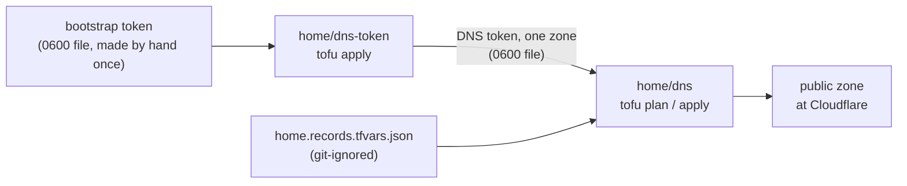

# Manage the public zone's DNS records with OpenTofu

The public zone at Cloudflare holds about 32 records. The old VPS setup made them: a script in its repository that wrote seven names by API, and a copy of the zone from the previous DNS host. None of them were in code here. This runbook adopts every record into OpenTofu state once. After that, a record is added, changed or deleted by editing one private file and applying a plan.



| Part | Code | Run with |
|---|---|---|
| A token that can change only this zone's DNS | `hosts/terraform/home/dns-token/` | `tofu apply` (step 2) |
| The live zone written as a records file, once | `hosts/terraform/home/dns/export-records.sh` | step 3 |
| Every record, and the import of the ones that exist | `hosts/terraform/home/dns/` | `tofu plan` / `tofu apply` (steps 4 to 6) |

## What needs the owner's hands

Nothing. The bootstrap token that made the cert-manager token on 2026-10-27 also makes this one. The owner reads the plan in step 5 when it deletes or changes a record that is in use.

## Before you start

- The bootstrap token file is on the Mac, mode 0600, and the token is active.
- No other run is changing the zone. cert-manager's own `_acme-challenge` records are fine: the export skips them, and OpenTofu never touches a record that is not in its state.

## Steps

1. Fill in the private values, in each folder, from its example:

   ```sh
   cd hosts/terraform/home/dns-token && cp home.tfvars.example home.tfvars && chmod 600 home.tfvars
   cd ../dns && cp home.tfvars.example home.tfvars && chmod 600 home.tfvars
   ```

   why: the zone name and the file paths are private, so the code has no defaults for them.
   expect: `git status` shows neither file (both are git-ignored).

2. Make the DNS token, from `hosts/terraform/home/dns-token/`:

   ```sh
   tofu init -backend-config="path=$HOME/.local/state/central-hub/home-dns-token.tfstate"
   tofu plan -var-file=home.tfvars -out=dns-token.tfplan
   tofu apply dns-token.tfplan
   ```

   why: a token of its own, with DNS Write and Zone Read on this zone only, so the records job never uses the bootstrap token and can be revoked alone. The provider reads the bootstrap token from its file, so no environment variable is needed.
   ※ [hosts/terraform/README.md, "home/certificates: the cert-manager token"](../../hosts/terraform/README.md#homecertificates-the-cert-manager-token) works the same way, rotation included.
   expect: the plan adds one token, one rotation clock and one file; `token_file` exists, mode 0600; a second plan shows no changes.

3. Write the live zone to the records file, once, from `hosts/terraform/home/dns/`:

   ```sh
   ./export-records.sh <zone> ~/.config/central-hub/cloudflare-dns-records-token.txt
   ```

   why: the records file is the source of the records from now on. The script only reads the zone, gives each record a stable key (`a-grafana`, `mx-apex-1`), and writes the import IDs beside them. It never overwrites an existing records file.
   expect: it prints the number of records; `home.records.tfvars.json` is mode 0600 and git-ignored.

4. Import every record:

   ```sh
   tofu init -backend-config="path=$HOME/.local/state/central-hub/home-dns.tfstate"
   tofu plan -var-file=home.tfvars -var-file=home.records.tfvars.json -out=dns.tfplan
   tofu apply dns.tfplan
   ```

   why: `imports.tf` adopts each record by its ID, so nothing is made or deleted at Cloudflare.
   expect: the plan says "N to import, 0 to add, 0 to change, 0 to destroy", with N the count from step 3. If it shows changes, stop and read them: they are differences between the records file and how the provider reads the record, and the file is fixed until the plan is clean.

5. Change the zone. Edit `home.records.tfvars.json`: delete an entry to delete its record, add an entry with a new key to make one, or change a value. Then plan and apply as in step 4.
   why: the plan is the review. A record left out of the file is deleted, so read every `destroy` line before applying.
   expect: the plan shows only the change you made; a second plan shows no changes.

6. After the first import is applied, delete `imports.tf` by pull request and empty `import_ids` in the records file.
   why: STD-0004 Terraform rule 1 allows `imports.tf` only while a folder adopts objects.
   expect: a plan shows no changes.

## See it in the dashboard

The dashboard is for looking, never for changing: Cloudflare dashboard, the account, the zone, DNS, Records. A record changed there is put back, or deleted, by the next apply.

## If it fails

- **Step 2 stops on the precondition:** the bootstrap token can't list permission groups, or its Zone Read policy doesn't cover the zone.
- **Step 4 wants to change an imported record:** compare the record's line in the plan with its entry in the records file. Usual causes: TTL `1` means automatic; a TXT value needs its quotes; `proxied` defaults to false.
- **Lost state:** move the records file away, then run steps 3 and 4 again; the import makes a new state from the live zone.
- **Undo a deleted record:** put its entry back in the records file (git-ignored, so keep a copy before step 5) and apply. The record comes back with a new ID.
- Tell the owner before trying anything not written here.

## Exit path

The records file is plain JSON with each record's type, name and value, and the zone can be exported from the dashboard as a BIND file at any time. Moving to another DNS host is a new provider in this folder, or importing that BIND file there.
