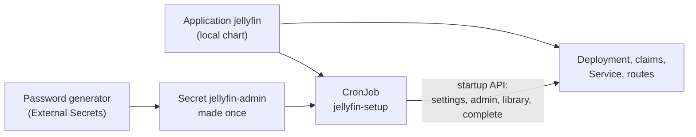

# Move Jellyfin on c1 from Ansible to Argo CD, with its first-run setup as code

Jellyfin is the media server on c1, at `https://jellyfin.apps.c1.prod.<zone>/`. Until now Ansible applied it (role `k8s_jellyfin`) and its setup wizard had never run, so the admin account would have lived only on the `/config` volume. This runbook moves it under Argo CD and makes the setup itself part of git.

## What is in git

| File | What |
|---|---|
| `apps/jellyfin/templates/jellyfin.yaml` | The namespace, the claims `jellyfin-config` (5Gi) and `jellyfin-media` (100Gi), the Deployment and the Service. The same objects the Ansible role applied, so the first diff is empty. The namespace and both claims are marked so Argo CD never deletes them. |
| `apps/jellyfin/templates/route.yaml` | The HTTPS route on the shared Gateway, and the plain-HTTP redirect to it. The hostname takes the zone from the root Application. |
| `apps/jellyfin/templates/setup-secret.yaml` | External Secrets makes a 32-character password once (letters and digits) into Secret `jellyfin-admin`, keys `username` and `password`. It never changes it after. |
| `apps/jellyfin/templates/setup-job.yaml` and `files/setup.sh` | After each sync, a Job calls Jellyfin's startup API: server settings, the admin user, the library `Media` at `/media`, then "complete". If the wizard is already done it stops at its first check. It never prints the password. |
| `apps/jellyfin/values.yaml` | Every setting above. |

## Before you start

- `kubectl -n media get deploy jellyfin` shows 1/1 ready.
- `kubectl -n argocd get application c1` shows Synced (the root Application exists).
- `kubectl get crd passwords.generators.external-secrets.io externalsecrets.external-secrets.io` finds both.
- The lab clone is on a `main` that includes `hosts/kubernetes/home/c1/apps/jellyfin/`.

Stop if any of these is not true.

## Steps

The owner chose auto-sync for every app (card, 2026-11-10 02:50 UTC). `jellyfin` was OutOfSync on c1 at 02:54 UTC. The read at 03:08 UTC found that the only difference from git was Argo CD's tracking, because Ansible made the objects, so its auto-sync is on in `root/values.yaml` too. Its first automatic sync is step 3. Step 4's inventory switch is still needed, so the role stops applying the same objects.

1. Wait for the root Application to pick up `main`, or press Refresh on `c1` in the Argo CD UI.
   why: the root chart lists `jellyfin` with `local: true`, so the root makes the child Application `jellyfin`, which renders the chart in this repository.
   expect: `kubectl -n argocd get application jellyfin` exists and shows OutOfSync. Automatic sync is off.

2. Read the diff in the UI (Application `jellyfin`, "App diff").
   why: nothing changes until the chart renders the same objects Ansible made.
   ※ [spec, "Taking over a running component"](../specs/2026-11-c1-apps-under-argo-cd.md#taking-over-a-running-component-agent-pick)
   expect: the Deployment, Service, claims and routes show no difference except Argo CD's tracking labels. The Password, ExternalSecret and setup Job are new. If anything else differs, fix the chart by PR, not on the cluster.

3. Sync once, by hand.
   why: Argo CD takes over the running objects, External Secrets makes the password, and the setup Job runs the wizard.
   expect: Synced and Healthy. The first setup Job's log (`c1-read get jobs -n media`, then `c1-read logs -n media job/<newest jellyfin-setup job>`) ends with `done: wizard completed`. `curl -s https://jellyfin.apps.c1.prod.<zone>/System/Info/Public` shows `"StartupWizardCompleted":true`. The Jellyfin pod did not restart.

4. Save the admin password to the gitignored env file on the Mac, without printing it. From the lab clone's root:
   `ssh <control plane> "kubectl -n media get secret jellyfin-admin -o jsonpath='{.data.password}'" | base64 -d | { printf 'JELLYFIN_ADMIN_USER=admin\nJELLYFIN_ADMIN_PASSWORD='; cat; echo; } >> .env.lab`
   why: the owner signs in from that file (the owner, 2026-11-08 07:58 UTC: lab passwords go in an env file, changed at the rebuild). `.env.*` is in `.gitignore`.
   expect: `grep -c JELLYFIN_ADMIN_PASSWORD .env.lab` prints 1, and `git status` does not list the file.

5. Sign in at `https://jellyfin.apps.c1.prod.<zone>/` as `admin` with that password.
   expect: the home page shows the library `Media`.

6. By PR, set `autoSync: true` for `jellyfin` in `hosts/kubernetes/home/c1/root/values.yaml`. In the private inventory, set `k8s_jellyfin_by_argocd: true`, then run `ansible-playbook -i inventories/home/ playbooks/k8s-jellyfin.yml`.
   why: from now on git is the source of truth. The role skips every task, so it never fights Argo CD.
   expect: the play reports `changed=0`, and a second run reports `changed=0` too.

## Sign in through Keycloak

Jellyfin has no OpenID Connect of its own, so the chart adds it by plugin. Everything is in git; nothing is clicked.

| Part | Where | What it does |
|---|---|---|
| Plugin | init container `sso-plugin` in `templates/jellyfin.yaml`, `files/install-sso-plugin.sh` | Before Jellyfin starts, downloads the SSO Authentication plugin 5.1.1 from K0lin's fork of `9p4/jellyfin-plugin-sso` (the original is archived and stops at Jellyfin 10.11; 5.1.1's `meta.json` has `targetAbi` 12.0.0.0), checks its sha256 and unpacks it into `/config/plugins`. |
| Trust | the same init container, Secret `media/jellyfin-lab-ca` | Keycloak's certificate comes from the lab CA. The lab root is not in git (its names may be private), so `templates/lab-ca.yaml` asks cert-manager for a small certificate from ClusterIssuer `lab-ca`, and cert-manager writes the issuing CA as `ca.crt` into that Secret. The pod mounts it as `lab-root-ca.pem`. The init container adds it to a copy of the public bundle and Jellyfin reads that through `SSL_CERT_FILE`. No Ansible run is involved. Set `sso.labRoot.certificate` to `false` to read Secret `jellyfin-lab-root-ca` from `playbooks/k8s-identity.yml` instead. With no Secret yet, Jellyfin starts as before and the setup CronJob skips the sign-in; a file with no certificate stops the container. The bundle is built when the pod starts, so if the pod started before the Secret existed, restart it once; the CronJob's next run, within 10 minutes, then writes the provider. |
| Provider | the setup CronJob's `sso` steps in `files/setup.sh` | Every 10 minutes (a CronJob, because a hook would run only on a sync): signs in as `admin`, waits until the plugin is loaded, writes provider `keycloak` (`POST /sso/OID/Add/keycloak`: issuer `https://sso.<zone>/realms/lab` with `sso.shortNames: true`, or `https://sso.<gateway.hostSuffix>.<zone>/realms/lab` with `false`, always Keycloak's own issuer; client `jellyfin`, secret from `media/jellyfin-sso`, roles from the realm's `roles` claim; `admin` makes a Jellyfin admin) and reads it back. The call overwrites, so a second run changes nothing. |

Its settings are the `sso:` block of `apps/jellyfin/values.yaml`. The client and the Secret `media/jellyfin-sso` come from `playbooks/k8s-identity.yml` ([set-up-lab-sign-in.md](set-up-lab-sign-in.md)); with no client secret, or no lab root Secret, yet the CronJob skips this part and says so.

Prove it without typing a password:

1. The newest setup Job's log (`c1-read get jobs -n media`, then `c1-read logs -n media job/<newest jellyfin-setup job>`) ends with `done: sso provider keycloak set`.
2. `kubectl -n media logs deploy/jellyfin -c jellyfin` shows `Loaded plugin: SSO Authentication`.
3. From a machine that can reach the app: `curl -s https://jellyfin.apps.c1.prod.<zone>/sso/OID/start/keycloak` answers a redirect whose `Location` starts with the issuer above.
4. The owner's sign-in with the Keycloak button, once, is the end-to-end proof.

   The same proof as a script, with no browser and no owner account: `roles/k8s_identity/files/jellyfin-signin-check.py <file>` follows the plugin's own flow (start, Keycloak's password and one-time-code form, the redirect back, the page's state, `POST /sso/OID/Auth/keycloak`, then `GET /Users/Me`) and passes only when Jellyfin answers an authenticated session for the test user. `<file>` is a JSON file on the agent box (mode 0600 or 0400, owned by the user running it) with the issuer's and Jellyfin's `https://` bases, the realm, the provider name, the test user's name, password and TOTP seed, and `expect_admin`; the script refuses to run, exit 2, when the file is missing, readable by others or incomplete, and it prints only step names and HTTP codes. It runs on prod, not on dev, because Jellyfin's SSO is off on dev (dev has no `lab-ca`, and its names resolve to prod's Gateway). The test user in the realm lab is an access right, which waits on the owner's own go. It is made without the realm replace: add it to `k8s_identity_extra_users` in the `lab-admins` group (a member of that group has a TOTP seed, which the script needs) and run `--tags secrets,users` ([set-up-lab-sign-in.md](set-up-lab-sign-in.md), "Change a password or add a user"). Its password and seed are then lines in the controller's `identity.env`, and the credentials file for the script must be copied to the agent box, which is the owner's go for secrets. Whether that user's role claim maps to Jellyfin admin decides `expect_admin`; the script's last step reports it. Until the user exists the script has been run only against a stand-in (`.github/hosts-check/tests/test_jellyfin_signin_check.sh`, 8 cases).

If it fails: **"Error loading discovery document: Issuer name does not match authority"** in the Jellyfin log (the sign-in start answers HTTP 500) means the setup CronJob wrote an authority that differs from the issuer in Keycloak's discovery document: `sso.shortNames` in `values.yaml` must match the role's `k8s_identity_short_names` (true: `https://sso.<zone>/realms/lab`; false: `https://sso.<gateway.hostSuffix>.<zone>/realms/lab`), and the next CronJob run writes the corrected provider (measured on c1, 2026-11-18, log relayed by the orchestrator). **"plugin SSO-Auth is not in GET /Plugins"** means the plugin is not loaded or the reply spells its name differently (Jellyfin lists it as `SSO-Auth`, the name in its dll, while the startup log and meta.json say `SSO Authentication`; measured on c1 2026-11-18) (the CronJob log lists the names the reply held; read the Jellyfin log for `targetAbi`); **a TLS error in the Jellyfin log** means the lab root is missing from the bundle (`kubectl -n media logs deploy/jellyfin -c sso-plugin` shows the certificate count). The way back is `sso.enabled: false` by PR; the plugin folder stays on the claim and does nothing.

## Metrics

Jellyfin serves Prometheus metrics at `/metrics` only when its `EnableMetrics` setting is on, which is off by default (<https://jellyfin.org/docs/general/post-install/networking/advanced/monitoring>). It reads the setting only when its web host starts (Jellyfin 12.2 `Jellyfin.Server/Startup.cs`, `UseHttpMetrics` and `MapMetrics`).

| Part | Where | What it does |
|---|---|---|
| The setting | the setup Job's `metrics` step in `files/setup.sh`, `metrics.enabled` in `values.yaml` | Signs in as `admin` and reads `GET /System/Configuration`. If `EnableMetrics` is false, it posts the same configuration back with only that value changed, then calls `POST /System/Restart`. Jellyfin then builds its host again in the same process (`Program.cs`, the restart loop), so the pod is not replaced. It waits until `/metrics` answers. Once the setting is on, a run changes nothing. |
| The scrape | PodMonitor `jellyfin` in app `monitoring-extras` | Prometheus reads the pod's port `http` at `/metrics` every 60 s. The Service is left as it was. |
| The route | `templates/route.yaml`, `metrics.blockPath` in `values.yaml` | A request from outside the cluster for any path with a segment spelled `metrics` gets a 302 to `/`, because the docs say to keep the endpoint off the public internet. Prometheus reads the pod directly. |

Why the route uses a pattern: Jellyfin's routing ignores case and a trailing slash, and its web server decodes percent-encoded letters and removes `.` and `..` segments before routing, while the Gateway's `Exact` and `PathPrefix` matches compare the path as sent. So `/Metrics`, `/metrics/` or `/%6Detrics` would pass an `Exact` match on `/metrics` and still reach the endpoint. The rule is a `RegularExpression` match instead: Cilium hands it to Envoy as an RE2 full match on the path without its query string, and tries it before any `PathPrefix` (Cilium 1.20.4, `operator/pkg/model/ingestion/gateway.go` and `envoy_virtual_host.go`). `.github/hosts-check/tests/test_jellyfin_metrics_route.sh` renders the chart and checks the pattern against each spelling below, and against Jellyfin paths it must leave alone, such as `/web/metrics.js`.

| Caught | Examples |
|---|---|
| Any case | `/Metrics`, `/METRICS` |
| A trailing slash, or more segments after it | `/metrics/`, `/metrics/.`, `/metrics/x/..` |
| Percent-encoded letters or slashes | `/%6Detrics`, `/%6D%65%74%72%69%63%73`, `/%2Fmetrics` |
| Dot segments or a doubled slash before it | `/./metrics`, `/x/../metrics`, `//metrics` |

What it does not promise: an encoding the web server accepts and the test does not list could still reach the endpoint. That would show the request counts and timings per endpoint, and the process's memory and CPU. The metrics hold no password, token or media name.

The metric names are prometheus-net's, the library Jellyfin 12.2 ships (8.2.1): `http_requests_received_total` (labels `code`, `method`, `controller`, `action`, `endpoint`), `http_request_duration_seconds`, `http_requests_in_progress`, and `process_*` and `dotnet_*`. They were read out of the pinned image's `Prometheus.AspNetCore.dll` and `Prometheus.NetStandard.dll` on 2026-11-18.

Prove it without typing a password:

1. The newest setup Job's log (`c1-read get jobs -n media`, then `c1-read logs -n media job/<newest jellyfin-setup job>`) shows `metrics: /metrics answers`.
2. The panel check prints `Jellyfin requests per second: <a number>` ([check-c1-alerts-and-dashboard.md](check-c1-alerts-and-dashboard.md#read-the-panels-without-a-browser)).

If it fails: **`metrics: EnableMetrics not in the configuration`** means the API's answer no longer has that field: read the Jellyfin version's `ServerConfiguration`. **`C1JellyfinNotScraped`** with the Job's line present means the PodMonitor does not match the pod: compare its labels.

## Change it

- Image, sizes, resources, the library: edit `apps/jellyfin/values.yaml` by PR. Argo CD applies it after merge.
- Settings made later in Jellyfin's own web pages live on the `jellyfin-config` claim, not in git. Write each one here as a value or a step when it matters for a rebuild.

## Rebuild from nothing

On a new cluster with the root Application made, Argo CD makes every object, External Secrets makes a new password, and the Job runs the wizard. Then do step 4 for the new password. The media files are not in git: they come back only from a backup of `jellyfin-media` (TASK-0194, `back-up-c1-off-box.md`).

## If it fails

- **The setup Job fails:** read the newest Job's log (`c1-read get jobs -n media`, then `c1-read logs -n media job/<newest jellyfin-setup job>`). The CronJob runs again every 10 minutes and every step is safe to repeat; a failed run marks the app Degraded until one passes, once the CronJob has had a first success (Argo CD shows a CronJob that never succeeded as Healthy). If the wizard was finished by hand, the Job sees that and does nothing.
- **The password is lost or must change:** delete the ExternalSecret and the Secret `jellyfin-admin`, then sync; a new password is made. Jellyfin still has the old one, so reset it in Jellyfin's Dashboard, Users, `admin`.
- **The way back:** delete the `jellyfin` Application. It has no resources finalizer, so every object stays. Set `k8s_jellyfin_by_argocd: false` and run the Jellyfin playbook, and Ansible owns it again. The generated Secret also stays.
- Tell the owner before trying anything not written here.

## Afterwards

- Set `last-tested` here, with the date, who ran it and on what.
- Add the run to the spec's decision log.

## Related

- [Spec: move c1's apps and add-ons under Argo CD](../specs/2026-11-c1-apps-under-argo-cd.md)
- [Move metrics-server on c1 from Ansible to Argo CD](move-metrics-server-to-argo-cd.md)
- `hosts/AGENT-PICKS.md` picks 127-131
