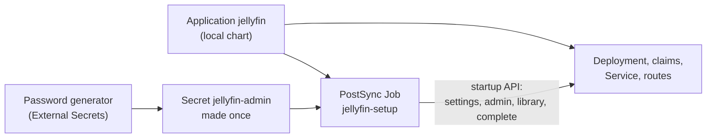

# Move Jellyfin on c1 from Ansible to Argo CD, with its first-run setup as code

Jellyfin is the media server on c1, at `https://jellyfin.apps.c1.prod.<zone>/`. Until now Ansible applied it (role `k8s_jellyfin`) and its setup wizard had never run, so the admin account would have lived only on the `/config` volume. This runbook moves it under Argo CD and makes the setup itself part of git.

## What is in git

| File | What |
|---|---|
| `apps/jellyfin/templates/jellyfin.yaml` | The namespace, the claims `jellyfin-config` (5Gi) and `jellyfin-media` (100Gi), the Deployment and the Service. The same objects the Ansible role applied, so the first diff is empty. The namespace and both claims are marked so Argo CD never deletes them. |
| `apps/jellyfin/templates/route.yaml` | The HTTPS route on the shared Gateway, and the plain-HTTP redirect to it. The hostname takes the zone from the root Application. |
| `apps/jellyfin/templates/setup-secret.yaml` | External Secrets makes a 32-character password once (letters and digits) into Secret `jellyfin-admin`, keys `username` and `password`. It never changes it after. |
| `apps/jellyfin/templates/setup-job.yaml` and `files/setup.sh` | After each sync, a Job calls Jellyfin's startup API: server settings, the admin user, the library `Media` at `/media`, then "complete". If the wizard is already done it stops at its first check. It never prints the password. |
| `apps/jellyfin/values.yaml` | Every setting above. |

## Before you start

- `kubectl -n media get deploy jellyfin` shows 1/1 ready.
- `kubectl -n argocd get application c1` shows Synced (the root Application exists).
- `kubectl get crd passwords.generators.external-secrets.io externalsecrets.external-secrets.io` finds both.
- The lab clone is on a `main` that includes `hosts/kubernetes/clusters/c1/apps/jellyfin/`.

Stop if any of these is not true.

## Steps

1. Wait for the root Application to pick up `main`, or press Refresh on `c1` in the Argo CD UI.
   why: the root chart lists `jellyfin` with `local: true`, so the root makes the child Application `jellyfin`, which renders the chart in this repository.
   expect: `kubectl -n argocd get application jellyfin` exists and shows OutOfSync. Automatic sync is off.

2. Read the diff in the UI (Application `jellyfin`, "App diff").
   why: nothing changes until the chart renders the same objects Ansible made.
   ※ [spec, "Taking over a running component"](../specs/2026-11-c1-apps-under-argo-cd.md#taking-over-a-running-component-agent-pick)
   expect: the Deployment, Service, claims and routes show no difference except Argo CD's tracking labels. The Password, ExternalSecret and setup Job are new. If anything else differs, fix the chart by PR, not on the cluster.

3. Sync once, by hand.
   why: Argo CD takes over the running objects, External Secrets makes the password, and the setup Job runs the wizard.
   expect: Synced and Healthy. `kubectl -n media logs job/jellyfin-setup` ends with `done: wizard completed`. `curl -s https://jellyfin.apps.c1.prod.<zone>/System/Info/Public` shows `"StartupWizardCompleted":true`. The Jellyfin pod did not restart.

4. Save the admin password to the gitignored env file on the Mac, without printing it. From the lab clone's root:
   `ssh <control plane> "kubectl -n media get secret jellyfin-admin -o jsonpath='{.data.password}'" | base64 -d | { printf 'JELLYFIN_ADMIN_USER=admin\nJELLYFIN_ADMIN_PASSWORD='; cat; echo; } >> .env.lab`
   why: the owner signs in from that file (the owner, 2026-11-08 07:58 UTC: lab passwords go in an env file, changed at the rebuild). `.env.*` is in `.gitignore`.
   expect: `grep -c JELLYFIN_ADMIN_PASSWORD .env.lab` prints 1, and `git status` does not list the file.

5. Sign in at `https://jellyfin.apps.c1.prod.<zone>/` as `admin` with that password.
   expect: the home page shows the library `Media`.

6. By PR, set `autoSync: true` for `jellyfin` in `hosts/kubernetes/clusters/c1/root/values.yaml`. In the private inventory, set `k8s_jellyfin_by_argocd: true`, then run `ansible-playbook -i inventories/home/ playbooks/k8s-jellyfin.yml`.
   why: from now on git is the source of truth. The role skips every task, so it never fights Argo CD.
   expect: the play reports `changed=0`, and a second run reports `changed=0` too.

## Change it

- Image, sizes, resources, the library: edit `apps/jellyfin/values.yaml` by PR. Argo CD applies it after merge.
- Settings made later in Jellyfin's own web pages live on the `jellyfin-config` claim, not in git. Write each one here as a value or a step when it matters for a rebuild.

## Rebuild from nothing

On a new cluster with the root Application made, Argo CD makes every object, External Secrets makes a new password, and the Job runs the wizard. Then do step 4 for the new password. The media files are not in git: they come back only from a backup of `jellyfin-media` (BL-0139, not built yet).

## If it fails

- **The setup Job fails:** read `kubectl -n media logs job/jellyfin-setup`. The Job is safe to run again: sync again, or delete the Job and sync. If the wizard was finished by hand, the Job sees that and does nothing.
- **The password is lost or must change:** delete the ExternalSecret and the Secret `jellyfin-admin`, then sync; a new password is made. Jellyfin still has the old one, so reset it in Jellyfin's Dashboard, Users, `admin`.
- **The way back:** delete the `jellyfin` Application. It has no resources finalizer, so every object stays. Set `k8s_jellyfin_by_argocd: false` and run the Jellyfin playbook, and Ansible owns it again. The generated Secret also stays.
- Tell the owner before trying anything not written here.

## Afterwards

- Set `last-tested` here, with the date, who ran it and on what.
- Add the run to the spec's decision log.

## Related

- [Spec: move c1's apps and add-ons under Argo CD](../specs/2026-11-c1-apps-under-argo-cd.md)
- [Move metrics-server on c1 from Ansible to Argo CD](move-metrics-server-to-argo-cd.md)
- `hosts/AGENT-PICKS.md` picks 127-131
