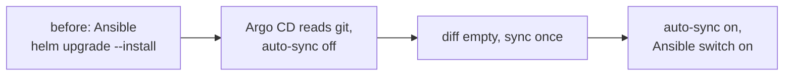

# Move metrics-server on c1 from Ansible to Argo CD

metrics-server is the small add-on that makes `kubectl top` work. It is the first component to move, because it holds no data and nothing depends on it except `kubectl top`.

## Before you start

- `kubectl -n kube-system get deploy metrics-server` shows 1/1 ready, and `kubectl top nodes` lists both nodes.
- `kubectl -n argocd get applications` lists no Application named `metrics-server`.
- The lab clone is on a `main` that includes `kubernetes/clusters/c1/apps/metrics-server/`.

Stop if any of these is not true.

## Steps

1. In the private inventory, set `k8s_gitops_source_enabled: true` (once, for the first component only), then run `ansible-playbook -i inventories/home/ playbooks/k8s-gitops.yml --tags source`.
   why: this makes the one root Application `c1`, which reads `kubernetes/clusters/c1/root/` from `main` and makes a child Application for each component listed there.
   ※ [D-0027](../decisions/0027-let-c1-read-central-hub-before-the-activation-gate.md), [D-0023 rule 5](../decisions/0023-use-argo-cd-as-the-gitops-engine.md)
   expect: `kubectl -n argocd get application c1` shows Synced and Healthy, and `metrics-server` appears as OutOfSync or Synced.

2. Open the `metrics-server` Application in the Argo CD UI (or run `kubectl -n argocd get application metrics-server -o jsonpath='{.status.sync.status}'`) and read the diff.
   why: automatic sync is off for a new component, so nothing changes until the files in git render the same objects Ansible made.
   ※ [spec, "Taking over a running component"](../specs/2026-11-c1-apps-under-argo-cd.md#taking-over-a-running-component-agent-pick)
   expect: no difference except Argo CD's tracking annotation. If the values differ, fix `apps/metrics-server/values.yaml` by PR, not on the cluster.

3. Sync once, by hand, from the UI.
   why: Argo CD applies the same objects and marks them as its own.
   expect: Synced, Healthy; the pod is not restarted when nothing changed; `kubectl top nodes` still answers.

4. By PR, set `autoSync: true` for `metrics-server` in `kubernetes/clusters/c1/root/values.yaml`. In the private inventory, set `k8s_observability_metrics_server_by_argocd: true`, then run `ansible-playbook -i inventories/home/ playbooks/k8s-observability.yml --tags metrics_server,proof`.
   why: from now on git is the source of truth, and self-heal puts back any drift. Ansible stops installing metrics-server and deletes Helm's old release records, which Argo CD doesn't use.
   expect: the first run reports one change (the Helm records deleted), and a second run reports `changed=0`. The proof's `kubectl top` passes.

## If it fails

- **The way back:** delete the `metrics-server` Application. It has no resources finalizer, so the Deployment and its objects stay. Then set `k8s_observability_metrics_server_by_argocd: false` and run the observability playbook with `--tags metrics_server`, and Ansible owns it again.
- To stop all reading from git, delete the root Application `c1`. That also leaves every object in place.
- Tell the owner before trying anything not written here.

## Afterwards

- Set `last-tested` here, with the date, who ran it and on what.
- Add the run to the spec's decision log.

## Related

- [Spec: move c1's apps and add-ons under Argo CD](../specs/2026-11-c1-apps-under-argo-cd.md)
- [D-0027](../decisions/0027-let-c1-read-central-hub-before-the-activation-gate.md), [D-0023](../decisions/0023-use-argo-cd-as-the-gitops-engine.md)
- `hosts/AGENT-PICKS.md` picks 121-126
