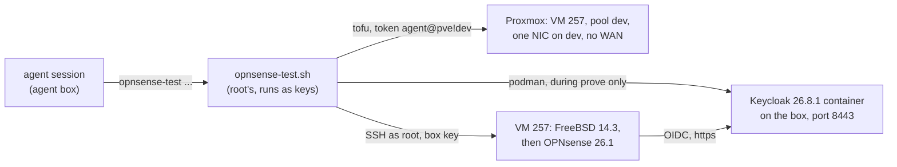

# Prove OPNsense sign-in through Keycloak on a throwaway dev VM

**Status:** draft, not run. The wrapper, its stack and its helpers pass offline tests only.

## Why

The lab firewall (VM 100) gets sign-in through Keycloak with the os-openid-connect plugin. Before that, a throwaway OPNsense on dev shows the plugin works with the settings VM 100 will get, and that the local root login still works when the plugin is off. Nothing touches VM 100, prod or the lab firewall's rules.

## What is built



- **The VM.** VM 257 in pool dev, one NIC on the dev VNet, no WAN, 1 core, 3072 MiB, 16 GB. It never starts with the host. The dev rebuild's preflight refuses to run while VM 257 exists, and this wrapper refuses to build it while dev's state holds anything.
  ※ `hosts/terraform/home/opnsense-test/`; `hosts/rebuild-k8s.sh`, the `OPNSENSE_TEST_VMID` check
- **A first boot with no console.** The agents' Proxmox role has no `VM.Console`, so nothing can type at the VM. It boots the FreeBSD 14.3 cloud image with a NoCloud seed ISO the wrapper builds. Its user-data is a script that FreeBSD's nuageinit runs as root before the network starts. The script sets the static dev address, dev's gateway and DNS, and root's SSH key. It writes the address and gateway to `/etc/rc.conf.d`, because `/etc/rc` reads `/etc/rc.conf` only once per boot, so a change made there during boot is not seen until the next boot. It turns password logins off and skips the image's first-boot update.
  ※ freebsd-src releng/14.3, `libexec/nuageinit/nuageinit` (a non-cloud-config user-data is run) and `libexec/rc/rc.d/nuageinit` (`BEFORE: NETWORKING`, label `cidata`)
- **Why not Proxmox's own cloud-init drive.** FreeBSD 14.3's nuageinit reads no `network-config` file from a NoCloud drive. It reads only a `network` key inside cloud-config user-data, and Proxmox writes the address to `network-config`. Its default user-data also makes user `freebsd` with the password `freebsd`, and the image allows SSH password logins.
  ※ the same nuageinit file, the `nocloud` branch and `default_user`; `release/tools/basic-cloudinit.conf`
- **OPNsense from the bootstrap.** Over SSH the wrapper writes `/conf/config.xml`, then runs `opnsense-bootstrap` pinned at tag 26.1. The bootstrap keeps `/conf` and reboots. At the first OPNsense boot the importer finds `/conf/config.xml` and exits, so the seeded config is the first one used. The proof covers OPNsense 26.1 bootstrapped from FreeBSD 14.3, not the nano image VM 100 runs.
  ※ opnsense/update tag 26.1 `src/bootstrap/opnsense-bootstrap.sh.in`; opnsense/core stable/26.1 `src/sbin/opnsense-importer`
- **The seeded config.** It starts from OPNsense 26.1's default and drops WAN, DHCP (dnsmasq), the DNS resolver and IPv6. LAN sits on vtnet0 with the static dev address and dev's gateway. The GUI uses https and SSH uses keys only, both on LAN only. The proof's CA goes into the trust store. A new local admin, `proofadmin` (uid 2000), has a password no one keeps. The plugin's server gets application code `keycloak`, PAR mode `disabled`, shared signals off, logout notifications off, admission `approval`, root not allowed, and no account made on first login. The plugin itself is not in the config.
  ※ opnsense/core stable/26.1 `src/etc/config.xml.sample`, `src/etc/inc/system.inc` (`system_trust_configure` puts every `<ca>` in the trust store); os-openid-connect v1.0.0-beta5 `OpenIDConnect.php` (`getConfigurationOptions`)
- **The plugin.** The wrapper downloads os-openid-connect 1.0.0-beta5, checks it against the pinned SHA-256 on the box, copies it to the VM and installs it with `pkg add`. CI's `plugin-pin` job runs `gh attestation verify` on the same pinned file, as the plugin's install guide gives it. The box has no `gh`: it is not in AlmaLinux's repositories.
  ※ os-openid-connect `docs/setup/install.md`; `.github/hosts-check/opnsense-plugin-pin.sh`
- **The proof's Keycloak.** It runs on the agent box, not in dev, because dev and the test VM together don't fit the node's memory. It is Keycloak 26.8.1, the release c1 runs, pinned by the same digest as the identity check, in a rootless podman container. It runs on the host network with port 8443. DPoP stays at Keycloak's default, on, as in the lab's Keycloak (role k8s_identity sets no features), and `prove` stops unless discovery lists ES256 for DPoP. It holds a realm `opnsense-proof` with one confidential client (`opnsense`, PKCE S256) and two users. The client's only redirect URI is the plugin's callback, `/api/openidconnect/auth/callback/keycloak`, and its only post-logout URI is `/api/openidconnect/auth/logouttestcallback/keycloak`, both on the VM's address. The plugin's application code is `keycloak`. These match the lab realm's OPNsense client (role k8s_identity), so the proof runs with the settings VM 100 gets. It runs only during `prove`, and its data lives in the container and is removed with it. A packet filter on the box, loaded at boot by its own unit, accepts port 8443 only from the test VM's address and the box itself.
  ※ `.github/hosts-check/identity/test_realm.sh` (the image digest); `hosts/ansible/roles/agent_box/templates/opnsense-test.nft.j2`
- **The proof's secrets.** The wrapper makes the root password, the client secret and the two users' passwords for this proof only. The root hash is SHA-512 crypt (`openssl passwd -6`), because the box has no bcrypt. They live in the keys user's proof folder, and `destroy` removes them. The realm file Keycloak imports holds `${...}` placeholders in their place, and the wrapper passes the values to the container by environment variable name, so they appear in no file it reads and in no command line (keycloak.org, Importing and exporting realms, "Using Environment Variables within the Realm Configuration Files"). None is in this repository or the inventory.

## Steps

All steps run on the agent box as the session user. The wrapper takes no other arguments.

1. Tear dev down, so dev and the test VM never run together:

   ```sh
   sudo -n -u keys /usr/local/libexec/agent-box/rebuild.sh teardown
   ```

   why: the node does not have the memory for both, and the wrapper refuses while dev's state holds anything.
   ※ [rebuild-k8s-layer-with-one-command.md](rebuild-k8s-layer-with-one-command.md)
2. Plan, then apply:

   ```sh
   opnsense-test plan
   opnsense-test apply
   ```

   why: `plan` checks the guards (dev down, no dev rebuild running, VM 257 not in dev's tfvars, free memory), downloads the image and checks it against its pin, builds the seed ISO and saves a plan. `apply` applies only that saved plan.
   ※ `opnsense-test.sh`, `guards`, `image` and `seed_iso`
3. Configure:

   ```sh
   opnsense-test configure
   ```

   why: this step checks the VM runs 14.3-RELEASE. It measures that dev reaches github.com and pkg.opnsense.org, and stops if not, because opening egress is a firewall change. It makes the proof's secrets and CA, seeds `/conf/config.xml`, runs the pinned bootstrap and waits for OPNsense. Then it checks the plugin package's SHA-256 (proof item 1) and installs the package with `pkg add`.
4. Prove:

   ```sh
   opnsense-test prove
   ```

   why: this step starts the proof's Keycloak and checks that the VM reaches it over verified https. It then prints one `proof item N:` line for items 2 to 7, 9 and 10, and stops at the first that fails. Item 10 stops Keycloak itself, so it runs last. Keycloak's container and its data are removed when the step ends, pass or fail.
   ※ `opnsense-test-prove.py`
5. Destroy:

   ```sh
   opnsense-test destroy
   ```

   why: this is proof item 8. It removes VM 257 and its disk, the Keycloak container if it is still there, and the proof folder with its secrets. The agents' token cannot delete files on the node's `local` storage (its role's `PRIVS` list has no `Datastore.Allocate`, `hosts/terraform/home/bootstrap/agent-access.sh` line 34). So the seed ISO and the uploaded image both stay in the wrapper's state and on `local` for the next proof. Each seed is named by its hash, and the wrapper builds the ISO byte for byte the same from the same settings (fixed file dates and `SOURCE_DATE_EPOCH`), so the next proof reuses the same seed file. When the settings change, plan drops the old seed from the state, its file stays on `local`, and the new seed is a new file, so a proof never needs a delete. Destroy ends by listing what it left on `local`. The unpacked image also stays on the box.
6. Bring dev back if it is needed (`rebuild.sh up`). The dev rebuild's preflight refuses while VM 257 exists.

`opnsense-test log` prints the last run's output, then reads VM 257 without changing anything. It shows the VM's Proxmox state, uptime, traffic counters and network, seed and boot settings, and its last start task's log. It then pings each dev host address once and names the dev address the VM's MAC answers on, ending with one verdict line. It leaves the last run's log alone. It cannot show the VM's serial output, because the agents' token has no `VM.Console` (`hosts/terraform/home/bootstrap/agent-access.sh`).

## Proof items

| Item | What `prove` measures |
|---|---|
| 1 | The package's SHA-256 matches its pin on the box (configure). CI's `plugin-pin` job verifies the attestation of the same file. |
| 2 | `proof-user`'s first sign-in gets no session and is queued. Once it is approved onto `proofadmin`, its next sign-in lands on the dashboard, and the plugin's DPoP key store (`/var/db/openid-connect/dpop`, mode 0700) holds a key file with mode 0600, and the plugin's own sign-in test, run as the bound admin, reports the DPoP sender constraint as `Used`, so the token was DPoP-bound. |
| 3 | `proof-stranger` gets no session and waits as one pending request. |
| 4 | With the plugin's server disabled, root signs in by password through the Local Database. |
| 5 | Can the API install a local `.pkg`? No. The firmware API's install takes a package name, sanitized as `pkgname`, and installs it from the repository (opnsense/core stable/26.1 `FirmwareController.php` `installAction`; `actions_firmware.conf` `[install]`). |
| 6 | The plugin's settings are in `/conf/config.xml`, and the run reads them back. |
| 7 | Memory in use, from the kernel's page counts. |
| 8 | `opnsense-test destroy`. |
| 9 | The run reads admission `approval`, root not allowed, PAR disabled and shared signals off from the config, and checks that binding an identity to root (uid 0) is refused. |
| 10 | Keycloak down, the break-glass case D-0037 rule 5 names: the plugin's server is turned on again, the proof's Keycloak container is stopped, the VM is shown not to reach its issuer, and root then signs in by password through the Local Database. Item 4 proves less, because with the server off the plugin never calls Keycloak. |

## If it fails

| Output | Meaning |
|---|---|
| `refused, dev's state holds N resources` | Dev is up. Tear it down first (step 1). |
| `refused, short on memory` | The node lacks the VM's memory plus the margin. Stop nothing else; report it. |
| `refused, VM 257 is in the state` | An earlier proof's VM was not destroyed. A new plan would make a new seed and replace the old seed file, a delete the agents' token can't make. Run `opnsense-test destroy`, then plan again. |
| `403 Permission check failed (/vms/257, VM.Config.Options)` at apply | The VM sets tags, which Proxmox checks on `/vms/257` before the VM joins pool dev, and the agents' token has rights on pool dev only. The stack sets no tags for this reason, so a tag was added back: remove it. Run `opnsense-test log`, then report it. |
| `refused, a dev rebuild run is going` | A dev rebuild holds the run lock. Wait for it to end, then tear dev down (step 1). |
| `the image does not match its pin` | The archive's file changed. Nothing is built. Check the archive's CHECKSUM.SHA256 before you move the pin. |
| `no SSH to <address> after 10 minutes` | The first boot did not take the seed's address, or dev blocks the box's SSH. Run `opnsense-test log` and keep its status verdict line, then destroy and report both. |
| `stopped, dev does not reach ...` | Dev has no route to the mirrors. Don't open egress: that is a firewall change and needs the owner. Destroy. |
| `Keycloak did not come up` | The proof's Keycloak gave no discovery answer after 60 tries, 5 to 10 minutes; the last 30 lines of its log follow. The container is removed. Destroy, then report it. |
| `stopped, Keycloak does not advertise DPoP with ES256` | Discovery lacks ES256 under `dpop_signing_alg_values_supported`, so the plugin would not use DPoP and the proof would not match the lab. Destroy, then report it. |
| `stopped, the Keycloak container listens on more than tcp 8443` | On the host network the filter covers only 8443, so another listening port would be open. Ports bound to loopback only are listed apart and allowed, because only the box reaches them. The proof runs Keycloak with `start` (the prod profile, dev-file database, local caches), because `start-dev` listens on 8080 whatever `--http-enabled` says (measured 2026-11-18). The container is removed. Destroy, then report it. |
| `stopped, the VM does not reach Keycloak` | Dev can't reach the box's port 8443, or the trust store lacks the proof CA. Destroy, then report it. |
| `proof failed: ...` | The named item did not hold. Keep the output, then destroy. |
| `proof failed: no Keycloak sign-in form after ...` | OPNsense answered the login button without sending the browser to Keycloak. The lines after it give OPNsense's HTTP status and page text and the VM's `OIDC` log lines: a 404 means no authentication server of that name, and is followed by what OPNsense's authentication factory lists (servers, connector types) and what its `get()` returns for the proof's server; a 400 means the address the proof used is not one of the WebGUI's accepted origins (os-openid-connect beta5, `loginAction`). Keep the output, then destroy. |

## Limits

- The proof covers OPNsense 26.1 bootstrapped from FreeBSD 14.3, not the nano image VM 100 runs.
- The bootstrap fetches OPNsense's core source for tag 26.1 from GitHub, and that download is not pinned by hash. The bootstrap script itself is pinned.
- The GUI's self-signed certificate names the VM's hostname, so the proof's browser steps check the certificate chain but not the name. The trust anchors are only that certificate (read over SSH) and the proof CA.

## Exit

`opnsense-test destroy`, then empty `agent_box_opnsense_test` and run the box's role. The files destroy lists on `local` (`opnsense-test-257-seed-*.iso`, the kept seed among them, and the FreeBSD image under `import`) are for the owner to remove, because deleting them is a delete the agents' token cannot make. The role then leaves the filter file and its unit in place. Disable the unit with `systemctl disable --now opnsense-test-nft.service` to remove the table.
