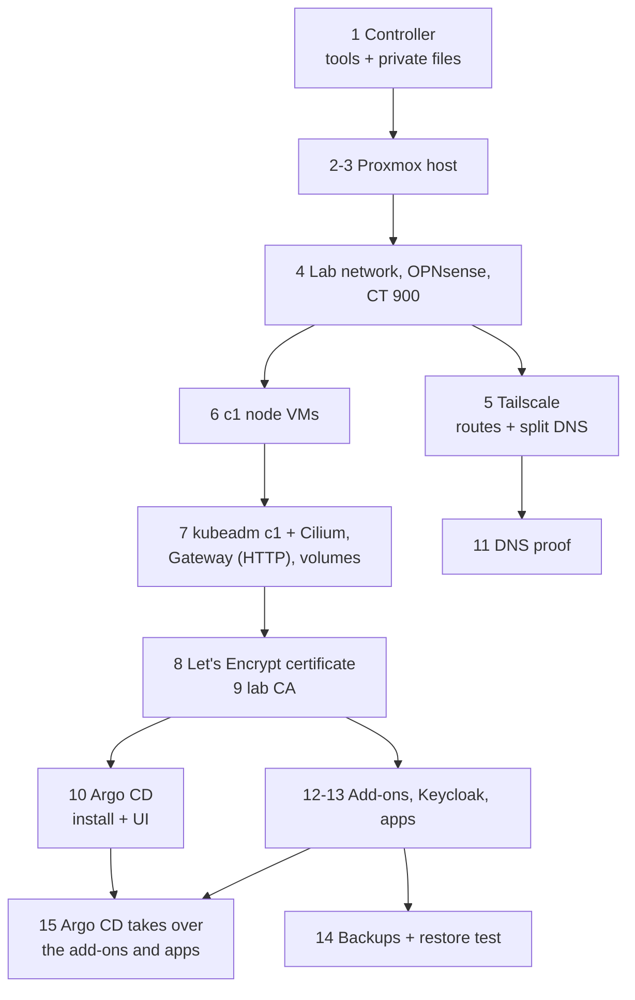

# Rebuild the home lab from bare metal

**Status:** draft. No part of this order has been run end to end from bare metal. It is put together from the step runbooks and the code on `main` on 2026-11-08, plus PRs #64 to #69 as they stood that day (#64 and #66 have since merged). Each step says which runbook covers it, or says plainly that none exists yet.

This is the top-level runbook. It holds no commands of its own: each step points at the runbook or README section that does the work, in the order the code needs. Read a step's runbook before you run it.

## Before you start

### What "only the repository" means here

The repository holds every step and every setting that is not private. Private values (names, addresses, MAC addresses, tokens, keys, passwords) never go in git, because the repository is public (CLAUDE.md rule 4, D-0013). A rebuild needs both halves:

- **This repository**, cloned on the controller.
- **The private files**, on the controller only. They are listed in the table below. They are not in a password manager and not in git. For the lab CA, the owner said on 2026-11-08 (07:58 UTC) that the keys and the passphrase live in a local folder on the Mac, replaced at the first full rebuild (spec `2026-11-lab-pki`, decision log, PR #65).

If a private file is lost, the runbook that makes it makes it again: a new token, a new key, a new password. Only three things can't be made again, and losing them changes what a rebuild can bring back: the lab root CA key (a new root means every device trusts a new CA), the secrets-at-rest key (an old etcd backup can't be read without it), and the restic password (the off-box backups can't be read without it).

### The private files on the controller

| File or folder | Holds | Made by | If lost |
|---|---|---|---|
| `~/.config/central-hub/` (mode 0700) | the folder for every file below whose path starts with it | [Set up the lab controller](set-up-lab-controller.md) | make it again |
| `~/.config/central-hub/<Proxmox token file>` | `iac@pve!apply=<secret>`, OpenTofu's Proxmox token (90 days) | [Set up a Proxmox VE host](set-up-proxmox-host.md) step 6b | make a new token |
| `~/.config/central-hub/pve-root-ca.pem` | the Proxmox host's own CA, trusted in the Mac's System keychain | `playbooks/controller-trust.yml` | fetched again from the host |
| `~/.config/central-hub/opnsense-api.txt` | the OPNsense API key and secret for user `ansible` | [Set up the lab network and firewall](set-up-lab-network-and-firewall.md) step 6 | make a new key |
| `~/.config/central-hub/c1-secrets-encryption.key` | the secretbox key for Secrets at rest on c1 | [Build c1 with Ansible](build-c1-with-ansible.md) step 1 | a new cluster gets a new key; old etcd backups can't be read |
| `~/.config/central-hub/cloudflare-bootstrap-token.txt` | the hand-made Cloudflare token that can make tokens | [hosts/terraform/README.md, The bootstrap token](../../hosts/terraform/README.md#the-bootstrap-token) | make a new one in the dashboard |
| `~/.config/central-hub/cloudflare-dns01-token.txt` | cert-manager's DNS-01 token (90 days) | `hosts/terraform/home/certificates` | the next apply makes it again |
| `~/.config/central-hub/lab-ca/` | lab root CA key and certificate, c1's intermediate, `lab-ca.env` with the passphrase | `create-lab-root-ca.md` (PR #65) | a new root CA; every device trusts it again |
| `~/.config/central-hub/c1-backup.env` | `RESTIC_REPOSITORY`, `RESTIC_PASSWORD`, the target's credentials | `back-up-c1-off-box.md` (PR #68) | a new repository; the old snapshots can't be read |
| `~/.local/state/central-hub/*.tfstate` | OpenTofu state per run folder; the certificates folder's state holds the Cloudflare token in plain text | `tofu apply` | see [If it fails](#if-it-fails) |
| `hosts/.env` (git-ignored) | `TAILSCALE_OAUTH_CLIENT_ID`, `TAILSCALE_OAUTH_CLIENT_SECRET` | `set-up-lab-dns.md` step 2 (PR #67) | make a new OAuth client |
| `hosts/ansible/inventories/home/hosts.yml` (git-ignored) | the filled-in inventory: every name, address, MAC and file path | copied from `hosts.example.yml` and filled in | fill in again from the lab |
| `hosts/ansible/inventories/home/identity.env` (git-ignored) | every Keycloak user password and client secret | the first `k8s-identity.yml` run (PR #69) | the next run makes new values |
| `hosts/terraform/home/*/home.tfvars` (git-ignored) | each run folder's private names, MACs and addresses | copied from `home.tfvars.example` | fill in again |
| an SSH key pair for the c1 nodes | the key `hosts/terraform/home/k8s` puts on the nodes | `ssh-keygen` on the controller | make a new one before step 4 |

Agent pick: this table is the first list of the private files in one place. Where a file has no fixed name in the code (the Proxmox token file), the name is left open.

### Open PRs this runbook already counts on

These were open on 2026-11-08. Until each one merges, the step that names it runs from that PR's branch, or waits.

| PR | What it adds | Used in step |
|---|---|---|
| #64 (merged) | moves `kubernetes/` to `hosts/kubernetes/`; seven `move-*-to-argo-cd.md` runbooks; check-mode fix for `k8s_gitops` | 15 |
| #65 | lab PKI: D-0028, spec `2026-11-lab-pki`, runbooks `create-lab-root-ca.md`, `trust-lab-root-ca-on-mac.md`, `restore-c1-intermediate-ca.md`; on its branch also roles for the `lab-ca` issuer and host certificates | 8 |
| #66 (merged) | label fixes in D-0003, D-0020 and two roles | none (corrections only) |
| #67 | lab DNS: `home/tailnet`, role `tailnet_connector`, `dns_proof`, runbook `set-up-lab-dns.md` | 3, 9 |
| #68 | c1 backups off the box: role `k8s_backup`, runbooks `back-up-c1-off-box.md`, `test-etcd-restore.md` | 11 |
| #69 | realm `lab` as code, `identity.env`, runbook `set-up-lab-sign-in.md` | 10 |

Runbooks that exist only in an open PR are named in `code` here, not linked, so this page's links work on `main`. Link them once their PR merges.

## Steps

### Controller

#### Step 1

Set up the controller: tools, the clone, the private folder, the filled-in inventory.
why: every later step runs from the controller (OpenTofu, Ansible, `kubectl` through SSH), and every private value is read from it.
runbook: [Set up the lab controller](set-up-lab-controller.md).
expect: `tofu version`, `ansible --version` and `ansible-galaxy collection list -p hosts/ansible/collections` answer; `~/.config/central-hub` is mode 0700.

### Proxmox

#### Step 2

Install Proxmox VE 9 on the host and make it a clean, patched, locked-down host with the `iac@pve` account and its token.
why: everything else is a guest on this host or is reached through it.
runbook: [Set up a Proxmox VE host by hand](set-up-proxmox-host.md), Parts 1 and 2 (steps 0-6). Part 3 (notifications, backups, host firewall) runs later, in step 4's runbook, because its checks probe the guests.
expect: that runbook's step 6 `expect:` line.

#### Step 3

Trust the host's CA on the controller.
why: OpenTofu's Proxmox provider has no CA setting, so the Mac's System keychain must trust the host's CA ([hosts/ansible/README.md, Proxmox CA on the controller](../../hosts/ansible/README.md#proxmox-ca-on-the-controller)).
runbook: none of its own; the README section above is the procedure (`playbooks/controller-trust.yml --tags trust --ask-become-pass`).
expect: a second run reports no change.

### OPNsense and the lab network

#### Step 4

Build the lab network, the OPNsense firewall VM and the tailnet connector container, then configure OPNsense, pass the WAN safety check and turn on the host's safety net.
why: the c1 nodes sit on VNet `prod` behind OPNsense, and the controller reaches them through the host's address on VNet `mgmt`.
runbook: [Set up the lab network and firewall](set-up-lab-network-and-firewall.md) (written from `hosts/README.md` "Order for the home lab" and the code).
expect: that runbook's last step: `tofu plan` shows no changes in the three run folders, and `opnsense.yml --check` reports `changed=0`.
first: [Put the OPNsense image and the Debian 13 template on the host](stage-lab-images-on-proxmox.md), because the firewall and remote-access run folders don't download them.

### Tailscale

#### Step 5

Put the tailnet client in CT 900, then turn on its routes for every lab VLAN and split DNS for the lab names.
why: the owner's Mac reaches the lab, at home or away, only through CT 900 on the tailnet (D-0022 for how agents reach c1).
runbook, first half: [Install the tailnet client in CT 900](set-up-tailnet-client-in-ct-900.md).
runbook, second half: `set-up-lab-dns.md` (PR #67), steps 2-5: the OAuth client in `hosts/.env`, `playbooks/tailnet-connector.yml`, then `hosts/terraform/home/tailnet`.
expect: from the Mac, `dig api.c1.prod.<zone>` answers with the control plane's address (it will answer once step 6 has made the node).

### VMs

#### Step 6

Make the c1 node VMs: the AlmaLinux 10 template and the nodes.
why: c1 runs on Proxmox VMs on VNet `prod` (spec `2026-10-home-lab-and-c1`).
runbook: [Create the c1 node VMs](create-c1-node-vms.md).
expect: `tofu plan` in `hosts/terraform/home/k8s` shows no changes, and both nodes answer SSH through the host.

### kubeadm c1 and Cilium

#### Step 7

Build c1 with Ansible: node preparation, `kubeadm init`, Secrets at rest, Cilium with kube-proxy replacement and its Gateway API controller, the worker join and a smoke test. Then the shared Gateway (HTTP) and the volumes.
why: `playbooks/k8s.yml` is the by-hand runbook's steps 1-10 and 36 as code; Cilium is installed inside it (role `k8s_control_plane`, step 9), so it has no separate runbook (D-0017).
runbook: [Build c1 with Ansible](build-c1-with-ansible.md). For why each step exists, read [Build a single-node kubeadm cluster by hand](build-kubeadm-cluster.md) steps 1-10.
expect: `kubectl get nodes` shows both nodes `Ready`; `cilium status --wait` is all OK.

### Certificates, the lab CA and Argo CD

The order here differs from a plain list on purpose. Argo CD can be installed right after c1, but its web UI needs the Gateway's HTTPS listener, and that needs the certificate. Agent pick: install first, UI after the certificate.

#### Step 8

Get the wildcard certificate for `*.apps.c1.prod.<zone>` from Let's Encrypt (staging, then prod) and turn on the Gateway's HTTPS listener.
why: every lab app is served over HTTPS through the one Gateway ([D-0021](../decisions/0021-use-gateway-api-on-cilium-as-the-way-in-for-web-traffic.md)).
runbook: [Issue c1's app certificate](issue-c1-app-certificate.md) (from `hosts/terraform/README.md` and `hosts/ansible/README.md`).
expect: `kubectl -n gateway get certificate apps` shows `Ready=True`.

#### Step 9

Make the lab root CA and c1's intermediate (once, off the cluster), trust the root on the Mac, and restore the intermediate into cert-manager.
why: lab hosts (Proxmox, OPNsense) and internal names get certificates from the lab CA, not from Let's Encrypt (D-0028, proposed, PR #65).
runbook: `create-lab-root-ca.md`, `trust-lab-root-ca-on-mac.md`, then `restore-c1-intermediate-ca.md` (all PR #65). On a rebuild with the CA folder kept, skip the first and run only the restore.
expect: `kubectl get clusterissuer lab-ca` shows `Ready=True`.

#### Step 10

Install Argo CD, then its web UI.
why: Argo CD is the GitOps engine ([D-0023](../decisions/0023-use-argo-cd-as-the-gitops-engine.md)); c1 may read this repository before the Activation gate ([D-0027](../decisions/0027-let-c1-read-central-hub-before-the-activation-gate.md)).
runbook: [Install Argo CD on c1](install-argo-cd-on-c1.md). It stops before the source is turned on; that happens in step 15.
expect: `https://argocd.apps.c1.prod.<zone>/` answers with Argo CD's page.

### DNS

#### Step 11

Prove every lab name answers, inside the lab and from the Mac.
why: the c1 API name and the wildcard were added to Unbound in step 4, but nothing proved them from the Mac until the tailnet routes existed.
runbook: `set-up-lab-dns.md` (PR #67), step 6 (`opnsense.yml --tags dns_proof`, then the same proof through `100.100.100.100`).
expect: each `dig` in that step answers with the right address.

### Apps and Keycloak

#### Step 12

Install the add-ons and apps with Ansible: External Secrets, metrics and logs with Grafana, Keycloak with realm `lab`, Grafana's sign-in through it, and Jellyfin.
why: this is how they are installed today, and Keycloak sits in the middle because Grafana's sign-in needs both; Argo CD takes the add-ons and apps over in step 15.
runbook: [Install c1's add-ons and apps with Ansible](install-c1-add-ons-with-ansible.md), then [Seed namespace secret-source](seed-secret-source.md) only if its file has lines (nothing reads store `c1` today). Its Keycloak step becomes `set-up-lab-sign-in.md` (PR #69) once that merges; on `main` today the procedure is [hosts/ansible/README.md, Sign-in on c1](../../hosts/ansible/README.md#sign-in-on-c1).
expect: Grafana's "Lab sign-in" button signs the owner in, and Jellyfin answers at its name.

#### Step 13

Prove the apps' names from the Mac.
why: the same split DNS as step 11 covers every name under `apps.c1.prod`.
runbook: `set-up-lab-dns.md` (PR #67), step 6.
expect: Grafana, Keycloak, Argo CD and Jellyfin open in the Mac's browser by name.

### Backups and restore

#### Step 14

Turn on the backups and prove a restore.
why: two copies: the nightly Proxmox backup of every guest on the HDD in the same PC, and restic snapshots of etcd and the volume folders off the box (TASK-0194).
runbook, on the host: [Set up a Proxmox VE host by hand](set-up-proxmox-host.md) step 8, done as code by `playbooks/proxmox-safety.yml --tags backup` in step 4. Its proof is `vzdump 900 --storage hdd-backup` then `pvesm list hdd-backup` ([hosts/ansible/README.md, Backups](../../hosts/ansible/README.md#backups)).
runbook, off the box: `back-up-c1-off-box.md` and `test-etcd-restore.md` (PR #68). Blocked until an off-box target exists.
runbook, full restore of the lab from these backups: [Restore the home lab from its backups](restore-home-lab-from-backups.md): whole guests from `hdd-backup`, or c1 from restic.
expect: the drill in `back-up-c1-off-box.md` prints two PASS lines.

### Apps under Argo CD

#### Step 15

Turn on Argo CD's source and move each component from Ansible to Argo CD, one at a time.
why: the target state is that Argo CD, reading `hosts/kubernetes/home/c1/`, owns c1's add-ons and apps (spec `2026-11-c1-apps-under-argo-cd`).
runbook: [Move metrics-server to Argo CD](move-metrics-server-to-argo-cd.md) first (it turns the source on), then, in the spec's order: [volumes](move-local-path-to-argo-cd.md), [logging](move-logging-to-argo-cd.md), [monitoring](move-monitoring-to-argo-cd.md), [External Secrets](move-external-secrets-to-argo-cd.md), [cert-manager](move-cert-manager-to-argo-cd.md), [Jellyfin](move-jellyfin-to-argo-cd.md), [the Gateway](move-gateway-to-argo-cd.md).
expect: `kubectl -n argocd get applications` shows each one Synced and Healthy.

## If it fails

Stop at the step that fails and use that step's own runbook's "If it fails". Two failures are specific to a rebuild:

- **The whole lab is gone, but its backups are not.** Use [Restore the home lab from its backups](restore-home-lab-from-backups.md) instead of building everything again: it brings the guests back from the HDD, or c1's etcd and volumes from restic.
- **State lost, lab still running.** Adopt the running objects into a new state with `tofu import` ([hosts/terraform/README.md, Adopt a running lab after state is lost](../../hosts/terraform/README.md#adopt-a-running-lab-after-state-is-lost)). The old `imports.tf` files that did this on every plan were removed on 2026-11-08, so an empty host now plans clean.

## Afterwards

- Set `last-tested` here and in each step runbook you ran, with the date, who ran it and on what.

## Picks in this runbook

Every item below is an agent pick, not a decision by the owner.

- The step order: certificates before the Argo CD UI, apps before backups, and the Argo CD move last. Reason: the code's own checks (`k8s-gitops.yml --tags ui` stops without the HTTPS listener; the backup role backs up volume folders that the apps make).
- One table of every private file, with the paths the code and the open PRs already use.
- The new step runbooks are `automated` and `draft`, written from the code, not from a run.

## Related

- [hosts/README.md](../../hosts/README.md), "Order for the home lab": the first six steps in the code's own words.
- [Spec: Build the home lab from code and the first cluster c1](../specs/2026-10-home-lab-and-c1.md).
- [Spec: Move c1's apps and add-ons under Argo CD](../specs/2026-11-c1-apps-under-argo-cd.md).
- [D-0011](../decisions/0011-keep-machine-code-in-hosts.md): machine code in `hosts/`. [D-0012](../decisions/0012-sort-docs-by-kind-of-document.md): runbook format.
- [hosts/AGENT-PICKS.md](../../hosts/AGENT-PICKS.md): every agent pick in the code.
- [Use break-glass access](use-break-glass-access.md): when the normal ways in are gone during a rebuild.
