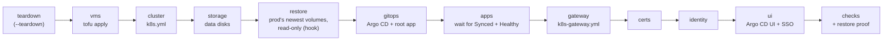
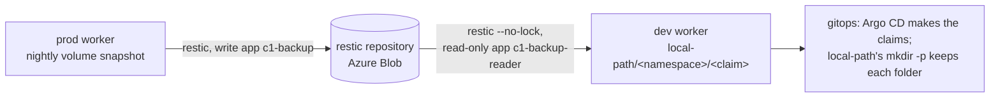

# Rebuild one cluster's Kubernetes layer with one command

**Status:** tested. `hosts/rebuild-k8s.sh` was written from the code on `main` on 2026-11-09. It was proven on dev from the agent box with two clean `rebuild rebuild` runs in a row on 2026-11-13 (see Proven runs). Prod has not been rebuilt with it. D-0012 also expects an automated runbook to link a `tested` manual one: [Rebuild the home lab from scratch](rebuild-home-lab-from-scratch.md) is still `draft`, so that link is not yet to a `tested` runbook.

This covers the Kubernetes layer only. The Proxmox host, OPNsense, the tailnet container, DNS and the backup target stay as they are (the owner's card, 2026-11-09 23:21 UTC). For those, and for the whole order from bare metal, see [Rebuild the home lab from bare metal](rebuild-home-lab-from-scratch.md).



On dev the stages are `preflight vms cluster storage restore gitops secrets apps gateway checks` (with `openbao-seal` after `storage` once the box's `agent_box_openbao_in_cluster` is true), then `dev-ca`, `openbao-measure` and `openbao-handover` (both only with `OPENBAO_SEAL_KEY_FILE` set), `identity-keycloak` and, with `OPENBAO_SEAL_KEY_FILE` set, `app-secrets` and `ssh-ca-proof`, then `panels` (below): certs, identity and ui as prod runs them are left out (D-0028). `secrets` seeds namespace `secret-source` from `SECRET_SOURCE_FILE` (`playbooks/k8s-secret-source.yml`, [seed-secret-source.md](seed-secret-source.md)) after Argo CD makes it and before `apps` waits on the ExternalSecrets that read it; unset, the stage is skipped. The agent box makes its own dev file once, with random values, and never prints it. The wrapper's `STAGES` is the default list, not a limit: `hosts/rebuild-k8s.sh` may add dev-only stages after it, as it does with these, and each refuses any env but dev (`test_rebuild_dev_stages.sh`). `dev-ca` stops with a clear message when the `k8s_certs` role has no `devca` tag.

`openbao` (proposed D-0038) is in the script's default list (`default_stages` in `hosts/rebuild-k8s.sh`, line 58) but **no dev run of 2026-11-18 ran it**: the box's `rebuild.sh` puts it in the stage list only on the branch where the in-cluster switch is off and the old store's files exist (`rebuild.sh` lines 405-415), and with the switch on it sets the list `vms cluster storage openbao-seal restore gitops secrets apps gateway checks` (line 493) with no `openbao`. The console of run `20261118T204624Z` printed `rebuild: env dev, stages: preflight vms cluster storage openbao-seal restore gitops secrets apps gateway checks dev-ca openbao-measure openbao-handover identity-keycloak`, with no `openbao`. The stage has never run on the lab. What follows describes it. It runs after `secrets` and before `apps`. A rebuilt cluster signs its service-account tokens with a new key, so External Secrets can't sign in at the secrets store until the store knows that key. The stage reads the key (`/etc/kubernetes/pki/sa.pub`, the public half) and the token issuer on the first control-plane node, and writes them to the store's `auth/jwt-c1/config` through the AppRole `rebuild`, which can write that one path and nothing else (`playbooks/k8s-openbao-auth.yml`). It needs `OPENBAO_ADDR`, `OPENBAO_CACERT`, `OPENBAO_ROLE_ID_FILE` and `OPENBAO_SECRET_ID_FILE` in `rebuild.env`; with `OPENBAO_ADDR` unset it is skipped. The store side is [set-up-the-secrets-store.md](set-up-the-secrets-store.md). Not yet run on the lab. The agent box's `rebuild` adds `openbao` after `secrets`, and sets those four from its own files, once the AppRole `rebuild`'s IDs are in `/etc/agent-keys/dev/`. Only the store VM's `secrets-store configure` made them, and that code is gone (D-0058 rule 5 ends the `jwt-c1` login), so the stage is skipped; it stays until the box's rebuild stops calling it; It also hands the store's address and certificate to Argo CD's root Application (`k8s_gitops_source_openbao_address` and `_ca_file`), so dev's secret-store app adds store `openbao` and its test ExternalSecret `openbao-check`, which `apps` then waits for. Before that it leaves all of it out.

## Stages

| Stage | Runs | Notes |
|---|---|---|
| `teardown` | `tofu destroy` in `hosts/terraform/home/k8s`, then, when the box's wrapper set `TEARDOWN_HOOK` (dev, always), `dev-secrets.sh remove`: it deletes dev's SOPS file of the apps' secrets, `/etc/agent-keys/dev/openbao-kv.sops.json`, once the state holds 0 VMs; a failed destroy deletes nothing ([Dev's secrets leave at teardown](make-the-box-secrets-bundle.md#devs-secrets-leave-at-teardown)) | only with `--teardown`, and as the end-of-run teardown of every full dev run under `ephemeral-dev` |
| `preflight` | reads the Proxmox node's memory with the stage-`vms` token (`/nodes/<node>/status`: `memory.available` when present, from PVE 9, else total minus used; the log names the field) | dev only, added to every dev run after a `--teardown` and before `vms`. It checks only a fresh build or a run after a teardown: when the state holds every dev VM the tfvars declare, a re-run allocates no new VMs and the check is skipped; a partial state is checked (the log says `branch skipped` or `branch checked`). When it checks, it refuses below `PREFLIGHT_MIN_FREE_MIB` and refuses when the memory can't be read. The default minimum is what the declared dev nodes need at the dev sizes, plus a 512 MiB margin (1024 until 2026-11-19): 4096 + 8192 + 512 = 12800 MiB for one control plane and one worker (see [Dev node sizes](#dev-node-sizes)); a declared node with no `role` of `control-plane` or `worker` is refused, and the log names the sum and the minimum. It prints sizes only, never the token. When it checks, it also lists the guests the token can see (`/cluster/resources?type=vm`: VM ID, type, status, maxmem, mem, name; a failed read prints one line and does not stop the run), and `rebuild log` keeps those lines. It refuses, whatever the memory, while VM 257 (the OPNsense test VM, [prove-opnsense-sign-in-on-dev.md](prove-opnsense-sign-in-on-dev.md)) or VM 256 (the lab test copy, [hosts/terraform/home/lab-test](../../hosts/terraform/home/lab-test/)) is in that list; when the list can't be read, the log says neither was checked. The list shows only the guests the token can see: VM 258 is NoAccess for it (`agent-access.sh`, `NO_ACCESS`), so the memory the lines add up to undercounts what the node uses, and the log says so. It also lists the node's storages the token can see (name and type only), so the log shows whether the host uses ZFS. It also prints one line with the node's total, used and available memory, the memory KSM shares and swap use (`/nodes/<node>/status`), because the guest list can't show the guests the token can't see. When the check is short and VM 400 (the owner's desktop, in pool `desktop`) is running, it shuts that VM down first (`VM.PowerMgmt`, a forced stop after 60 s, 120 s to stop), reads the memory again, and nothing starts the desktop again: the owner starts it when it is wanted (log lines `desktop stop`). It does not check whether anyone is signed in to the desktop: a running desktop is stopped whenever a dev rebuild is short, so save work on it before starting a dev rebuild. A run with `PREFLIGHT_KEEP_DESKTOP=true`, which the box's timer run (`rebuild auto`) sets, never stops the desktop: it says the desktop is left alone and judges without it. When it is still short and VM 300 (the notebook's CI runner) is running, what happens is the owner's pick, `PREFLIGHT_SHORT_NODE` (`agent_box_short_node` on the box), with no default: unset, it refuses before it stops anything and names both values ([On a node short of memory](#on-a-node-short-of-memory)). With a value it shuts VM 300 down through the token's `VM.PowerMgmt` (pool `ci`, no other guest is touched), waits up to 120 s for it to stop, reads the memory again and passes only if the node now has the minimum; otherwise it refuses. The log lines start `runner stop`, `runner restart`, `runner left stopped` and `diag`. `hosts/rebuild-k8s.sh <env-dir> --fit` (dev only) asks whether this check would pass now without running anything: the same reads and refusals, but it stops nothing, counts a guest a run would stop (VM 400, then VM 300 when the short-node setting is set) as its maxmem freed, writes no run log, prints `fit: yes` (exit 0) or `fit: no` (exit 3), and sends no POST (`test_rebuild_preflight.sh`). The estimate can be high: a guest's maxmem is the most its stop frees, so a run started on `fit: yes` can still be refused by the real check |
| `vms` | `PRE_VMS_HOOK`, then `tofu apply` in the same folder | the hook re-adds the Proxmox `/vms` ACLs, which Proxmox removes on every destroy |
| `cluster` | waits until every node takes an ssh login (`SSH_TIMEOUT`, default 300 s), then `playbooks/k8s.yml` | `vms` returns when the guests exist, not when sshd answers |
| `storage` | `playbooks/k8s-storage.yml --tags disk` | the data disks only; Argo CD installs the provisioner |
| `openbao-seal` | `playbooks/k8s-openbao-seal.yml -e openbao_seal_key_file=$OPENBAO_SEAL_KEY_FILE` | skipped unless `OPENBAO_SEAL_KEY_FILE` is set: the secrets store inside the cluster (D-0058), its 32-byte seal key on the node `k8s_gitops_source_openbao_seal_node` names, before `gitops` makes the store ([set-up-the-secrets-store.md](set-up-the-secrets-store.md)); never replaces a different key; on prod a secrets step, the owner's tap at the act |
| `restore` | `RESTORE_HOOK` | before `gitops`, so each restored folder is there when Argo CD makes its claim; required on dev ([Restore on dev](#restore-on-dev)); skipped on prod when unset |
| `gitops` | `playbooks/k8s-gitops.yml --tags install,source` (a dev re-run, where the certificate's Secret `gateway/apps-tls` already exists, adds `-e k8s_gitops_source_gateway_https=true`, so the root Application keeps the Gateway's HTTPS on; a fresh build leaves it off until `dev-ca` makes the Secret). On dev every render of the root Application, here and in `dev-ca`, also passes `-e k8s_gitops_source_lab_ca_issuer=false -e k8s_gitops_source_login_probe=false`: dev has no ClusterIssuer `lab-ca` (no `certs` stage, and its own CA, `dev-ca`, comes after `checks`), so jellyfin reads its lab root from its optional Secret instead of a Certificate that would wait for ever and hold `apps`; and dev makes no `login-probe`, whose names are prod's, so its failed Jobs can't fail `checks`; and `-e k8s_gitops_source_jellyfin_setup=false` (root value `jellyfinSetup`), so dev makes no Jellyfin setup CronJob and no `jellyfin-admin` Secret: `restore` has already put prod's Jellyfin config, with prod's admin password, in place, and dev's own freshly made password can't sign in to it (every setup Job ended `sign-in as admin failed` after `401`s, and its Error pods failed `checks`, dev run of 2026-11-18 19:49 UTC); and `-e k8s_gitops_source_panel_check_suspended=true` (root value `panelCheckSuspended`), which suspends the CronJob `monitoring/panel-check`: dev's Keycloak panel has no data before the `identity-keycloak` stage, which runs after `apps`, and the five OpenBao panels and Jellyfin's request rate printed none for a cause not measured, so a `*/30` tick inside the run ended `some panels have no data` and its Error pod failed `checks` (dev run of 2026-11-18 20:46 UTC, pod `panel-check-29917260`: seven panels printed `no data`, the six OpenBao and Keycloak ones and `Jellyfin requests per second`; whether the Jellyfin one has data once the run is over is not yet measured). On dev an agent runs one by hand once the run is over: `kubectl -n monitoring create job --from=cronjob/panel-check panel-check-manual`. Prod leaves it running | the inventory sets `k8s_gitops_source_enabled: true` |
| `apps` | waits until every Argo CD app is Synced and Healthy (`APPS_TIMEOUT`, default 1200 s), then on dev only re-reads every ExternalSecret and waits for each to be Ready, then for ntfy and Alertmanager's pod to be Ready (`SECRETS_TIMEOUT`, default 300 s each; the failure names what is not Ready) | see "Apps and auto-sync" |
| `gateway` | `playbooks/k8s-gateway.yml`, then on dev with `OPENBAO_SEAL_KEY_FILE` set `playbooks/k8s-openbao-admin-firewall.yml`, then on dev the L2 report | after `apps`: with the store in the cluster, dev's nodes also let the box's /32 reach the store's 8200 through firewalld ([The box's admin path](set-up-the-secrets-store.md#the-boxs-admin-path)); without an admin address or the box's /32 in the inventory that play prints a `SKIP` line and changes nothing. with `k8s_gateway_by_argocd: true`, Argo CD makes the Gateway and the playbook checks it. On dev the stage then lists every LoadBalancer Service with its address, the L2 announcement policy meant for it (its own, by the label `central-hub/l2-policy`, or the general one) and the node holding its lease `cilium-l2announce-<namespace>-<name>`, into the short log as `gateway: l2:` lines, and fails when a Service has an address and no lease holder ([D-0062](../decisions/0062-announce-the-secrets-stores-admin-address-from-its-node-with-its-own-l2-policy.md); Cilium v1.20.4 [`l2-announcements.rst`](https://github.com/cilium/cilium/blob/v1.20.4/Documentation/network/l2-announcements.rst) lines 240-259). A failed dev run's read before its teardown lists them too, as `diag: l2:` lines |
| `certs` | `playbooks/k8s-certs.yml` | staging issuer on dev |
| `identity` | `playbooks/k8s-identity.yml` | throwaway users on dev |
| `dev-ca` | `playbooks/k8s-gitops.yml --tags source -e k8s_gitops_source_gateway_https=true` (the dev inventory leaves the Gateway's HTTPS off, so this turns it on in the root Application), then `playbooks/k8s-certs.yml --tags devca -e k8s_certs_dev_ca=true`, then `playbooks/k8s-gateway.yml --tags gateway -e k8s_gateway_https=true` | dev only, added to every dev run after `checks`: a throwaway CA made by cert-manager in the cluster and the Gateway's wildcard certificate from it, so dev has HTTPS with no prod secret. The last play opens 443/tcp in each node's lab zone, which role `k8s_gateway` opens only with HTTPS on (`roles/k8s_gateway/vars/main.yml`, line 6) and the dev inventory leaves off; until 2026-11-19 nothing opened it, so no call from outside reached dev's https listeners (Envoy takes Gateway traffic through the node's input filter: `roles/k8s_gateway/defaults/main.yml`, lines 18-20). That fits the timeouts of the measurement's probes in dev runs `20261118T212236Z` and `20261119T104715Z`, not yet shown by a run with the port open. The sign-in proof does not verify it (`dev-ca` is untrusted by design) |
| `openbao-measure` | `playbooks/k8s-openbao-measure.yml` | dev only, added after `dev-ca` when `OPENBAO_SEAL_KEY_FILE` is set (the secrets store inside the cluster), and skipped without it: the measurement of the box's path to OpenBao through the Gateway (MEASURE-1). With the key file set, a dev run's `gitops` and `dev-ca` also pass `-e k8s_gitops_source_openbao_measure=true`, so the root Application turns on the measure routes; prod never does. It ends with one `PASS: openbao-measure:` line: the policy reading and, for each probe, the HTTP code, the address OpenBao saw and the `X-Forwarded-For` it got. When no probe gets an HTTP answer from the Gateway, the stage still passes, but its line is `SKIP: openbao-measure: not measured, no probe got an HTTP answer from the Gateway;` with curl's error for each probe, and nothing was measured ([set-up-the-secrets-store.md](set-up-the-secrets-store.md#measuring-the-boxs-path-through-the-gateway-dev-only)) |
| `openbao-handover` | `playbooks/k8s-openbao-handover.yml -e openbao_admin_role_id_file=$OPENBAO_ADMIN_ROLE_ID_FILE -e openbao_admin_secret_id_file=$OPENBAO_ADMIN_SECRET_ID_FILE` | dev only, added after `openbao-measure` when `OPENBAO_SEAL_KEY_FILE` is set, and skipped without it. With neither ID file named (a box wrapper installed before the stage) it ends with a SKIP line; with one named but missing or empty it fails. The one-time hand-over of the store's admin login to the box's IDs, from inside OpenBao's pod, every value on stdin. While `k8s_gitops_source_openbao_box_cidr` is unset it hands nothing over and ends with a SKIP line (role `bootstrap` stays open); a store handed over before passes with `already handed over` ([set-up-the-secrets-store.md](set-up-the-secrets-store.md#handing-the-admin-login-to-the-box)) |
| `identity-keycloak` | `playbooks/k8s-identity.yml --tags all,signin` with `k8s_identity_owner_username=dev-admin`, no extra users and `k8s_app_route_proof=false` and no sign-in theme (`k8s_identity_theme_dir` empty: Keycloak's own look, since the theme folder is the owner's private checkout) and `k8s_identity_db_storage=local-path` (Keycloak's database claims the data disk's StorageClass, as TASK-0225 plans for prod; written, not yet run on dev) | dev only, added to every dev run after `dev-ca` (and `openbao-measure` and `openbao-handover`, when they run): the whole identity role, then the sign-in proof: the password alone stops at the one-time-code form, the password with a code computed from the dev admin's seed redirects back to Grafana's client with a code (the log has step names and HTTP codes only). Every secret is random and made in `identity.env` inside the dev env folder (passed as `k8s_identity_values_file`, so no prod file is read whichever machine runs it); the route's by-name proof is off because dev's names resolve to prod's Gateway, and the proof goes to this cluster's own Gateway address. The run's short log (`rebuild log`) keeps the preflight's branch line and the three sign-in step lines (step name, HTTP code, ok or the reason). |
| `app-secrets` | `$APP_SECRETS_HOOK`: the box's `secrets-store.sh put-apps`, then `compare` | dev only, added after `identity-keycloak` (which writes `identity.env`) when `OPENBAO_SEAL_KEY_FILE` is set, and skipped without it. **Gated, shut by default.** The box's `rebuild.sh` sets `APP_SECRETS_HOOK` only when the secrets store's settings have `sops_copies: true` (the owner's access-right tap, D-0058 rule 9) and `box_cidr` and no rebuild hold is set; otherwise it sets `APP_SECRETS_SKIP` to the first reason, and the stage ends with `SKIP: app-secrets: <reason>`, writes nothing and passes. Open, it first writes this run's store CA to the box's dev keys folder (`store_ca`: `ca.crt` of Secret `openbao/openbao-tls` only, one PEM certificate or the stage fails), then puts every value the apps read into SOPS, then OpenBao, and compares the two; the short log keeps the SKIP line, or the CA line, the `put-apps` count, any `DIFF:` lines (names only) and the compare's PASS line. The apps keep reading store `c1` (`appSecretsStore` stays off). Opening the gate is a settings change, not new code ([set-up-the-secrets-store.md](set-up-the-secrets-store.md#the-dev-rebuilds-stage-app-secrets); `test_rebuild_app_secrets.sh`) |
| `ssh-ca-proof` | `playbooks/k8s-ssh-ca-proof.yml` with `k8s_identity_values_file=<env dir>/identity.env`, on the first control-plane node; its scripts are `playbooks/files/ssh-ca-proof-token.py`, `ssh-ca-proof.sh`, `opkssh-proof.sh` and `opkssh-proof-login.py` | dev only, after `app-secrets`, and skipped without `OPENBAO_SEAL_KEY_FILE` (it needs the store's OpenBao image). It tests two ways for the lab's Linux boxes to trust a Keycloak sign-in, end to end, and undoes each: **ssh-ca**, a throwaway OpenBao in dev mode in namespace `ssh-ca-proof` (deleted at the end) trusts realm `lab`'s ID tokens through its JWT auth method and signs 5-minute SSH certificates for test user `dev-admin` only, and the node's sshd trusts that CA through a drop-in (`TrustedUserCAKeys`, `RevokedKeys`); and **opkssh** (OpenPubkey SSH v0.19.2, each download checked against its pinned sha256), where a temporary public client `opkssh-proof` in realm `lab` lets `opkssh login` put `dev-admin`'s ID token inside an SSH key that sshd checks with `AuthorizedKeysCommand`. Each route checks that the allowed user logs in and that a refused user or account is refused; ssh-ca also checks an expired certificate and a revoked one. The store the apps use is never touched, and no password, seed, secret or token is logged. It never fails the run: the short log keeps its `ssh-ca: ...` and `opkssh: ...` lines and its final `PASS` or `FAIL` for each route (`test_rebuild_dev_stages.sh`). opkssh stays installed on the node until the end-of-run teardown |
| `panels` | `panels_read` in `hosts/rebuild-k8s.sh`: one Job made from the suspended CronJob `monitoring/panel-check`, its log, then `up{namespace="openbao"}` and `up{namespace="media"}` from Prometheus through the API server, and the age of StatefulSet `openbao/openbao` | dev only, last on every full dev run, so it reads dev before the end-of-run teardown (`ephemeral-dev`). It writes nothing but that Job. Each `read:` line goes into the short log: whether the Job ended with every panel holding data, the panel check's own lines, one line per `up` series (`job`, `pod`, value) or `no series`, and the StatefulSet's creation time and age; with the store in the cluster and no snapshot yet, a line says the snapshot panel's no data is expected (CronJob `openbao-snapshot` ticks at minute 17). It never fails the run: a read that gets no answer says so on its `read:` line (`test_rebuild_panels.sh`) |
| `identity-db` | `playbooks/k8s-identity-restore.yml` | prod rebuilt from the box only (env prod and `k8s_backup_restore_own_env`): Keycloak stopped through its operator, the `keycloak` database dropped and prod's own dump from the snapshot `restore` used loaded into the running PostgreSQL (`c1-restore-identity.sh load`), Keycloak started again, the rows counted before and after. Not in the default list ([Rebuild prod from the box](#rebuild-prod-from-the-box)) |
| `ui` | `playbooks/k8s-gitops.yml --tags ui,sso` | |
| `backup` | `playbooks/k8s-backup.yml` | not in the default list; prod only, the script refuses it on dev |
| `backup-drill` | `playbooks/k8s-backup.yml --tags drill -e k8s_backup_drill=true` | not in the default list; prod only, after `backup`. The first backup and the restore tests, so the nodes write the times the `checks` stage reads (`c1_backup_last_success_timestamp_seconds`). `backup` alone only installs the timers, whose first runs are at 02:10, 02:25 and Sunday 04:30; the backup panels and `C1BackupNotRecorded` failed `checks` on prod resume 5 until then. It is its own stage so a resume of a run whose `backup` passed starts here |
| `checks` | nodes Ready, failed Jobs of any CronJob from the bring-up settled (see below), pods Running, apps Synced and Healthy, a second `k8s.yml` with `changed=0`, `tofu plan` with no changes, then `RESTORE_CHECK_HOOK` when `RESTORE_HOOK` is set | |

## Before you start

- The env folder exists on the controller, outside the repository, mode `0700`, and holds `rebuild.env` (mode `0600`). The script's header lists every variable; [hosts/rebuild.env.example](../../hosts/rebuild.env.example) is a dev one with made-up paths. For dev: `ENV_NAME=dev`, `VM_ID_MIN=250`, `VM_ID_MAX=257`, and a tfvars with `node_vnet = "dev"`. VM 258 is the agent box, which stays, and 259 was the jumpbox rehearsal's container, which the owner chose to delete on 2026-11-18, so the dev range stops at 257.
- No kubeconfig is needed on the controller, and none is copied there. Every `kubectl` call in the `apps` and `checks` stages runs on the env's first control-plane node through Ansible, with that node's `/etc/kubernetes/admin.conf`. Its output comes back through the `ansible.posix.json` callback, so `hosts/ansible/collections/` holds the collections from `requirements.yml` (`ansible-galaxy collection install -r requirements.yml -p ./collections`). A `KUBECONFIG` in `rebuild.env` is ignored.
- Every node `vm_id` in the tfvars sits in the env's range. The script stops before any stage if one does not.
- The env's inventory sets the values the root app needs. For dev:
  - `k8s_gitops_source_enabled: true`, or the `gitops` stage installs Argo CD with no root app.
  - `k8s_gitops_source_zone` and `k8s_gitops_source_gateway_address`: dev's zone and gateway address (private values).
  - `k8s_gitops_cluster_labels.env: dev`, so dev's Argo CD cluster labels don't say `prod`.
  - `k8s_lab_dns_points_here: false`: dev uses c1's names, and the lab's wildcard DNS still sends them to prod's Gateway, so the checks that a name resolves to this Gateway are skipped with a note (RB1 run 13 stopped there). The checks that call the Gateway by its address with a Host header still run.
- The env's inventory has a `proxmox` group, as c1's has. The `gateway` stage's smoke test runs its client from the first host in that group (`k8s_gateway_smoke_client`), and fails without it. The box's own copy of an inventory drops that group (the box never holds root on the hypervisor) and names the box itself (`localhost`) as the client, which is right on dev, whose Gateway is on the box's VLAN. On prod the `gateway` stage passes `-e k8s_gateway_smoke_client=<first prod worker>` (`hosts/rebuild-k8s.sh`, stage `gateway`), so the HTTP smoke runs on prod's own VLAN, as the app routes' proofs already do (`k8s_app_route_proof_client`, a worker). That proves the Gateway answers inside prod's VLAN, not from outside it: prod rerun 8 (2026-11-21) measured, from the box, port 443 of prod's Gateway answering (HTTP 404 for an unknown name) and port 80 giving no answer in 5 s, and that is by design: the firewall's app-access rules open tcp 443 only, because the Gateway's port 80 only redirects to 443 (`hosts/ansible/roles/opnsense_lab/tasks/app_access.yml`, lines 2-8 and 25). The certs smoke test (HTTPS, from the box) still proves 443 from outside the VLAN.
- `rebuild-prod.sh` clears `openbao-prod`'s known hosts (`/var/lib/agent-box/openbao-prod/known_hosts`) where it clears its own, at a rebuild and at the start of a resume. That wrapper pins node host keys with `accept-new`, which refuses a changed key, so after a rebuild its `admin-firewall`, `ca`, `handover` and `refresh` stopped with "REMOTE HOST IDENTIFICATION HAS CHANGED" (prod resume 1, 2026-11-22).
- A CronJob's tick that lands while the cluster is coming up fails and leaves a failed Job with Error pods, which the `checks` pod check would count: the OpenBao snapshot CronJob (minute 17 of every hour; dev run 10, 2026-11-21: apps ran 23:16 to 23:22 and two Error pods of the 23:17 tick failed the stage; the cause inside the pod was not read, because the cluster is read only after the stage), and on prod's resume 4 (2026-11-22) `media/jellyfin-setup` and `monitoring/panel-check`. For every CronJob in every namespace, `checks` (`settle_cronjob_jobs`) finds Jobs with failed pods. A failed Job followed by a newer Job of the same CronJob that completed with no failed pod is settled: it is deleted (foreground, so its pods are gone before the pod check). With no such newer Job, `checks` runs one Job from the CronJob (`kubectl create job --from=cronjob/<name>`, named `<cronjob>-rebuild-check`, in the CronJob's namespace), requires it to complete within 5 minutes, and then removes the failed Jobs and that Job. A Job that does not complete with the cluster up fails the run, and the output holds the last 30 log lines of its pod, scrubbed by `hosts/diag-apps.py`; that Job and the failed ones stay for the next read. A failed Job of a suspended CronJob is deleted with no rerun: where Jellyfin's config is restored the chart renders `jellyfin-setup` with `suspend: true` (the Application does not prune, so a CronJob an earlier render made would otherwise keep running), and dev's `panel-check` is suspended too. The method is Kubernetes' own: a manual Job from a CronJob, and failed Jobs and their pods kept until a delete or the history limit removes them (Kubernetes docs, CronJob and Jobs; named here, not re-read for this change). Test: `.github/hosts-check/tests/test_rebuild_cronjob_jobs.sh`. The Job it runs is made with `kubectl create job --from` and its owner is taken off at once with a JSON patch (`create --from` makes the CronJob the owner, and the CronJob controller then deleted it under `failedJobsHistoryLimit` when the CronJob's own tick failed too, prod resume 6, 2026-11-22). `kc` is an Ansible ad-hoc command on the node with no stdin, so nothing can be piped into it. It is read until it succeeds or fails, not waited on for the full 300 s, and a failure prints its last 30 log lines. The failure diag keeps up to 500 lines; a cap of 200 cut the last pod's log, where the failing panel lines are.
- On prod, the `ui` stage and `checks` read `argocd-cm` (`argocd_signin_listed`): it must hold an `oidc.config` that names `Lab sign-in`, so a sign-in that is missing, or removed later, fails the run at once instead of showing only in the login probe.
- The `gateway` app prunes (`root/values.yaml`). Argo CD follows `main` (`targetRevision: main`), so when a pull request renames a route (#856: `central-hub-app` became `hub`, merged 03:17 UTC on 2026-11-22 during a dev run and after prod's bring-up) the old HTTPRoute stayed with prune off, the app stayed OutOfSync, and `apps` and `checks` failed on it.
- A run with a `RESTORE_HOOK` (dev always; prod's rebuild) passes `k8s_gitops_source_jellyfin_setup=false` on every render of the root Application, so `jellyfin-setup` is rendered suspended (its admin Secret and generator still render, so the Jellyfin Application, which does not prune, stays in sync): the restore puts the old Jellyfin config and its admin password back, and the new cluster's freshly generated `jellyfin-admin` Secret could not sign in to it (prod resume 4, 2026-11-22: `wizard already completed`, then 401 every tick, which failed `checks`). The Application does not prune, so a cluster that already had the CronJob keeps it until it is deleted.
- The `certs` smoke test writes the lab root to `k8s_certs_smoke_root_file` on its client, which is the box, run as the `keys` user. The role's default is under `/root`, which that user cannot read. Both wrappers therefore set it to a file in the run's own folder (`lab-root-ca.crt`). Prod rerun 9 (2026-11-21) stopped at the `gateway` stage with `Permission denied` on the default path, the first time prod ran this smoke test. The prod `check` now also refuses a run when the identity role's values file is one the `keys` user cannot write and chmod (the role does both, on the box, in stage `identity`), or when a set `k8s_identity_jellyfin_root_ca_file` is not on the box; both would otherwise stop a run after its teardown.
- The env's inventory hands every app to Argo CD, so no Ansible role applies the same objects: every `*_by_argocd` switch is `true` (`k8s_gateway_by_argocd`, `k8s_observability_grafana_route_by_argocd`, `k8s_observability_metrics_server_by_argocd`, `k8s_observability_logs_by_argocd`, `k8s_observability_metrics_by_argocd`, `k8s_storage_provisioner_by_argocd`, `k8s_jellyfin_by_argocd`, `k8s_secrets_by_argocd`, `k8s_certs_cert_manager_by_argocd`). For dev, `k8s_certs_issue` stays `false`, so the `certs` stage requests no certificate. With no certificate, dev's `k8s_gateway_https` is `false` too; `k8s_gitops_source_gateway_https` follows it, so the root app passes `gatewayHttps: false`: the gateway app makes only the HTTP listeners, and its routes and Jellyfin's serve plain HTTP (RB1 run 11 found the gateway Degraded on the missing Secret without this).
- The Mac has an allow rule for `hosts/rebuild-k8s.sh` ([Let agents run a new command](allow-a-command-for-agents.md)). The owner approves it.

## Steps

1. Run the script for the env.

   ```sh
   hosts/rebuild-k8s.sh <env-dir>              # build on what is there
   hosts/rebuild-k8s.sh <env-dir> --teardown   # destroy the env's VMs first, then build
   hosts/rebuild-k8s.sh <env-dir> --only checks
   ```

   why: one entry point runs every stage in the order the code needs and stops at the first that fails, so a rebuild is the same each time (spec draft, TASK-0220).
   ※ [Create the c1 node VMs](create-c1-node-vms.md), [Build cluster c1 with Ansible](build-c1-with-ansible.md), [Install Argo CD on c1](install-argo-cd-on-c1.md).
   expect: one `start` and one `end rc=0` line per stage in `<env-dir>/logs/rebuild-<UTC stamp>.log`, then `rebuild: all stages passed`. The full output is in the `.raw` file beside it.

2. Read the log's times into the run's worklog.

   why: the dev runs measure each stage, and two clean runs in a row are the proof.
   expect: every stage `rc=0`.

## Restore on dev

A dev rebuild proves the code with prod's data in it: the `restore` stage puts a read-only copy of prod's newest volume snapshot on dev's data disk (TASK-0240; the owner's card, 2026-11-10 02:50 UTC, and the owner's words of 2026-11-10 03:08 UTC that c1 holds no real data). Every part is agent pick 205 in [hosts/AGENT-PICKS.md](../../hosts/AGENT-PICKS.md).

The secrets store's folders (`openbao/data-openbao-0`, `openbao/audit-openbao-0`, `openbao/openbao-snapshots`, role value `k8s_backup_restore_skip_claims`) are not restored on dev: dev has its own store and seal key, and prod's secrets must not be on dev. `c1-restore-volumes.sh` leaves them out only when the snapshot is another node's (`RESTORE_SOURCE_HOST` is not this node), excludes them from the restic restore and prints `SKIP: folders of claims not restored on this env ...` naming the folders; prod's rebuild restores its own node's snapshot and skips nothing (two layers: the restore task hands the script an empty list when `k8s_backup_restore_own_env` is true, which only `rebuild-prod.sh` sets, and the script skips only when the source host is not this node). Dev run 5 of 2026-11-21 (central-hub `2675d921`) showed the failure: restore passed, then `apps` ended rc=1 with `openbao` Progressing and `secret-store` Degraded.



What comes back: only `/var/lib/c1-data/local-path`, every app volume. Not etcd: dev's cluster is built from code, which is what is being proven, and prod's snapshot carries prod's certificates and node names. Keycloak's database is not restored into a running Keycloak, because the identity stage doesn't run on dev (D-0028). The checks stage proves its dump instead ([below](#keycloaks-database-on-dev)).

Why it works without fighting Argo CD: on dev, local-path names each volume's folder `<namespace>/<claim>` (its `pathPattern`, from upstream's README at v0.0.37), so a folder has the same name on every dev rebuild. The restore puts the folders in place before Argo CD exists; when Argo CD makes a claim, the provisioner's setup script runs `mkdir -m 0777 -p`, which keeps the folder and its files. Nothing is scaled down.

c1 needs no change for this. It keeps upstream's folder names, `pvc-<uid>_<namespace>_<claim>`, and the restore maps each one to `<namespace>/<claim>` itself: namespaces, claim names and `pvc-<uid>` are DNS names with no `_`, so each name splits into exactly those three parts. A folder already named `<namespace>/<claim>` passes through. Any other name, or two folders for the same claim (a deleted claim's folder kept by reclaim policy `Retain`), stops the restore before it writes anything. The switch that turns `pathPattern` on is per cluster and off by default: `k8s_gitops_source_local_path_stable_folders` (root value `localPathStableFolders`, chart value `storageClass.stableFolders`). c1 leaves it off, because a StorageClass's parameters can't change in place; a rebuilt c1 may turn it on.

Read-only, twice over: dev's worker signs in as its own app registration, `c1-backup-reader`, which holds Storage Blob Data Reader on the backup container only, and every restic call runs with `--no-lock`, which restic needs to read a repository it can't write. Known limit: restic has no read-only keys, so dev's worker holds the repository password, as prod's nodes do. It is on the access register, and it is rotated with every other secret once the secrets store exists.

### Once, before the first dev restore

These run through the Mac lane, in this order. Nothing here needs the owner except where it says so.

1. Apply `hosts/terraform/azure/backup` ([Back up c1 off the box](back-up-c1-off-box.md), step A1). The plan adds 3 resources, the reader app, its service principal and its role, and changes nothing else. Note the outputs `reader_client_id` and `reader_app_object_id`.

   why: the reader identity is code, like the backup app.
   expect: `Plan: 3 to add, 0 to change, 0 to destroy.`

2. Check that prod has a volume snapshot of its worker: [Back up c1 off the box](back-up-c1-off-box.md), step 4. If the newest is older than you want on dev, run one backup first (step 3 there).

   why: dev restores the newest volume snapshot of `k8s_backup_restore_source_host`, as it is.
   expect: a snapshot tagged `volumes` for the prod worker.

3. In dev's private inventory, under `k8s_nodes` `vars`, set:

   ```yaml
   k8s_backup_env_file: ~/.config/central-hub/c1-backup.env   # the same RESTIC_REPOSITORY and RESTIC_PASSWORD as prod
   k8s_backup_azure_identity: true
   k8s_backup_azure_account: <storage_account_name>
   k8s_backup_azure_client_id: <reader_client_id>
   k8s_backup_azure_tenant_id: <tenant_id>
   k8s_backup_azure_app_object_id: <reader_app_object_id>
   k8s_backup_restore_source_host: <prod worker's short host name, as restic snapshots lists it>
   k8s_gitops_source_local_path_stable_folders: true
   ```

   Optional, for a controller with no Azure sign-in (the agent box): also set `k8s_backup_azure_fixed_cert_file` to the path of one PEM file (key and certificate) that the reader app already knows. The nodes then copy that file instead of making their own, and nothing is uploaded to or removed from the app. The certificate's expiry is the one date to renew by hand.

   Leave `k8s_backup_enabled` unset or `false`: `playbooks/k8s-restore.yml` refuses an inventory that turns the backup timers on, or whose `k8s_gitops_cluster_labels.env` is not `dev`.
   why: the reader app's IDs, never the backup app's, so dev can't write; the playbook also never makes the repository and runs no timer. The last line gives dev's local-path the `<namespace>/<claim>` folder names, so its claims find the restored folders.

4. In dev's `rebuild.env`, set `STAGES`, `RESTORE_HOOK` and `RESTORE_CHECK_HOOK` as in [hosts/rebuild.env.example](../../hosts/rebuild.env.example).

### What the stage does and how it is proven

- `restore` runs `playbooks/k8s-restore.yml` on dev's workers: the backup tools, the node's own key and certificate (uploaded to the reader app the first time, as for prod's nodes), the env file, then `c1-restore-volumes.sh restore`. It maps each folder in the newest volume snapshot of `k8s_backup_restore_source_host` to `<namespace>/<claim>` (and stops on a name it can't map or two folders for one claim), restores the snapshot with `--verify` into a staging folder on the same disk, renames each folder into place (logged as `mapped <from> -> <to>`), then compares each `<namespace>/<claim>` folder's file count and bytes on disk with `restic ls` of the same snapshot, and the canary file with the snapshot's copy. Any mismatch fails the run. A node without its data disk mounted says `SKIP`; at least one node must restore. It never writes over a folder it didn't restore: a non-empty folder with no record stops it, and a second run on the same snapshot says `ALREADY` and does nothing.
- `checks` runs `RESTORE_CHECK_HOOK`, the same playbook with `--tags restore_check`, after the apps synced: each node's restore is still in place, `media/jellyfin` is rolled out with a Ready pod that mounts `jellyfin-config`, that claim's volume is the restored folder `local-path/media/jellyfin-config`, the folder's own owner and mode equal its copy in the restored snapshot (most of prod's are `0:0 777` as local-path makes them, Grafana's `472:472`), it is not empty, and every entry directly inside it belongs to the Deployment's `runAsUser`.
- `checks` also proves Keycloak's database ([below](#keycloaks-database-on-dev)).
- The run's `.log` gets the snapshot ID, the canary and one `folder <namespace>/<claim> <files> <bytes>` line per folder, so the run's worklog can quote them.
- The `checks` stage's first restore check compares each worker's canary file with the one the restore recorded. Every volume backup writes a new canary into each folder (`c1-backup-volumes.sh`), so a backup that ran after the restore (prod's `backup-drill` stage, or the nightly timer) changes it; prod resume 7, 2026-11-22, failed there (`canary in /var/lib/c1-data/local-path is 'KAvQ…', the restore recorded 'J8nk…'`). `c1-restore-volumes.sh check` now accepts a different canary only when the node's own backup record (`canary-volumes`, replaced only after a snapshot succeeded) holds it, that record is newer than the restore's, and the newest `volumes` snapshot of the node holds exactly the canary on disk (read from the repository); a canary nobody recorded, a record the snapshot does not hold, or a record older than the restore still fails, and every restored folder must still be there (`test_backup.sh` section 6).

### Keycloak's database on dev

After a real loss, prod comes back by [Back up c1 off the box](back-up-c1-off-box.md), "Restore Keycloak's database": the identity stage makes an empty Keycloak, and its `pg_dumpall` dump from the newest snapshot is loaded into it. The checks stage proves that path on prod's own data, without the identity stage, certificates or sign-in on dev (the owner's card of 2026-11-10 10:11 UTC; the Plan thread's option C; agent pick 206):

1. A throwaway namespace, `restore-check-identity`, with one PostgreSQL pod from role `k8s_identity`'s image on the first worker, its account's password made on the control-plane node and never read back. No Service, Ingress or route; a NetworkPolicy lets only the Keycloak pod reach it.
2. `c1-restore-identity.sh load` on that worker brings the dump back with `restic dump --no-lock` from the same snapshot the volume restore used, checks its size and its end line, counts the rows of `realm`, `user_entity` and `client` in it, then does the runbook's step 3 through `crictl exec`: drop `keycloak`, load the whole dump. The counts in the database must equal the dump's.
3. A pod of the pinned Keycloak, the image role `k8s_identity`'s operator runs, starts on that database over plain HTTP with nothing reaching it. It must turn Ready (`/health/ready`), which it does only once it opened the database and its schema checks passed.
4. `c1-restore-identity.sh recount`: the counts are still the dump's.
5. Always, pass or fail: the namespace is deleted, the manifests and the counts are removed, and the run fails if any of that doesn't finish.

The dump holds prod's realm, its client secrets and its users' password hashes. It lives only in a mode-0700 folder for the minutes `load` takes, the log carries counts only, and its stay on dev is on the access register. Not proven here: the operator's wiring and a sign-in through Entra, which knows only prod's address.

## Apps and auto-sync

On a fresh cluster, Argo CD installs an app only if its `autoSync` is on in `hosts/kubernetes/home/c1/root/values.yaml`. The owner chose auto-sync for every app (card, 2026-11-10 02:50 UTC). It is on for every app in that file: 19 `autoSync: true` lines and no `false`, at `main` (`grep -c 'autoSync: true' hosts/kubernetes/home/c1/root/values.yaml`). The four that waited for their diffs on c1 (`local-path`, `jellyfin`, `kube-prometheus-stack`, `secret-store`) were turned on from 2026-11-10 (the comments on their `autoSync` lines). `prune` stays off except for `monitoring-extras`, `alerts` and `openbao-measure`. To leave the stage out, set `STAGES` in `rebuild.env`.

On dev, the root Application and every child it makes follow the commit the run is made from, not `main`: `run_stage` passes `k8s_gitops_source_branch` and `k8s_gitops_source_target_revision` with `git rev-parse HEAD` of the checkout, so the cluster the run proves runs that code even if `main` moves while the run is going. The commit must be on GitHub, which the box's checkout of a merged commit is. Prod is unchanged and follows `main` (`test_rebuild_dev_stages.sh`, the dev-commit cases; `hosts-check/manifests/cases.txt`, the dev source case).

## Rebuild prod from the box

The teardown destroys the node VMs only (`TEARDOWN_TARGET=proxmox_virtual_environment_vm.node`, set in the run's `rebuild.env`): prod's state also owns the AlmaLinux image and the template VM 9000 the nodes clone from, and a full `tofu destroy` would delete both and download the image again. `check` plans the same targeted destroy and refuses anything but node VMs 200-249. Dev sets no target, so its teardown still destroys everything in its state (written, not yet run on prod). A targeted destroy refuses a state that still holds resources the code has moved to new addresses ("Moved resource instances excluded by targeting"), so before it the teardown stage runs a refresh-only apply, which writes those moves into the state and changes nothing on the host; the prod check does the same on a copy of the state, never on the live one, and fails if that apply fails. A teardown with no target (dev) does neither.

The agent box's `rebuild-prod` wrapper (`hosts/ansible/roles/agent_box/files/rebuild-prod.sh`) tears prod's Kubernetes layer (VMs 200-249) down and builds it again with this same script, then puts prod's data back. It runs as user `keys`, so a session never sees the Proxmox token, the node key, the seal key, the backup certificates or the inventory. It runs only the code on `main`, from its own checkout, and shares the dev rebuild's lock, so dev and prod never build at once. The host, OPNsense, the tailnet container, DNS and the backup target stay as they are.

```sh
sudo -n -u keys /usr/local/libexec/agent-box/rebuild-prod.sh check
sudo -n -u keys /usr/local/libexec/agent-box/rebuild-prod.sh rebuild --full-teardown <tap id> <commit> [<volume snapshot id>]
sudo -n -u keys /usr/local/libexec/agent-box/rebuild-prod.sh resume <tap id> <commit>
sudo -n -u keys /usr/local/libexec/agent-box/rebuild-prod.sh log
```

`check` changes nothing. One `PASS` or `FAIL` line each (a failed OpenTofu step shows fixed facts only: the output's line count and which phrases of a closed list it holds, `Permission denied`, `No such file`, `command not found`, `Failed to query`, `registry` and `Error`; it never prints a line of OpenTofu's own text, which can carry a private value):

1. Every file the run needs is in the keys folder: the lab token (`proxmox-lab.env`, [give-agents-proxmox-rights-for-the-whole-lab.md](give-agents-proxmox-rights-for-the-whole-lab.md) step 4), prod's tfvars and OpenTofu state, the Mac's prod inventory, the box's prod node key (its public half already on every prod node), the private files the inventory names, the seal key's SOPS copy and the store's settings.
2. The box's own copies: the tfvars with the box's node key, every node `vm_id` in 200-249; the inventory with the Mac's ssh settings and `proxmox` group dropped, plain ssh with the box's key, the private files pointed at the box's copies, and the rebuild's own settings (`k8s_backup_restore_own_env`, the first worker as the restore's source, `k8s_gitops_source_local_path_stable_folders`, `k8s_backup_azure_seed_dir`). A value that still points at the Mac fails the check by key name. The Mac's inventory leaves `k8s_gitops_cluster_labels` to the `k8s_gitops` role's default (`env: prod`), which the restore plays' own checks do not load, so when no labels are set anywhere the box's copy gets that role default; labels that are set, with an `env` other than `prod`, still fail. `k8s_gitops_sso_root_ca_file` is pointed at `<keys>/prod/lab-ca/root.crt`, which the controller's prod-files run copies (`lab-ca/root.crt` in `agent_box_prod_files`). `k8s_identity_theme_dir` is pointed at `<keys>/prod/identity-theme/<the folder's own name>`, where the prod-files run copies the theme folder (`agent_box_prod_theme_src`) and `c1-ansible` looks for it, because the folder's name is the theme's name in Keycloak; a folder there with no `login/theme.properties` fails the check, since stage `identity` would stop on it only after the teardown. The box's copy also sets `k8s_certs_cert_manager_by_argocd` and `k8s_gateway_by_argocd` true whatever the Mac's inventory says: Argo CD makes cert-manager and the Gateway on a rebuilt cluster, and the `certs` stage's own helm install over cert-manager stopped prod rerun 7 (2026-11-21, `ServiceAccount "cert-manager-cainjector" ... exists and cannot be imported into the current release`).
3. `tofu plan` on the box's state gives no changes, first with the box's copy of the tfvars (the Mac's with the box's node key, the file the rebuild applies, so VMs a box run built pass) and, if that differs, with the Mac's own (VMs built from the Mac), so the box's state is the live prod; a change names the attributes that differ down into a block (for example `initialization.user_account.keys`), never a value; `tofu plan -destroy` deletes only node VMs in 200-249, never VM 258 or 259, and no more than the tfvars declare (D-0035 rules 2 and 6).
4. Every prod node answers ssh with the box's key.
5. Neither the box's default route nor its route to the Proxmox API goes through a node VM, so the teardown can't cut the box off half way (D-0035 rule 5). Only the routing table is read.
6. The newest dev run on the box passed every stage at this same commit (D-0035 rule 3(a)). `rebuild-k8s.sh` writes `rebuild: central-hub <commit>` into each run's short log for this. The log must end `rebuild: all stages passed` and hold a good end line (`<stage> end rc=0`) for each of `vms cluster storage restore gitops secrets apps gateway checks`: a teardown-only run (`rebuild.sh teardown`) ends with the same line but ran only `teardown`, so `rebuild-prod.sh check` skips teardown-only logs and judges the newest run that did more, the way `rebuild log` does: a teardown run after a good full run does not hide that run (dev is torn down after a run: `hosts/rebuild-k8s.sh` `runner_run_teardown` tears it down at the end of every full run under `ephemeral-dev`, and the hand `rebuild teardown` above does the same; `rebuild-prod.sh` lines 32-33 take the dev rebuild's lock so dev and prod never build at once), and with no such run behind it the check fails. If the newest full run failed or ran another commit, the check fails.

**Resume a stopped rebuild.** A rebuild that stopped after its teardown has built prod's VMs and, up to the failed stage, the cluster. Do not tear down again: `resume <tap id> <commit>` runs `hosts/rebuild-k8s.sh --only <stages from the first one with no good end line>` on the cluster already built, with no teardown, no backup, no restore of the volumes and no new bundle. It destroys nothing, so it takes no new go: `<tap id>` must be the one the stopped run was started with, and `<commit>` is any commit on main (usually the fix), held to the same `check` lines and the same dev-first rule as a rebuild. It runs only when each of these is a `PASS` line: the last run that reached its teardown did not end well (a resume that ended well ends it); its restore pin is kept; every stage before the resume point has a good end line in the short logs since that teardown; every prod node is Ready (`kubectl get nodes` on the first control-plane node); and OpenTofu plans no change to the VMs. It keeps the pin and the carried keys until a run ends well, and clears them when the resumed stages pass. The proof of the earlier stages is their logged end lines plus the live node check; it does not re-run them. A resume that fails keeps the pin and the carried keys, so after the fix run `resume` again with the same tap id; it starts from the stage that failed.

`check` reads main's newest commit. `rebuild <tap id> <commit>` builds the commit the go names (7 to 40 hex digits), not main's newest: it refuses one that is not on main, or one older than the floor `PIN_FLOOR` in the wrapper (main's merge of #624, the dev wrapper's floor too: a run uses that commit's own `rebuild-k8s.sh`, and one below it leaves dev up after a full run that had memory to spare, and further down lacks the refusal while VM 256 exists and the memory preflight), checks it out, and runs `check` at it, so the dev run it needs is the one at that commit, and a merge after the dev run and the go neither moves the code under the go nor sends dev round again. Then it runs the checks before a teardown (D-0035 rule 5). Each must pass or nothing is destroyed:

1. A backup of every prod node now, then the restore tests (`k8s-backup.yml --tags drill`). The tests restore into a temporary folder on each node, never over its data, and each names the snapshot it restored: the first worker's volume test must restore at least one folder, and the control plane's etcd test must pass. Both `PASS` lines, with their snapshot IDs, go into the run's log. This is also the Azure restore test's proof. The same drill then maps that snapshot the way the restore will (`c1-restore-volumes.sh plan`, strict) on the first worker, and the run stops, with nothing destroyed, unless it ends `PASS: plan: snapshot <full ID>: N folders map to N claims, no claim has more than one folder` and the ID is the snapshot the restore test passed on: two folders for one claim in a snapshot (a claim made again, its old folder kept by `Retain`) are cleaned up on the live nodes first, not found at the restore stage after the teardown (prod run 4, 2026-11-21: three folders for `openbao/data-openbao-0`). That full ID is then the restore's **pin**: the box writes it to its state (`prod-restore-pin`) just before the teardown, passes it to the restore as `k8s_backup_restore_snapshot`, so prod never restores "latest", and clears it when a run ends well.
2. With the Azure sign-in (`k8s_backup_azure_identity` true on every prod node), each node's backup certificate and its key ID on the app, copied into the keys folder (mode 0600), so each rebuilt node signs in to the backup as before ([Back up c1 off the box](back-up-c1-off-box.md), "A rebuilt node keeps its certificate"). With no Azure sign-in there is no certificate, and the run says so and goes on. `check` refuses a prod inventory with `k8s_backup_sftp` true (the Proxmox host as the target): each rebuilt node makes a new key that only the host play (group `proxmox`) lets in, and the box's copy has no such group because the box holds no key on the host ([Back up c1 off the box](back-up-c1-off-box.md), P3), so the rebuilt nodes would lose their backup and the restore after the teardown. Until the box has its key there, rebuild prod from the controller.
3. The seal key's SOPS copy decrypts, in memory, to the same key as on the seal node, so the rebuilt store unseals.
4. A fresh OPNsense configuration copy and a fresh secrets bundle (which holds this OpenTofu state), both sent off the box.

Then it runs `hosts/rebuild-k8s.sh --teardown` with `ENV_NAME=prod` and stages `vms cluster storage openbao-seal restore gitops secrets apps certs gateway identity identity-db ui backup backup-drill checks`, with `APPS_DEFER="gateway jellyfin"`: the `apps` wait leaves those two out, because on prod the Gateway's HTTPS listener waits for the certificate Secret and Jellyfin's lab-CA Certificate waits for ClusterIssuer lab-ca, both of which the `certs` stage makes; `certs` therefore runs before `gateway` (without its smoke test, which needs the 443 that only the `gateway` stage opens: `CERTS_SMOKE_LATE=true` runs `k8s-certs.yml --tags smoke` at the end of `gateway`, then waits for every app, so identity finds Jellyfin's deployment), and `checks` waits for every app (prod run 6, 2026-11-21, stopped at `apps` with gateway Degraded and jellyfin OutOfSync; this order had never run on prod). `restore` puts prod's own newest volume snapshot (the one step 1 just made) back onto the empty data disk with `k8s-restore.yml`, with backups off; `identity-db` loads Keycloak's database from the same snapshot; `backup` turns the timers on again with the carried certificates. When the box holds snapshots of the secrets store, the run sets the store's rebuild hold, so the rebuilt store waits for `secrets-store-prod restore-rebuilt` or `clear-hold` before a new snapshot replaces them.

The tap id is the message ID of the owner's go (his typed line, or his tap on a card option the card did not recommend) that names `rebuild-prod`, the repository and this main commit (D-0034 rule 9; D-0035 rule 3(b): a teardown of prod is one of D-0042 rule 6's deletes). A reviewing agent checks the go, the member and the commit before the run (rule 3(c)); the wrapper writes the id into the log. A message that orders a rebuild without naming the commit is not a go. After a box rebuild the Mac's prod tfstate is stale and its inventory needs `k8s_gitops_source_local_path_stable_folders: true`: take both from the box's run before any prod run from the Mac. Until then the role's prod-files run from the Mac refuses to copy its older state over the box's (it stops on a higher serial or another lineage on the box, [Set up the agent box](set-up-the-agent-box.md#copy-the-controllers-private-files-to-the-box)).

## Dev node sizes

A dev run gives its nodes fixed memory by role, set in `hosts/rebuild-k8s.sh` (`DEV_MEMORY_MB_CONTROL_PLANE` and `DEV_MEMORY_MB_WORKER`) and passed to the k8s stack as `memory_mb_by_role`, in place of each node's `memory_mb` in the env's tfvars. Prod passes nothing, so c1 keeps the sizes in its own tfvars. The same value goes to the `vms`, `teardown` and `checks` stages, so the drift check in `checks` sees no change.

| Role | Dev memory | Why |
|---|---|---|
| control plane | 4096 MiB (3072 from 02:37 to 06:46 UTC on 2026-11-18, 4096 until 2026-11-18 14:27 UTC, 3584 until 2026-11-19) | Back to 4096 on 2026-11-19: with the kubelet reservations of [Kubelet reservations on dev nodes](#kubelet-reservations-on-dev-nodes), 3584 left the control plane at 103 to 110% of its allocatable memory (173 MiB free, 735 available of 3405, `node psi` line) and Ansible's sudo on it timed out after 12 s in `identity-keycloak` (run `rebuild-20261119T091356Z`, `fail:` lines). The node read 15409 MiB available with dev down (`rebuild fit`, 09:38 UTC), above the 11008 minimum. Before that: at 3072 MiB the run of 2026-11-18 06:11 UTC (`rebuild-20261118T061140Z`) passed every stage through `secrets`, then failed `apps`: the API server timed out lease renewals (`context deadline exceeded`, 5 s), kube-controller-manager and cilium-operator lost leader election and went into CrashLoopBackOff, and openbao's volume claims stayed Pending (`rebuild diag`). c1's control plane, which runs only the control-plane pods, used 2530 MiB that day, 1809 MiB of it `kube-apiserver` (`c1-read top nodes` and `top pods`, 06:46 UTC), so 3072 leaves the API server too little. The dev VMs then summed to 10240 MiB; with the margin, 11264, under the 11914 MiB the 06:11 preflight read once the agent box had its balloon ([grow the agent jumpbox](grow-the-agent-jumpbox.md)) and its page-cache timer ([set up the agent box](set-up-the-agent-box.md)). At 4096 MiB dev's control plane read 2403 to 2839 MiB in the run of 2026-11-18 13:14 UTC (`rebuild-20261118T131441Z`, `node top` lines), so 3584 keeps about 745 MiB above that peak and 512 MiB above the 3072 that failed. Run `20261118T212236Z` then passed `apps` at 3584 (`apps end rc=0 225s`) and the whole run, with the control plane at 2620Mi (79%) at its peak (see Proven runs) |
| worker | 8192 MiB, as in the box's tfvars (6144 until 2026-11-18 14:27 UTC, then 6656, then 6400 until 2026-11-19) | 8192 since 2026-11-19: at 6400, with the control plane at 4096 and the [kubelet reservations](#kubelet-reservations-on-dev-nodes), run `rebuild-20261119T095027Z` lost the worker in `identity-keycloak`. It read 4725 MiB used, 141 free and 1446 available of 6171 at 10:14:41 UTC (`node psi` line), then answered no ssh (banner timeout) from 10:16 UTC while Proxmox counted 6108 to 6119 of 6400 MiB, and the realm import never finished (`kubectl wait ... --timeout=1200s` failed, `fail:` lines). The reservations did not stop it: the node hung with 1446 MiB still available a minute before, above the 384 MiB eviction line. The total is now 12288 MiB and the minimum 12800, under the 15409 MiB the node read with dev down (`rebuild fit`, 2026-11-19 09:38 UTC). Before that: At 7168 MiB the run of 2026-11-17 05:30 UTC (`rebuild-20261117T053037Z`) passed `identity-keycloak`, and its worker peaked at 4255 MiB (54 to 62%) with CPU up to 98% (see Proven runs). At 6144 MiB the run of 2026-11-17 04:33 UTC (`rebuild-20261117T043328Z`) passed every stage through `dev-ca`, then the Keycloak realm import timed out after 600 s with probes failing across the worker. This page does not record whether memory or CPU ran short then; the `node top` lines of the next run at 6144 show it. So dev's `identity-keycloak` now waits 1200 s for the realm import (`DEV_REALM_IMPORT_TIMEOUT_S` in `hosts/rebuild-k8s.sh`, passed as the role's `k8s_identity_realm_import_timeout`, default 600 s). c1's worker used 5248 MiB on 2026-11-18, about 4700 MiB of it in the top pods by memory at rest (`c1-read top pods -A`, 14:11 UTC: argocd-application-controller 772, prometheus 706, Keycloak 546, grafana 544, jellyfin 322, cilium 303, the Keycloak operator 279, loki 257, the rest smaller). The run of 2026-11-18 13:14 UTC (`rebuild-20261118T131441Z`) at 6144 failed in `identity-keycloak` again: its worker read 4007 MiB (68%) at 13:41:25 UTC, then `<unknown>` at every sample after, and was unreachable over ssh with 5729 of 6144 MiB in use as Proxmox counts it. At 6656 the run of 2026-11-18 19:19 UTC (`rebuild-20261118T191933Z`) was refused at preflight: the host had 11237 MiB free after VM 300 stopped, 27 short of 11264. In both failed runs the realm import ran with the Keycloak operator's default memory for its job, request 1700Mi and limit 2Gi (operator 26.8.2, `application.properties` lines 15 and 16, applied by `KeycloakRealmImportJobDependentResource` line 173, because the KeycloakRealmImport set no `resources`), beside Keycloak's own pod (limit 1536Mi), and Keycloak's JVM starts with half its limit as heap (`kc.sh` line 100). So dev now caps the import at 1Gi, request and limit (`DEV_REALM_IMPORT_MEMORY` in `hosts/rebuild-k8s.sh`, passed as the role's `k8s_identity_realm_import_memory`; empty on prod, which keeps the operator's default), and the worker gets 6400 MiB, 256 more than the size that failed. Dev's total is 9984 MiB, 11008 with the margin of the time, under both readings; 10496 with the 512 MiB margin from 2026-11-19; with the control plane back at 4096 the total was 10496 MiB and the minimum 11008 (see [On a node short of memory](#on-a-node-short-of-memory)). Run `20261118T212236Z` passed `identity-keycloak` at 6400 with the cap in 602 s (`identity-keycloak end rc=0 602s`), so the import fits in 1Gi on that run. Still unproven: whether memory was the cause of the failures at 6144 and 6656 (no OOM kill or eviction line was read) |

While `identity-keycloak` runs on dev, the run logs each node's CPU and memory every 60 s from `kubectl top nodes` (lines `identity-keycloak: node top <time> <node> cpu <%> memory <MiB> (<%>)` in `rebuild log`), and a failed run's diag starts with the same reading, so a slow sign-in stage shows whether the worker ran short. A sample that gets no node row logs one line instead, `identity-keycloak: node top <time> no reading after <seconds>s: <first line of the error>` (or `no node row and no error`), so a gap in the samples says whether the call hung or failed fast.

The box's own `dev-vms.sh plan` reads the box's tfvars without these sizes, so on dev VMs a rebuild made it shows a memory change for the worker; don't apply it there.

### Why a stage failed, in `rebuild log`

Added 2026-11-19 after the dev run `20261119T074634Z` at `dadd6c7` failed `identity-keycloak` in 5 s (`end rc=2 5s`) with no reason in the short log. When any stage ends non-zero, `hosts/rebuild-k8s.sh` (`stage_failure_lines`) now copies from that stage's part of the raw log into the short log, as `<stage>: fail: ...` lines: the last Ansible `TASK [...]` lines, the `fatal:` and `FAILED!` lines and the `msg` and `stderr` lines, at most 20 in all, scrubbed by `hosts/diag-apps.py`; a stage with none of those (not Ansible) gets its last 5 lines. The check is `.github/hosts-check/tests/test_rebuild_failure_lines.sh`. Not yet seen on a real failed run. Also, the Keycloak operator's upstream files are now downloaded with 3 tries 5 s apart (`roles/k8s_identity/tasks/operator.yml`), because that download is the first task in the stage that leaves the lab; whether it caused the 08:08 failure is unproven.

### What a dev run records while `identity-keycloak` runs

Added 2026-11-19 after run `20261119T055343Z` and the 06:45 UTC auto run at `409ebee` both lost the worker: in the second, `kubectl top` read the worker at 4343Mi (71% of 6400) at 07:19:32 UTC, then `<unknown>`, so working-set memory alone did not explain the loss. While that stage runs, `hosts/rebuild-k8s.sh` now adds two lines per minute to the short log, next to the `node top` lines, each read bounded by a timeout (`PROBE_TIMEOUT_S`, 45 s) so a dead node cannot hang the run:

- `node psi <time> <node> ... some avg10=... Mem: ...`: on every node, `/proc/pressure/memory`, `cpu` and `io` and the `Mem:` row of `free -m`, over ssh. A node that stops answering leaves a `no reading` line.
- `vm <time> guest vmid=... maxmem=... mem=...`: Proxmox's own count of this run's VMs, from `/cluster/resources`. It shows what the host counts used when the guest stops answering (5729 of 6144 MiB in the 11-18 run).

A failed run that is about to be torn down (`ephemeral-dev`) also reads, in `runner_capture_diag`, each node's firewalld lab zone (`--list-ports`, `--list-forward-ports`) and policies (`--get-policies`), its kernel warnings (`journalctl -k -p warning`, 60 lines) and its kubelet and containerd journal (200 lines) of the last 30 minutes, when ssh answers (`JOURNAL_TIMEOUT_S`, 90 s), into `rebuild log` as `diag:` lines, with secrets scrubbed by `hosts/diag-apps.py`. The cluster read before it adds Cilium's own status lines for host routing, masquerading and kube-proxy replacement (`cilium-dbg status`): `Host Routing: Legacy` means packets "still traverse through all of the iptables hooks", so traffic from a load-balancer address to a pod meets firewalld; `BPF` bypasses them, and needs eBPF masquerading, which role `k8s_control_plane` does not set (Cilium v1.20.4 [`tuning.rst`](https://github.com/cilium/cilium/blob/v1.20.4/Documentation/operations/performance/tuning.rst), lines 174-178 and 181-187, requirements at 197-200). Read them first: an `Out of memory: Killed process` line says the kernel ran out; a PSI `some avg10` near 100 on io or cpu says the node was starved without running out of memory. The offline check is `.github/hosts-check/tests/test_node_probes.sh`. Not yet seen on a real run.

A failed prod run (any stage) also reads, in `prod_capture_diag`, the read-only part: the Argo CD applications, the pods not Running or Completed, the newest 25 events, why each application is not Synced and Healthy, and the last 30 log lines of each pod in Error (at most 6), all scrubbed, into `rebuild log` as `diag:` lines. It reads nothing from the nodes and changes nothing; before this, only dev read its cluster after a failure.

### Kubelet reservations on dev nodes

Added 2026-11-19 after the dev worker was lost twice under Keycloak: run `20261118T131441Z` (worker read 4007 MiB, 68%, at 13:41 UTC, then `<unknown>`) and run `20261119T055343Z` at central-hub `640ce91d` (`identity-keycloak end rc=2` after 1479 s; the worker read 4177 MiB, 68%, at 06:19:49 UTC, then the metrics API went down and pods went Terminating or Pending). Dev VMs have `floating = 0` (`hosts/terraform/home/k8s/main.tf`), so host ballooning is not the cause, and before this change nothing under `hosts/` set a kubelet reservation or eviction threshold (`git grep systemReserved hosts` found none), so the kubelet let pods and page cache take the whole 6400 MiB VM with no swap.

On dev, `hosts/rebuild-k8s.sh` now passes `DEV_KUBELET_SYSTEM_RESERVED_MEMORY` (384Mi), `DEV_KUBELET_KUBE_RESERVED_MEMORY` (256Mi) and `DEV_KUBELET_EVICTION_HARD_MEMORY` (384Mi) to both `k8s.yml` runs (the `cluster` stage and the idempotency check). Role `k8s_node` (step 6a) then writes `/etc/kubernetes/kubelet.conf.d/10-central-hub-reserve.conf`, a KubeletConfiguration drop-in with `systemReserved`, `kubeReserved` and `evictionHard`, and points the kubelet at that folder with `--config-dir` in `/etc/sysconfig/kubelet`. The kubelet then evicts a pod while 384 MiB is still available, instead of the node going silent. c1 (prod) sets none of the three variables, so nothing is written and no kubelet restarts there. The offline check is `.github/hosts-check/tests/test_kubelet_reservations.sh`.

Check on a live dev node: `kubectl describe node <worker>` shows Allocatable memory about 1 GiB below Capacity, and `cat /etc/kubernetes/kubelet.conf.d/10-central-hub-reserve.conf` shows the file. Not yet run on a cluster: the first dev run after this merges is its proof. Still unproven: that memory exhaustion was the cause of the two losses (the box's raw logs were not read for the 06:19 run, so no OOM-kill or eviction line has been seen). If the next dev run loses the worker again, read the kubelet and kernel journal (`journalctl -k -u kubelet`) from the node before changing sizes.

## On a node short of memory

When the preflight finds less than `PREFLIGHT_MIN_FREE_MIB` free and VM 300 is running, the owner picks one of two values, set as `agent_box_short_node` in the private inventory and written to the box at the install (the box's rebuild wrapper reads it). There is no default, because each value costs something the owner weighs:

- Unset: the run refuses before it stops anything, and the log names both values with their costs.
- `ephemeral-dev`: the run stops VM 300, builds, runs its checks and the sign-in proof, then tears dev down at its end, pass or fail, and an exit trap starts VM 300 again. Dev lasts one run, and notebook CI keeps running except during the run. Every full run (no `--only`) tears dev down at its end under this setting, also one that had memory to spare and stopped nothing (log line `runner stop: the short-node setting is ephemeral-dev, so dev lasts one run and is torn down now`); before 2026-11-18 such a run left dev up and an agent tore it down by hand. A run with `--only`, such as `rebuild identity`, leaves dev as it is. A failed run reads the cluster first (the Argo CD applications and why each is not Synced and Healthy, the pods not running, the last log lines of each pod in Error with secrets scrubbed, the newest events, in the short log with the prefix `diag:`) and then tears down.
- `keep-dev`: the run stops VM 300 and dev stays up. While dev is up, VM 300 stays stopped, because it starts only when the node has VM 300's memory plus 2048 MiB free again. Notebook jobs that need VM 300 queue, and a job queued for 24 hours fails or is cancelled. GitHub's two pages differ: "If the job remains queued for more than 24 hours, the job will fail" ([self-hosted runners reference](https://docs.github.com/en/actions/reference/runners/self-hosted-runners)) and "A job can be in the queue for 24 hours before it is automatically cancelled" ([Actions limits](https://docs.github.com/en/actions/reference/limits)). Which one happens was not measured. So when dev stays up for more than a day, the notebook's daily `access-expiry` check does not run, and its pull-request checks and `daily-note` runs are lost the same way. The check's alert is a red scheduled run that e-mails the owner (the notebook's `access-expiry.yml`, line 4): a failure may still send it, and a cancelled run is not a failed run, so a cancellation may not. GitHub's notice for a finished run covers failed and cancelled runs and goes to the workflow's creator, unless that person chose to hear only about failures ([notifications for workflow runs](https://docs.github.com/en/actions/concepts/workflows-and-actions/notifications-for-workflow-runs)).

The owner picked `ephemeral-dev` on 2026-11-15 at 04:52:36 UTC (card `cmsg_01X43rfNYp4H1dL1V2dkfkwNB91S52bRLTbbxhLvDMtyW7`). The private inventory sets `agent_box_short_node: ephemeral-dev` at the install. The code keeps no default, so an inventory without the setting still refuses.

Either way, stopping VM 300 ends any notebook job running on it. VM 300 runs four of the notebook's five jobs: `org-check` (two jobs, on every pull request and push to main), `access-expiry` and `daily-note`; central-hub's own jobs run elsewhere. The real fixes are more RAM (money) or moving those four jobs off VM 300, which reverses the owner's 11-10 20:05 UTC decision to move the notebook's CI off GitHub-hosted minutes ([set-up-the-ci-runner.md](set-up-the-ci-runner.md)). Work that needs dev up, such as the dev Keycloak, waits on that capacity fix.

After an `ephemeral-dev` run no dev cluster exists, so the steps that need one have nothing to read: `rebuild identity`, `rebuild diag`, the OpenBao dev configure and the External Secrets check all need a run that left dev up. Run them inside the run, or keep dev up with `keep-dev`. The panel check and the `up` reads for `openbao` and `media` are run inside it, by the last stage, `panels`; read them in `rebuild log`.

A run killed before its end can leave dev up and VM 300 stopped (the marker file in the env folder says so). The next dev run tries to start VM 300 first, and starts it only if the memory rule holds. To free the memory, run `rebuild teardown` by hand.

### A rebuild that stopped after its teardown

Prod's nodes are then rebuilt and empty, and a backup of them would make the repository forget the good snapshot (the retention keeps the newest snapshot of each day, week and month). So when the newest `rebuild` run in the box's logs that reached `teardown and build start` (a later run that stopped before its teardown changed nothing and is skipped) and did not end with `prod torn down and built again`, the next `rebuild` takes no backup: it uses the pin the box kept, or needs the full 64-digit ID of the snapshot to restore as the fourth argument, and refuses without either before anything is backed up or destroyed. A snapshot ID is refused when no run stopped after its teardown (prod then holds live data, and the drill takes a fresh backup first). The run starts from no known hosts, since the rebuilt nodes have new host keys. The empty nodes are not read for what the stopped run kept before its teardown: their sftp backup keys (step 1a) and, with the Azure sign-in, their backup certificates (step 2) come from the keys folder, and the run stops before the teardown if those are missing or not whole. A seal node that holds a key must still equal the SOPS copy. One that cannot be read counts as empty only when the stopped run's log shows it compared the SOPS copy with the live key, the SOPS file is older than that log, and the node answers a clean `test ! -e` for the key file; any other failure (an ssh or sudo error, an unreadable file) refuses before the teardown. To see what a restore would do with the snapshot before running, `c1-ansible check restore-inspect` runs `c1-restore-volumes.sh inspect` on each worker (read only): every folder in the snapshot with its files, bytes and newest file time, which folder each claim takes and why one is not settled. It reads the box's pin when there is one. When the box holds no pin (the stopped run came before pins existed), the ID given must start with the snapshot that run's own log says it backed up and tested; an older snapshot of the same host is refused, and so is a log that names none. After the restore, every node's backup forgets nothing (`forget-hold` in the node's backup state, set by the restore stage on every node and removed by the checks stage once every restored folder is proven), so the first backup of the rebuilt nodes cannot make the repository forget the snapshot the restore came from; a run that fails after the restore leaves the hold. It works only once the nodes hold a restore script that has `inspect`, which the restore stage installs.

### Two folders for one claim

A snapshot can hold several `pvc-<uid>_<namespace>_<claim>` folders for one claim, the leftovers of a claim made again while its volume was kept by reclaim policy `Retain`. The strict plan before a teardown refuses them, so a normal run never meets them. When one does reach the restore (a snapshot taken before the plan existed), `c1-restore-volumes.sh` reads which volume the claim was bound to from the etcd backup taken with that snapshot (`c1-restore-pv-map.sh`: the etcd snapshot of the control plane (`RESTORE_ETCD_HOST`) nearest in time to the volume snapshot and within 15 minutes (a dev cluster restoring prod's snapshot names a control plane that no repository snapshot carries: then another host's etcd snapshot in the window is used only when exactly one host has one, and the log says so; with two hosts it refuses), started as a throwaway one-member etcd on 127.0.0.1, then the `pvc-<uid>` named in the claim's own PersistentVolumeClaim object, `spec.volumeName`) and restores only that folder; the others never move into place, and the log names them (`not restored: ...`). It never guesses by size or time: no etcd snapshot in the window, no record of the claim, a claim whose object names two volumes, or a bound volume with no folder in the snapshot stops it with `DUPLICATE`, nothing written. The reader nodes carry the etcd tools for this (role `k8s_backup`, `install`).

## If it fails

- The script prints the stage, its `rc` and the last 20 lines of the `.raw` file. Fix the cause, then run again from that stage with `--only <stage>,<next>,...`.
- `vm_id ... is outside` or `a dev run needs node_vnet`: the tfvars is for the wrong env. Nothing has run.
- On dev, `--teardown` puts the env back to empty. On prod, stop and tell the owner before any teardown.
- `cluster` fails at `step8a | Restart the API server for a changed encryption config` with `DeadlineExceeded` (rc 123, 2.02 s; dev run `20261120T070308Z`, the second of two runs at dc3335b; the first passed): crictl's own call deadline is 2 s and the API server stops slower. The task now calls crictl with `--timeout 60s` and retries 3 times, 10 s apart. Not yet run on a cluster.
- `restore` fails with `can't be mapped`, `UNKNOWN` or `DUPLICATE`: prod's snapshot holds a folder that is not a volume, or two folders for one claim that the etcd backup does not settle (a deleted claim's folder, kept by `Retain`; the message ends with why). It names them. Nothing was written. On prod after a teardown, do not run a backup: ask for the cause with `c1-ansible check restore-inspect` and rerun with the same snapshot ID (see "A rebuild that stopped after its teardown"). On dev, remove the stray folder on prod, run one volume backup, and run again.
- `restore` fails with `is not empty and holds no recorded restore`: dev's data disk holds data this restore didn't put there. Run again with `--teardown`.
- `restore` fails with `AuthorizationFailure` or `AADSTS700027`: the reader app's role or its certificate isn't in effect yet; see [Back up c1 off the box](back-up-c1-off-box.md), "If it fails".
- `checks` fails at `identity`: the message says which step. `has no dump`: prod's snapshot of that host holds no Keycloak dump (the node that runs `sso-postgres-0` is another host). `cut short` or a count that differs: the dump or the load lost rows; the backup's own restore test checks the same dump weekly. `keycloak` not Ready: the pods' states are printed (never their logs, which can quote the realm); a Keycloak version that can't open the dump fails here. The namespace is deleted either way.
- `checks` fails with `its copy in snapshot` or `not owned by uid`: the restored folder or an entry in it has another owner or mode than the app needs or prod had. The message names each one.
- `checks` fails on the restore proof: its message names the claim, the folder the volume uses and the folder the restore made. A volume at a `pvc-...` folder means dev's StorageClass has no `pathPattern`: set `k8s_gitops_source_local_path_stable_folders: true` in dev's inventory, run `--teardown`, and rebuild (the parameter can't change in place).

## Proven runs

- 2026-11-12, the agent box (`rebuild up`, one run), central-hub `7e3e182`, dev: all eight stages passed. `vms` 1s (the nodes already existed from an earlier run), `cluster` 181s, `storage` 7s, `restore` 43s, `gitops` 55s, `apps` 196s, `gateway` 20s, `checks` 172s; 11 minutes in all, exit 0. Earlier runs from the box failed at faults now fixed in the wrapper, the inventory copy or the roles: the clone of template 9000 (the agents' token may clone only 9001), the pool (it may not add a guest to one) and the Mac's path for the Secrets-at-rest key.
- 2026-11-13, the agent box (`rebuild rebuild`, one command, no step on the Mac after the teardown), central-hub `0c7136f`, dev, run `20261113T084245Z`: all ten stages (`teardown` and the nine after it) passed in 14.4 minutes (08:42:45 to 08:57:06 UTC), exit 0. `teardown` 18s, `vms` 38s, `cluster` 293s, `storage` 6s, `restore` 47s, `gitops` 54s, `secrets` 46s, `apps` 172s, `gateway` 20s, `checks` 167s. Earlier runs found four faults, one at a time, now fixed: `apps` stayed Degraded because `ntfy-auth` and `alertmanager-ntfy` read three Secrets from namespace `secret-source` and a rebuild never seeded it (the `secrets` stage, #227); `checks` failed because ESO retries a failed read with a growing backoff, so `apps` now re-reads every ExternalSecret and waits for it and for the pods that mount them (#230); the next teardown left the agents' token without rights on the new VMs, so dev VMs go into pool `dev` and the rights sit on the pool (#231); and `cluster` failed in 0s on "Connection refused" because `vms` returns before sshd answers, so `cluster` waits for ssh first (#232). A `rebuild up` on the freshly made VMs of the run before it (central-hub `59d39c3`, run `20261113T082844Z`) also passed every stage: `cluster` 283s, `apps` 170s, `checks` 188s.
- 2026-11-13, the agent box (`rebuild rebuild`, one command, no step on the Mac after the teardown), central-hub `8861d3d`, dev, run `20261113T085920Z`: all ten stages (`teardown` and the nine after it) passed in 14.4 minutes (08:59:20 to 09:13:43 UTC), exit 0. `teardown` 20s, `vms` 37s, `cluster` 294s, `storage` 7s, `restore` 46s, `gitops` 56s, `secrets` 45s, `apps` 170s, `gateway` 20s, `checks` 168s. Nothing was changed or rerun between this run and the one before it except that main moved by docs and the `c1-read` wrapper (#221 and #226).
- 2026-11-17, the agent box (`rebuild up`), central-hub `69edf9b`, dev, run `20261117T053037Z`, with the dev worker at 7168 MiB: every stage passed, `identity-keycloak` included (176 s, all three sign-in steps ok). The preflight read 12633 MiB free with VM 300 running, stopped it, and read 14616 MiB against the 13312 MiB minimum. During `identity-keycloak`, `node top` read the worker at 3720 to 4255 MiB (54 to 62%) with CPU up to 98%, and the control plane at 2453 to 2813 MiB (64 to 73%). The short-node pick `ephemeral-dev` then tore dev down (20 s) and started VM 300 again with 15376 MiB free. `cluster` 416s, `apps` 170s, `checks` 173s.
- 2026-11-18, the agent box (`rebuild`), central-hub `b50513f`, dev, run `20261118T212236Z`, the dev worker at 6400 MiB and the realm import capped at 1Gi: `rebuild: all stages passed`, with the store inside the cluster. From the box's `rebuild log`: `preflight: node free memory 12611 MiB (field: available), minimum 11008 MiB` with VM 300 still running; `apps end rc=0 225s` (21:36:27); `gateway end rc=0 33s` and `gateway: l2: PASS: every LoadBalancer Service with an address has a lease holder`; `checks end rc=0 178s` with `PASS: Keycloak 26.8.2 is Ready on prods database`; `identity-keycloak end rc=0 602s` with its three sign-in steps `1 login page: HTTP 200 ok`, `2 password only: HTTP 200 ok`, `3 password + code: HTTP 302 ok`. The restore check read the realms, users and clients as `2 2 17` before and after Keycloak started. What it proved: the dev sizes of [Dev node sizes](#dev-node-sizes) (control plane 3584 MiB passed `apps`, worker 6400 MiB with the 1Gi import cap passed `identity-keycloak` in 602 s of its 1200 s wait; the worker's `node top` peaked at 4380Mi (72%) with CPU 97%, the control plane at 2620Mi (79%)), and the in-cluster store's `openbao-seal` and `apps`. What it did not prove: three stages passed without doing their work. `openbao-measure end rc=0 209s` printed `policy=enforced` but all three probes `curl: (28) Connection timed out after 15002 milliseconds`, so no address was measured; `openbao-handover end rc=0 0s` printed `SKIP: openbao-handover: not handed over, no box address yet; role bootstrap stays open`; `app-secrets end rc=0 0s` printed `SKIP: app-secrets: not run, the rebuild wrapper on the box set no gate (an install older than this stage)`. The lines of `preflight`, `cluster`, `storage`, `openbao-seal`, `restore`, `gitops` and `secrets` are not among those read for this entry; they passed because the run ended `rebuild: all stages passed`. The node-top samples have a gap from 21:46:48 to 21:52:40 that is not explained. The short-node pick `ephemeral-dev` then tore dev down at the end of the run.
- 2026-11-18, runs that passed some stages and then stopped, so none is a clean run: `20261118T131441Z` (central-hub `d333499`): `apps end rc=0 237s`, `gateway end rc=0 31s` with `gateway: l2: PASS`, `checks end rc=0 225s` and `dev-ca end rc=0 20s`, then `identity-keycloak` ended rc=2 after 1459 s when the realm import wait of 1200 s ran out (the worker at 6144 MiB); `20261118T194920Z` (central-hub `c215bd6`): `preflight end rc=0 15s`, `apps end rc=0 272s`, `gateway end rc=0 23s` with `gateway: l2: PASS`, then `checks end rc=1 3s` because the Jellyfin setup Jobs got `401` on their admin sign-in (fixed since: dev makes no Jellyfin setup CronJob, see `gitops` above); `20261118T204624Z` (central-hub `6f9f213`): `preflight end rc=0 0s`, `cluster end rc=0 404s`, `openbao-seal end rc=0 3s`, `apps end rc=0 313s`, `gateway end rc=0 23s`, then `checks end rc=1 2s` on the Error pod `panel-check-29917260` (dev now suspends that CronJob, see `gitops` above). Earlier runs that day, `20261118T040207Z`, `20261118T061140Z`, `20261118T071239Z` and `20261118T114910Z`, stopped at `apps`.
- 2026-11-20, the agent box (`rebuild rebuild <commit>`, one command each), dev, two clean runs in a row at central-hub `b162d52` (main after #762): run `20261120T073636Z` (07:36:36 to 08:13:25 UTC) and run `20261120T081336Z` (08:13:37 to 08:36:55 UTC), each ending `rebuild: all stages passed` with every stage `rc=0` (teardown, preflight, vms, cluster, storage, openbao-seal, restore, gitops, secrets, apps, gateway, checks, dev-ca, openbao-measure, openbao-handover, identity-keycloak, app-secrets, panels, and the end-of-run teardown). Stage times, run 1 then run 2: `vms` 34 s / 41 s, `cluster` 427 s / 408 s, `restore` 56 s / 55 s, `apps` 1010 s / 235 s, `checks` 177 s / 199 s, `identity-keycloak` 170 s / 182 s. Run 1's `apps` was slow (secret-store read Degraded for part of it, then passed); run 2's was not; the cause of the slow one is unproven. The preflight read 7203 MiB free with VM 300 and the desktop VM running, below the 12800 minimum; the first run's console shows `runner stop: this run stopped VM 300` and a later `runner restart: VM 300 started again (free 15582 MiB)`. Whether the preflight also stopped the desktop VM 400 is unproven: the console log has no `desktop stop` line, and the short log was not read for it. Before these, an earlier run at `dc3335b` (`20261120T063319Z`) passed every stage, and its twin (`20261120T070308Z`) failed in `cluster` on `step8a` with crictl `DeadlineExceeded` after 2.02 s; fixed by #762 (see "If it fails"). Prod has not run: `rebuild-prod.sh check` at `b8aae029ed9d` failed 4 checks (missing `proxmox-lab.env` and the seal key's SOPS copy on the box, `k8s_backup_sftp` true, the lab CA root not on the box, and the newest dev run was another commit).
- What the restore covered: `restore` brings back only the local-path app volumes (see "Restore on dev"). Keycloak's database was not loaded into a running Keycloak; `checks` loads prod's dump into a throwaway PostgreSQL and starts the pinned Keycloak on it, then deletes both. That check is on by default and `checks` returned 0. The box's `rebuild log` (added after the run) prints that run's `PASS` lines: every stage passed, and the pinned Keycloak 26.8.1 became Ready on prod's dump with 2 realms, 2 users and 17 clients.
- Two clean runs in a row (`20261113T084245Z` and `20261113T085920Z`), so `status` is `tested`. Dev only: a prod rebuild also runs `certs`, `identity` and `ui`, which no run here has covered.

## Afterwards

Set `last-tested` after a clean run, and `status: tested` after two clean runs in a row on dev. Keep the logs with the run's worklog in the agent notebook.

## Related

- [Rebuild the home lab from bare metal](rebuild-home-lab-from-scratch.md): the whole order, including the layers this script leaves alone.
- [Move c1's volume provisioner to Argo CD](move-local-path-to-argo-cd.md): why `storage` runs only the `disk` tag.
- [D-0012](../decisions/0012-sort-docs-by-kind-of-document.md): runbook format.

### Shipping a fix to prod (owner's order of 2026-11-22)

- `rebuild` tears prod down, so it needs `--full-teardown` and refuses without it. A fix goes through `resume <tap id> <commit>`, from the failed stage, or an apply in place; prod is never torn down again to ship a fix.
- The dev-first check accepts the newest full dev pass at an older commit when that commit is behind the one being run and every file changed since is one dev never reads: `docs/`, any `.md`, `.github/`, the box's `agent_box` role and its limit-approvals file. Any other changed file, such as `hosts/rebuild-k8s.sh`, a playbook or a role dev runs, needs a new full dev run. The prod run from the failed stage is the proof for the rest.

### The steps after the one command (owner's order of 2026-11-22)

Between the `gateway` and `identity` stages of the one command, `rebuild-prod` runs four steps itself (the identity stage waits on the ExternalSecret these fill), splitting the run with `--only`, each logged as a stage in a `rebuild-<time>-post.log` beside the one command's log, so `resume` carries on from the one that failed:

| Stage | Runs | Why |
|---|---|---|
| `store-admin` | `openbao-prod admin-firewall <tap id>` | the node firewall rule for the store's admin path (the dev rebuild runs the same play in stage `gateway`) |
| `store-ca` | `openbao-prod ca` | the rebuild makes a new store CA; its header says to run it again after a rebuild |
| `identity-values` | `c1-ansible apply identity-values <tap id>` | adds any key the realm needs that the box's `identity.env` lacks (idempotent; it names a key it added) |
| `store-secrets` | `secrets-store-prod clear-hold` (only with the hold set), `put-apps`, `compare` | the apps' secrets from their SOPS copy into the rebuilt store, then proof that every key is there |

A resume counts a step with no log line at all as done when a later stage of the same run ended well (a run that began before these were stages had them run by hand); a step whose line says it failed never counts. The run's own go is the clearance each step takes. The pin and the carried sftp keys are removed only after the whole run passed. If `clear-hold` sets any earlier snapshot aside, the run stops there with the pin kept, before `put-apps`: whether to restore a snapshot instead is a decision, not a default. The hold is cleared, not restored from a snapshot, because that is the path run by hand after prod run 9 and `restore-rebuilt` has not been run on prod; `clear-hold` keeps the earlier snapshots in a kept folder, and a restore stays a separate decision.

The box's copy of the prod inventory always names the identity role's values file as `<keys>/prod/identity.env`. This is defensive: if the controller's inventory leaves the variable to the role's default (`~/.config/central-hub/identity.env`), that file could differ from the one `put-apps` and `c1-ansible` read. Whether that caused the extra `identity-values` change in prod resumes 2 and 3 (2026-11-22) is unproven.
