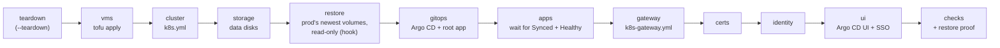
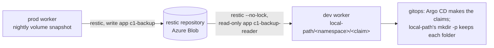

# Rebuild one cluster's Kubernetes layer with one command

**Status:** draft. `hosts/rebuild-k8s.sh` was written from the code on `main` on 2026-11-09 and has not been run. It is proven first with R1 (kubeadm by this repository's Ansible) on dev, twice, before it is used on prod.

This covers the Kubernetes layer only. The Proxmox host, OPNsense, the tailnet container, DNS and the backup target stay as they are (the owner's card, 2026-11-09 23:21 UTC). For those, and for the whole order from bare metal, see [Rebuild the home lab from bare metal](rebuild-home-lab-from-scratch.md).



On dev the stages are `vms cluster storage restore gitops apps gateway checks`: certs, identity and ui are left out (D-0028).

## Stages

| Stage | Runs | Notes |
|---|---|---|
| `teardown` | `tofu destroy` in `hosts/terraform/home/k8s` | only with `--teardown` |
| `vms` | `PRE_VMS_HOOK`, then `tofu apply` in the same folder | the hook re-adds the Proxmox `/vms` ACLs, which Proxmox removes on every destroy |
| `cluster` | `playbooks/k8s.yml` | |
| `storage` | `playbooks/k8s-storage.yml --tags disk` | the data disks only; Argo CD installs the provisioner |
| `restore` | `RESTORE_HOOK` | before `gitops`, so each restored folder is there when Argo CD makes its claim; required on dev ([Restore on dev](#restore-on-dev)); skipped on prod when unset |
| `gitops` | `playbooks/k8s-gitops.yml --tags install,source` | the inventory sets `k8s_gitops_source_enabled: true` |
| `apps` | waits until every Argo CD app is Synced and Healthy (`APPS_TIMEOUT`, default 1200 s) | see "Apps and auto-sync" |
| `gateway` | `playbooks/k8s-gateway.yml` | after `apps`: with `k8s_gateway_by_argocd: true`, Argo CD makes the Gateway and the playbook checks it |
| `certs` | `playbooks/k8s-certs.yml` | staging issuer on dev |
| `identity` | `playbooks/k8s-identity.yml` | throwaway users on dev |
| `ui` | `playbooks/k8s-gitops.yml --tags ui,sso` | |
| `backup` | `playbooks/k8s-backup.yml` | not in the default list; prod only, the script refuses it on dev |
| `checks` | nodes Ready, pods Running, apps Synced and Healthy, a second `k8s.yml` with `changed=0`, `tofu plan` with no changes, then `RESTORE_CHECK_HOOK` when `RESTORE_HOOK` is set | |

## Before you start

- The env folder exists on the controller, outside the repository, mode `0700`, and holds `rebuild.env` (mode `0600`). The script's header lists every variable; [hosts/rebuild.env.example](../../hosts/rebuild.env.example) is a dev one with made-up paths. For dev: `ENV_NAME=dev`, `VM_ID_MIN=250`, `VM_ID_MAX=257`, and a tfvars with `node_vnet = "dev"`. VM 258 and CT 259 are the jumpboxes, which stay (the owner, 2026-11-09 23:04 UTC), so the dev range stops at 257.
- No kubeconfig is needed on the controller, and none is copied there. Every `kubectl` call in the `apps` and `checks` stages runs on the env's first control-plane node through Ansible, with that node's `/etc/kubernetes/admin.conf`. Its output comes back through the `ansible.posix.json` callback, so `hosts/ansible/collections/` holds the collections from `requirements.yml` (`ansible-galaxy collection install -r requirements.yml -p ./collections`). A `KUBECONFIG` in `rebuild.env` is ignored.
- Every node `vm_id` in the tfvars sits in the env's range. The script stops before any stage if one does not.
- The env's inventory sets the values the root app needs. For dev:
  - `k8s_gitops_source_enabled: true`, or the `gitops` stage installs Argo CD with no root app.
  - `k8s_gitops_source_zone` and `k8s_gitops_source_gateway_address`: dev's zone and gateway address (private values).
  - `k8s_gitops_cluster_labels.env: dev`, so dev's Argo CD cluster labels don't say `prod`.
  - `k8s_lab_dns_points_here: false`: dev uses c1's names, and the lab's wildcard DNS still sends them to prod's Gateway, so the checks that a name resolves to this Gateway are skipped with a note (RB1 run 13 stopped there). The checks that call the Gateway by its address with a Host header still run.
- The env's inventory has a `proxmox` group, as c1's has. The `gateway` stage's smoke test runs its client from the first host in that group (`k8s_gateway_smoke_client`), and fails without it.
- The env's inventory hands every app to Argo CD, so no Ansible role applies the same objects: every `*_by_argocd` switch is `true` (`k8s_gateway_by_argocd`, `k8s_observability_grafana_route_by_argocd`, `k8s_observability_metrics_server_by_argocd`, `k8s_observability_logs_by_argocd`, `k8s_observability_metrics_by_argocd`, `k8s_storage_provisioner_by_argocd`, `k8s_jellyfin_by_argocd`, `k8s_secrets_by_argocd`, `k8s_certs_cert_manager_by_argocd`). For dev, `k8s_certs_issue` stays `false`, so the `certs` stage requests no certificate. With no certificate, dev's `k8s_gateway_https` is `false` too; `k8s_gitops_source_gateway_https` follows it, so the root app passes `gatewayHttps: false`: the gateway app makes only the HTTP listeners, and its routes and Jellyfin's serve plain HTTP (RB1 run 11 found the gateway Degraded on the missing Secret without this).
- The Mac has an allow rule for `hosts/rebuild-k8s.sh` ([Let agents run a new command](allow-a-command-for-agents.md)). The owner approves it.

## Steps

1. Run the script for the env.

   ```sh
   hosts/rebuild-k8s.sh <env-dir>              # build on what is there
   hosts/rebuild-k8s.sh <env-dir> --teardown   # destroy the env's VMs first, then build
   hosts/rebuild-k8s.sh <env-dir> --only checks
   ```

   why: one entry point runs every stage in the order the code needs and stops at the first that fails, so a rebuild is the same each time (spec draft, TASK-0220).
   ※ [Create the c1 node VMs](create-c1-node-vms.md), [Build cluster c1 with Ansible](build-c1-with-ansible.md), [Install Argo CD on c1](install-argo-cd-on-c1.md).
   expect: one `start` and one `end rc=0` line per stage in `<env-dir>/logs/rebuild-<UTC stamp>.log`, then `rebuild: all stages passed`. The full output is in the `.raw` file beside it.

2. Read the log's times into the run's worklog.

   why: the dev runs measure each stage, and two clean runs in a row are the proof.
   expect: every stage `rc=0`.

## Restore on dev

A dev rebuild proves the code with prod's data in it: the `restore` stage puts a read-only copy of prod's newest volume snapshot on dev's data disk (TASK-0240; the owner's card, 2026-11-10 02:50 UTC, and the owner's words of 2026-11-10 03:08 UTC that c1 holds no real data). Every part is agent pick 205 in [hosts/AGENT-PICKS.md](../../hosts/AGENT-PICKS.md).



What comes back: only `/var/lib/c1-data/local-path`, every app volume. Not etcd: dev's cluster is built from code, which is what is being proven, and prod's snapshot carries prod's certificates and node names. Not Keycloak's database: the identity stage doesn't run on dev (D-0028).

Why it works without fighting Argo CD: local-path names each volume's folder `<namespace>/<claim>` (its `pathPattern`, from upstream's README at v0.0.37), so a folder has the same name on prod and on every dev rebuild. The restore puts the folders in place before Argo CD exists; when Argo CD makes a claim, the provisioner's setup script runs `mkdir -m 0777 -p`, which keeps the folder and its files. Nothing is scaled down.

Read-only, twice over: dev's worker signs in as its own app registration, `c1-backup-reader`, which holds Storage Blob Data Reader on the backup container only, and every restic call runs with `--no-lock`, which restic needs to read a repository it can't write. Known limit: restic has no read-only keys, so dev's worker holds the repository password, as prod's nodes do. It is on the access register, and it is rotated with every other secret once the secrets store exists.

### Once, before the first dev restore

These run through the Mac lane, in this order. Nothing here needs the owner except where it says so.

1. Apply `hosts/terraform/azure/backup` ([Back up c1 off the box](back-up-c1-off-box.md), step A1). The plan adds 3 resources, the reader app, its service principal and its role, and changes nothing else. Note the outputs `reader_client_id` and `reader_app_object_id`.

   why: the reader identity is code, like the backup app.
   expect: `Plan: 3 to add, 0 to change, 0 to destroy.`

2. Move c1's volumes to the new folder names ([below](#move-c1s-volumes-to-the-new-folder-names)), then run one volume backup on prod: [Back up c1 off the box](back-up-c1-off-box.md), step 3.

   why: a snapshot taken before the move holds `pvc-<uid>_<namespace>_<claim>` folders, which no claim on dev would find. The restore stops on such a snapshot rather than guess a mapping.
   expect: the drill passes; `restic ls latest --host <prod worker> /var/lib/c1-data/local-path` lists `<namespace>` folders and no `pvc-` ones.

3. In dev's private inventory, under `k8s_nodes` `vars`, set:

   ```yaml
   k8s_backup_env_file: ~/.config/central-hub/c1-backup.env   # the same RESTIC_REPOSITORY and RESTIC_PASSWORD as prod
   k8s_backup_azure_identity: true
   k8s_backup_azure_account: <storage_account_name>
   k8s_backup_azure_client_id: <reader_client_id>
   k8s_backup_azure_tenant_id: <tenant_id>
   k8s_backup_azure_app_object_id: <reader_app_object_id>
   k8s_backup_restore_source_host: <prod worker's short host name, as restic snapshots lists it>
   ```

   Leave `k8s_backup_enabled` unset or `false`: `playbooks/k8s-restore.yml` refuses an inventory that turns the backup timers on, or whose `k8s_gitops_cluster_labels.env` is not `dev`.
   why: the reader app's IDs, never the backup app's, so dev can't write; the playbook also never makes the repository and runs no timer.

4. In dev's `rebuild.env`, set `STAGES`, `RESTORE_HOOK` and `RESTORE_CHECK_HOOK` as in [hosts/rebuild.env.example](../../hosts/rebuild.env.example).

### What the stage does and how it is proven

- `restore` runs `playbooks/k8s-restore.yml` on dev's workers: the backup tools, the node's own key and certificate (uploaded to the reader app the first time, as for prod's nodes), the env file, then `c1-restore-volumes.sh restore`. It restores the newest volume snapshot of `k8s_backup_restore_source_host` with `--verify`, then compares each `<namespace>/<claim>` folder's file count and bytes on disk with `restic ls` of the same snapshot, and the canary file with the snapshot's copy. Any mismatch fails the run. A node without its data disk mounted says `SKIP`; at least one node must restore. It never writes over a folder it didn't restore: a non-empty folder with no record stops it, and a second run on the same snapshot says `ALREADY` and does nothing.
- `checks` runs `RESTORE_CHECK_HOOK`, the same playbook with `--tags restore_check`, after the apps synced: each node's restore is still in place, `media/jellyfin` is rolled out with a Ready pod that mounts `jellyfin-config`, that claim's volume is the restored folder `local-path/media/jellyfin-config`, and the folder belongs to the Deployment's `runAsUser`.
- The run's `.log` gets the snapshot ID, the canary and one `folder <namespace>/<claim> <files> <bytes>` line per folder, so the run's worklog can quote them.

### Move c1's volumes to the new folder names

Once, on c1, after the PR that set `pathPattern` merged. The owner said c1 holds no real data and is "safe to destroy and rebuild, do anything" (2026-11-10 03:08 UTC), so this is an agent step. Every command runs on c1's control-plane node with its `admin.conf`, as the rebuild's `kc` does. For each claim, the folder keeps its files and only its name changes.

1. Delete the StorageClass, so Argo CD makes it again with `pathPattern`:

   ```sh
   kubectl delete storageclass local-path
   kubectl -n argocd get application local-path -o jsonpath='{.status.sync.status}{"\n"}'
   kubectl get storageclass local-path -o jsonpath='{.parameters.pathPattern}{"\n"}'
   ```

   why: a StorageClass's parameters can't change in place (Kubernetes rejects it: "updates to parameters are forbidden"), so Argo CD's sync of `local-path` fails until the old one is gone. Bound volumes don't depend on their StorageClass object.
   expect: `Synced`, then `{{ .PVC.Namespace }}/{{ .PVC.Name }}/`.

2. List the local-path volumes and their folders:

   ```sh
   kubectl get pv -o custom-columns=PV:.metadata.name,CLAIM:.spec.claimRef.namespace,NAME:.spec.claimRef.name,PATH:.spec.hostPath.path,SC:.spec.storageClassName | awk 'NR==1 || $5=="local-path"'
   ```

   expect: one line per claim, each `PATH` ending in `pvc-<uid>_<namespace>_<claim>`.

3. Pause syncing, so Argo CD's self-heal doesn't start the apps again mid-move: set `c1Project.syncPaused: true` in `hosts/kubernetes/home/c1/root/values.yaml` by PR, merge, and wait until the root app is Synced. Then scale every workload that mounts a local-path claim to 0 (`kubectl -n <namespace> scale deploy/<name> --replicas=0`, or `statefulset/<name>`).

   why: a folder must not change while its app writes to it, and the pause switch is the cluster's own way to hold Argo CD ([use-break-glass-access.md](use-break-glass-access.md)).
   expect: `kubectl get pods -A` shows none of those pods.

4. For each claim from step 2: delete the claim and its volume (reclaim policy `Retain` keeps the folder), then move the folder on the worker:

   ```sh
   kubectl -n <namespace> delete pvc <claim> --wait=false
   kubectl delete pv <pv>
   # on the worker:
   sudo mkdir -p /var/lib/c1-data/local-path/<namespace>
   sudo mv /var/lib/c1-data/local-path/pvc-<uid>_<namespace>_<claim> /var/lib/c1-data/local-path/<namespace>/<claim>
   ```

   A claim made by a StatefulSet's `volumeClaimTemplates` stays `Terminating` until its pod is gone, which step 3 did.
   expect: `/var/lib/c1-data/local-path` holds only `<namespace>` folders and `.central-hub-backup-canary`.

5. Set `c1Project.syncPaused: false` by PR and merge. Argo CD makes each claim again; local-path provisions it at `<namespace>/<claim>` and keeps the moved files. Scale the workloads back to their replicas from git (Argo CD's self-heal does it).

   expect: every app Synced and Healthy; each local-path PV's `PATH` is `/var/lib/c1-data/local-path/<namespace>/<claim>`.

If anything in a move goes wrong, c1 may instead start empty: delete the claims and the old folders and let Argo CD make new ones (the owner's words of 2026-11-10 03:08 UTC).

## Apps and auto-sync

On a fresh cluster, Argo CD installs an app only if its `autoSync` is on in `hosts/kubernetes/home/c1/root/values.yaml`. The owner chose auto-sync for every app (card, 2026-11-10 02:50 UTC). It is on for 8 of 12; `jellyfin`, `kube-prometheus-stack`, `local-path` and `secret-store` follow once their diffs on c1 are reconciled. Until then, the `apps` stage times out on a fresh cluster. `prune` stays off except for `monitoring-extras` and `alerts`. To leave the stage out, set `STAGES` in `rebuild.env`.

## If it fails

- The script prints the stage, its `rc` and the last 20 lines of the `.raw` file. Fix the cause, then run again from that stage with `--only <stage>,<next>,...`.
- `vm_id ... is outside` or `a dev run needs node_vnet`: the tfvars is for the wrong env. Nothing has run.
- On dev, `--teardown` puts the env back to empty. On prod, stop and tell the owner before any teardown.
- `restore` fails with `taken before local-path's pathPattern change`: prod's newest snapshot is from before the move. Do [Once, before the first dev restore](#once-before-the-first-dev-restore), step 2.
- `restore` fails with `is not empty and holds no recorded restore`: dev's data disk holds data this restore didn't put there. Run again with `--teardown`.
- `restore` fails with `AuthorizationFailure` or `AADSTS700027`: the reader app's role or its certificate isn't in effect yet; see [Back up c1 off the box](back-up-c1-off-box.md), "If it fails".
- `checks` fails on the restore proof: its message names the claim, the folder the volume uses and the folder the restore made. A volume at a `pvc-...` folder means the StorageClass in the env has no `pathPattern`.

## Afterwards

Set `last-tested` after a clean run, and `status: tested` after two clean runs in a row on dev. Keep the logs with the run's worklog in the agent notebook.

## Related

- [Rebuild the home lab from bare metal](rebuild-home-lab-from-scratch.md): the whole order, including the layers this script leaves alone.
- [Move c1's volume provisioner to Argo CD](move-local-path-to-argo-cd.md): why `storage` runs only the `disk` tag.
- [D-0012](../decisions/0012-sort-docs-by-kind-of-document.md): runbook format.
