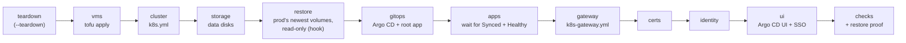
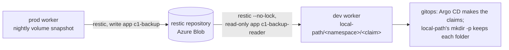

# Rebuild one cluster's Kubernetes layer with one command

**Status:** tested. `hosts/rebuild-k8s.sh` was written from the code on `main` on 2026-11-09. It was proven on dev from the agent box with two clean `rebuild rebuild` runs in a row on 2026-11-13 (see Proven runs). Prod has not been rebuilt with it. D-0012 also expects an automated runbook to link a `tested` manual one: [Rebuild the home lab from scratch](rebuild-home-lab-from-scratch.md) is still `draft`, so that link is not yet to a `tested` runbook.

This covers the Kubernetes layer only. The Proxmox host, OPNsense, the tailnet container, DNS and the backup target stay as they are (the owner's card, 2026-11-09 23:21 UTC). For those, and for the whole order from bare metal, see [Rebuild the home lab from bare metal](rebuild-home-lab-from-scratch.md).



On dev the stages are `preflight vms cluster storage restore gitops secrets apps gateway checks`, then `dev-ca` and `identity-keycloak` (below): certs, identity and ui as prod runs them are left out (D-0028). `secrets` seeds namespace `secret-source` from `SECRET_SOURCE_FILE` (`playbooks/k8s-secret-source.yml`, [seed-secret-source.md](seed-secret-source.md)) after Argo CD makes it and before `apps` waits on the ExternalSecrets that read it; unset, the stage is skipped. The agent box makes its own dev file once, with random values, and never prints it. The wrapper's `STAGES` is the default list, not a limit: `hosts/rebuild-k8s.sh` may add dev-only stages after it, as it does with these two, and each refuses any env but dev (`test_rebuild_dev_stages.sh`). `dev-ca` stops with a clear message when the `k8s_certs` role has no `devca` tag.

`openbao` (proposed D-0038) runs after `secrets` and before `apps`. A rebuilt cluster signs its service-account tokens with a new key, so External Secrets can't sign in at the secrets store until the store knows that key. The stage reads the key (`/etc/kubernetes/pki/sa.pub`, the public half) and the token issuer on the first control-plane node, and writes them to the store's `auth/jwt-c1/config` through the AppRole `rebuild`, which can write that one path and nothing else (`playbooks/k8s-openbao-auth.yml`). It needs `OPENBAO_ADDR`, `OPENBAO_CACERT`, `OPENBAO_ROLE_ID_FILE` and `OPENBAO_SECRET_ID_FILE` in `rebuild.env`; with `OPENBAO_ADDR` unset it is skipped. The store side is [set-up-the-secrets-store.md](set-up-the-secrets-store.md). Not yet run on the lab. The agent box's `rebuild` adds `openbao` after `secrets`, and sets those four from its own files, once `secrets-store configure` has made the AppRole `rebuild`'s IDs in `/etc/agent-keys/dev/`; It also hands the store's address and certificate to Argo CD's root Application (`k8s_gitops_source_openbao_address` and `_ca_file`), so dev's secret-store app adds store `openbao` and its test ExternalSecret `openbao-check`, which `apps` then waits for. Before that it leaves all of it out.

## Stages

| Stage | Runs | Notes |
|---|---|---|
| `teardown` | `tofu destroy` in `hosts/terraform/home/k8s` | only with `--teardown` |
| `preflight` | reads the Proxmox node's memory with the stage-`vms` token (`/nodes/<node>/status`) | dev only, added to every dev run after a `--teardown` and before `vms`: refuses below `PREFLIGHT_MIN_FREE_MIB` (default 14336 MiB, 12 GiB plus a 2 GiB margin) and refuses when the memory can't be read; prints sizes only, never the token |
| `vms` | `PRE_VMS_HOOK`, then `tofu apply` in the same folder | the hook re-adds the Proxmox `/vms` ACLs, which Proxmox removes on every destroy |
| `cluster` | waits until every node takes an ssh login (`SSH_TIMEOUT`, default 300 s), then `playbooks/k8s.yml` | `vms` returns when the guests exist, not when sshd answers |
| `storage` | `playbooks/k8s-storage.yml --tags disk` | the data disks only; Argo CD installs the provisioner |
| `restore` | `RESTORE_HOOK` | before `gitops`, so each restored folder is there when Argo CD makes its claim; required on dev ([Restore on dev](#restore-on-dev)); skipped on prod when unset |
| `gitops` | `playbooks/k8s-gitops.yml --tags install,source` | the inventory sets `k8s_gitops_source_enabled: true` |
| `apps` | waits until every Argo CD app is Synced and Healthy (`APPS_TIMEOUT`, default 1200 s), then on dev only re-reads every ExternalSecret and waits for each to be Ready, then for ntfy and Alertmanager's pod to be Ready (`SECRETS_TIMEOUT`, default 300 s each; the failure names what is not Ready) | see "Apps and auto-sync" |
| `gateway` | `playbooks/k8s-gateway.yml` | after `apps`: with `k8s_gateway_by_argocd: true`, Argo CD makes the Gateway and the playbook checks it |
| `certs` | `playbooks/k8s-certs.yml` | staging issuer on dev |
| `identity` | `playbooks/k8s-identity.yml` | throwaway users on dev |
| `dev-ca` | `playbooks/k8s-certs.yml --tags devca -e k8s_certs_dev_ca=true` | dev only, added to every dev run after `checks`: a throwaway CA made by cert-manager in the cluster and the Gateway's wildcard certificate from it, so dev has HTTPS with no prod secret. The sign-in proof does not verify it (`dev-ca` is untrusted by design) |
| `identity-keycloak` | `playbooks/k8s-identity.yml --tags all,signin` with `k8s_identity_owner_username=dev-admin`, no extra users and `k8s_app_route_proof=false` and no sign-in theme (`k8s_identity_theme_dir` empty: Keycloak's own look, since the theme folder is the owner's private checkout) | dev only, added to every dev run after `dev-ca`: the whole identity role, then the sign-in proof: the password alone stops at the one-time-code form, the password with a code computed from the dev admin's seed redirects back to Grafana's client with a code (the log has step names and HTTP codes only). Every secret is random and made in `identity.env` inside the dev env folder (passed as `k8s_identity_values_file`, so no prod file is read whichever machine runs it); the route's by-name proof is off because dev's names resolve to prod's Gateway, and the proof goes to this cluster's own Gateway address |
| `ui` | `playbooks/k8s-gitops.yml --tags ui,sso` | |
| `backup` | `playbooks/k8s-backup.yml` | not in the default list; prod only, the script refuses it on dev |
| `checks` | nodes Ready, pods Running, apps Synced and Healthy, a second `k8s.yml` with `changed=0`, `tofu plan` with no changes, then `RESTORE_CHECK_HOOK` when `RESTORE_HOOK` is set | |

## Before you start

- The env folder exists on the controller, outside the repository, mode `0700`, and holds `rebuild.env` (mode `0600`). The script's header lists every variable; [hosts/rebuild.env.example](../../hosts/rebuild.env.example) is a dev one with made-up paths. For dev: `ENV_NAME=dev`, `VM_ID_MIN=250`, `VM_ID_MAX=257`, and a tfvars with `node_vnet = "dev"`. VM 258 and CT 259 are the jumpboxes, which stay (the owner, 2026-11-09 23:04 UTC), so the dev range stops at 257.
- No kubeconfig is needed on the controller, and none is copied there. Every `kubectl` call in the `apps` and `checks` stages runs on the env's first control-plane node through Ansible, with that node's `/etc/kubernetes/admin.conf`. Its output comes back through the `ansible.posix.json` callback, so `hosts/ansible/collections/` holds the collections from `requirements.yml` (`ansible-galaxy collection install -r requirements.yml -p ./collections`). A `KUBECONFIG` in `rebuild.env` is ignored.
- Every node `vm_id` in the tfvars sits in the env's range. The script stops before any stage if one does not.
- The env's inventory sets the values the root app needs. For dev:
  - `k8s_gitops_source_enabled: true`, or the `gitops` stage installs Argo CD with no root app.
  - `k8s_gitops_source_zone` and `k8s_gitops_source_gateway_address`: dev's zone and gateway address (private values).
  - `k8s_gitops_cluster_labels.env: dev`, so dev's Argo CD cluster labels don't say `prod`.
  - `k8s_lab_dns_points_here: false`: dev uses c1's names, and the lab's wildcard DNS still sends them to prod's Gateway, so the checks that a name resolves to this Gateway are skipped with a note (RB1 run 13 stopped there). The checks that call the Gateway by its address with a Host header still run.
- The env's inventory has a `proxmox` group, as c1's has. The `gateway` stage's smoke test runs its client from the first host in that group (`k8s_gateway_smoke_client`), and fails without it.
- The env's inventory hands every app to Argo CD, so no Ansible role applies the same objects: every `*_by_argocd` switch is `true` (`k8s_gateway_by_argocd`, `k8s_observability_grafana_route_by_argocd`, `k8s_observability_metrics_server_by_argocd`, `k8s_observability_logs_by_argocd`, `k8s_observability_metrics_by_argocd`, `k8s_storage_provisioner_by_argocd`, `k8s_jellyfin_by_argocd`, `k8s_secrets_by_argocd`, `k8s_certs_cert_manager_by_argocd`). For dev, `k8s_certs_issue` stays `false`, so the `certs` stage requests no certificate. With no certificate, dev's `k8s_gateway_https` is `false` too; `k8s_gitops_source_gateway_https` follows it, so the root app passes `gatewayHttps: false`: the gateway app makes only the HTTP listeners, and its routes and Jellyfin's serve plain HTTP (RB1 run 11 found the gateway Degraded on the missing Secret without this).
- The Mac has an allow rule for `hosts/rebuild-k8s.sh` ([Let agents run a new command](allow-a-command-for-agents.md)). The owner approves it.

## Steps

1. Run the script for the env.

   ```sh
   hosts/rebuild-k8s.sh <env-dir>              # build on what is there
   hosts/rebuild-k8s.sh <env-dir> --teardown   # destroy the env's VMs first, then build
   hosts/rebuild-k8s.sh <env-dir> --only checks
   ```

   why: one entry point runs every stage in the order the code needs and stops at the first that fails, so a rebuild is the same each time (spec draft, TASK-0220).
   ※ [Create the c1 node VMs](create-c1-node-vms.md), [Build cluster c1 with Ansible](build-c1-with-ansible.md), [Install Argo CD on c1](install-argo-cd-on-c1.md).
   expect: one `start` and one `end rc=0` line per stage in `<env-dir>/logs/rebuild-<UTC stamp>.log`, then `rebuild: all stages passed`. The full output is in the `.raw` file beside it.

2. Read the log's times into the run's worklog.

   why: the dev runs measure each stage, and two clean runs in a row are the proof.
   expect: every stage `rc=0`.

## Restore on dev

A dev rebuild proves the code with prod's data in it: the `restore` stage puts a read-only copy of prod's newest volume snapshot on dev's data disk (TASK-0240; the owner's card, 2026-11-10 02:50 UTC, and the owner's words of 2026-11-10 03:08 UTC that c1 holds no real data). Every part is agent pick 205 in [hosts/AGENT-PICKS.md](../../hosts/AGENT-PICKS.md).



What comes back: only `/var/lib/c1-data/local-path`, every app volume. Not etcd: dev's cluster is built from code, which is what is being proven, and prod's snapshot carries prod's certificates and node names. Keycloak's database is not restored into a running Keycloak, because the identity stage doesn't run on dev (D-0028). The checks stage proves its dump instead ([below](#keycloaks-database-on-dev)).

Why it works without fighting Argo CD: on dev, local-path names each volume's folder `<namespace>/<claim>` (its `pathPattern`, from upstream's README at v0.0.37), so a folder has the same name on every dev rebuild. The restore puts the folders in place before Argo CD exists; when Argo CD makes a claim, the provisioner's setup script runs `mkdir -m 0777 -p`, which keeps the folder and its files. Nothing is scaled down.

c1 needs no change for this. It keeps upstream's folder names, `pvc-<uid>_<namespace>_<claim>`, and the restore maps each one to `<namespace>/<claim>` itself: namespaces, claim names and `pvc-<uid>` are DNS names with no `_`, so each name splits into exactly those three parts. A folder already named `<namespace>/<claim>` passes through. Any other name, or two folders for the same claim (a deleted claim's folder kept by reclaim policy `Retain`), stops the restore before it writes anything. The switch that turns `pathPattern` on is per cluster and off by default: `k8s_gitops_source_local_path_stable_folders` (root value `localPathStableFolders`, chart value `storageClass.stableFolders`). c1 leaves it off, because a StorageClass's parameters can't change in place; a rebuilt c1 may turn it on.

Read-only, twice over: dev's worker signs in as its own app registration, `c1-backup-reader`, which holds Storage Blob Data Reader on the backup container only, and every restic call runs with `--no-lock`, which restic needs to read a repository it can't write. Known limit: restic has no read-only keys, so dev's worker holds the repository password, as prod's nodes do. It is on the access register, and it is rotated with every other secret once the secrets store exists.

### Once, before the first dev restore

These run through the Mac lane, in this order. Nothing here needs the owner except where it says so.

1. Apply `hosts/terraform/azure/backup` ([Back up c1 off the box](back-up-c1-off-box.md), step A1). The plan adds 3 resources, the reader app, its service principal and its role, and changes nothing else. Note the outputs `reader_client_id` and `reader_app_object_id`.

   why: the reader identity is code, like the backup app.
   expect: `Plan: 3 to add, 0 to change, 0 to destroy.`

2. Check that prod has a volume snapshot of its worker: [Back up c1 off the box](back-up-c1-off-box.md), step 4. If the newest is older than you want on dev, run one backup first (step 3 there).

   why: dev restores the newest volume snapshot of `k8s_backup_restore_source_host`, as it is.
   expect: a snapshot tagged `volumes` for the prod worker.

3. In dev's private inventory, under `k8s_nodes` `vars`, set:

   ```yaml
   k8s_backup_env_file: ~/.config/central-hub/c1-backup.env   # the same RESTIC_REPOSITORY and RESTIC_PASSWORD as prod
   k8s_backup_azure_identity: true
   k8s_backup_azure_account: <storage_account_name>
   k8s_backup_azure_client_id: <reader_client_id>
   k8s_backup_azure_tenant_id: <tenant_id>
   k8s_backup_azure_app_object_id: <reader_app_object_id>
   k8s_backup_restore_source_host: <prod worker's short host name, as restic snapshots lists it>
   k8s_gitops_source_local_path_stable_folders: true
   ```

   Optional, for a controller with no Azure sign-in (the agent box): also set `k8s_backup_azure_fixed_cert_file` to the path of one PEM file (key and certificate) that the reader app already knows. The nodes then copy that file instead of making their own, and nothing is uploaded to or removed from the app. The certificate's expiry is the one date to renew by hand.

   Leave `k8s_backup_enabled` unset or `false`: `playbooks/k8s-restore.yml` refuses an inventory that turns the backup timers on, or whose `k8s_gitops_cluster_labels.env` is not `dev`.
   why: the reader app's IDs, never the backup app's, so dev can't write; the playbook also never makes the repository and runs no timer. The last line gives dev's local-path the `<namespace>/<claim>` folder names, so its claims find the restored folders.

4. In dev's `rebuild.env`, set `STAGES`, `RESTORE_HOOK` and `RESTORE_CHECK_HOOK` as in [hosts/rebuild.env.example](../../hosts/rebuild.env.example).

### What the stage does and how it is proven

- `restore` runs `playbooks/k8s-restore.yml` on dev's workers: the backup tools, the node's own key and certificate (uploaded to the reader app the first time, as for prod's nodes), the env file, then `c1-restore-volumes.sh restore`. It maps each folder in the newest volume snapshot of `k8s_backup_restore_source_host` to `<namespace>/<claim>` (and stops on a name it can't map or two folders for one claim), restores the snapshot with `--verify` into a staging folder on the same disk, renames each folder into place (logged as `mapped <from> -> <to>`), then compares each `<namespace>/<claim>` folder's file count and bytes on disk with `restic ls` of the same snapshot, and the canary file with the snapshot's copy. Any mismatch fails the run. A node without its data disk mounted says `SKIP`; at least one node must restore. It never writes over a folder it didn't restore: a non-empty folder with no record stops it, and a second run on the same snapshot says `ALREADY` and does nothing.
- `checks` runs `RESTORE_CHECK_HOOK`, the same playbook with `--tags restore_check`, after the apps synced: each node's restore is still in place, `media/jellyfin` is rolled out with a Ready pod that mounts `jellyfin-config`, that claim's volume is the restored folder `local-path/media/jellyfin-config`, the folder's own owner and mode equal its copy in the restored snapshot (most of prod's are `0:0 777` as local-path makes them, Grafana's `472:472`), it is not empty, and every entry directly inside it belongs to the Deployment's `runAsUser`.
- `checks` also proves Keycloak's database ([below](#keycloaks-database-on-dev)).
- The run's `.log` gets the snapshot ID, the canary and one `folder <namespace>/<claim> <files> <bytes>` line per folder, so the run's worklog can quote them.

### Keycloak's database on dev

After a real loss, prod comes back by [Back up c1 off the box](back-up-c1-off-box.md), "Restore Keycloak's database": the identity stage makes an empty Keycloak, and its `pg_dumpall` dump from the newest snapshot is loaded into it. The checks stage proves that path on prod's own data, without the identity stage, certificates or sign-in on dev (the owner's card of 2026-11-10 10:11 UTC; the Plan thread's option C; agent pick 206):

1. A throwaway namespace, `restore-check-identity`, with one PostgreSQL pod from role `k8s_identity`'s image on the first worker, its account's password made on the control-plane node and never read back. No Service, Ingress or route; a NetworkPolicy lets only the Keycloak pod reach it.
2. `c1-restore-identity.sh load` on that worker brings the dump back with `restic dump --no-lock` from the same snapshot the volume restore used, checks its size and its end line, counts the rows of `realm`, `user_entity` and `client` in it, then does the runbook's step 3 through `crictl exec`: drop `keycloak`, load the whole dump. The counts in the database must equal the dump's.
3. A pod of the pinned Keycloak, the image role `k8s_identity`'s operator runs, starts on that database over plain HTTP with nothing reaching it. It must turn Ready (`/health/ready`), which it does only once it opened the database and its schema checks passed.
4. `c1-restore-identity.sh recount`: the counts are still the dump's.
5. Always, pass or fail: the namespace is deleted, the manifests and the counts are removed, and the run fails if any of that doesn't finish.

The dump holds prod's realm, its client secrets and its users' password hashes. It lives only in a mode-0700 folder for the minutes `load` takes, the log carries counts only, and its stay on dev is on the access register. Not proven here: the operator's wiring and a sign-in through Entra, which knows only prod's address.

## Apps and auto-sync

On a fresh cluster, Argo CD installs an app only if its `autoSync` is on in `hosts/kubernetes/home/c1/root/values.yaml`. The owner chose auto-sync for every app (card, 2026-11-10 02:50 UTC). It is on for 8 of 12; `jellyfin`, `kube-prometheus-stack`, `local-path` and `secret-store` follow once their diffs on c1 are reconciled. Until then, the `apps` stage times out on a fresh cluster. `prune` stays off except for `monitoring-extras` and `alerts`. To leave the stage out, set `STAGES` in `rebuild.env`.

## If it fails

- The script prints the stage, its `rc` and the last 20 lines of the `.raw` file. Fix the cause, then run again from that stage with `--only <stage>,<next>,...`.
- `vm_id ... is outside` or `a dev run needs node_vnet`: the tfvars is for the wrong env. Nothing has run.
- On dev, `--teardown` puts the env back to empty. On prod, stop and tell the owner before any teardown.
- `restore` fails with `can't be mapped`, `UNKNOWN` or `DUPLICATE`: prod's snapshot holds a folder that is not a volume, or two folders for one claim (a deleted claim's folder, kept by `Retain`). The message names them. Nothing was written. Remove the stray folder on prod, run one volume backup, and run again.
- `restore` fails with `is not empty and holds no recorded restore`: dev's data disk holds data this restore didn't put there. Run again with `--teardown`.
- `restore` fails with `AuthorizationFailure` or `AADSTS700027`: the reader app's role or its certificate isn't in effect yet; see [Back up c1 off the box](back-up-c1-off-box.md), "If it fails".
- `checks` fails at `identity`: the message says which step. `has no dump`: prod's snapshot of that host holds no Keycloak dump (the node that runs `sso-postgres-0` is another host). `cut short` or a count that differs: the dump or the load lost rows; the backup's own restore test checks the same dump weekly. `keycloak` not Ready: the pods' states are printed (never their logs, which can quote the realm); a Keycloak version that can't open the dump fails here. The namespace is deleted either way.
- `checks` fails with `its copy in snapshot` or `not owned by uid`: the restored folder or an entry in it has another owner or mode than the app needs or prod had. The message names each one.
- `checks` fails on the restore proof: its message names the claim, the folder the volume uses and the folder the restore made. A volume at a `pvc-...` folder means dev's StorageClass has no `pathPattern`: set `k8s_gitops_source_local_path_stable_folders: true` in dev's inventory, run `--teardown`, and rebuild (the parameter can't change in place).

## Proven runs

- 2026-11-12, the agent box (`rebuild up`, one run), central-hub `7e3e182`, dev: all eight stages passed. `vms` 1s (the nodes already existed from an earlier run), `cluster` 181s, `storage` 7s, `restore` 43s, `gitops` 55s, `apps` 196s, `gateway` 20s, `checks` 172s; 11 minutes in all, exit 0. Earlier runs from the box failed at faults now fixed in the wrapper, the inventory copy or the roles: the clone of template 9000 (the agents' token may clone only 9001), the pool (it may not add a guest to one) and the Mac's path for the Secrets-at-rest key.
- 2026-11-13, the agent box (`rebuild rebuild`, one command, no step on the Mac after the teardown), central-hub `0c7136f`, dev, run `20261113T084245Z`: all ten stages (`teardown` and the nine after it) passed in 14.4 minutes (08:42:45 to 08:57:06 UTC), exit 0. `teardown` 18s, `vms` 38s, `cluster` 293s, `storage` 6s, `restore` 47s, `gitops` 54s, `secrets` 46s, `apps` 172s, `gateway` 20s, `checks` 167s. Earlier runs found four faults, one at a time, now fixed: `apps` stayed Degraded because `ntfy-auth` and `alertmanager-ntfy` read three Secrets from namespace `secret-source` and a rebuild never seeded it (the `secrets` stage, #227); `checks` failed because ESO retries a failed read with a growing backoff, so `apps` now re-reads every ExternalSecret and waits for it and for the pods that mount them (#230); the next teardown left the agents' token without rights on the new VMs, so dev VMs go into pool `dev` and the rights sit on the pool (#231); and `cluster` failed in 0s on "Connection refused" because `vms` returns before sshd answers, so `cluster` waits for ssh first (#232). A `rebuild up` on the freshly made VMs of the run before it (central-hub `59d39c3`, run `20261113T082844Z`) also passed every stage: `cluster` 283s, `apps` 170s, `checks` 188s.
- 2026-11-13, the agent box (`rebuild rebuild`, one command, no step on the Mac after the teardown), central-hub `8861d3d`, dev, run `20261113T085920Z`: all ten stages (`teardown` and the nine after it) passed in 14.4 minutes (08:59:20 to 09:13:43 UTC), exit 0. `teardown` 20s, `vms` 37s, `cluster` 294s, `storage` 7s, `restore` 46s, `gitops` 56s, `secrets` 45s, `apps` 170s, `gateway` 20s, `checks` 168s. Nothing was changed or rerun between this run and the one before it except that main moved by docs and the `c1-read` wrapper (#221 and #226).
- What the restore covered: `restore` brings back only the local-path app volumes (see "Restore on dev"). Keycloak's database was not loaded into a running Keycloak; `checks` loads prod's dump into a throwaway PostgreSQL and starts the pinned Keycloak on it, then deletes both. That check is on by default and `checks` returned 0. The box's `rebuild log` (added after the run) prints that run's `PASS` lines: every stage passed, and the pinned Keycloak 26.8.1 became Ready on prod's dump with 2 realms, 2 users and 17 clients.
- Two clean runs in a row (`20261113T084245Z` and `20261113T085920Z`), so `status` is `tested`. Dev only: a prod rebuild also runs `certs`, `identity` and `ui`, which no run here has covered.

## Afterwards

Set `last-tested` after a clean run, and `status: tested` after two clean runs in a row on dev. Keep the logs with the run's worklog in the agent notebook.

## Related

- [Rebuild the home lab from bare metal](rebuild-home-lab-from-scratch.md): the whole order, including the layers this script leaves alone.
- [Move c1's volume provisioner to Argo CD](move-local-path-to-argo-cd.md): why `storage` runs only the `disk` tag.
- [D-0012](../decisions/0012-sort-docs-by-kind-of-document.md): runbook format.
