# Rebuild one cluster's Kubernetes layer with one command

**Status:** draft. `hosts/rebuild-k8s.sh` was written from the code on `main` on 2026-11-09 and has not been run. It is proven first with R1 (kubeadm by this repository's Ansible) on dev, twice, before it is used on prod.

This covers the Kubernetes layer only. The Proxmox host, OPNsense, the tailnet container, DNS and the backup target stay as they are (the owner's card, 2026-11-09 23:21 UTC). For those, and for the whole order from bare metal, see [Rebuild the home lab from bare metal](rebuild-home-lab-from-scratch.md).

```mermaid
flowchart LR
  td["teardown<br/>(--teardown)"] --> vms["vms<br/>tofu apply"] --> cl["cluster<br/>k8s.yml"] --> st["storage<br/>data disks"]
  st --> go["gitops<br/>Argo CD + root app"] --> ap["apps<br/>wait for Synced + Healthy"] --> gw["gateway<br/>k8s-gateway.yml"]
  gw --> ce["certs"] --> id["identity"] --> ui["ui<br/>Argo CD UI + SSO"] --> re["restore<br/>(hook)"] --> ck["checks"]
```



## Stages

| Stage | Runs | Notes |
|---|---|---|
| `teardown` | `tofu destroy` in `hosts/terraform/home/k8s` | only with `--teardown` |
| `vms` | `PRE_VMS_HOOK`, then `tofu apply` in the same folder | the hook re-adds the Proxmox `/vms` ACLs, which Proxmox removes on every destroy |
| `cluster` | `playbooks/k8s.yml` | |
| `storage` | `playbooks/k8s-storage.yml --tags disk` | the data disks only; Argo CD installs the provisioner |
| `gitops` | `playbooks/k8s-gitops.yml --tags install,source` | the inventory sets `k8s_gitops_source_enabled: true` |
| `apps` | waits until every Argo CD app is Synced and Healthy (`APPS_TIMEOUT`, default 1200 s) | see "Apps and auto-sync" |
| `gateway` | `playbooks/k8s-gateway.yml` | after `apps`: with `k8s_gateway_by_argocd: true`, Argo CD makes the Gateway and the playbook checks it |
| `certs` | `playbooks/k8s-certs.yml` | staging issuer on dev |
| `identity` | `playbooks/k8s-identity.yml` | throwaway users on dev |
| `ui` | `playbooks/k8s-gitops.yml --tags ui,sso` | |
| `backup` | `playbooks/k8s-backup.yml` | not in the default list; prod only, the script refuses it on dev |
| `restore` | `RESTORE_HOOK` | skipped when the hook is unset |
| `checks` | nodes Ready, pods Running, apps Synced and Healthy, a second `k8s.yml` with `changed=0`, `tofu plan` with no changes | |

## Before you start

- The env folder exists on the controller, outside the repository, mode `0700`, and holds `rebuild.env` (mode `0600`). The script's header lists every variable. For dev: `ENV_NAME=dev`, `VM_ID_MIN=250`, `VM_ID_MAX=257`, and a tfvars with `node_vnet = "dev"`. VM 258 and CT 259 are the jumpboxes, which stay (the owner, 2026-11-09 23:04 UTC), so the dev range stops at 257.
- No kubeconfig is needed on the controller, and none is copied there. Every `kubectl` call in the `apps` and `checks` stages runs on the env's first control-plane node through Ansible, with that node's `/etc/kubernetes/admin.conf`. Its output comes back through the `ansible.posix.json` callback, so `hosts/ansible/collections/` holds the collections from `requirements.yml` (`ansible-galaxy collection install -r requirements.yml -p ./collections`). A `KUBECONFIG` in `rebuild.env` is ignored.
- Every node `vm_id` in the tfvars sits in the env's range. The script stops before any stage if one does not.
- The env's inventory sets the values the root app needs. For dev:
  - `k8s_gitops_source_enabled: true`, or the `gitops` stage installs Argo CD with no root app.
  - `k8s_gitops_source_zone` and `k8s_gitops_source_gateway_address`: dev's zone and gateway address (private values).
  - `k8s_gitops_cluster_labels.env: dev`, so dev's Argo CD cluster labels don't say `prod`.
- The env's inventory has a `proxmox` group, as c1's has. The `gateway` stage's smoke test runs its client from the first host in that group (`k8s_gateway_smoke_client`), and fails without it.
- The env's inventory hands every app to Argo CD, so no Ansible role applies the same objects: every `*_by_argocd` switch is `true` (`k8s_gateway_by_argocd`, `k8s_observability_grafana_route_by_argocd`, `k8s_observability_metrics_server_by_argocd`, `k8s_observability_logs_by_argocd`, `k8s_observability_metrics_by_argocd`, `k8s_storage_provisioner_by_argocd`, `k8s_jellyfin_by_argocd`, `k8s_secrets_by_argocd`, `k8s_certs_cert_manager_by_argocd`). For dev, `k8s_certs_issue` stays `false`, so the `certs` stage requests no certificate. With no certificate, dev's `k8s_gateway_https` is `false` too; `k8s_gitops_source_gateway_https` follows it, so the root app passes `gatewayHttps: false` and the gateway app makes only the HTTP listeners, and its routes serve plain HTTP (RB1 run 11 found the gateway Degraded on the missing Secret without this).
- The Mac has an allow rule for `hosts/rebuild-k8s.sh` ([Let agents run a new command](allow-a-command-for-agents.md)). The owner approves it.

## Steps

1. Run the script for the env.

   ```sh
   hosts/rebuild-k8s.sh <env-dir>              # build on what is there
   hosts/rebuild-k8s.sh <env-dir> --teardown   # destroy the env's VMs first, then build
   hosts/rebuild-k8s.sh <env-dir> --only checks
   ```

   why: one entry point runs every stage in the order the code needs and stops at the first that fails, so a rebuild is the same each time (spec draft, TASK-0220).
   ※ [Create the c1 node VMs](create-c1-node-vms.md), [Build cluster c1 with Ansible](build-c1-with-ansible.md), [Install Argo CD on c1](install-argo-cd-on-c1.md).
   expect: one `start` and one `end rc=0` line per stage in `<env-dir>/logs/rebuild-<UTC stamp>.log`, then `rebuild: all stages passed`. The full output is in the `.raw` file beside it.

2. Read the log's times into the run's worklog.

   why: the dev runs measure each stage, and two clean runs in a row are the proof.
   expect: every stage `rc=0`.

## Apps and auto-sync

On a fresh cluster, Argo CD installs an app only if its `autoSync` is on in `hosts/kubernetes/home/c1/root/values.yaml`. The owner chose auto-sync for every app (card, 2026-11-10 02:50 UTC). It is on for 8 of 12; `jellyfin`, `kube-prometheus-stack`, `local-path` and `secret-store` follow once their diffs on c1 are reconciled. Until then, the `apps` stage times out on a fresh cluster. `prune` stays off except for `monitoring-extras` and `alerts`. To leave the stage out, set `STAGES` in `rebuild.env`.

## If it fails

- The script prints the stage, its `rc` and the last 20 lines of the `.raw` file. Fix the cause, then run again from that stage with `--only <stage>,<next>,...`.
- `vm_id ... is outside` or `a dev run needs node_vnet`: the tfvars is for the wrong env. Nothing has run.
- On dev, `--teardown` puts the env back to empty. On prod, stop and tell the owner before any teardown.

## Afterwards

Set `last-tested` after a clean run, and `status: tested` after two clean runs in a row on dev. Keep the logs with the run's worklog in the agent notebook.

## Related

- [Rebuild the home lab from bare metal](rebuild-home-lab-from-scratch.md): the whole order, including the layers this script leaves alone.
- [Move c1's volume provisioner to Argo CD](move-local-path-to-argo-cd.md): why `storage` runs only the `disk` tag.
- [D-0012](../decisions/0012-sort-docs-by-kind-of-document.md): runbook format.
