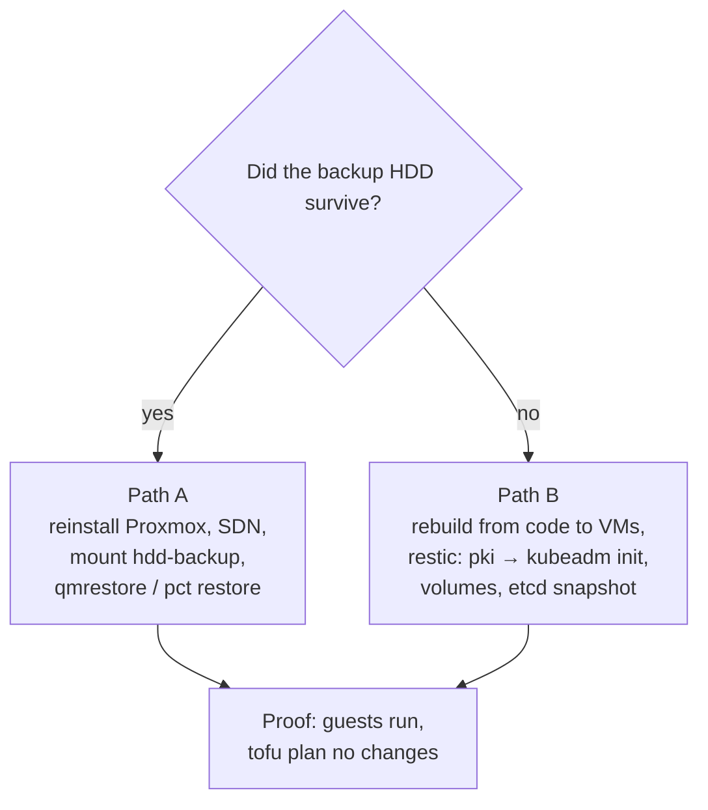

# Restore the home lab from its backups

**Status:** draft, written on 2026-11-08 from the backup code on `main` (role `proxmox_backup`), PR #68 (role `k8s_backup`, runbooks `back-up-c1-off-box.md` and `test-etcd-restore.md`) and the Proxmox docs named in each step. No part of it has been run. Path B in particular joins steps that are each written down elsewhere (the etcd restore, tested in CI against a scratch etcd; `kubeadm init` over kept CA files, in the by-hand runbook's step 11) but have never run together.

The lab keeps two copies ([Rebuild the home lab, Backups and restore](rebuild-home-lab-from-scratch.md#backups-and-restore)):

| Copy | What | Where | Made by |
|---|---|---|---|
| Whole guests | VMs 100, 200, 201 and CT 900, disks and config, daily at 03:00, keep-last 3, keep-daily 7 | storage `hdd-backup`, an HDD in the same PC | `proxmox_backup`, job `nightly-guests` |
| c1's data | etcd snapshot with `/etc/kubernetes/pki`, the static pod manifests and `kubeadm-config`, nightly; every volume folder, nightly | the off-box restic repository | `k8s_backup` (PR #68) |



Agent pick: path A first whenever the HDD survived, because one archive brings back a whole guest with its data disk, the secrets-at-rest key on the node and everything c1 had, with no Kubernetes steps.

## Before you start

- Decide which path. On a host that still boots, `pvesm list hdd-backup` lists archives: path A. If the host boots but one guest is broken, use path A's step 5 for that guest only.
- Have the private files: the filled-in inventory, the `home.tfvars` files, the Proxmox token, and for path B `~/.config/central-hub/c1-backup.env` and `~/.config/central-hub/c1-secrets-encryption.key`. Without the env file the restic repository can't be read; without the key, restored Secrets can't be read.
- Stop every nightly job that could write a new, empty backup over the good ones: on a rebuilt host, don't run `proxmox-safety.yml --tags backup` until step 4 says so, and in path B keep `k8s_backup_enabled: false` until the end.

## Path A: the backup HDD survived

1. Reinstall Proxmox VE 9 and run [Set up a Proxmox VE host by hand](set-up-proxmox-host.md) steps 0-6, with the same node name as before.
   why: the archives hold each guest's config, which names the node's storages (`local-lvm`) and the SDN VNets; a different node name or storage layout means editing every restore.
   expect: that runbook's step 6 `expect:` line.

2. Rebuild the lab network: [Set up the lab network and firewall](set-up-lab-network-and-firewall.md) steps 1-2 only (vmbr1, then `home/network`).
   why: the guests' NICs sit on vmbr0, vmbr1 and the VNets `prod` and `mgmt`; a guest restored before its VNet exists starts with no network.
   expect: a second `tofu plan` in `home/network` shows no changes.

3. Mount the HDD and add it back as storage `hdd-backup`, without formatting it.

   ```sh
   lsblk -f <proxmox_backup_disk>                         # one ext4 partition: note its UUID
   mkdir -p /mnt/hdd-backup
   echo 'UUID=<uuid> /mnt/hdd-backup ext4 defaults,nofail 0 2' >> /etc/fstab
   mount /mnt/hdd-backup
   pvesm add dir hdd-backup --path /mnt/hdd-backup --content backup --is_mountpoint yes
   pvesm list hdd-backup
   ```

   why: `proxmox_backup` formats only a disk with nothing on it, and stops on anything it doesn't expect; a used disk on a host that has no storage `hdd-backup` yet is such a case. Mounting it by hand at `/mnt/hdd-backup` with `nofail` is how the home lab's disk was set up before, and the role then leaves it alone ([hosts/ansible/README.md, Backups](../../hosts/ansible/README.md#backups)). Agent pick: `is_mountpoint`, so Proxmox never writes backups to the empty folder if the disk is missing.
   expect: `pvesm list hdd-backup` lists the `vzdump-qemu-100-…`, `-200-`, `-201-` and `vzdump-lxc-900-…` archives.

4. Pick one archive per guest, the newest that is older than the failure.
   why: retention keeps the last 3 and 7 daily, so a failure found days later may need an older one; the newest archive could already hold the broken state.
   expect: a written list of four archive names.

5. Restore each guest to its own ID and start them in order: firewall, connector, then the c1 nodes.

   ```sh
   qmrestore /mnt/hdd-backup/dump/<vzdump-qemu-100-….vma.zst> 100 --storage local-lvm
   pct restore 900 /mnt/hdd-backup/dump/<vzdump-lxc-900-….tar.zst> --storage local-lvm
   qmrestore /mnt/hdd-backup/dump/<vzdump-qemu-200-….vma.zst> 200 --storage local-lvm
   qmrestore /mnt/hdd-backup/dump/<vzdump-qemu-201-….vma.zst> 201 --storage local-lvm
   qm start 100 && pct start 900 && qm start 200 && qm start 201
   ```

   why: `qmrestore <archive> <vmid>` and `pct restore <vmid> <archive>` restore a vzdump archive with the guest's config inside it; `--storage` sets where its disks go (Proxmox "Backup and Restore", <https://pve.proxmox.com/wiki/Backup_and_Restore>; `qmrestore` and `pct` manuals). Restoring to the same IDs keeps OpenTofu's state and the inventory right. Leave out `--unique`: the guests keep their MAC addresses, so the home router's reservations and the SDN still match. To replace one broken guest on a running host, add `--force 1`, which overwrites the existing guest.
   expect: `qm list` and `pct list` show all four running; from the host, `ping 10.1.50.1` answers.

6. Put the host's own setup back, then turn the safety net on.

   ```sh
   ansible-playbook -i inventories/home/ playbooks/proxmox-host.yml --tags mgmt
   ansible-playbook -i inventories/home/ playbooks/proxmox-safety.yml --tags notify,backup
   ```

   Then the host firewall in its two runs ([Set up the lab network and firewall](set-up-lab-network-and-firewall.md) step 8).
   why: the host's mgmt address and its firewall live on the host, not in any guest archive. The backup run now finds storage `hdd-backup` present and leaves the disk alone, and job `nightly-guests` starts again.
   expect: both runs end without error.

7. Prove it.

   ```sh
   cd hosts/terraform/home/firewall && tofu plan -var-file=home.tfvars      # and in remote-access and k8s
   ```

   On c1's control plane: `kubectl get nodes` shows both `Ready`.
   why: if the controller's state files survived, they still describe these IDs, and a plan with no changes proves the restore matches the code. If the state was lost too, adopt the guests first ([hosts/terraform/README.md, Adopt a running lab after state is lost](../../hosts/terraform/README.md#adopt-a-running-lab-after-state-is-lost)). Template 9000 is not in the backup job; the k8s plan makes it again, which touches no node.
   expect: no changes, or only template 9000 to add.

## Path B: the HDD is lost too, the restic repository is not

c1 comes back from restic; OPNsense and CT 900 are built from code again, because they hold no data the code can't make again.

1. Build up to the node VMs: [Rebuild the home lab from bare metal](rebuild-home-lab-from-scratch.md) steps 1-6, with the **same node hostnames** in `hosts/terraform/home/k8s/home.tfvars` as before.
   why: the etcd snapshot holds Node objects and etcd's own member name by hostname; new names leave the restored cluster waiting for nodes that never come.
   expect: both nodes answer SSH through the host.

2. Put the backup tools on the nodes, with backups off. In the inventory keep `k8s_backup_enabled: false`, then:

   ```sh
   ansible-playbook -i inventories/home/ playbooks/k8s-backup.yml
   ```

   why: the role installs restic and etcd's tools without a cluster, each checked against its SHA-256 (PR #68). With backups off, no timer runs, so nothing writes a new snapshot of an empty cluster.
   expect: `/usr/local/libexec/central-hub-backup/restic version` answers on each node.

3. Give each node the repository's settings for this session only, and pick the snapshots.

   ```sh
   scp ~/.config/central-hub/c1-backup.env <node>:/root/c1-backup.env && ssh <node> chmod 600 /root/c1-backup.env
   # on the control plane:
   sudo bash -c 'set -a; . /root/c1-backup.env; /usr/local/libexec/central-hub-backup/restic snapshots'
   ```

   why: with backups off the role leaves no env file on the nodes. Use one snapshot ID per tag, the newest one older than the failure, never `latest`, so nothing written since can be picked by mistake.
   expect: the IDs of one `etcd` snapshot (control plane) and one `volumes` snapshot (worker).

4. On the control plane, restore the bundle and put the old CA files in place before `kubeadm init`.

   ```sh
   sudo bash -c 'set -a; . /root/c1-backup.env; /usr/local/libexec/central-hub-backup/restic restore <etcd snapshot id> --target /root/etcd-restore'
   sudo mkdir -p /etc/kubernetes && sudo cp -a /root/etcd-restore/kubernetes/pki /etc/kubernetes/
   ```

   why: kubeadm uses CA files it finds in `/etc/kubernetes/pki` instead of making new ones, so the rebuilt control plane signs with the old cluster CA, and every token and certificate in the restored etcd is still valid (`test-etcd-restore.md`, "A real etcd restore", PR #68).
   expect: `/etc/kubernetes/pki/ca.crt` and `etcd/ca.crt` exist.

5. Build c1 with the **old** secrets-at-rest key: [Build c1 with Ansible](build-c1-with-ansible.md) step 2 only (`k8s.yml`), with `k8s_control_plane_encryption_key_file` pointing at the kept key file. Then `k8s-storage.yml` (step 4) for the worker's data disk.
   why: Secrets in the snapshot are encrypted with that key, and the bundle leaves it out on purpose ([hosts/ansible/README.md, Secrets at rest on c1](../../hosts/ansible/README.md#secrets-at-rest-on-c1)). The data disk must be mounted before its folders are restored.
   expect: both nodes `Ready` on an empty cluster; `findmnt /var/lib/c1-data` on the worker.

6. On each node that held volumes, restore the volume folders into place.

   ```sh
   sudo bash -c 'set -a; . /root/c1-backup.env; /usr/local/libexec/central-hub-backup/restic restore <volumes snapshot id> \
     --host <this node> --tag volumes --target /'
   ```

   why: snapshots keep each folder's full path (`/var/lib/c1-data/local-path`, `/var/lib/central-hub/identity-postgres`), so `--target /` puts them back where the restored PersistentVolumes point (`back-up-c1-off-box.md`, "Restore a volume", PR #68). Done before etcd, so apps find their data when they start.
   expect: the folders under `/var/lib/c1-data/local-path` are back, one per old volume.

7. On the control plane, put etcd back from the snapshot.

   Follow `test-etcd-restore.md` (PR #68), "A real etcd restore", steps 2-4: move the static pod manifests out, move `/var/lib/etcd` aside, `etcdutl snapshot restore /root/etcd-restore/etcd/snapshot.db` with the name and peer URL from the restored `kubernetes/manifests/etcd.yaml`, then move the manifests back. Use the tools in `/usr/local/libexec/central-hub-backup/`.
   why: this swaps the empty cluster's data for the old one while the CA and the encryption key already match.
   expect: within a few minutes `kubectl get nodes` shows both nodes `Ready`, and `kubectl get pods -A` shows the old workloads starting.

8. Clean up and turn backups back on.

   ```sh
   ssh <node> 'shred -u /root/c1-backup.env; rm -rf /root/etcd-restore'
   ```

   Set `k8s_backup_enabled: true` and run `k8s-backup.yml`, then its drill (`back-up-c1-off-box.md` step 3). Rebuild the Proxmox safety net with a new HDD ([Set up the lab network and firewall](set-up-lab-network-and-firewall.md) step 8).
   why: the env file held the repository password; the role puts its own 0600 copy in `/etc/central-hub/backup.env`.
   expect: the drill prints two PASS lines.

## If it fails

- Path A, a guest won't start after restore: read `qm config <id>` for a storage or bridge that doesn't exist on the new host, fix it with `qm set`, and start it again. The archive is unchanged, so you can restore it again with `--force 1`.
- Path B, the API server doesn't come back after step 7: put the moved-aside `/var/lib/etcd` back and the manifests in place; the empty cluster from step 5 returns. Then check the snapshot with `test-etcd-restore.md`'s drill before trying again.
- Path B, Secrets read as garbage: the key file isn't the one the snapshot was written with. There is no way around that; restore the key from wherever its copy is, or accept that every Secret must be made again.

## Afterwards

Set `last-tested`. Write down which archive or snapshot was restored, how much data was lost (time since that backup), and anything this runbook got wrong.

## Related

- [Rebuild the home lab from bare metal](rebuild-home-lab-from-scratch.md).
- [Set up a Proxmox VE host by hand](set-up-proxmox-host.md) step 8: the nightly backup job.
- [Build a single-node kubeadm cluster by hand](build-kubeadm-cluster.md#11-backup-and-restore), step 11: the by-hand etcd backup and restore.
