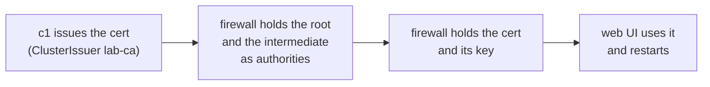
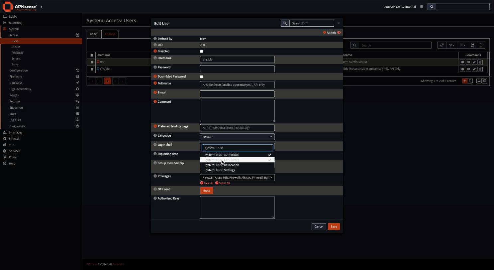
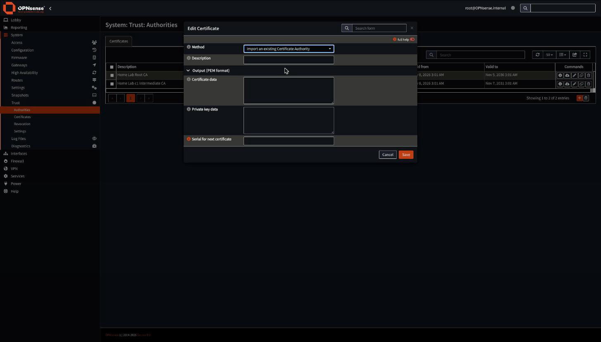
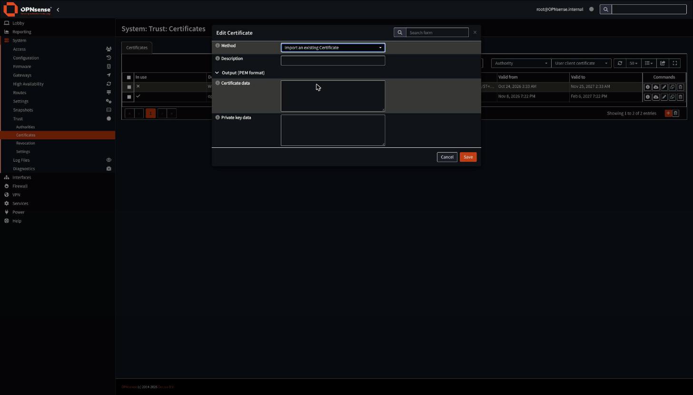
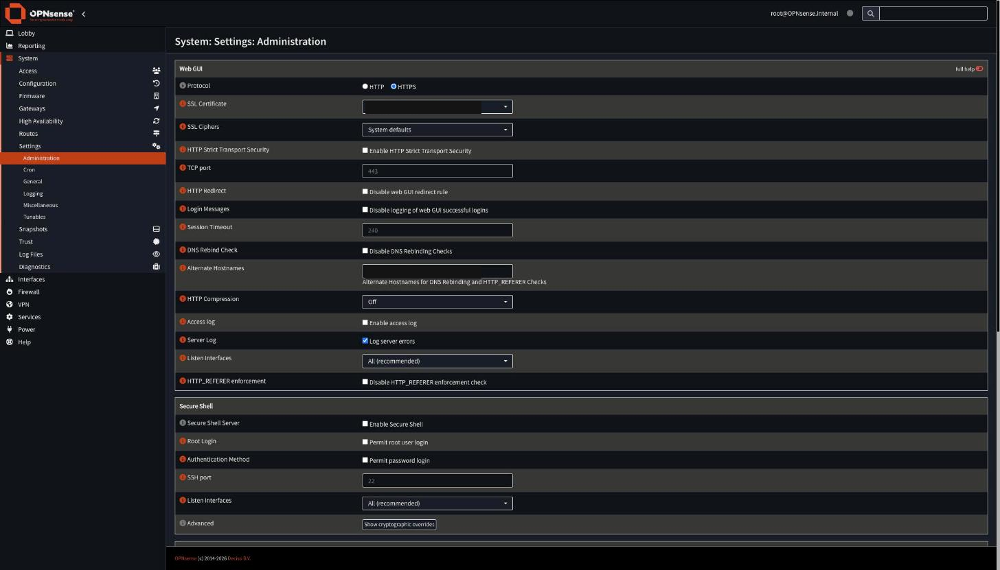

# Give the OPNsense web UI a certificate from the lab CA, by CLI or in the web UI

The firewall's web UI starts with a self-signed certificate. This runbook replaces it with one that c1's ClusterIssuer `lab-ca` issues, so it chains to the lab root the owner's Mac already trusts.

There are two ways to do the same job. **Path A** is the command line: one playbook does every step through the OPNsense API, and agents use it. **Path B** is the web UI, for people who would rather click. Both end in the same state, and a later Path A run changes nothing after a correct Path B.



## Before you start

- `kubectl get clusterissuer lab-ca` on c1 shows `READY True`. If not, do [Restore c1's intermediate CA](restore-c1-intermediate-ca.md) first.
- The owner's Mac trusts the lab root ([Trust the lab root CA on a Mac](trust-lab-root-ca-on-mac.md)).
- `opnsense.<zone>` resolves from where you are ([Set up lab DNS](set-up-lab-dns.md)).
- Path A only: the inventory sets `opnsense_api_host`, `opnsense_api_key`, `opnsense_api_secret` and `opnsense_cert_names` (for example `["opnsense.<zone>"]`).

## Path A: command line

1. Run the playbook in check mode.

   ```sh
   cd hosts/ansible
   ansible-playbook -i inventories/home/ playbooks/opnsense-cert.yml --check
   ```

   why: check mode issues nothing on the firewall but reads the authorities and certificates through the API, so it proves the API key works first.
   expect: `failed=0`. An HTTP 401 means the key or secret is wrong; a 403 means the key's user is missing a privilege (step B1 shows where to add it).

2. Run it for real.

   ```sh
   ansible-playbook -i inventories/home/ playbooks/opnsense-cert.yml
   ```

   why: the role issues the certificate on c1 (role `lab_host_cert`), adds the lab root and the c1 intermediate as authorities if they are missing, writes the issued certificate over the one the web UI uses, and restarts the web UI.
   ※ [D-0028 rule 5](../decisions/0028-run-a-lab-ca-with-the-root-off-cluster-and-one-intermediate-per-cluster.md); API calls follow <https://github.com/0xabu/opnsense-cert>
   expect: `changed` above 0 and `failed=0`.

3. Run it a second time.

   expect: `changed=0`. The role compares the fingerprint the web UI serves with the issued one and writes nothing when they match.

4. Check it from the Mac, with no `-k`.

   ```sh
   curl -sv https://opnsense.<zone>/ -o /dev/null 2>&1 | grep -E 'issuer|verify'
   ```

   expect: issuer `Home Lab c1 Intermediate CA` and `SSL certificate verify ok`.

## Path B: web UI

The web UI can't fetch the certificate from c1, so the first step is one command that saves it as three files. Everything after that is clicks.

B0. Save the issued certificate as files on your computer.

   ```sh
   # after Path A ran once, or any run of role lab_host_cert, the Secret exists:
   kubectl -n host-certs get secret opnsense-tls -o jsonpath='{.data.tls\.crt}' | base64 -d > opnsense.crt
   kubectl -n host-certs get secret opnsense-tls -o jsonpath='{.data.tls\.key}' | base64 -d > opnsense.key
   kubectl -n host-certs get secret opnsense-tls -o jsonpath='{.data.ca\.crt}' | base64 -d > lab-root.crt
   chmod 600 opnsense.key
   ```

   why: cert-manager keeps the certificate and its key in a Secret on c1. `opnsense.crt` holds the server certificate followed by the c1 intermediate.
   expect: three files. Delete `opnsense.key` when B4 is done.

B1. Check the API user's privileges (only needed for Path A, shown here so both paths match).

   In **System > Access > Users**, click the pencil on the user that owns the API key. In the **Edit User** dialog, type `System: Trust` in the **Privileges** field and tick **System: Trust: Authorities** and **System: Trust: Certificates**, then type `Status: Services` and tick it, and click **Save**. A member of the `admins` group already has every privilege.

   

B2. Add the lab root and the c1 intermediate as authorities.

   In **System > Trust > Authorities**, click **+**. In the **Edit Certificate** dialog, set **Method** to **Import an existing Certificate Authority**, **Description** to `Home Lab Root CA`, paste `lab-root.crt` into **Certificate data**, and save. Do it again with **Description** `Home Lab c1 Intermediate CA` and the second certificate block of `opnsense.crt`.

   why: the firewall then sends the full chain, and it trusts the lab root for its own outbound checks.
   expect: both rows in the list. Skip either one that is already there.

   

B3. Import the certificate.

   In **System > Trust > Certificates**, click **+**. In the **Edit Certificate** dialog, set **Method** to **Import an existing Certificate**, **Description** to the web UI's name (`opnsense.<zone>`), paste the first certificate block of `opnsense.crt` into **Certificate data** and `opnsense.key` into **Private key data**, and save.

   expect: a row whose issuer is `Home Lab c1 Intermediate CA`.

   

B4. Point the web UI at it.

   In **System > Settings > Administration**, under **Web GUI**, set **SSL Certificate** to the certificate from B3, and click **Save**. The web UI restarts and the page reloads.

   

B5. Check it in the browser.

   Open `https://opnsense.<zone>/` on the Mac. The padlock shows no warning, and the browser's certificate details show the chain lab root, c1 intermediate, then the web UI's certificate with `opnsense.<zone>` as its alternative name. From a terminal the same check is Path A step 4.

   expect: no certificate warning. A warning means this computer does not trust the lab root yet.

## If it fails

- The browser still warns after B4: the page may be cached; open it in a new private window. If it still warns, the Mac does not trust the lab root yet.
- Locked out of the web UI after B4: on the console, menu option 2 (or `configctl webgui restart` from the shell) and the setting **SSL Certificate** back to **Web GUI TLS certificate**, or restore the configuration from **System > Configuration > History**.
- Path A fails at "There is one to replace": no certificate in use carries a name the role expects. Set `opnsense_cert_target_descrs` to the description shown in **System > Trust > Certificates**.
- Tell the owner before trying anything not written here.

## Afterwards

- Set `last-tested` here, with the date, the path (A or B) and who ran it.
- cert-manager renews the certificate on c1 30 days before it ends; OPNsense does not fetch it. Run Path A at least every 30 days, or repeat B0, B3 and B4.

## Proven runs

- 2026-11-09, Path A, an agent lane on the owner's Mac, central-hub main with PR #96. Check mode first failed at "Certificate differs on c1?" (no manifest file in check mode), fixed by #96. The first real run stopped with HTTP 403 on `trust/ca/search` until the API user got the three privileges in step B1. After that the web UI served leaf, c1 intermediate, lab root (not before 00:22 UTC). Runs at 08:2x and 19:1x UTC each reported `ok=16 changed=0 failed=0 skipped=3`. `curl` from the Mac with no `-k`: `SSL certificate verify ok`, issuer `Home Lab c1 Intermediate CA`.

## Related

- [D-0028](../decisions/0028-run-a-lab-ca-with-the-root-off-cluster-and-one-intermediate-per-cluster.md), [spec 2026-11-lab-pki](../specs/2026-11-lab-pki.md) part 6, [Restore c1's intermediate CA](restore-c1-intermediate-ca.md).
