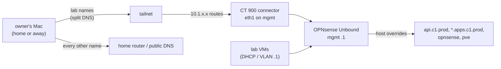

# Set up lab DNS and make the owner's Mac resolve lab names

The lab has one DNS server: Unbound on the OPNsense firewall, at the mgmt VLAN's `.1`. It holds the lab names as host overrides and resolves every other name publicly. Lab machines use it because DHCP and their VLAN's `.1` point at it. The owner's Mac did not, because the Mac asks the home router, which knows nothing about the lab. This runbook closes that gap through the tailnet.



Which parts are code:

| Part | Code | Run with |
|---|---|---|
| Lab names in Unbound | role `opnsense_lab`, `tasks/dns.yml`, list `opnsense_lab_host_overrides` | `playbooks/opnsense.yml --tags dns` |
| Proof that each name answers | role `opnsense_lab`, `tasks/dns_proof.yml` | same run, tag `dns_proof` |
| CT 900 routes the lab and advertises every lab VLAN | role `tailnet_connector` | `playbooks/tailnet-connector.yml` |
| Those routes turned on, and split DNS for the lab names | `hosts/terraform/home/tailnet/` | `tofu apply` |
| Tailnet OAuth client | made by hand once (bootstrap) | step 2 |

## What needs the owner's hands

No new DNS server is needed: Unbound on the firewall already answers the lab names. The Mac only has to reach it. Three things need the owner, everything else is code an agent runs:

1. Make the tailnet OAuth client and put it in `hosts/.env` (step 2, about 2 minutes in the Tailscale admin console).
2. Check that the Tailscale app on the Mac has **Use Tailscale DNS settings** and **Use Tailscale subnets** on.
3. Say go for steps 3 to 6, which change the firewall, CT 900 and the tailnet.

Only if split DNS can't be used, the [fallback](#fallback-a-resolver-file-on-the-mac) needs one `sudo` command on the Mac.

## Before you start

- `playbooks/opnsense.yml` has run against the firewall, so the mgmt VLAN, its `.1` and Unbound are up.
- CT 900 is running and `ssh root@<host address> 'pct exec 900 -- tailscale status --peers=false'` shows it online.
- On the Mac, the Tailscale app's **Use Tailscale DNS settings** and **Use Tailscale subnets** are on (both are on by default on macOS).
- The tailnet policy lets the owner reach the lab range (`10.1.0.0/16`, STD-0002). With the default allow-all policy nothing is needed; a stricter policy needs one accept rule for it.

Stop if any of these is not true.

## Steps

1. Fill in the private values.
   - In `hosts/ansible/inventories/home/hosts.yml`: `opnsense_lab_host_overrides` (the c1 API, the Gateway wildcard, and `pve` pointing at the Proxmox host's mgmt address), and under `proxmox_host` the two `tailnet_connector_*` values from the template. `tailnet_connector_extra_routes` is the route CT 900 advertises today, the Proxmox host's home LAN address as a /32.
   - In `hosts/terraform/home/tailnet/home.tfvars` (copy of `home.tfvars.example`, mode 0600): the same zone, CT 900's tailnet hostname, and the same extra route.
   why: the code has no defaults for these, because the repository is public; a missing value stops the run.
   ※ [hosts/ansible/README.md, "Private values"](../../hosts/ansible/README.md#private-values)
   expect: `git status` shows neither file (both are git-ignored).

2. Make a tailnet OAuth client, once, in the Tailscale admin console (Settings, then Trust credentials or OAuth clients): scopes **DNS** write, **Devices: Routes** write and **Devices: Core** read, no tags. Put its ID and secret in `hosts/.env` (copy of `hosts/.env.example`, mode 0600).
   why: Tailscale has no API call that makes the first credential, so this is the one hand-made step, like the Proxmox and Cloudflare bootstrap tokens. The lab's passwords and keys live in this file until the rebuild changes them all (the owner, 2026-11-08 07:58 UTC).
   expect: `hosts/.env` exists, mode 0600, git-ignored.

3. Put the lab names in Unbound and prove them, from `hosts/ansible/`:

   ```sh
   ansible-playbook -i inventories/home/ playbooks/opnsense.yml --tags dns --check --diff
   ansible-playbook -i inventories/home/ playbooks/opnsense.yml --tags dns
   ```

   why: every name in `opnsense_lab_host_overrides`, plus `opnsense.<zone>`, becomes an Unbound host override. The `dns_proof` tasks then ask the mgmt gateway for each name with `dig` and fail if the answer is not the listed address; for the wildcard they ask `dns-proof.apps.c1.prod.<zone>`.
   ※ The proof runs `dig` on the Mac against the mgmt gateway, the address the OPNsense API is reached on too; `tasks/wan.yml` lets the home LAN reach it on tcp/udp 53. If the Mac has no route there yet (away from home, or no home router route), run the proof again after step 5.
   expect: the second run reports `changed=0` for the overrides that already exist, and every proof item is `ok`.

4. Route the lab through CT 900 and advertise every lab VLAN:

   ```sh
   ansible-playbook -i inventories/home/ playbooks/tailnet-connector.yml --check --diff
   ansible-playbook -i inventories/home/ playbooks/tailnet-connector.yml
   ```

   why: CT 900's default route is the home LAN, so it can reach only the mgmt VLAN it sits on. The role puts a systemd unit in CT 900 that routes the lab range through the mgmt gateway (Proxmox rewrites the container's `/etc/network/interfaces` at every start, so the route can't live there), then runs `tailscale set --advertise-routes` with every lab VLAN plus the extra route. Replies come back to CT 900 because Tailscale rewrites the source of subnet traffic to CT 900's own address (its default).
   expect: the second run reports `changed=0`; the last task shows the lab range `via` the mgmt gateway on `eth1`.

5. Turn the routes on and point split DNS at the lab, from `hosts/terraform/home/tailnet/`:

   ```sh
   set -a; . ../../../.env; set +a
   tofu init -backend-config="path=$HOME/.local/state/central-hub/home-tailnet.tfstate"
   tofu plan -var-file=home.tfvars -out=tailnet.tfplan
   tofu apply tailnet.tfplan
   ```

   why: a route is used only when it is both advertised (step 4) and turned on here. Split DNS sends `c1.prod.<zone>`, `opnsense.<zone>` and `pve.<zone>`, and every name below them, to the mgmt gateway; every other name in the zone still goes to public DNS, so the public zone keeps working if the lab is down.
   ※ `tailscale_device_subnet_routes` owns the whole list of turned-on routes for CT 900, which is why the extra route is in it.
   expect: the plan adds one route set and three split DNS entries and changes nothing else; a second plan shows no changes.

6. Prove it from the Mac:

   ```sh
   tailscale dns status | grep 'c1.prod'                  # the split DNS names the Tailscale client uses
   dscacheutil -q host -a name api.c1.prod.<zone>          # the system resolver, which browsers use
   ansible-playbook -i inventories/home/ playbooks/opnsense.yml --tags dns_proof -e opnsense_lab_dns_proof_server=100.100.100.100
   ```

   Then open `https://grafana.apps.c1.prod.<zone>/` in a browser.
   why: plain `dig` on macOS skips the system resolver and asks the first server in `/etc/resolv.conf`, so it does not show what apps see. `dscacheutil` does. `scutil --dns` shows no entry for the split names on the owner's Mac (measured 2026-11-08): the Tailscale app answers them without a per-domain resolver entry, so check `tailscale dns status` instead. The proof run asks Tailscale's resolver on the Mac, which forwards the lab names through CT 900.
   expect: `dscacheutil` prints the c1 node's address; every proof item is `ok`; the page loads. Then tell the PKI thread, whose certificate checks need this.

## If it fails

- **A name doesn't answer (step 3):** the proof prints the name, the server and what came back. Check the override in the OPNsense GUI under Services, Unbound DNS, Overrides.
- **The Mac gets no answer (step 6):** `tailscale ping <connector tailnet name>` and `tailscale status` on the Mac; the routes show under CT 900 only after step 5. If Unbound refuses the query, check Services, Unbound DNS, Access Lists: the mgmt VLAN must be allowed, which it is by default.
- **Undo split DNS only:** `tofu destroy -var-file=home.tfvars -target=tailscale_dns_split_nameservers.lab`. The Mac goes back to asking the home router.
- **Undo the routes:** never `tofu destroy` the route set as it is, because that also turns off the extra route the Proxmox host is reached by. Set the route list to the extra route alone by hand in the admin console, then `tofu state rm tailscale_device_subnet_routes.connector`. In CT 900: `tailscale set --advertise-routes=<the extra route>` and `systemctl disable --now central-hub-lab-route`.
- Tell the owner before trying anything not written here.

## Fallback: a resolver file on the Mac

Use this only when split DNS is off (step 5 not applied, or the Tailscale app's DNS setting off). macOS sends every name under a domain to the server named in `/etc/resolver/<domain>`. The Mac still needs a route to the mgmt gateway, from step 4 and 5's subnet routes or a home router route to the lab.

```sh
# one file per lab domain, the same names as split_dns_names; the server is the mgmt VLAN's .1
for d in c1.prod.<zone> opnsense.<zone> pve.<zone>; do
  printf 'nameserver 10.1.50.1\ntimeout 3\n' | sudo tee /etc/resolver/$d >/dev/null
done
scutil --dns | grep -A3 'c1.prod'                  # a resolver for c1.prod.<zone>, nameserver 10.1.50.1
dscacheutil -q host -a name api.c1.prod.<zone>      # the c1 node's address
```

Undo: `sudo rm /etc/resolver/c1.prod.<zone> /etc/resolver/opnsense.<zone> /etc/resolver/pve.<zone>`. Remove the files once split DNS works, so there is one path to keep.

## Exit path: without Tailscale

The lab's names live in one place, the Unbound host overrides on OPNsense, written from `opnsense_lab_host_overrides`. Tailscale holds no names. It only carries the route to the lab and tells the Mac which domains to ask Unbound about. Replacing it touches only `hosts/terraform/home/tailnet/` and role `tailnet_connector`; the names, the role `opnsense_lab` and the proof stay as they are. Each replacement below is an agent pick, not a decision.

| Where the Mac is | Replacement | What changes |
|---|---|---|
| On a lab VLAN, or on a network whose DHCP is OPNsense | Nothing to add: OPNsense's DHCP gives the VLAN's `.1` as the DNS server, and Unbound answers there. The home LAN gets this only when OPNsense, or the planned hardware firewall, hands out the home LAN's addresses; today the home router does | the DHCP settings in role `opnsense_lab` |
| Away, through another VPN, for example WireGuard on OPNsense | The VPN client config names Unbound as its DNS server. In a `wg-quick` config that is the `DNS =` line of `[Interface]`, which sets the interface's DNS servers when the tunnel comes up (wg-quick(8)). `AllowedIPs` carries the lab range, as the subnet routes do today | a new VPN role and client config replace `home/tailnet` and `tailnet_connector` |
| Anywhere the Mac has a route to the lab, with no VPN DNS setting | The [resolver file fallback](#fallback-a-resolver-file-on-the-mac): macOS sends every name under a domain to the server in `/etc/resolver/<domain>`, where the file name is the domain (resolver(5)) | one file per lab domain on the Mac |

To leave Tailscale: first set up the replacement and prove it with the `dns_proof` tag, using `opnsense_lab_dns_proof_server` set to the replacement's DNS server. Then remove split DNS (`tofu destroy -target=tailscale_dns_split_nameservers.lab`) and take the lab routes off CT 900, as in [If it fails](#if-it-fails).

## Afterwards

- Set `last-tested` here, with the date, who ran it and on what, and `status: tested` once every step has passed.
- Add new lab names to `opnsense_lab_host_overrides` and, when they are outside `c1.prod`, `opnsense` and `pve`, to `split_dns_names` in `home/tailnet`.

## Related

- `hosts/AGENT-PICKS.md` picks 160-166 (Unbound over AdGuard Home, split DNS for the Mac, how they are built, and the exit path from Tailscale)
- [Spec: the home lab and c1](../specs/2026-10-home-lab-and-c1.md), decision log 2026-10-26 (the API name as an Unbound override)
- [D-0021](../decisions/0021-use-gateway-api-on-cilium-as-the-way-in-for-web-traffic.md) (the wildcard name for apps)
- [Build a single-node kubeadm cluster](build-kubeadm-cluster.md) step 7 (the endpoint name)
- wg-quick(8), `DNS` under `[Interface]` (wireguard-tools, `src/man/wg-quick.8`); resolver(5), the `/etc/resolver` directory (Apple libresolv, `resolver.5`)
