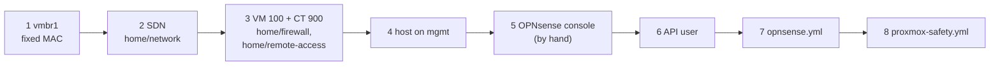

# Set up the lab network, the OPNsense firewall and the tailnet connector container

**Status:** draft. Written on 2026-11-08 from [hosts/README.md](../../hosts/README.md) "Order for the home lab" and the code. The run folders were applied to the running lab, which already existed, by adopting its objects; those import blocks were removed on 2026-11-08 so an empty host plans clean. This order has never run on an empty host.



## Before you start

- The host is set up through step 6 of [Set up a Proxmox VE host by hand](set-up-proxmox-host.md): `iac@pve`, its pools and the token exist.
- The OPNsense nano image and the Debian 13 container template are on the host, and their file IDs are in `hosts/terraform/home/firewall/home.tfvars` (`opnsense_image_file_id`) and `hosts/terraform/home/remote-access/home.tfvars` (`connector_template_file_id`): [Put the OPNsense image and the Debian 13 template on the host](stage-lab-images-on-proxmox.md).
- Load the Proxmox provider's settings into the shell for every `tofu` step: `PROXMOX_VE_ENDPOINT` (the host's API URL) and `PROXMOX_VE_API_TOKEN` from the token file ([hosts/terraform/README.md](../../hosts/terraform/README.md#run-one-folder)).

Stop if the image or the template is missing: step 3 can't make VM 100 or CT 900 without them.

## Steps

Run every Ansible step from `hosts/ansible/` with `-i inventories/home/`, first with `--check --diff`.

1. Give vmbr1 a fixed MAC.

   ```sh
   ansible-playbook -i inventories/home/ playbooks/proxmox-host.yml --tags vmbr1
   ```

   why: a bridge with no ports gets an all-zero MAC, and then the SDN's VLAN devices on it can't come up ([hosts/ansible/README.md](../../hosts/ansible/README.md#what-it-builds)).
   expect: `ip link show vmbr1` on the host shows the MAC from `proxmox_vmbr1_mac`.

2. Make the SDN: zone `lab` on vmbr1, VNets `prod` (10), `qa` (20), `dev` (30) and `mgmt` (50), one `10.1.<tag>.0/24` subnet each.

   ```sh
   cd ../terraform/home/network
   tofu init -backend-config="path=$HOME/.local/state/central-hub/home-network.tfstate"
   export TF_VAR_proxmox_node_name=<node name>   # this folder has no home.tfvars
   tofu plan -var vlans_file=../../../ansible/inventories/home/group_vars/all/vlans.yml -out=network.tfplan
   tofu apply network.tfplan
   ```

   why: the VLAN list is written once, in the shared VLAN file that Ansible reads too ([STD-0002](../standards/0002-ip-address-plan.md)).
   expect: a second `tofu plan` shows no changes; the host's SDN page shows the four VNets.

3. Make VM 100 (OPNsense) and CT 900 (the tailnet connector), one run folder at a time, each with its own state file.

   ```sh
   cd ../firewall        # opnsense_wan_connected = false in home.tfvars on a fresh build
   tofu init -backend-config="path=$HOME/.local/state/central-hub/home-firewall.tfstate"
   tofu plan -var-file=home.tfvars -out=firewall.tfplan && tofu apply firewall.tfplan
   cd ../remote-access
   tofu init -backend-config="path=$HOME/.local/state/central-hub/home-remote-access.tfstate"
   tofu plan -var-file=home.tfvars -out=ra.tfplan && tofu apply ra.tfplan
   ```

   why: VM 100's net0 is the trunk on vmbr1 and net1 is WAN on vmbr0. WAN stays link-down on a fresh build (`opnsense_wan_connected = false`) so a firewall with default settings is never on the home LAN (`hosts/terraform/home/firewall/main.tf`). CT 900 gets eth0 on vmbr0 and eth1 on VNet mgmt; what runs inside it is not in this run folder.
   ※ the pools `firewall` and `remote-access` come from `iac-access.sh` ([Set up a Proxmox VE host](set-up-proxmox-host.md) step 6b).
   expect: VM 100 and CT 900 are running; a second plan in each folder shows no changes.

4. Give the host its address on VNet mgmt.

   ```sh
   cd ../../../ansible
   ansible-playbook -i inventories/home/ playbooks/proxmox-host.yml --tags mgmt
   ```

   why: Ansible and the controller reach the firewall's API and the c1 nodes through this address; it needs the SDN from step 2. The host's home LAN address on vmbr0 is checked after every reload and never changed.
   expect: `ip -br addr` on the host shows the mgmt address; the home LAN address is unchanged.

5. At the OPNsense console (VM 100 in the Proxmox web UI), by hand: set the root password, make VLAN 50 on the trunk the LAN interface with the mgmt gateway address (`10.1.50.1/24`), and leave WAN unassigned until the next step works.
   why: the API can't be reached before the mgmt VLAN has an address, so the role leaves the mgmt VLAN and its LAN slot alone (`hosts/README.md` step 4).
   expect: from the host, `ping 10.1.50.1` answers.
   note: the root password goes only in the owner's private store; this step has no code.

6. Make the OPNsense API user `ansible` and its key, with no GUI login.
   On the controller, make a key and a secret and keep both in `~/.config/central-hub/opnsense-api.txt` (mode 0600). Send the firewall only `"<key>|$(openssl passwd -6 <secret>)"`, as `/root/ansible-apikey.line`, together with `hosts/ansible/bootstrap/opnsense-ansible-user.php`, through the QEMU guest agent in pieces under about 700 bytes, then run `qm guest exec 100 -- php /root/ansible-user.php` on the host.
   why: the user gets only the privileges `opnsense.yml` needs, and the secret never leaves the controller; OPNsense gets only its hash (the script's header; agent pick 29 in [hosts/AGENT-PICKS.md](../../hosts/AGENT-PICKS.md)). Larger guest-agent payloads hung OPNsense's agent during the build.
   expect: the script prints no error; `opnsense_api_key` and `opnsense_api_secret` in the inventory are filled from the file.

7. Configure OPNsense: VLANs 10, 20 and 30, their interfaces and gateways, DHCP on 10 and 30, the four rules per lab VLAN, the WAN rules and the Unbound host overrides.

   ```sh
   ansible-playbook -i inventories/home/ playbooks/opnsense.yml --check --diff
   ansible-playbook -i inventories/home/ playbooks/opnsense.yml
   ```

   why: this is the firewall's whole lab setup as code ([hosts/ansible/README.md](../../hosts/ansible/README.md#what-it-builds), row `opnsense.yml`). The host overrides include `api.c1.prod` and the `*.apps.c1.prod` wildcard, so the names exist before c1 does.
   expect: a second run reports `changed=0`. WAN is still link-down; the WAN safety check below brings it up.

   Then the WAN safety check, and WAN up.
   VM 100's WAN (net1) sits on vmbr0, the home LAN. A firewall that answers there as a DHCP server or an IPv6 router hands home devices a wrong gateway, so WAN stays link-down (`opnsense_wan_connected = false`) until this check passes (`hosts/terraform/home/firewall/main.tf`). It checks three things.

   1. Before link-up, inside VM 100: WAN is a DHCP client and nothing else, and the lab's DHCP service is not on it.

      ```sh
      qm guest exec 100 -- pgrep -lf 'dhclient|dhcp6c|radvd|kea|dnsmasq'
      ```

      expect: `dhclient` for the WAN interface (`vtnet1`), and `dnsmasq`, which the role limits to the DHCP VLANs and mgmt, "never on WAN" (`hosts/ansible/roles/opnsense_lab/tasks/dhcp.yml`). No `radvd`, `kea` or `dhcp6c`.
   2. Link-up while you watch: on the host, start a 60-second capture of server-type packets from the WAN's MAC on vmbr0, then bring WAN up from the controller.

      ```sh
      # on the host, first
      timeout 60 tcpdump -n -e -i vmbr0 'ether src <opnsense_wan_mac> and (udp src port 67 or udp src port 547 or (icmp6 and ip6[40] == 134))' | tee /root/wan-check.txt
      # on the controller, at once: set opnsense_wan_connected = true in home.tfvars, then
      cd hosts/terraform/home/firewall && tofu plan -var-file=home.tfvars -out=firewall.tfplan && tofu apply firewall.tfplan
      ```

      why: UDP from port 67 is a DHCPv4 server's offer or ack, UDP from port 547 a DHCPv6 server's reply, and ICMPv6 type 134 a router advertisement; a WAN that is only a client sends none of them.
      expect: the capture ends with 0 packets (`wc -l /root/wan-check.txt` prints 0), and VM 100 gets its WAN address by DHCP from the home router's reservation for `opnsense_wan_mac`.
   3. Repeat the capture after a reboot of VM 100 (`qm reboot 100`): the boot is when a wrong default (the nano image's LAN DHCP server on the wrong port) would show.
      expect: 0 packets again.

   why: this is the check the build session ran on 2026-10-23 and 2026-10-24, at link-up, after a reboot, after the rules and after a firmware update, each time with 0 server-type packets (the owner's private build log; no values from it are copied here). The OPNsense nano image starts with LAN on the first NIC at 192.168.1.1/24 with its own DHCP server and WAN as a DHCP client (OPNsense manual, "Installation"), which is why net0, the trunk, must stay first.
   If it fails: set `opnsense_wan_connected = false` and apply at once, which takes WAN link-down; then fix the interface assignment at the console before trying again.
   Agent pick: the capture filter and the three moments to check; the build session watched the same packet types by hand.

   Then, once the agent box exists, let it (VM 258 on VNet dev) reach the Proxmox API and c1's API, and nothing else in the lab. Only when the box exists.
   why: the dev VLAN's own rules allow only the internet, ping and DNS, so the box's tools can't reach the APIs they run against. The owner said yes on 2026-11-10 at 05:16 UTC to one rule from the box's address only, to those two ports, once a reach test showed them blocked. Lane C measured that at 07:47 UTC: both timed out.
   Fill `opnsense_lab_agent_box` in the inventory: the box's address, VLAN 30, and the two targets. The Proxmox API is the host's **mgmt** address (agent pick): the dev VLAN's rule 0 blocks the home LAN, so the home-LAN address can't be reached from dev, and `pve.<zone>` and its lab certificate already point at mgmt.

   ```sh
   cd hosts/ansible
   ansible-playbook -i inventories/home/ playbooks/opnsense.yml --tags agent_box --check --diff
   ansible-playbook -i inventories/home/ playbooks/opnsense.yml --tags agent_box
   ```

   expect: two pass rules on the dev interface, `Allow agent box to Proxmox API` and `Allow agent box to c1 API`, at sequence 1 and 2. From the box, `curl -sk -o /dev/null -w '%{http_code}' https://<mgmt address>:8006/` prints `200` and `curl -sk https://<c1 API address>:6443/version` answers. A connection from the box to any other lab address still times out.
   If 8006 still times out while 6443 answers, and the host firewall is on (step 8), the host's own rules allow 8006 only from its `management` IPSet. Stop and ask the owner: it is a second firewall change. With their words, don't add the box to `management` (that would also open 22). Add one rule to `proxmox_firewall_extra_rules` in the inventory instead, `{ action: ACCEPT, source: "<box address>/32", proto: tcp, dport: "8006", comment: "agent box to the Proxmox API" }`, and run step 8's firewall commands (`proxmox-safety.yml --tags firewall`, `--check --diff` first). expect: the diff adds that one `IN ACCEPT` line to `host.fw`, and the box's `curl` to 8006 then answers.
   For a prod rebuild from the box, the box also needs SSH to prod's two node VMs (the owner's answer of 2026-11-11, applied only on the owner's typed go naming the pull request that added this paragraph). Add the two commented targets in `hosts.example.yml`, `prod node 200 SSH` and `prod node 201 SSH`, each with its VM's address and port 22, after `c1 API`, and run the same two commands.
   expect: the diff adds two pass rules at sequence 3 and 4 and changes nothing else. From the box, `ssh -o BatchMode=yes <VM 200 address> true` reaches the node (it may refuse the key until the box's key is on the node); port 22 on any other lab address still times out.
   To remove the rules: delete `opnsense_lab_agent_box` from the inventory and run the same command.

8. Turn on the host's safety net: notifications, backups, then the host firewall in two runs.

   ```sh
   ansible-playbook -i inventories/home/ playbooks/proxmox-safety.yml --tags notify,backup
   ansible-playbook -i inventories/home/ playbooks/proxmox-safety.yml --tags firewall
   ansible-playbook -i inventories/home/ playbooks/proxmox-safety.yml --tags firewall -e '{"proxmox_firewall_enable": true}'
   ```

   why: it goes last because the firewall run's checks probe CT 900 and the paths through OPNsense that steps 2 to 7 make. The second firewall run arms a 10-minute dead-man timer before it switches on ([hosts/ansible/README.md, Host firewall](../../hosts/ansible/README.md#host-firewall)).
   expect: the run ends with the timer cancelled; then set `proxmox_firewall_enable: true` in the inventory. Prove one backup by hand: `vzdump 900 --storage hdd-backup --mode snapshot --compress zstd`, then `pvesm list hdd-backup`.
   note: the CT 900 probe expects the tailnet client to run in CT 900. On a fresh build, run [Install the tailnet client in CT 900](set-up-tailnet-client-in-ct-900.md) first.

## If it fails

- A `tofu apply` that fails part way: run `tofu plan` again and read it; each folder has its own state, so the others are untouched. `tofu destroy` in that folder removes only what it made.
- Lost the firewall's API after step 7: use the console from step 5. The rules allow the home LAN to the mgmt gateway on tcp 443, so a wrong rule shows up as a timeout from the controller.
- The host firewall locks you out: wait 10 minutes for the dead-man timer, or follow the rollback in [hosts/ansible/README.md, Host firewall](../../hosts/ansible/README.md#host-firewall).

## Afterwards

Set `last-tested`. Record anything the "Still open" list in [hosts/ansible/README.md](../../hosts/ansible/README.md#still-open) names that this run settled.

## Related

- [Rebuild the home lab from bare metal](rebuild-home-lab-from-scratch.md).
- [STD-0002](../standards/0002-ip-address-plan.md): the IP address plan. [D-0011](../decisions/0011-keep-machine-code-in-hosts.md): code in `hosts/`.
- [Spec: Build the home lab from code and the first cluster c1](../specs/2026-10-home-lab-and-c1.md).
