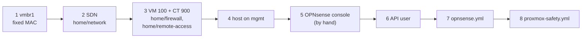

# Set up the lab network, the OPNsense firewall and the tailnet connector container

**Status:** draft. Written on 2026-11-08 from [hosts/README.md](../../hosts/README.md) "Order for the home lab" and the code. The run folders were applied to the running lab, which already existed, through their `imports.tf` files. This order has never run on an empty host.



## Before you start

- The host is set up through step 6 of [Set up a Proxmox VE host by hand](set-up-proxmox-host.md): `iac@pve`, its pools and the token exist.
- The OPNsense nano image is on the host as an import file, and its file ID is in `hosts/terraform/home/firewall/home.tfvars` as `opnsense_image_file_id` (for example `local:import/<image>.img`). **No runbook says how to get it there.** Download the nano image for the OPNsense version the role is tested on (26.1, `hosts/ansible/requirements.yml`) from OPNsense's own mirror, check its checksum, and upload it to the host's `import` content.
- The Debian 13 container template is on the host, and its file ID is in `hosts/terraform/home/remote-access/home.tfvars` as `connector_template_file_id`. **No runbook says how to get it there** either; Proxmox's own template list offers it (`pveam`).
- On an empty host, delete the `imports.tf` files in `home/network`, `home/firewall` and `home/remote-access` in a branch first. They adopt objects that existed before the code; with nothing to adopt, `tofu plan` stops ([Rebuild the home lab, If it fails](rebuild-home-lab-from-scratch.md#if-it-fails)).
- Load the Proxmox provider's settings into the shell for every `tofu` step: `PROXMOX_VE_ENDPOINT` (the host's API URL) and `PROXMOX_VE_API_TOKEN` from the token file ([hosts/terraform/README.md](../../hosts/terraform/README.md#run-one-folder)).

Stop if the image or the template is missing: step 3 can't make VM 100 or CT 900 without them.

## Steps

Run every Ansible step from `hosts/ansible/` with `-i inventories/home/`, first with `--check --diff`.

1. Give vmbr1 a fixed MAC.

   ```sh
   ansible-playbook -i inventories/home/ playbooks/proxmox-host.yml --tags vmbr1
   ```

   why: a bridge with no ports gets an all-zero MAC, and then the SDN's VLAN devices on it can't come up ([hosts/ansible/README.md](../../hosts/ansible/README.md#what-it-builds)).
   expect: `ip link show vmbr1` on the host shows the MAC from `proxmox_vmbr1_mac`.

2. Make the SDN: zone `lab` on vmbr1, VNets `prod` (10), `qa` (20), `dev` (30) and `mgmt` (50), one `10.1.<tag>.0/24` subnet each.

   ```sh
   cd ../terraform/home/network
   tofu init -backend-config="path=$HOME/.local/state/central-hub/home-network.tfstate"
   export TF_VAR_proxmox_node_name=<node name>   # this folder has no home.tfvars
   tofu plan -var vlans_file=../../../ansible/inventories/home/group_vars/all/vlans.yml -out=network.tfplan
   tofu apply network.tfplan
   ```

   why: the VLAN list is written once, in the shared VLAN file that Ansible reads too ([STD-0002](../standards/0002-ip-address-plan.md)).
   expect: a second `tofu plan` shows no changes; the host's SDN page shows the four VNets.

3. Make VM 100 (OPNsense) and CT 900 (the tailnet connector), one run folder at a time, each with its own state file.

   ```sh
   cd ../firewall        # opnsense_wan_connected = false in home.tfvars on a fresh build
   tofu init -backend-config="path=$HOME/.local/state/central-hub/home-firewall.tfstate"
   tofu plan -var-file=home.tfvars -out=firewall.tfplan && tofu apply firewall.tfplan
   cd ../remote-access
   tofu init -backend-config="path=$HOME/.local/state/central-hub/home-remote-access.tfstate"
   tofu plan -var-file=home.tfvars -out=ra.tfplan && tofu apply ra.tfplan
   ```

   why: VM 100's net0 is the trunk on vmbr1 and net1 is WAN on vmbr0. WAN stays link-down on a fresh build (`opnsense_wan_connected = false`) so a firewall with default settings is never on the home LAN (`hosts/terraform/home/firewall/main.tf`). CT 900 gets eth0 on vmbr0 and eth1 on VNet mgmt; what runs inside it is not in this run folder.
   ※ the pools `firewall` and `remote-access` come from `iac-access.sh` ([Set up a Proxmox VE host](set-up-proxmox-host.md) step 6b).
   expect: VM 100 and CT 900 are running; a second plan in each folder shows no changes.

4. Give the host its address on VNet mgmt.

   ```sh
   cd ../../../ansible
   ansible-playbook -i inventories/home/ playbooks/proxmox-host.yml --tags mgmt
   ```

   why: Ansible and the controller reach the firewall's API and the c1 nodes through this address; it needs the SDN from step 2. The host's home LAN address on vmbr0 is checked after every reload and never changed.
   expect: `ip -br addr` on the host shows the mgmt address; the home LAN address is unchanged.

5. At the OPNsense console (VM 100 in the Proxmox web UI), by hand: set the root password, make VLAN 50 on the trunk the LAN interface with the mgmt gateway address (`10.1.50.1/24`), and leave WAN unassigned until the next step works.
   why: the API can't be reached before the mgmt VLAN has an address, so the role leaves the mgmt VLAN and its LAN slot alone (`hosts/README.md` step 4).
   expect: from the host, `ping 10.1.50.1` answers.
   note: the root password goes only in the owner's private store; this step has no code.

6. Make the OPNsense API user `ansible` and its key, with no GUI login.
   On the controller, make a key and a secret and keep both in `~/.config/central-hub/opnsense-api.txt` (mode 0600). Send the firewall only `"<key>|$(openssl passwd -6 <secret>)"`, as `/root/ansible-apikey.line`, together with `hosts/ansible/bootstrap/opnsense-ansible-user.php`, through the QEMU guest agent in pieces under about 700 bytes, then run `qm guest exec 100 -- php /root/ansible-user.php` on the host.
   why: the user gets only the privileges `opnsense.yml` needs, and the secret never leaves the controller; OPNsense gets only its hash (the script's header; agent pick 29 in [hosts/AGENT-PICKS.md](../../hosts/AGENT-PICKS.md)). Larger guest-agent payloads hung OPNsense's agent during the build.
   expect: the script prints no error; `opnsense_api_key` and `opnsense_api_secret` in the inventory are filled from the file.

7. Configure OPNsense: VLANs 10, 20 and 30, their interfaces and gateways, DHCP on 10 and 30, the four rules per lab VLAN, the WAN rules and the Unbound host overrides.

   ```sh
   ansible-playbook -i inventories/home/ playbooks/opnsense.yml --check --diff
   ansible-playbook -i inventories/home/ playbooks/opnsense.yml
   ```

   why: this is the firewall's whole lab setup as code ([hosts/ansible/README.md](../../hosts/ansible/README.md#what-it-builds), row `opnsense.yml`). The host overrides include `api.c1.prod` and the `*.apps.c1.prod` wildcard, so the names exist before c1 does.
   expect: a second run reports `changed=0`. Then set `opnsense_wan_connected = true` in the firewall's `home.tfvars` and apply step 3's firewall folder again, so WAN comes up.
   gap: the code names a "WAN safety check" before WAN is connected, but no file says what it checks. Agent pick until it is written: WAN comes up only after this step's rules are in place and the home router has the reservation for `opnsense_wan_mac`.

8. Turn on the host's safety net: notifications, backups, then the host firewall in two runs.

   ```sh
   ansible-playbook -i inventories/home/ playbooks/proxmox-safety.yml --tags notify,backup
   ansible-playbook -i inventories/home/ playbooks/proxmox-safety.yml --tags firewall
   ansible-playbook -i inventories/home/ playbooks/proxmox-safety.yml --tags firewall -e '{"proxmox_firewall_enable": true}'
   ```

   why: it goes last because the firewall run's checks probe CT 900 and the paths through OPNsense that steps 2 to 7 make. The second firewall run arms a 10-minute dead-man timer before it switches on ([hosts/ansible/README.md, Host firewall](../../hosts/ansible/README.md#host-firewall)).
   expect: the run ends with the timer cancelled; then set `proxmox_firewall_enable: true` in the inventory. Prove one backup by hand: `vzdump 900 --storage hdd-backup --mode snapshot --compress zstd`, then `pvesm list hdd-backup`.
   note: the CT 900 probe expects the tailnet client to run in CT 900. On a fresh build it doesn't yet ([Rebuild the home lab](rebuild-home-lab-from-scratch.md), Tailscale step), so the firewall runs wait until that is done.

## If it fails

- A `tofu apply` that fails part way: run `tofu plan` again and read it; each folder has its own state, so the others are untouched. `tofu destroy` in that folder removes only what it made.
- Lost the firewall's API after step 7: use the console from step 5. The rules allow the home LAN to the mgmt gateway on tcp 443, so a wrong rule shows up as a timeout from the controller.
- The host firewall locks you out: wait 10 minutes for the dead-man timer, or follow the rollback in [hosts/ansible/README.md, Host firewall](../../hosts/ansible/README.md#host-firewall).

## Afterwards

Set `last-tested`. Record anything the "Still open" list in [hosts/ansible/README.md](../../hosts/ansible/README.md#still-open) names that this run settled.

## Related

- [Rebuild the home lab from bare metal](rebuild-home-lab-from-scratch.md).
- [STD-0002](../standards/0002-ip-address-plan.md): the IP address plan. [D-0011](../decisions/0011-keep-machine-code-in-hosts.md): code in `hosts/`.
- [Spec: Build the home lab from code and the first cluster c1](../specs/2026-10-home-lab-and-c1.md).
