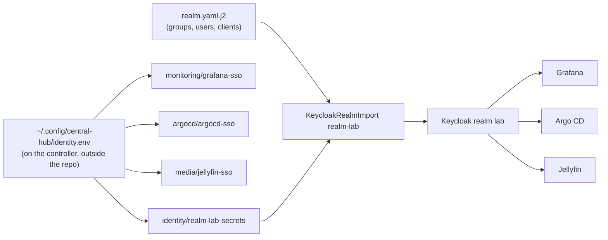

# Set up sign-in for lab apps on c1

Realm `lab` in Keycloak is code: its groups, users and the OIDC clients of every lab app are in `hosts/ansible/roles/k8s_identity/templates/realm.yaml.j2`, and every password and client secret is a line in `~/.config/central-hub/identity.env` on the machine that runs Ansible, outside the repository. This runbook applies them to c1. Run it from `hosts/ansible` in the lab clone.

| Client | Type | Redirects to | App reads its secret from |
|---|---|---|---|
| `grafana` | confidential, PKCE S256 | `https://grafana.apps.c1.prod.<zone>/login/generic_oauth` | `monitoring/grafana-sso`, key `client-secret` |
| `argocd` | confidential | `https://argocd.apps.c1.prod.<zone>/auth/callback` | `argocd/argocd-sso`, key `clientSecret` |
| `argocd-cli` | public, PKCE S256 | `http://localhost:8085/auth/callback` | none (public) |
| `jellyfin` | confidential | `https://jellyfin.apps.c1.prod.<zone>/sso/OID/redirect/keycloak` and `/sso/OID/r/keycloak` | `media/jellyfin-sso`, key `client-secret` |

Issuer for every app: `https://sso.apps.c1.prod.<zone>/realms/lab`. Claims: `groups` (`lab-admins`, `lab-viewers`) and `roles` (`admin`, `viewer`).

## Before you start

1. Keycloak runs: `kubectl -n identity get keycloak sso` shows `Ready` True.
   why: this runbook changes the realm, not Keycloak itself; a first install is the same playbook with tags `operator,secrets,database` first (`hosts/ansible/README.md`, "Sign-in on c1").
2. The filled-in inventory sets `k8s_identity_owner_username`, and `k8s_identity_extra_users` if anyone else needs an account.
   why: the role stops without the owner's user name, and each listed user gets a password line in the values file.

## Steps

1. See what would change: `ansible-playbook -i inventories/home/ playbooks/k8s-identity.yml --tags secrets,keycloak --check --diff`
   why: the first run writes `~/.config/central-hub/identity.env` (mode 0600) with a random value for each missing key, even in check mode, because nothing after it can be checked without the values; it never changes a line that is there.
   ※ `hosts/AGENT-PICKS.md` pick 154.
   expect: `identity.env` exists, mode 0600, with `GRAFANA_CLIENT_SECRET`, `ARGOCD_CLIENT_SECRET`, `JELLYFIN_CLIENT_SECRET` and one `PASSWORD_<USER NAME>` per user.
2. Apply: `ansible-playbook -i inventories/home/ playbooks/k8s-identity.yml --tags secrets,keycloak`
   why: the Secrets are made from the values file, then the realm import. When the import differs from the one on c1, the role deletes realm `lab` in Keycloak (`files/delete-realm.sh`, inside the Keycloak pod) and imports it again, because a KeycloakRealmImport never updates a realm that exists. Open sessions end; nothing else is lost, since every part of the realm is code.
   ※ `hosts/AGENT-PICKS.md` picks 153 and 157.
   expect: `kubectl -n identity get keycloakrealmimport realm-lab` shows condition `Done` True; Grafana's pod restarts if its secret changed.
3. Run it again: same command as step 2.
   why: proves the run is idempotent.
   expect: `changed=0`.
4. Sign in: open `https://grafana.<zone>/` (or `https://grafana.apps.c1.prod.<zone>/` without short names), choose "Lab sign-in", and sign in with your user name and the `PASSWORD_<USER NAME>` line from `identity.env`.
   why: proves the user, the password and Grafana's client end to end.
   expect: Grafana opens with the Admin role for a member of `lab-admins`.
5. Argo CD and Jellyfin: once their own config points at the issuer and the secrets above (the c1 GitOps work owns `argocd-cm` and the Jellyfin plugin), sign in to each the same way.
   why: this role makes their clients and secrets; it doesn't configure the apps.
   expect: Argo CD shows your groups under "User info"; Jellyfin signs you in through the plugin's "Sign in with keycloak" button.

## Change a password or add a user

- Password: edit its line in `identity.env`, then step 2. The realm is imported again with the new value.
- New user: add it to `k8s_identity_extra_users` in the inventory, then step 2. The role adds a random password line for it.
- New app: add a client to `realm.yaml.j2`, a `*_CLIENT_SECRET` key to `k8s_identity_client_secret_keys`, and a copy to the app's namespace in `tasks/secrets.yml`; CI's `identity` job checks the import.
- Rotate everything at a lab rebuild: delete `identity.env`, then step 2.
- Change the sign-in look: set `k8s_identity_theme_dir` in the inventory to a Keycloak theme folder on the controller (for example the owner's branding repository, cloned next to the lab clone), then step 2. Only its `login/` files below 500 KB are used; they go into ConfigMap `identity/keycloak-theme`, the Keycloak pod restarts with them, and the realm is imported again with `loginTheme` set to the folder's name. The path is private because the theme's name can name the zone. Empty goes back to Keycloak's own look.

## If it fails

- The realm import never reaches `Done`: `kubectl -n identity logs job/realm-lab` shows Keycloak's import error. Fix the template; CI's `identity` job reproduces most import errors without a cluster (`.github/hosts-check/run.sh identity`).
- The delete step fails to sign in: the operator's first admin account (Secret `identity/sso-initial-admin`) was removed or changed in Keycloak. Set `k8s_identity_realm_replace: false` to stop the delete, and tell the owner.
- To undo: check out the previous commit of the role and run step 2; the realm is imported again from that code.

## Afterwards

Fill in `last-tested` above with the date, who ran it and on what, and set `status: tested` once steps 1 to 4 pass on c1.

## Related

- D-0025, Keycloak behind OIDC for sign-in to lab apps on c1.
- `hosts/ansible/README.md`, "Sign-in on c1".
- `hosts/AGENT-PICKS.md`, picks 153 to 159.
- `.github/hosts-check/identity/`, the realm test.
