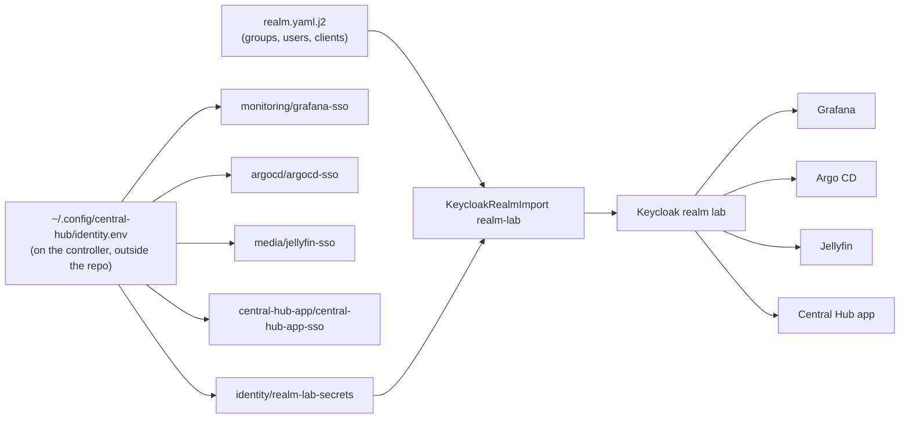

# Set up sign-in for lab apps on c1

Realm `lab` in Keycloak is code: its groups, users and the OIDC clients of every lab app are in `hosts/ansible/roles/k8s_identity/templates/realm.yaml.j2`, and every password and client secret is a line in `~/.config/central-hub/identity.env` on the machine that runs Ansible, outside the repository. This runbook applies them to c1. Run it from `hosts/ansible` in the lab clone.

| Client | Type | Redirects to | App reads its secret from |
|---|---|---|---|
| `grafana` | confidential, PKCE S256 | `https://grafana.apps.c1.prod.<zone>/login/generic_oauth` | `monitoring/grafana-sso`, key `client-secret` |
| `argocd` | confidential | `https://argocd.apps.c1.prod.<zone>/auth/callback` | `argocd/argocd-sso`, key `clientSecret` |
| `central-hub-app` | confidential, PKCE S256 | `https://central-hub-app.apps.c1.prod.<zone>/auth/callback` and the short name's | `central-hub-app/central-hub-app-sso`, key `client-secret`; the issuer and origins in `central-hub-app/central-hub-app-oidc` ([runbook](sign-in-to-the-central-hub-app-with-keycloak.md)) |
| `argocd-cli` | public, PKCE S256 | `http://localhost:8085/auth/callback` | none (public) |
| `jellyfin` | confidential | `https://jellyfin.apps.c1.prod.<zone>/sso/OID/redirect/keycloak` and `/sso/OID/r/keycloak` | `media/jellyfin-sso`, key `client-secret` |
| `proxmox` (only with `k8s_identity_proxmox_hosts`) | confidential | `https://<web UI name>` for each name | the controller's `identity.env`, read by role `proxmox_sso` ([runbook](sign-in-to-proxmox-through-keycloak.md)) |

Issuer for every app: `https://sso.<zone>/realms/lab` (short names on, `k8s_identity_short_names: true`, the default; with them off, `https://sso.apps.c1.prod.<zone>/realms/lab`). Claims: `groups` (`lab-admins`, `lab-viewers`) and `roles` (`admin`, `viewer`).

## Before you start

1. Keycloak runs: `kubectl -n identity get keycloak sso` shows `Ready` True.
   why: this runbook changes the realm, not Keycloak itself; a first install is the same playbook with tags `operator,secrets,database` first (`hosts/ansible/README.md`, "Sign-in on c1").
2. The filled-in inventory sets `k8s_identity_owner_username`, and `k8s_identity_extra_users` if anyone else needs an account.
   why: the role stops without the owner's user name, and each listed user gets a password line in the values file.

## Steps

1. See what would change: `ansible-playbook -i inventories/home/ playbooks/k8s-identity.yml --tags secrets,keycloak --check --diff`
   why: the first run writes `~/.config/central-hub/identity.env` (mode 0600) with a random value for each missing key, even in check mode, because nothing after it can be checked without the values; it never changes a line that is there.
   ※ `hosts/AGENT-PICKS.md` pick 154.
   expect: `identity.env` exists, mode 0600, with `GRAFANA_CLIENT_SECRET`, `ARGOCD_CLIENT_SECRET`, `JELLYFIN_CLIENT_SECRET`, `PROXMOX_CLIENT_SECRET`, `CENTRAL_HUB_APP_CLIENT_SECRET`, one `TOTP_<USER NAME>` per member of `lab-admins` (base32), and one `PASSWORD_<USER NAME>` per user.
2. Apply: `ansible-playbook -i inventories/home/ playbooks/k8s-identity.yml --tags secrets,keycloak`
   why: the Secrets are made from the values file, then the realm import. When the import differs from the one on c1, the role deletes realm `lab` in Keycloak (`files/delete-realm.sh`, inside the Keycloak pod) and imports it again, because a KeycloakRealmImport never updates a realm that exists. Open sessions end; nothing else is lost, since every part of the realm is code.
   ※ `hosts/AGENT-PICKS.md` picks 153 and 157.
   expect: `kubectl -n identity get keycloakrealmimport realm-lab` shows condition `Done` True; Grafana's pod restarts if its secret changed.
3. Run it again: same command as step 2.
   why: proves the run is idempotent.
   expect: `changed=0`.
4. Sign in: open `https://grafana.<zone>/` (or `https://grafana.apps.c1.prod.<zone>/` without short names), choose "Lab sign-in", and sign in with your user name and the `PASSWORD_<USER NAME>` line from `identity.env`. A member of `lab-admins` is then asked for a code: first scan their seed into an authenticator app with `bootstrap/show-totp-qr.sh <user name>` on the controller, which shows it as a QR code on the controller's own screen for 120 seconds and then deletes the image; close the image window after scanning.
   why: proves the user, the password and Grafana's client end to end.
   expect: Grafana opens with the Admin role for a member of `lab-admins`.
5. Argo CD and Jellyfin: this role makes their clients and secrets; it doesn't configure the apps. Argo CD's side is role `k8s_gitops`, tag `sso` ([runbook](sign-in-to-argo-cd-with-keycloak.md)). Jellyfin's side is its Argo CD chart: [the SSO section of move-jellyfin-to-argo-cd.md](move-jellyfin-to-argo-cd.md#sign-in-through-keycloak) installs the plugin and writes the provider. Sign in to each the same way.
   expect: Argo CD shows your groups under "User info"; Jellyfin's login page shows a "Sign in with Keycloak" button (the setup Job writes it into Jellyfin's branding, [move-jellyfin-to-argo-cd.md](move-jellyfin-to-argo-cd.md), step 4 of "Prove it without typing a password"), and it signs you in.

6. Prove it without a password: CronJob `login-probe` in namespace `login-probe` (Argo CD app `login-probe`) runs every 10 minutes inside c1. Its checks ask Keycloak for its sign-in page for the argocd, jellyfin and grafana clients and each client's redirect, check that Argo CD lists the provider Lab sign-in and sends its login to Keycloak, and check that Jellyfin's SSO plugin starts a login at Keycloak. Read the newest Job's log with `c1-read logs -n login-probe job/<newest job>` (list them with `c1-read get jobs -n login-probe`).
   expect: the log ends with `RESULT: PASS`. A failed check prints `FAIL:` with the HTTP code and the redirect path (no host name), the last line is `RESULT: FAIL (n checks)` and the Job fails, which marks the app Degraded until the next run passes.

## Change a password or add a user

- Password: edit its line in `identity.env`, then step 2. The realm is imported again with the new value.
- New user: add it to `k8s_identity_extra_users` in the inventory, then step 2. The role adds a random password line for it.
- New app on a live realm without ending sessions: add its client to `realm.yaml.j2` (below), then `ansible-playbook -i inventories/home/ playbooks/k8s-identity.yml --tags secrets,clients -e '{"k8s_identity_ensure_clients":["<client id>"]}'`. The run adds or updates only that client in Keycloak; the realm is not replaced. CI proves it in `.github/hosts-check/identity/test_realm.sh`.
- New user on a live realm without ending sessions: add it to `k8s_identity_extra_users` (an admin gets a TOTP seed line too), then `ansible-playbook -i inventories/home/ playbooks/k8s-identity.yml --tags secrets,users -e '{"k8s_identity_ensure_users":["<user name>"]}'`. The `secrets` tag first adds the user's `PASSWORD_` and `TOTP_` lines to `identity.env`. The run creates only that user in Keycloak (`files/ensure-user.sh`, with its groups, password and, for an admin, its TOTP credential), and a user that is already there is left as it is, so a changed password still needs the realm replace. From the box, once `c1-ansible list` there prints `users`: `c1-ansible check users`, then `c1-ansible apply users <clearance id>` adds the sign-in test user `signin-test` the same way (see [Set up the agent box](set-up-the-agent-box.md), the `users` name); the Mac command above stays for any other user. Creating a user is an access right, which waits on the owner's own go. CI proves the create path in `.github/hosts-check/identity/test_realm.sh` by deleting the admin and adding it back through the script, then checking it signs in with the password and a code; nothing has run on c1.
- New app: add a client to `realm.yaml.j2`, a `*_CLIENT_SECRET` key to `k8s_identity_client_secret_keys`, and a copy to the app's namespace in `tasks/secrets.yml`; CI's `identity` job checks the import.
- Rotate everything at a lab rebuild: delete `identity.env`, then step 2.
- Change the sign-in look: set `k8s_identity_theme_dir` in the inventory to a Keycloak theme folder on the controller (for example the owner's branding repository, cloned next to the lab clone), then step 2. Only its `login/` files below 500 KB are used; they go into ConfigMap `identity/keycloak-theme`, the Keycloak pod restarts with them, and the realm is imported again with `loginTheme` set to the folder's name. The path is private because the theme's name can name the zone. Empty goes back to Keycloak's own look.

## Metrics and alerts

With `k8s_identity_metrics: true` (the default), the Keycloak object sets the server options `metrics-enabled` and `event-metrics-user-enabled`, so Keycloak serves `/metrics` on its management port (9000), with `keycloak_user_events_total` counting logins and their errors per realm (Keycloak 26.8.1 guides "Gaining insights with metrics" and "Monitoring user activities with event metrics"). Changing the setting restarts the Keycloak pod once; it does not touch the realm. App `monitoring-extras` reads it through ServiceMonitor `keycloak` (Service `sso-service`, port `management`), raises `C1KeycloakDown`, `C1KeycloakNotScraped` and `C1KeycloakLoginFailures`, and shows the dashboard's **Keycloak (sign-in)** row ([check-c1-alerts-and-dashboard.md](check-c1-alerts-and-dashboard.md)). Order: first a run of this role with `k8s_identity_metrics: true` reaches c1 (on prod, the agent box's `c1-ansible apply identity`), then a pull request sets `keycloak.metrics: true` in `apps/monitoring-extras/values.yaml`. In the other order `C1KeycloakNotScraped` fires until the role's run. `C1KeycloakDown` and the pod-ready panel need no metrics and are on from the start.

expect: the role's run ends with Keycloak Ready, and Keycloak's start log (`kubectl -n identity logs sso-0`) shows no error for either option. After the values pull request, within an hour the panel check prints `Keycloak metrics read: 1` and a `Logins, 24h` line (`c1-read logs -n monitoring job/<newest panel-check job>`).

## If it fails

- The realm import never reaches `Done`: `kubectl -n identity logs job/realm-lab` shows Keycloak's import error. Fix the template; CI's `identity` job reproduces most import errors without a cluster (`.github/hosts-check/run.sh identity`).
- The delete step fails to sign in: the operator's first admin account (Secret `identity/sso-initial-admin`) was removed or changed in Keycloak. Set `k8s_identity_realm_replace: false` to stop the delete, and tell the owner.
- The operator step stops at "Upstream files, checked against their pinned sha256": upstream rebuilt or changed a file at the pinned tag. Don't just copy the new hash. Download the file at the tag, diff it against the pinned content (from the earlier download in `/root/central-hub/identity/operator/` on the control plane, which the next run overwrites, or the live objects on c1), and move the pin in `vars/main.yml` by pull request only when the diff is harmless, such as build annotations. Write what changed in the comment above the pins and in the pull request.
- To undo: check out the previous commit of the role and run step 2; the realm is imported again from that code.

## Afterwards

Fill in `last-tested` above with the date, who ran it and on what, and set `status: tested` once steps 1 to 4 pass on c1.

## Related

- D-0025, Keycloak behind OIDC for sign-in to lab apps on c1.
- `hosts/ansible/README.md`, "Sign-in on c1".
- `hosts/AGENT-PICKS.md`, picks 153 to 159.
- `.github/hosts-check/identity/`, the realm test.
