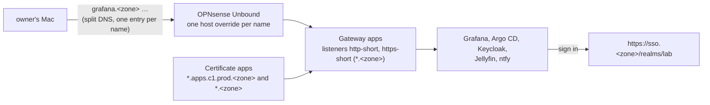

# Give lab apps short names under the zone

STD-0001 rule 5 lets each prod app have a short alias, `<app>.<zone>`, next to its service name `<app>.apps.c1.prod.<zone>`. Rule 7 says an app builds its links with the name people use. This runbook turns the short names on for the five apps on c1 (`grafana`, `argocd`, `sso`, `jellyfin`, `ntfy`).



Each short name is its own DNS entry, in Unbound and in the tailnet's split DNS, so every other name in the zone still resolves publicly. On the Gateway one pair of listeners takes `*.<zone>`, and each app's route adds its short name. The certificate gets a second wildcard, `*.<zone>`, so no app name reaches Certificate Transparency logs with a public issuer.

Every part has its own switch, all on by default: `k8s_gateway_short_names`, `k8s_certs_short_names`, `k8s_app_route_short_names`, `k8s_identity_short_names`, `k8s_gitops_ui_short_names`, `k8s_observability_short_names`, and `shortNames` in the `gateway`, `jellyfin` and `alerts` charts.

## What needs the owner's hands

1. Say go for steps 2 and 3, which change the firewall's DNS and the tailnet.
2. After step 7, sign in at `https://grafana.<zone>/` with "Lab sign-in".

## Before you start

1. The lab DNS runbook is done: `dscacheutil -q host -a name grafana.apps.c1.prod.<zone>` on the Mac prints the Gateway's address.
   why: this runbook adds names to the same Unbound and split DNS set-up.
2. The repo's `main` has this change and c1's root Application has refreshed.

## Steps

1. Private values. In the private inventory, add the five short names to `opnsense_lab_host_overrides`, each pointing at `{{ k8s_gateway_address }}`, as `hosts.example.yml` shows. If `home.tfvars` sets `split_dns_names`, add `grafana`, `argocd`, `sso`, `jellyfin` and `ntfy` to it; if not, the default has them.
   ※ `hosts/AGENT-PICKS.md` pick 175.
   expect: `git status` in the lab clone shows no change: both files are git-ignored.

2. Unbound, from `hosts/ansible/`:

   ```sh
   ansible-playbook -i inventories/home/ playbooks/opnsense.yml --tags dns --check --diff
   ansible-playbook -i inventories/home/ playbooks/opnsense.yml --tags dns
   ```

   why: each short name becomes a host override with the Gateway's address. A host override without a wildcard leaves the rest of the zone public, the same as `opnsense.<zone>` today.
   expect: five overrides added, and every `dns_proof` item `ok`. A second run reports `changed=0`.

3. Split DNS, from `hosts/terraform/home/tailnet/`:

   ```sh
   set -a; . ../../../.env; set +a
   tofu init -backend-config="path=$HOME/.local/state/central-hub/home-tailnet.tfstate"
   tofu plan -var-file=home.tfvars -out=tailnet.tfplan
   tofu apply tailnet.tfplan
   ```

   expect: the plan adds five split DNS entries and changes nothing else; a second plan shows no changes. On the Mac, `dscacheutil -q host -a name grafana.<zone>` prints the Gateway's address.

4. The certificate:

   ```sh
   ansible-playbook -i inventories/home/ playbooks/k8s-certs.yml --tags issue
   ```

   why: Certificate `gateway/apps` gains `*.<zone>`, and cert-manager issues it again from the same issuer (`lab-ca`).
   expect: `kubectl -n gateway get certificate apps` is Ready, and its Secret's certificate lists both wildcards (`kubectl -n gateway get secret apps-tls -o jsonpath='{.data.tls\.crt}' | base64 -d | openssl x509 -noout -ext subjectAltName`).

5. The Gateway and the routes. In Argo CD, sync `gateway`, `jellyfin` and `alerts` (or with Ansible in charge of the Gateway, run `playbooks/k8s-gateway.yml`). Then:

   ```sh
   ansible-playbook -i inventories/home/ playbooks/k8s-gitops.yml --tags ui,sso
   ```

   why: the Gateway gains listeners `http-short` and `https-short`, each route adds its short name, ntfy builds links with `ntfy.<zone>`, and Argo CD's `url` becomes `https://argocd.<zone>` with the issuer `https://sso.<zone>/realms/lab`.
   expect: `kubectl -n gateway get gateway apps -o jsonpath='{range .status.listeners[*]}{.name}={.conditions[?(@.type=="Programmed")].status} {end}'` shows all four listeners `True`. `https://argocd.<zone>/` opens on the Mac.

6. Keycloak and realm lab:

   ```sh
   ansible-playbook -i inventories/home/ playbooks/k8s-identity.yml --tags keycloak,route
   ```

   why: Keycloak's hostname, and so its issuer, becomes `https://sso.<zone>`. Every client also accepts its app's short name, so the realm is imported again (see set-up-lab-sign-in.md, step 2).
   expect: `https://sso.<zone>/realms/lab/.well-known/openid-configuration` shows `"issuer":"https://sso.<zone>/realms/lab"`. A second run reports `changed=0`.

7. Grafana: sync `kube-prometheus-stack` in Argo CD (or run `playbooks/k8s-observability.yml` when Ansible runs it).
   why: Grafana's `root_url` becomes `https://grafana.<zone>/` and its sign-in goes to `https://sso.<zone>/`.
   expect: `https://grafana.<zone>/` opens, "Lab sign-in" goes to `sso.<zone>` and comes back signed in.

## If it fails

- **A short name doesn't resolve on the Mac:** `tailscale dns status | grep <zone>` must list it (step 3), and the Unbound override must exist (step 2).
- **The browser warns about the certificate:** step 4 hasn't issued the new one yet, or the Mac doesn't trust the lab root (trust-lab-root-ca-on-mac.md).
- **Sign-in fails with "Invalid parameter: redirect_uri":** realm lab was not imported again (step 6).
- **The way back:** set the switches above to false in the inventory and `shortNames: false` in the three charts, then run steps 4 to 7 again; the long names never stopped working.

## Afterwards

Fill in `last-tested` with the date, who ran it and on what, and set `status: tested` once steps 1 to 7 pass.

## Related

- STD-0001, "Service names", rules 5 to 7.
- set-up-lab-dns.md, set-up-lab-sign-in.md, issue-c1-app-certificate.md, move-gateway-to-argo-cd.md.
