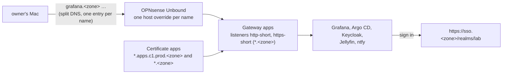

# Give lab apps short names under the zone

STD-0001 rule 5 lets each prod app have a short alias, `<app>.<zone>`, next to its service name `<app>.apps.c1.prod.<zone>`. Rule 7 says an app builds its links with the name people use. This runbook turns the short names on for the apps on c1 (`grafana`, `argocd`, `sso`, `jellyfin`, `ntfy`, and `hub`, the Central Hub web app).



Each short name is its own DNS entry, in Unbound and in the tailnet's split DNS, so every other name in the zone still resolves publicly. On the Gateway one pair of listeners takes `*.<zone>`, and each app's route adds its short name. The certificate gets a second wildcard, `*.<zone>`, so no app name reaches Certificate Transparency logs with a public issuer.

An app whose short name needs no private value gets its Unbound override from the role's own list, `opnsense_lab_short_app_names` (`roles/opnsense_lab/defaults/main.yml`, today `hub`, `homeassistant`, `mealie`, `openbao` and `vault`), pointing at `k8s_gateway_address`; it needs no line in the private inventory. The firewall pipeline on the agent box runs it from `main` (`opnsense-prod.sh check`, then a reviewer's pass and `apply-recorded`, D-0063), and the box's own check of the name is `dig` or `getent hosts <app>.<zone>`. The tailnet split-DNS entry is the same change: `hub` is in `app_split_dns_names` (`hosts/terraform/home/tailnet/variables.tf`), added to whatever `split_dns_names` a private `home.tfvars` sets, and applied on the agent box by `tailnet-stack.sh plan`, then the reviewer's pass and the standing go, then `apply-recorded` ([run-the-tailnet-stack-as-a-pipeline-job.md](run-the-tailnet-stack-as-a-pipeline-job.md)).

Every part has its own switch, all on by default: `k8s_gateway_short_names`, `k8s_certs_short_names`, `k8s_app_route_short_names`, `k8s_identity_short_names`, `k8s_gitops_ui_short_names`, `k8s_observability_short_names`, and `shortNames` in the `gateway`, `jellyfin` and `alerts` charts.

## What needs the owner's hands

1. Say go for steps 2 and 3, which change the firewall's DNS and the tailnet (D-0036 rule 8).
2. Say go for the firewall pass that lets the agent box and the desktop VM open the Gateway on tcp 443 (the app access pass, [set-up-lab-network-and-firewall.md](set-up-lab-network-and-firewall.md), the paragraph "For the apps' names from dev"). It is not a step of this runbook: steps 1 to 7 and the in-cluster check below do not need it. Without it, the box's and the desktop's own checks of the names cannot pass.
3. After step 7, sign in at `https://grafana.<zone>/` with "Lab sign-in".

## Where this stands on main

Read from `main` at `8bca3cd` on 2026-11-18, not run again here:

| Part | What main has | Still waits |
|---|---|---|
| Switches | all on by default: `k8s_gateway_short_names` (`roles/k8s_gateway/defaults/main.yml`), `k8s_observability_short_names` (`roles/k8s_observability/defaults/main.yml`) and `shortNames` in `apps/gateway/values.yaml` | nothing |
| The in-cluster name check | CronJob `gateway/name-check`, schedule `15,45 * * * *`, apps `grafana argocd sso jellyfin ntfy` (`apps/gateway/values.yaml`, `nameCheck`) | to read its newest job, see "Prove it from the agent box" |
| Unbound and tailnet split DNS (steps 2 and 3) | code and default names (`split_dns_names`, `hosts/terraform/home/tailnet/variables.tf`) | the owner's go; the private values are not in this repository |
| The firewall pass for the box and the desktop VM on tcp 443 | merged: role `opnsense_lab`, `tasks/app_access.yml` | the owner's go, and a run from a machine that holds the private inventory; whether it has run is not shown by this repository |
| The desktop's own check of the names | `desktop_trust_check_reach: false` (`roles/desktop/defaults/main.yml`), a switch a one-line pull request sets after the firewall pass | the firewall pass above; [set-up-the-desktop.md](set-up-the-desktop.md) |

## Proven runs, 2026-11-20

A second kind of run, from the agent box: the sixth short name, then called `central-hub-app` and since 2026-11-21 `hub`, with no step on the owner's Mac.

| Part | What ran | Result |
|---|---|---|
| Unbound override (#773) | `opnsense-prod.sh check`, then the reviewer's pass, the standing go and `apply-recorded` | check 282cc9b547f0: 1 changed, 10 skipped, 47 tasks; applied at 09:27 to 09:29 UTC, no rollback |
| Resolve and open the page | from the box, `getent hosts central-hub-app.<zone>`, then `curl https://central-hub-app.<zone>/` (the name before the rename to `hub`) | the Gateway's address; `200`, certificate verified against the lab CA, page title `Central Hub`; `/api/v1/catalog` `200` |
| Tailnet split DNS (#785, #788) | `tailnet-stack.sh plan`, the reviewer's pass, the standing go and `apply-recorded` | plan 755385b91b0c: 1 to add; applied at 10:30 UTC; a fresh plan shows 0 to add |
| Rename to `hub` (#856), applied 2026-11-22 on commit 67d83032 | `opnsense-prod.sh apply-recorded 9fcdf8be6849` and `tailnet-stack.sh apply-recorded 80344700d834`, each on the owner's own go | the tailnet re-plan showed 0 to add, 0 to change, 0 to destroy; from the box, `hub.<zone>` resolved and answered `200` (reported by the orchestrator thread's run) |

The old name's override is removed by the role's list `opnsense_lab_short_app_names_retired`, so a rename does not leave the old name answering; add a renamed app's old name there. The list is empty today: on 2026-11-22 the owner chose to leave the old `central-hub-app` override in place, so add it to the list only when that choice changes. Not proven: that a tailnet device resolves the new name through split DNS (now `hub.<zone>`). The box and the agent cloud session do not use split DNS (a query for `grafana.<zone>` to `100.100.100.100` from the cloud session also returned NXDOMAIN), so the check is the owner's Mac or phone opening `https://hub.<zone>/`.

## Before you start

1. The lab DNS runbook is done: `dscacheutil -q host -a name grafana.apps.c1.prod.<zone>` on the Mac prints the Gateway's address.
   why: this runbook adds names to the same Unbound and split DNS set-up.
2. The repo's `main` has this change and c1's root Application has refreshed.

## Steps

1. Private values. In the private inventory, add the five short names to `opnsense_lab_host_overrides`, each pointing at `{{ k8s_gateway_address }}`, as `hosts.example.yml` shows. If `home.tfvars` sets `split_dns_names`, add `grafana`, `argocd`, `sso`, `jellyfin` and `ntfy` to it; if not, the default has them.
   ※ `hosts/AGENT-PICKS.md` pick 175.
   expect: `git status` in the lab clone shows no change: both files are git-ignored.

2. Unbound, from `hosts/ansible/`:

   ```sh
   ansible-playbook -i inventories/home/ playbooks/opnsense.yml --tags dns --check --diff
   ansible-playbook -i inventories/home/ playbooks/opnsense.yml --tags dns
   ```

   why: each short name becomes a host override with the Gateway's address. A host override without a wildcard leaves the rest of the zone public, the same as `opnsense.<zone>` today.
   expect: five overrides added, and every `dns_proof` item `ok`. A second run reports `changed=0`.

3. Split DNS, from `hosts/terraform/home/tailnet/`:

   ```sh
   set -a; . ../../../.env; set +a
   tofu init -backend-config="path=$HOME/.local/state/central-hub/home-tailnet.tfstate"
   tofu plan -var-file=home.tfvars -out=tailnet.tfplan
   tofu apply tailnet.tfplan
   ```

   expect: the plan adds five split DNS entries and changes nothing else; a second plan shows no changes. On the Mac, `dscacheutil -q host -a name grafana.<zone>` prints the Gateway's address.

4. The certificate:

   ```sh
   ansible-playbook -i inventories/home/ playbooks/k8s-certs.yml --tags issue
   ```

   why: Certificate `gateway/apps` gains `*.<zone>`, and cert-manager issues it again from the same issuer (`lab-ca`).
   expect: `kubectl -n gateway get certificate apps` is Ready, and its Secret's certificate lists both wildcards (`kubectl -n gateway get secret apps-tls -o jsonpath='{.data.tls\.crt}' | base64 -d | openssl x509 -noout -ext subjectAltName`).

5. The Gateway and the routes. In Argo CD, sync `gateway`, `jellyfin` and `alerts` (or with Ansible in charge of the Gateway, run `playbooks/k8s-gateway.yml`). Then:

   ```sh
   ansible-playbook -i inventories/home/ playbooks/k8s-gitops.yml --tags ui,sso
   ```

   From the box, once `c1-ansible list` there prints `gitops`: `c1-ansible check gitops`, then `c1-ansible apply gitops <clearance id>`. The box runs the wrapper's fixed tags (`source,ui,sso`), which can be more than the Mac command above, and reads its own copy of the inventory ([set-up-the-agent-box.md](set-up-the-agent-box.md#change-c1-from-the-box)).

   why: the Gateway gains listeners `http-short` and `https-short`, each route adds its short name, ntfy builds links with `ntfy.<zone>`, and Argo CD's `url` becomes `https://argocd.<zone>` with the issuer `https://sso.<zone>/realms/lab`.
   expect: `kubectl -n gateway get gateway apps -o jsonpath='{range .status.listeners[*]}{.name}={.conditions[?(@.type=="Programmed")].status} {end}'` shows all four listeners `True`. `https://argocd.<zone>/` opens on the Mac.

6. Keycloak and realm lab:

   ```sh
   ansible-playbook -i inventories/home/ playbooks/k8s-identity.yml --tags keycloak,route
   ```

   why: Keycloak's hostname, and so its issuer, becomes `https://sso.<zone>`. Every client also accepts its app's short name, so the realm is imported again (see set-up-lab-sign-in.md, step 2).
   expect: `https://sso.<zone>/realms/lab/.well-known/openid-configuration` shows `"issuer":"https://sso.<zone>/realms/lab"`. A second run reports `changed=0`.

7. Grafana: sync `kube-prometheus-stack` in Argo CD (or run `playbooks/k8s-observability.yml` when Ansible runs it).
   why: Grafana's `root_url` becomes `https://grafana.<zone>/` and its sign-in goes to `https://sso.<zone>/`.
   expect: `https://grafana.<zone>/` opens, "Lab sign-in" goes to `sso.<zone>` and comes back signed in.

## Prove it from the agent box

CronJob `gateway/name-check` (app `gateway`, `templates/name-check.yaml`) runs at :15 and :45. It opens `https://<app>.<zone>/` and `https://<app>.apps.c1.prod.<zone>/` for each app in `nameCheck.apps`, through the Gateway's own Service `cilium-gateway-apps`, and checks the certificate against the lab CA (`ca.crt` of Secret `apps-tls`, the only key it mounts). It proves the listeners, the routes, the certificate and the apps from inside c1, because the dev VLAN's rules do not pass the agent box to prod's port 443 until the firewall pass (see "What needs the owner's hands", item 2) is applied; the box's `curl` to the Gateway timed out on 2026-11-18 at 22:51 UTC, and whether that pass was applied since is not read here. After that pass, the box's `curl -sS -o /dev/null -w '%{http_code}' --cacert <lab CA chain> https://grafana.<zone>/` prints a status. DNS is checked separately: from the box, `getent ahostsv4 grafana.<zone>` must print the Gateway's address.

1. `c1-read get jobs -n gateway --sort-by=.metadata.creationTimestamp`
   expect: the newest `name-check-<number>` job has completions `1/1`.
2. `c1-read logs -n gateway job/<that job>`
   expect: two lines per app, such as `grafana short: 302, certificate verified` and `grafana long: 302, certificate verified`, ending `name check: every name answers with a verified certificate`. A failing line gives curl's exit code: 60 is a certificate the lab CA did not sign or that lacks the name, 7 or 28 is no answer from the Gateway, and `curl exit 0` with a 5xx code is the app.

This does not show that a browser trusts the certificate. That needs the lab root in the browser's trust store: [trust-lab-root-ca-on-mac.md](trust-lab-root-ca-on-mac.md) on the owner's Mac.

## If it fails

- **A short name doesn't resolve on the Mac:** `tailscale dns status | grep <zone>` must list it (step 3), and the Unbound override must exist (step 2).
- **The browser warns about the certificate:** step 4 hasn't issued the new one yet, or the Mac doesn't trust the lab root (trust-lab-root-ca-on-mac.md).
- **Sign-in fails with "Invalid parameter: redirect_uri":** realm lab was not imported again (step 6).
- **The way back:** set the switches above to false in the inventory and `shortNames: false` in the three charts, then run steps 4 to 7 again; the long names never stopped working.

## Afterwards

Fill in `last-tested` with the date, who ran it and on what, and set `status: tested` once steps 1 to 7 pass.

## Related

- STD-0001, "Service names", rules 5 to 7.
- set-up-lab-network-and-firewall.md, set-up-the-desktop.md, set-up-lab-dns.md, set-up-lab-sign-in.md, issue-c1-app-certificate.md, move-gateway-to-argo-cd.md.
