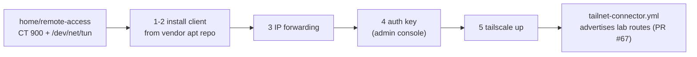

# Install the tailnet client in CT 900

**Status:** draft, written on 2026-11-08 from the tailnet vendor's docs named in each step; not yet run as written. The running CT 900 was set up by hand in an earlier build session, and how was not recorded.

`hosts/terraform/home/remote-access` makes CT 900 as an object only: eth0 on vmbr0 by DHCP, eth1 on VNet mgmt, `/dev/net/tun` passed through, and `keyctl` and `nesting` on. "What runs inside it (the tailnet client, sysctl, routes) is not done here" (`main.tf`). This runbook does the client and the sysctl. The routes are code in PR #67 (`playbooks/tailnet-connector.yml`, runbook `set-up-lab-dns.md`).



## Before you start

- On the host, `pct status 900` says `running`, and `pct exec 900 -- ip -br addr` shows an address on eth0 and the fixed mgmt address on eth1.
- `pct config 900` shows `dev0: /dev/net/tun` and `features: keyctl=1,nesting=1`. An unprivileged container needs the TUN device for the client's kernel networking; the vendor's guide sets exactly these with `pct set` (<https://tailscale.com/kb/1130/lxc-unprivileged>). Terraform sets them, so you change nothing here.

Stop if `/dev/net/tun` is missing: apply `hosts/terraform/home/remote-access` again rather than adding it by hand.

## Steps

Run on the Proxmox host as root. Every command goes into the container with `pct exec 900 --`.

1. Add the vendor's package repository for Debian 13 (trixie).

   ```sh
   pct exec 900 -- bash -c 'apt-get update && apt-get install -y curl ca-certificates'
   pct exec 900 -- bash -c 'mkdir -p --mode=0755 /usr/share/keyrings &&
     curl -fsSL https://pkgs.tailscale.com/stable/debian/trixie.noarmor.gpg -o /usr/share/keyrings/tailscale-archive-keyring.gpg &&
     curl -fsSL https://pkgs.tailscale.com/stable/debian/trixie.tailscale-keyring.list -o /etc/apt/sources.list.d/tailscale.list'
   ```

   why: these are the vendor's own install lines for trixie (<https://pkgs.tailscale.com/stable/>); apt then checks every package against that key, and `apt upgrade` keeps the client current.
   expect: `pct exec 900 -- cat /etc/apt/sources.list.d/tailscale.list` names the signed-by keyring.

2. Install the client.

   ```sh
   pct exec 900 -- bash -c 'apt-get update && apt-get install -y tailscale'
   pct exec 900 -- systemctl is-enabled tailscaled
   ```

   expect: `enabled`.

3. Turn on IP forwarding, so CT 900 can route between the tailnet and the lab.

   ```sh
   pct exec 900 -- bash -c 'printf "net.ipv4.ip_forward = 1\nnet.ipv6.conf.all.forwarding = 1\n" > /etc/sysctl.d/99-tailscale.conf && sysctl -p /etc/sysctl.d/99-tailscale.conf'
   ```

   why: a subnet router must forward packets (the vendor's subnet router guide, <https://tailscale.com/kb/1019/subnets>); `playbooks/tailnet-connector.yml` stops if `net.ipv4.ip_forward` is not `1` (PR #67, role `tailnet_connector`).
   expect: both values print as `1`.

4. In the tailnet admin console (Settings, Keys), make an auth key for CT 900: not reusable, **pre-approved**, with a **tag**, and a short expiry (1 day).
   why: an auth key logs a server in with no browser; pre-approved skips device approval, and a tagged device has key expiry turned off by default, so the connector doesn't drop off after 180 days (<https://tailscale.com/kb/1085/auth-keys>). Agent pick: the tag `tag:lab-connector`; the tailnet policy must list it under `tagOwners` before the key can carry it, and the policy is the owner's to change. The key is used once in step 5 and never saved; it expires by itself.
   expect: the console shows the key once; copy it straight into step 5.

5. Join the tailnet.

   ```sh
   pct exec 900 -- tailscale up --auth-key=<key from step 4> --hostname=<connector_hostname> --accept-dns=false
   pct exec 900 -- tailscale status
   ```

   why: `--hostname` gives the device its STD-0001 name (the same value as `connector_hostname` in `home.tfvars`, never written here). Agent pick: `--accept-dns=false`, so the container keeps the resolver Proxmox gives it and its own lookups don't depend on the tailnet. SNAT stays on, the vendor's default, so lab hosts see tailnet clients as CT 900's own address and need no return route; the host firewall's `management` rule counts on that ([hosts/ansible/README.md, Still open](../../hosts/ansible/README.md#still-open)).
   expect: `tailscale status` lists CT 900 with a 100.x address, and the admin console shows it tagged and approved.

6. Hand over to code: advertise the lab routes and turn them on.
   runbook: `set-up-lab-dns.md` (PR #67), steps 2-5: `playbooks/tailnet-connector.yml`, then `hosts/terraform/home/tailnet`.
   why: `tailscale set --advertise-routes` replaces the whole list, so the route list lives in one place, the role, never typed by hand.
   expect: from the owner's Mac, `ping 10.1.50.1` answers.

## If it fails

- `tailscale up` hangs or says the TUN device is missing: check `pct config 900` for `dev0: /dev/net/tun`, then `pct reboot 900`. The vendor's guide says a running container needs a full stop and start after the device is added.
- The key is refused: it expired, or the tag isn't in `tagOwners`. Make a new key.
- To undo: `pct exec 900 -- tailscale logout`, then remove the device in the admin console.

## Afterwards

Set `last-tested`. The Proxmox host firewall's probes check `tailscale status --json` in CT 900 ([Set up the lab network and firewall](set-up-lab-network-and-firewall.md) step 8), so run that step after this one on a fresh build.

## Related

- [Rebuild the home lab from bare metal](rebuild-home-lab-from-scratch.md).
- [D-0022](../decisions/0022-reach-clusters-by-ssh-now-and-keep-admin-kubeconfigs-for-break-glass.md): how agents reach c1 through the owner's Mac.
