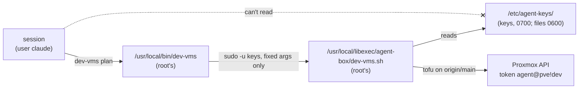

# Set up the agent box's users, keys, wrappers and guard rules

**Status:** draft, not yet run. Written 2026-11-10 from the code in `hosts/ansible/roles/agent_box`.

A deny rule can't stop a session from reading a file it is allowed to read, with `less`, `python` or anything else. So the keys are kept from sessions by file ownership, and the deny rules are a second floor for everything else:



| Piece | Where | Owner and mode |
|---|---|---|
| Session user | `claude`, no extra groups (no `wheel`) | |
| Keys user | `keys`, a system user with no login shell, home `/var/lib/agent-box` | |
| Keys | `/etc/agent-keys/` | `keys`, 0700; every file 0600 |
| Wrappers | `/usr/local/libexec/agent-box/<name>.sh` | root, 0755 |
| Front scripts sessions run | `/usr/local/bin/<name>` | root, 0755 |
| sudo | `/etc/sudoers.d/agent-box`, one line per wrapper | root, 0440, checked by `visudo` |
| Claude Code guard | `/etc/claude-code/managed-settings.json` | root, 0644 |
| Hostname kept across reboots | `/etc/cloud/cloud.cfg.d/99-keep-hostname.cfg` (`preserve_hostname: true`) | root, 0644 |
| Tailscale client | package `tailscale` from pkgs.tailscale.com, `tailscaled` on at boot | |

CT 259, the jumpbox rehearsal's container, is not the agent box. This runbook doesn't touch it. The owner chose to delete it (tap of 2026-11-18 00:00:40 UTC), and the steps are in [Grow the agent jumpbox](grow-the-agent-jumpbox.md#delete-the-rehearsals-container).

There are twenty-six wrappers (the entries of `agent_box_wrappers` in the role defaults). `rebuild up|rebuild [<commit>]|teardown|identity` runs the dev one-command rebuild, of main's newest commit or of the commit on main it names ([below](#rebuild-dev-from-the-box); every dev run also ends with a dev CA stage and the identity stage, a sign-in proof for a dev test admin; `identity` runs that stage alone once the role has been applied with the subcommand), and `rebuild log` prints the newest run's stage lines and its `PASS` and `FAIL` lines, nothing else, so a session can read what a run proved without reading the raw log. `pr-merge check OWNER/REPO PR HEAD` reads one pull request as the GitHub App and prints its verdict; the keys user's timer runs `pr-merge sweep`, which squash-merges a PR whose head holds the reviewer's recorded pass, under D-0031 and D-0042 ([how it decides](#merge-pull-requests-from-the-box)). `pass-record add|show|halt|resume` writes the ledger of passes and the sweep's stop flag. `ci-runner plan|apply|configure|destroy|bump` builds the notebook's CI runner VM, registers it, and opens a pull request when a newer runner release is due; a weekly timer, `ci-runner-weekly.timer`, runs `configure` then `bump` as the keys user ([Set up the notebook's self-hosted CI runner](set-up-the-ci-runner.md)). `desktop plan|apply|configure|destroy` builds and sets up the owner's desktop VM, with the agents' Proxmox rights on its pool only while `DESKTOP_ACCESS` is on in `agent-access.sh` ([Set up the owner's desktop VM](set-up-the-desktop.md)). `secrets-store recovery|status|snapshot|restore|restore-rebuilt [raft-<time>.snap]|clear-hold|put c1/<path> <key>|compare|reseed` calls the lab's secrets store, OpenBao, inside the dev cluster (D-0058), and makes its admin AppRole IDs in `/etc/agent-keys/dev/` and never prints them; every action refuses unless the store's address is the dev store the dev inventory names, and each stops until the box's path to the store sets that address and its CA file; `put` writes one key (value on stdin) to its SOPS copy, then the store, `compare` names keys that differ, and `reseed` fills a fresh store from SOPS, all three only once the owner's tap sets `sops_copies`; `snapshot` copies a Raft snapshot into that folder, `restore` puts the newest of the same store back and proves it, `restore-rebuilt` puts the previous store's newest snapshot, or one named exactly, onto a rebuilt one, and `clear-hold` ends a rebuild's hold when no restore is wanted ([Set up the lab's secrets store (OpenBao) on dev and prod](set-up-the-secrets-store.md)). `secrets-store-prod` takes the same actions for the store inside prod's c1, with prod's keys folder, settings and inventory, and makes no recovery shares; `openbao-prod key|check|seal <tap id>|seal-copy <tap id>|l2-policy|gitops|ca|handover|refresh <tap id>|reset-failed-start <tap id>|drop-box-path <tap id>|admin-firewall-check|admin-firewall <tap id>|log` turns that store on in prod's c1 with the box's own prod node key ([On prod](set-up-the-secrets-store.md#on-prod)). `rebuild-prod check|rebuild <tap id> <commit>|log` tears prod's Kubernetes layer down and builds it again with prod's data put back, under D-0035: `check` is read-only, and `rebuild` takes a fresh backup and its restore test, keeps each node's backup certificate, and needs dev to have passed at the same commit first ([Rebuild prod from the box](rebuild-k8s-layer-with-one-command.md#rebuild-prod-from-the-box)). `tailnet-cleanup plan` lists the old tailnet devices its daily timer would remove ([below](#remove-old-tailnet-devices)). `c1-read get|describe|logs|top|events|explain|api-resources|api-versions|version|auth can-i ...` reads c1 with the read-only kubeconfig from app `agent-read`, which sessions can't open; it passes read verbs only and refuses flags that pick other credentials or open a local file ([give-agents-read-access-to-c1.md](give-agents-read-access-to-c1.md) step 5). `tailnet-stack plan|apply <card> <hash>|log` plans and applies the tailnet's connector routes and split DNS as the keys user, through the `lab-tailnet` pipeline job: `plan` saves the plan with its commit and hash, and `apply` runs only that saved plan, and only when the owner has tapped a decision card that names the pull request and its head and the first 12 hex digits of the plan's hash, so a session can plan and read the log but can't apply; there is no Mac step and no typed line ([Change the tailnet stack through the pipeline job](run-the-tailnet-stack-as-a-pipeline-job.md)). `proxmox-host check|apply <pass> <hash>|log` runs `playbooks/proxmox-proxy.yml`, and nothing else, on the Proxmox host as root, through the `lab-proxmox-host` pipeline job; it runs as its own user, `hostops`, not `keys`, so no other wrapper can read its key in `/etc/agent-keys-host/`; a session can check and read the log, only the runner can apply, and an apply runs only when a fresh check gives the hash the agents passed ([Serve the Proxmox web UI on port 443](serve-proxmox-on-443.md)). `repo-create create <name>` makes one empty public repository under the owner's account as the GitHub App, with a token that can only create repositories ([below](#make-a-repository-from-the-box)). `checkpoint-note post test|<n>` posts one fixed-format comment, as the App, on the one pull request the box's settings name, so a session that watches it wakes on a box finding ([below](#wake-a-session-from-the-box)). `checkpoint-scan run|show` is the hourly checkpoint as a box script: it reads GitHub and the pass ledger, and posts through `checkpoint-note` only when a finding was not in its last run ([below](#the-hourly-checkpoint-scan)). `pickup-scan dry-run|show` (and `run`, which only its timer uses) reads the notebook's task board every 10 minutes and posts through `pickup-note` only when a project has a new ready task; `pickup-note post <project> <label>` (and `post-stale <project> <label>` for a stale claim) posts one fixed comment on that project's standing pull request, and sessions can only read its log ([below](#the-box-pickup-scan)). The last is `dev-vms plan|apply|destroy`: OpenTofu on `hosts/terraform/home/k8s` for the dev rebuild VMs (250-257), with the agents' own token `agent@pve!dev` (`hosts/terraform/home/bootstrap/agent-access.sh`). It runs only the code on `main`: it moves the `keys` user's own checkout to `origin/main` first, so a session can't change what runs with the token. Each wrapper that runs the repository's code (`ci-runner`, `dev-vms`, `rebuild`, `rebuild-prod`, `tailnet-stack`) has its own checkout, `/var/lib/agent-box/checkouts/<wrapper>` (cloned on its first run), and takes a lock for the whole run, so one run can't move the code under another, and a second run of the same wrapper stops at once with `another <wrapper> run is going`.

## Before you start

- The VM is grown and its plan names it by STD-0001 ([grow-the-agent-jumpbox.md](grow-the-agent-jumpbox.md)).
- The filled-in inventory has group `agent_box` with the VM's address, its admin user, `agent_box_hostname` (the same name as the VM's name in `home/jumpbox`), and the Mac's allow rules and `autoMode` block in `agent_box_allow` and `agent_box_auto_mode`. Copy rules only, never secrets ([hosts.example.yml](../../hosts/ansible/inventories/home/hosts.example.yml)).
- The Proxmox API's certificate is issued by the lab CA, which the box doesn't trust yet. List only the public root certificate's file in `agent_box_ca_files`, by its full path: no folder, no pattern, never a file that holds a key. The role checks each file on the controller first, and stops unless it is a regular file that parses as a certificate and holds no `PRIVATE KEY` block. Set `agent_box_tls_check_url` to the API's version path on the name the wrappers use; that name must be in the certificate.

## Steps

1. Read the change first.
   why: the role replaces `/etc/claude-code/managed-settings.json` and takes `claude` out of any extra group, so the diff shows what the box loses.

   ```sh
   cd hosts/ansible
   ansible-playbook -i inventories/home/ playbooks/agent-box.yml --check --diff
   ```

   expect: the hostname change, the new users and folders, the sudoers file and the settings diff. Stop if `claude` loses a group the box needs.
   On a fresh box, the steps that write into a folder the run would create (the OpenTofu download and unpack, and the Tailscale package after its repository) show as skipped, and the proofs are skipped in check mode. A check never writes to the box.

2. Run it.

   ```sh
   ansible-playbook -i inventories/home/ playbooks/agent-box.yml
   ```

   expect: `failed=0`. The hostname is the STD-0001 name and stays so after a reboot (cloud-init keeps it), and cloud-init no longer runs its first boot again when the VM is renamed (`manual_cache_clean: true`). The last tasks are the proofs: user `claude` can't open `/etc/agent-keys`, `sudo -l -U claude` lists only the wrappers, as `keys`, and `/etc/hosts` names the box once per address with no repeated line. When `agent_box_tls_check_url` is set, the last proof fetches it with certificate checks on and gets 200 or 401: the box trusts the Proxmox CA, so tofu will too.
   A backup of the old settings file stays beside it (`managed-settings.json.<date>~`).

3. Restart Remote Control so new sessions read the new hostname and settings.

   ```sh
   sudo systemctl restart claude-rc
   hostnamectl --static
   ```

   expect: the STD-0001 name. At claude.ai/code the box comes back under an entry with the new name. The old entry, under the rehearsal name, goes stale and can be ignored.

4. Join the tailnet as `tag:agent-box`, as the admin user.
   why: cloud sessions reach the box by Tailscale SSH as `claude` (the tailnet policy's SSH rule from `tag:agent` to `tag:agent-box`, `hosts/terraform/home/tailnet-policy`). The owner's devices (`autogroup:admin`) reach the box by Tailscale SSH as `admin`, for controller runs (the SSH rule from `autogroup:admin` to `tag:agent-box`). The policy's OAuth client can't mint auth keys, so the join uses a login link.

   ```sh
   sudo tailscale up --advertise-tags=tag:agent-box --ssh
   ```

   It prints a login link. The owner opens it once, signed in as a tailnet admin. `--ssh` stays on: the policy's SSH rule needs Tailscale SSH on the box.
   expect: `tailscale status` shows the box with `tag:agent-box`, and `ssh claude@<box>` from a cloud session gets a shell, while `ssh root@<box>` is refused.

5. Put the dev rebuild keys in place, as the admin user. The files never pass through a session or a repository.
   why: `dev-vms` reads them, and only the `keys` user can.

   ```sh
   sudo install -o keys -g keys -m 0600 /dev/stdin /etc/agent-keys/proxmox-dev.env <<'EOF'
   PROXMOX_VE_ENDPOINT=<the host's API URL>
   PROXMOX_VE_API_TOKEN=agent@pve!dev=<secret>
   EOF
   sudo install -o keys -g keys -m 0600 <dev tfvars from the Mac> /etc/agent-keys/dev-vms.tfvars
   ```

   `dev-vms.tfvars` needs no `vlans_file`: the wrapper passes the one in its own checkout, over any path the file gives.

6. Prove it as a session would, from a Remote Control session on the box.

   ```sh
   dev-vms plan
   cat /etc/agent-keys/proxmox-dev.env
   sudo -u keys cat /etc/agent-keys/proxmox-dev.env
   ```

   expect: `dev-vms plan` prints the central-hub commit and a plan; the `cat` fails with permission denied; the `sudo` line is refused by the deny rule `Bash(sudo:*)` before it runs.

7. Guard test: the owner sends each blocked line from their phone, as for the rehearsal (PLAN step 12). Each must be refused.

## The agents' GitHub App

The box holds the private key of the GitHub App "Central Hub Agents". Wrappers use it to mint one-hour installation tokens, so the agents act on GitHub under the App's own name instead of the owner's account. Six wrappers use it. `pickup-scan` mints a read-only token for the notebook (Contents and Pull requests read) to read its task board ([The box pickup scan](#the-box-pickup-scan)), and `pickup-note` mints a token for one repository with Pull requests (write) alone, as `checkpoint-note` does, to comment on a project's standing pull request. `checkpoint-note` mints a token for one repository with Pull requests (write) alone, to comment on one pull request ([Wake a session from the box](#wake-a-session-from-the-box)). `repo-create` mints a token with Repository creation alone to make one empty repository ([Make a repository from the box](#make-a-repository-from-the-box)). `pr-merge` mints a token for one repository to read a pull request and merge it. `ci-runner configure` mints a runner registration token for agent-notebook, and `ci-runner bump` mints a central-hub token with Contents and Pull requests (write) to open the runner bump pull request ([Set up the notebook's self-hosted CI runner](set-up-the-ci-runner.md), tested 2026-11-10). Cloud sessions don't use the App.

The owner sets it up once, in GitHub's web UI:

1. Register the App on the owner's account. Turn off the webhook and OAuth, and allow installs only on that account.
   why: nothing listens for events, and the App acts only as itself, never on the owner's behalf.
2. Give it repository permissions only:
   - Contents: read and write.
   - Pull requests: read and write.
   - Checks: read.
   - Actions: read.
   - Metadata: read.
   - Administration: write. GitHub requires it to create runner registration tokens, and the wrapper narrows each token to one repository and that one permission.
   - Repository creation: write. It covers making repositories (`POST /user/repos`, forks, template copies), not deleting them or changing their settings, and `repo-create` asks for it alone.

   Leave out Workflows, so a push that changes `.github/workflows/` is refused (rule 5). Leave out Secrets, Environments and Deployments too.
   why: least privilege. A permission added later must be accepted again on the installation.
3. Install it on the owner's account with "Only select repositories": central-hub, inpara, agent-notebook, obsidian-graph-3d, wizards and central-hub-app (which the App made itself, with the box's repo-create wrapper). Add the App to no ruleset bypass list.
   why: `main` stays protected, so the App merges and accepts nothing (rules 1 and 2).
4. Generate a private key, then put it on the box from the Mac with `agent-box-keys.sh put-github-app` ([allow-a-command-for-agents.md](allow-a-command-for-agents.md)). It lands as `/etc/agent-keys/github-app.pem`, owned by `keys`, mode 0600, and is never read, printed or copied anywhere else.
5. Put the App's ID in the private inventory, as `github_app_id` in `agent_box_ci_runner` ([hosts.example.yml](../../hosts/ansible/inventories/home/hosts.example.yml)), then run step 2 of the CI runner runbook.
   expect: `ci-runner configure` registers the runner. If the App is not installed on the repository, the wrapper says so by name ("If it fails" in the CI runner runbook).

Exit: uninstall the App and delete it in GitHub's settings, then delete `/etc/agent-keys/github-app.pem`.

## Prove a web sign-in from the box

The role installs headless Chromium through Playwright (pinned with hashes in `files/playwright-requirements.txt`, in its own virtual environment, browsers in a root-owned folder under the libexec folder) and the command `web-shot <url> <out.png> [--insecure]`. It loads the page as the session user, with no key, saves a full-page screenshot and prints the final address, the page title and the HTTP status. `--insecure` is for a dev cluster's throwaway CA only. It types nothing, so a sign-in that needs a form still goes through the proof scripts. Chromium's download comes from Playwright's own host at the first install, so the first run needs that outbound route. A bump of the pin is a change to the box's limits (D-0044). The role makes both folders readable and enterable by others (root-owned, writable by root only), because pip and Playwright left them `drwx------` and a session could not run `web-shot` (measured on the box on 2026-11-19: "playwright-venv/bin/python: Permission denied"); that fix is a box-limit change and reaches the box only by an install, and `.github/hosts-check/tests/test_web_shot_modes.sh` runs the task against folders of that mode.

## A browser that keeps its sign-ins

`web-shot` starts a fresh browser for every page. For web steps that need a session to stay signed in, the role also installs `agent-browser`, which uses the same Playwright pin and Chromium and adds no package. Only agent accounts sign in there, never the owner's.

```sh
agent-browser start --minutes 30   # Chromium in its full headless mode; stops by itself after 30 minutes (1 to 240)
agent-browser status               # running or not, its DevTools address, minutes left
agent-browser open https://example.com
agent-browser shot ~/shots/page.png
agent-browser stop                 # closes Chromium through DevTools, so the profile is written to disk first
```

- The profile is `~/.agent-browser/profile` (mode 700), so cookies and local storage are still there after a stop and a start.
- DevTools has no sign-in: whoever connects to its port drives the browser, its agent sign-ins and `file://` pages. So a packet filter, `/etc/nftables/agent-browser.nft`, loaded at boot by `agent-browser-nft.service`, lets only the session user's (`agent_box_user`) own sockets connect to the port on `lo`. Every other user's connection is reset, the runner's and root's included. The test runs this filter live as root: the session user connects, another user is reset, and without the filter that user connects.
- DevTools listens on `127.0.0.1:9222` only (`agent_box_browser_cdp_port`). A session drives the browser with Playwright's `connect_over_cdp("http://127.0.0.1:9222")`, or with Playwright MCP's `--cdp-endpoint`. A person watches it or takes over through DevTools' own page view at that address, reached by an SSH tunnel to the box. The only packet rule is the box-local filter above; no OPNsense, Proxmox firewall or tailnet rule is added.
- It runs headless because AlmaLinux 10 has no X server package (no Xvfb or Xvnc in BaseOS, AppStream or CRB, checked 2026-11-20).
- It stops by itself after its minutes, so it doesn't hold memory that a dev rebuild needs.
- `.github/hosts-check/tests/test_agent_browser.sh` checks its arguments and the role's tasks. The browser itself (start, open, shot, a sign-in kept across a restart, the timer) was run by hand with Playwright 1.64.1 on 2026-11-20.

Exit: delete the agent-browser role tasks, `agent-browser.py`, the filter and its unit (`systemctl disable --now agent-browser-nft.service`, which deletes the table), and each session user's `~/.agent-browser`.

## Render with Blender from the box

The role installs Blender 5.2.3 LTS (the newest release at least two weeks old on 2026-11-18, STD-0003) from the official Linux tarball, checked against the SHA-256 that download.blender.org publishes, into a root-owned folder under the libexec folder, links `blender` into `/usr/local/bin`, and installs the libraries it needs with no display or GPU: the X client libraries `ldd` found missing (`libSM`, `libICE`, `libXxf86vm`, `libX11-xcb`), and Mesa's software OpenGL, EGL and Vulkan. The tarball comes from an official mirror, because `download.blender.org` answers 403 to the box. A bump of the pin is a change to the box's limits (D-0044).

Sessions run it as themselves, always in background mode:

```sh
blender -b --factory-startup --python-exit-code 1 --python scene.py -- <args for the script>
blender -b file.blend -E CYCLES -o /tmp/out/frame_#### -f 1
```

why: `-b` runs with no window; the box has no display. `--factory-startup` skips any saved user startup file, so every run starts the same. `--python-exit-code 1` makes a script that raises end with exit code 1: without it Blender exits 0 even when the script failed (measured on the box on 2026-11-18, a script that raises returned 0 by default and 3 with `--python-exit-code 3`), so a failed render looks like a passed one. Arguments run in the order given, so `-f` or `-a` goes last.
expect: `Blender 5.2.3 LTS` from `blender -b --version`. Measured with the installed copy on the box on 2026-11-18 (2 vCPUs, 7.3 GB, no GPU), a 960x540 scene with three area lights and a subdivided mesh, peak memory read from `VmHWM`: Cycles on the CPU at 64 samples with denoising took 32 s and peaked at 850 MB; EEVEE took 52 s on Mesa's software renderer (llvmpipe) and peaked at 2.0 GB; Workbench took about 2 s and peaked at 740 MB. An earlier run of the same scene from a user-space copy took 48 s, 99 s and 1 s.

- Use Cycles with `cycles.device = "CPU"` for finished images. EEVEE works only through Mesa's software EGL, so it is slower than Cycles here.
- Check `free -m` before a render, and above all before EEVEE, which peaked at 2.0 to 2.5 GB on a small scene; the box shares the host with the dev rebuild.
- The Vulkan warning at start is expected: Blender falls back to OpenGL through EGL.
- docs.blender.org answers 403 to the box. The role keeps Blender Lab's MCP repository (projects.blender.org/lab/blender_mcp, pinned to commit dbbf836, 2026-09-29) under the libexec folder for the Python API reference and manual excerpts it bundles, about 4,500 RST files. Search them with `grep -rl <term> /usr/local/libexec/agent-box/blender-mcp/mcp/blmcp/data/`. Its MCP server is not installed, because sessions drive Blender directly with `blender -b --python`.

## Prove the lab's names from the box

`lab-proof` (a session runs it as itself, no key) reads c1's HTTPRoutes and the Gateway's address through `c1-read`, asks the box's resolver (the tailnet's, which hands lab names to Unbound) for each name with a short Python query, and opens a TLS connection to the Gateway with `openssl s_client`, checking the certificate against the box's trust store, where the lab root sits. It prints one line per route name and name number, with `dns=ok|FAIL` and the TLS verify result, then `PASS` or `FAIL`. It prints no host name, address or zone, so its output can go in a public record. It asks the question the `dns_proof` tag asks of the names c1 serves, but it is not that tag, and OPNsense's own name, which is not a c1 route, is not covered.

## Change c1 from the box

`c1-ansible` runs one named Ansible playbook against prod's c1 from the box, as the keys user, with the box's own prod node key (the one `openbao-prod key` makes), so the change leaves the Mac. `c1-ansible list` names what it runs: `identity`, `gateway`, `gitops`, `observability` and `users`. `observability` is `k8s-observability.yml` with every tag it has (`metrics_server,metrics,logs,route,proof`): metrics-server, kube-prometheus-stack, Loki, Alloy and Grafana's route, as the inventory's `*_by_argocd` switches decide. `gateway` is `k8s-gateway.yml --tags gateway` (the shared Gateway and the node firewall ports, not the smoke test), and `gitops` is `k8s-gitops.yml --tags source,ui,sso` (the GitOps source, the web UI route and the sign-in settings, never the `install` tag). Both use the inventory's own values and need no private file on the box. `k8s-certs.yml` is not a name, because it needs the lab CA's key and the Cloudflare token, which the box does not hold. `identity` is `k8s-identity.yml` with `k8s_identity_realm_replace=false`, fixed in the wrapper, so it never deletes and imports realm lab again on prod: that would end every sign-in; it runs with `--tags all,clients` and `k8s_identity_ensure_clients=[proxmox]`, so the role's clients task also adds or updates the proxmox client of realm lab in place; another client needs its own pull request that names it in the wrapper. Run `c1-ansible check identity` before the first apply: check mode skips the live client step, so it proves the play reaches the nodes and the client JSON builds, but shows no client diff. An in-place client update rewrites that client's secret from `identity.env`. `c1-ansible check <name>` is read-only (`--check --diff`). `c1-ansible apply <name> <clearance id>` runs it for real; the id is the reviewer's clearance message for the head that is on main, and it goes in the log (D-0042 rule 1). `c1-ansible log` prints the newest run's lines.

`opnsense-cert-check` reads the certificate the firewall's web UI serves and says how many days it has left (`check`, which the daily timer runs as the keys user, and `status`). It holds no key and writes nothing to the firewall; it needs `agent_box_opnsense_backup` for the firewall's name, and a failing run is a failed unit, not a push notification ([set-opnsense-gui-certificate.md](set-opnsense-gui-certificate.md), "Afterwards").

`signin-check` runs the three scripted sign-in checks (`jellyfin-signin-check.py`, `argocd-signin-check.py`, `proxmox-signin-check.py`) against prod with the test user, as the keys user, because the test user's password and TOTP seed are lines in `identity.env`, which a session cannot read. `sudo -n -u keys /usr/local/libexec/agent-box/signin-check.sh run` builds one private file per check from `<keys>/prod/signin-check.json` (the controller writes it and the prod-files run copies it: `base`, `realm`, `user`, `expect_admin`, `jellyfin_base`, `argocd_base`, and optionally `provider`, `pve_base`, `pve_realm`, `address`, `pve_address`, `digits`, `period`, `verify`, `admin_group`, `viewer_group`; no secret) and the user's `PASSWORD_<USER>` and `TOTP_<USER>` lines, runs the scripts from its own checkout of `main`, and prints only their numbered lines and `signin-check: PASS` or `FAIL`. Without a `pve_base` the Proxmox check does not run. `log` prints the newest run. It makes nothing in Keycloak or any app; the test user is an access right made by the owner's go, and how it is made is in [move-jellyfin-to-argo-cd.md](move-jellyfin-to-argo-cd.md). Not yet run on the box; the stand-in test is `.github/hosts-check/tests/test_signin_check_wrapper.sh`.

**`signin-check` needs the box to reach the apps' address on tcp 443, and the last read says it cannot.** The Jellyfin and Argo CD checks go through c1's Gateway. The dev VLAN's own rules pass nothing to prod, so the box needs the pass in role `opnsense_lab` (`tasks/app_access.yml`: the box and the desktop VM to the Gateway on 443, central-hub #491, applied on the owner's go, [set-up-lab-network-and-firewall.md](set-up-lab-network-and-firewall.md)). Measured from the box on 2026-11-18 at 22:51 UTC: `curl` to an app's short name ended "Connection timed out after 8002 milliseconds", http code 000, and at 04:36 UTC the same for all five names. The cause of the timeout was not read: either the #491 rules are not in effect, or something else blocks tcp 443 between the box and the Gateway. If the rules are the cause, `signin-check run` fails on a connection timeout before it tests any sign-in, whatever the test user's state; the timeout alone does not show that. Once the box's `curl` to an app name prints a status, the order is: the test account (an access-rights step), then `signin-check run`. Whether the #491 rules are applied is read by that `curl`, or from the firewall's rule list. Whether the Proxmox check reaches the web UI's name on 443 from the box is not measured.

The wrapper runs only code on `main`, in its own checkout, one run at a time, on its own copy of the prod inventory (the controller's ssh settings and proxmox group dropped, except that the group's `proxmox_cert_names` pass as a literal `k8s_identity_proxmox_hosts` on `k8s_nodes`, which the identity play needs to render client `proxmox`, and the run prints only their count; the box's key and plain ssh set; a host that sets a proxy, another key or another env than prod is refused). A name that needs a private values file stops with that file's name until the controller's prod-files run puts it on the box; `identity` needs `identity.env` in the keys folder's `prod` folder.

**Running the three playbooks from the box.** `gateway`, `gitops` and `observability` run their playbook with a fixed tag set, which is every tag the role has that the wrapper names: `gateway` is `gateway`, `gitops` is `source,ui,sso` and `observability` is `metrics_server,metrics,logs,route,proof`. A runbook step that names fewer tags on the Mac runs more tasks from the box; read the check's output first. The box reads the inventory copy that the controller's prod-files run put there, so a change to the private inventory reaches the box only after that run. `k8s-gateway.yml --tags smoke`, `k8s-gitops.yml --tags install` and `k8s-certs.yml` are not names: they stay on the Mac. The wrapper is not on the box until the box has installed it (`c1-ansible list` there prints the names); until then the Mac commands in each runbook stand. **Rule for `apply observability`** (the reviewer's, 2026-11-19 00:54 UTC): every `apply observability` needs the owner's go until the role prints what each of its delete tasks would remove. There are three, in `roles/k8s_observability/tasks/main.yml`: Helm's old `metrics-server` release Secrets (lines 44 to 51) and the old Secrets of `loki`, `alloy` and `kube-prometheus-stack` (lines 211 to 223), which run when the matching `*_by_argocd` switch is true; and Loki's StatefulSet (lines 148 to 155), which runs when `k8s_observability_logs_by_argocd` is false and the StatefulSet has no claim templates. Check mode cannot show them: they are `command` tasks with no `check_mode: false`, so a check lists each as skipped, never as changed. Once the reads in central-hub #653 are on main and on the box, the reviewer's clearance rule is: an `apply observability` is cleared only from the raw `c1-ansible check observability` output, filed in the Library, where every "delete would remove:" line says nothing. Any line that names a Secret or the Loki StatefulSet means the owner's go. File the whole output of the `check` run: `c1-ansible log` prints only the lines its filter keeps (`c1-ansible.sh`, the `log` branch), and it keeps the "delete would remove:" lines only once the box has installed central-hub #655; until then it drops them, so read the `check` output itself.

**The `users` name.** `c1-ansible check|apply users` runs `k8s-identity.yml` with tags `secrets,users`, the values file, `k8s_identity_realm_replace=false` and `{"k8s_identity_ensure_users":["signin-test"]}`: it adds the sign-in test user, `signin-test`, to the live realm lab and never replaces the realm (the role's `keycloak` tag does that, and this name does not run it). The user must be in the private inventory's `k8s_identity_extra_users` with `groups: [lab-admins]`, copied to the box by the controller's prod-files run; with no such user the run stops at `user-json.py` and creates nothing. A user that is already there is left as it is. `check` shows no user diff, because the create task skips in check mode. The `secrets` tag adds a random `PASSWORD_` and `TOTP_` line to the box's own `identity.env` for a key it lacks, and writes the realm's Secret in c1. Creating the user is an access right (D-0042 rule 6), so the apply needs its own recorded go naming the step and the commit.

expect: `c1-ansible check identity` ends with the play recap and `c1-ansible: check identity done`. If it says no prod node key yet or the key is refused, the node key's public half is not on prod's nodes (`openbao-prod key`, then `openbao-prod check`).

## Merge pull requests from the box

The box merges by a sweep, not by a workflow: a cloud session cannot start a GitHub workflow here (403, measured 2026-11-14). The page [Merge a pull request with the box's sweep](merge-a-pr-through-the-merge-job.md) is the how-to; this section is the setup.

- `pass-record` (sudo for sessions: `add`, `show`, `halt`, `resume`; `owner-tap` and `resume` only with the recorder `orchestrator`) writes the ledger of passes in `/var/lib/agent-box/passes/<repo>/<head>.jsonl` and sets or clears the halt flag. `pr-merge check` (sudo for sessions) is read-only. `pr-merge merge` and `pr-merge sweep` have no sudo line; only the keys user runs them.
- `agent_box_merge_sweep: true` in the inventory installs `pr-merge-sweep.service` and `.timer` (every `agent_box_merge_sweep_interval`, default 5 minutes), which run `pr-merge.sh sweep` as the keys user. Installing it is a change to the box's limits, so it waits for the agents' pass of its digest, with no owner card (D-0042 rule 4).
- Green is [D-0031](../decisions/0031-let-agents-merge-green-prs.md) rule 1: open, not a draft, base `main`, GitHub's merge state `clean` or `has_hooks`, and every check on the head passed, none pending, and all of them read. On top of that the head's ledger must hold the reviewer's pass. A PR that changes a rule 11 file needs an `owner-tap` line as well, until D-0059 is accepted and its verdict installed; after that, none does.
- It squash-merges only, pinned to the head. It never deletes a branch, never passes `--admin` and never enables auto-merge. It reads the halt flag before everything and before each merge.
- The App needs Contents (write), Pull requests (write) and Checks (read). Commit statuses (read) are used when the installation has accepted them; without it the wrapper says so and checks only the check runs. If the other three are missing, it stops.
- It does not look for secrets or private names in the diff (rule 4 of `CLAUDE.md`); the reviewer does that before the head is named.

expect: `pr-merge check` prints `GREEN` or `NOT GREEN: <reasons>` and changes nothing; with the timer on, `systemctl list-timers pr-merge-sweep.timer` shows the next run.

## Make a repository from the box

`repo-create create <name>` makes one empty public repository under the owner's account as the App, so an agent can start a new repository without the owner's admin rights. `repo-create log` prints the last 20 runs. Sessions run both through sudo as the keys user (`agent_box_wrappers`), so a session never sees the App key or the token.

- The name must be 1 to 63 lowercase letters, digits and hyphens, not starting with a hyphen; anything else is a usage error before any call to GitHub.
- The wrapper mints an installation token with `{"permissions":{"repository_creation":"write"}}` and no repositories. GitHub's table for Apps lists four endpoints under Repository creation (write): `POST /user/repos`, `POST /orgs/{org}/repos`, forking and generating from a template; deleting a repository (`DELETE /repos/{owner}/{repo}`) and changing its settings (`PATCH`) are under Administration ([permissions for GitHub Apps](https://docs.github.com/en/rest/authentication/permissions-required-for-github-apps), read 2026-11-19). So the token can make repositories and not delete or change them, and the wrapper calls only `POST /user/repos`.
- It looks the name up first and refuses one that exists. GitHub's own `422` on the create (a name the token can't see) is refused the same way. Nothing is made either time.
- It creates with `private: false` and `auto_init: false`: no README, licence or `.gitignore`, so the first push sets the history. If GitHub makes the repository under any account but the owner's, the run says so and fails instead of reporting it made.
- It revokes the token at the end of each run, and every `create` appends one line to `/var/lib/agent-box/state/repo-create.log` (time, name, result) and to the journal under `repo-create`. The token goes to `curl` on stdin only, never as an argument, and is never printed or logged (`test_repo_create.sh`).
- Unproven until the first real run: that an installation token can create a repository on a personal account (GitHub added Repository creation for Apps on 2026-10-13, [changelog](https://github.blog/changelog/2026-10-13-github-app-improvements-for-least-privilege-and-management); older community answers say it could not), that a token request takes the permission under the key `repository_creation`, and that it is enough alone: the table marks each Repository creation row "Multiple permissions are required, or a different permission may be used". If the token is refused, the run stops at that step with GitHub's message, before any lookup or create.
- The App's installation must have accepted Repository creation (write) first (step 2 of [The agents' GitHub App](#the-agents-github-app)); without it the run stops with `no token with Repository creation`.

expect: `repo-create create <name>` prints `repo-create: made <owner>/<name> on GitHub (empty, public)`, and `repo-create log` shows the line `<time> create <name> created <owner>/<name>`.

**The App is not on the new repository yet.** The installation covers selected repositories, and the new one is not among them. Until it is added, `pr-merge check` on its pull requests prints `no App installation on <owner>/<name>`, so the sweep cannot merge them. This was measured on central-hub-app on 2026-11-19 at 06:50 UTC. The owner adds it under the App's installation settings, or through `PUT /user/installations/{installation_id}/repositories/{repository_id}`. GitHub's page for that call says "The authenticated user must have admin access to the repository". A fine-grained token needs "GitHub App installation repository access" (write) for it ([REST: GitHub App installations](https://docs.github.com/en/rest/apps/installations#add-a-repository-to-an-app-installation), read 2026-11-19). No wrapper on the box makes that call, and whether the App could add a repository to its own installation is unproven. An access right is covered by the owner's standing go (D-0061 rule 1), so no card is needed. What is missing is a credential with admin on the repository, which only the owner's account holds and which agents never take (D-0061 rule 2). Until a wrapper can do it, the step waits on that account. Check it from the box afterwards: `pr-merge check <owner>/<name> <pr> <head>` no longer prints that line.

## Wake a session from the box

`checkpoint-note post test` and `checkpoint-note post <n>` (`n` from 1 to 999) post one comment, as the App, on the one pull request in `/var/lib/agent-box/checkpoint-note.json`, so a session subscribed to that pull request wakes on a finding the box makes, not on a clock. `checkpoint-note log` prints the last 20 runs. Run them as `sudo -n -u keys /usr/local/libexec/agent-box/checkpoint-note.sh ...`.

- The pull request is never an argument. It is `repo` and `number` in `agent_box_checkpoint_note` (role defaults: agent-notebook #729, the standing draft wake-path pull request), which the role writes to that file. The file is in the keys user's folder, so code running as keys could replace it. What keeps a session from pointing the wrapper elsewhere is that it runs as keys only through its sudo lines, and no wrapper but this one names the file, which it only reads (`test_checkpoint_note.sh` check 7). The repository must be one the App is installed on. With the setting empty, the file is left out and the wrapper refuses.
- The comment's text is fixed in the wrapper: `checkpoint: wake-path test from the agent box at <time>; no finding.` or `checkpoint: <n> finding(s) on the agent box at <time>.` Only the count comes from the arguments.
- It mints a token for that one repository with `{"permissions":{"pull_requests":"write"}}`. GitHub's table for Apps lists `POST /repos/{owner}/{repo}/issues/{issue_number}/comments` under Pull requests (write) as well as Issues (write) (<https://docs.github.com/en/rest/authentication/permissions-required-for-github-apps>, read 2026-11-19). The App already holds Pull requests (write), so no permission is added. It reads the pull request first and refuses one that is not open, posting nothing.
- It revokes the token at the end of each run. Every `post` appends one line to `/var/lib/agent-box/state/checkpoint-note.log` (time, what, pull request, result) and to the journal under `checkpoint-note`. The token is never printed, logged or passed as an argument (`test_checkpoint_note.sh`).
- Unproven until the first real run: that a session subscribed to the pull request wakes on a comment the App posts. One session got the event for the merge sweep's comment on a central-hub pull request; another got none for the sweep's comment on an agent-notebook pull request that the sweep closed at the same time.

expect: `checkpoint-note post test` prints `checkpoint-note: posted comment <id> on jonhill90/agent-notebook#729 at <time>`, and `checkpoint-note log` shows `<time> post test agent-notebook#729 posted comment-<id>`.

## The hourly checkpoint scan

`checkpoint-scan.timer` runs `checkpoint-scan.sh run` as the keys user every hour at minute 7 (`agent_box_checkpoint_scan_on_calendar`, up to 2 minutes later; a missed run happens at the next boot). It replaces a scheduled model task that woke a session every hour, whether or not there was anything to find. The scan reads, and wakes a session only when it finds something. `agent_box_checkpoint_scan: false` stops and disables the timer. A session can run it by hand, `sudo -n -u keys /usr/local/libexec/agent-box/checkpoint-scan.sh run`, or print the last report with `... checkpoint-scan.sh show`.

It mints a token for central-hub and agent-notebook with Contents (read) and Pull requests (read) only, and revokes it at the end. It then checks four things:

1. **said-i-would:** a row of the notebook's `00-inbox/00d-dashboards/said-i-would.md` on main whose State is Open and whose line last changed more than 2 hours ago. The line's age comes from git blame through GitHub's GraphQL API, so no checkout is needed.
2. **unpassed merge:** a pull request on either main, merged in the last 2 hours, whose head has no reviewer pass in the ledger (`/var/lib/agent-box/passes`).
3. **ledger time:** a ledger line written in the last 2 hours whose relay time is more than a minute later than the time the box wrote it, or more than a day before it. The box can't read the post a relay names, so a relay time a few seconds off the post's own time is not caught here.
4. **moved head:** an open pull request whose head has no reviewer pass while an earlier head of it has one.

A check that can't run, for example because GitHub answers with an error, is a finding of its own, and so is a crash of the scan (`scan crashed: <error type>`), so a broken scan never reads as a clean one. A finding's text holds no age or run time, so the same finding reads the same every hour.

expect, with nothing found: `checkpoint-scan: no findings at <time>`, exit 0. With findings: `checkpoint-scan: <n> finding(s), <m> new, at <time>`, one `new: ...` or `finding: ...` line each, then `checkpoint-scan: wake: posted <m> new` (or `no new finding; not posted`), exit 3. The service counts 3 as success.

- **The wake:** only a finding that was not in the last run's set wakes a session: the scan runs `checkpoint-note post <count of new findings>`, and the session that watches that pull request reads the details with `checkpoint-scan show`. A finding that stays, or drops out, posts nothing. One that drops out and comes back posts again. If the post fails, the finding stays new and the next run tries again.
- **The report:** `/var/lib/agent-box/state/checkpoint-scan.json` holds the time, the findings, the findings already posted and what the wake did. It contains only repository names, pull request numbers, short heads, times and said-i-would line numbers, never a token or key.
- **Tests:** `test_checkpoint_scan.sh` runs each check against stubbed GitHub answers and a stub ledger, then checks the posting rules and the timer's units.

## The box pickup scan

`pickup-scan.timer` runs `pickup-scan.sh <mode>` as the keys user every 10 minutes (`agent_box_pickup_scan_on_calendar`, up to 30 seconds later; a missed run happens at the next boot). It is the board in the owner's drawing, kept deterministic: a box process finds the next ready task and wakes a session only when a project has one, so no model runs on a clock. `agent_box_pickup_scan: false` stops and disables the timer. The mode is `agent_box_pickup_mode`: **`dry-run` by default**, which prints what the scan would post and posts nothing, or `run`, which posts. A session can read it with `sudo -n -u keys /usr/local/libexec/agent-box/pickup-scan.sh dry-run` (or `show` for the last report); `run` has no sudo line for sessions.

It mints a token for the notebook alone with Contents (read) and Pull requests (read), reads the task notes on the notebook's main and the files its open pull requests change in one GraphQL call (no checkout, nothing written), and revokes the token. Then, for each project in `agent_box_pickup_projects` (role defaults: agent-notebook only; the settings file is `/var/lib/agent-box/pickup.json`):

1. **The ready list.** The scan's own copy of the board's selector gives the list, best first: `state: ready`, `pickup: <project>`, a `done-when`, no field that asks for the owner's action, every `waits-on` task `done`, and not changed by an open pull request; ordered by `plan-order` (none last), then the label. The copy is in `files/pickup-scan.py`, not the notebook's script, so code merged to the notebook's main never runs under the App key; a change to it reaches the box only through a box-limit install. `test_pickup_scan.sh` requires the same list as the notebook's `task_board.py next --all` on 300 random sets of task notes, using a copy of that script in `.github/hosts-check/tests/pickup-oracle/` (see its README).
2. **The cap.** If a task marked `pickup: <project>` is `doing`, nothing is announced for the project (work in progress is capped at 1). If that claim is more than 3 hours old by its `doing-since`, or has no valid one, that is a finding instead: `stale: TASK-0123 (<project>) has been doing since <time>; reset it to ready by a PR` (or `... is doing with no valid doing-since; reset it to ready by a PR`). The scan writes nothing to the notebook, so the exit is a pull request on the notebook that sets the task back to `ready`. A stale claim also wakes a session, so it need not read the board to notice: `pickup-note post-stale <project> <label>` writes `pickup: TASK-0123 is stale for <project>.` on the standing pull request. It posts once per claim, under its own memory key (`stale <project> <label>`, apart from the ready key); it is not repeated while the claim stays stale, posts again if the claim drops out and comes back stale, and a failed post is tried again next run.
3. **The announcement.** Otherwise the first task of the list, the one a worker takes, is announced: `pickup-note post <project> <label>` writes `pickup: TASK-0123 is ready for <project>.` on the standing draft pull request that `pickup.json` names for the project. The pull request is never an argument. The label must look like `TASK-0123` (four digits) and the project must be named in the settings; nothing else reaches the text, and `post-stale` takes the same arguments with the same checks. A session's sudo line has `log` only, so neither form is open to sessions.

4. **The repeat.** An announcement nobody claims is posted again: while the same task is still the first of the list and nothing is `doing`, the scan posts it again once 30 minutes (`REANNOUNCE_AGE` in `files/pickup-scan.py`) have passed since its last post, at most 3 posts in all (`REANNOUNCE_POSTS`), so a worker that missed the first wake still gets one and the loop does not stall. 30 minutes after the third post it adds the finding `unclaimed: TASK-0123 (<project>) announced 3 times with no claim` and posts the task no more. Times are cut to the minute, so with the 10-minute timer the posts come about 30 minutes apart, not less. The times and the count are kept in the state file's `posts` (key `ready <project> <label>`: `first`, `last`, `count`). A task that is claimed, done or no longer first drops out and loses its count; if it comes back it starts again at one post. A failed repeat is tried again next run and is not counted. A state file written before this memory counts each known announcement as posted once, at the first run after the install. `dry-run` prints a due repeat as `again: pickup: TASK-0123 is ready for <project> (post 2 of 3)` and counts it among the announcements a run would post, but keeps no memory.

A finding is a line with no age or run time in it. Only an announcement or a finding that was not in the last `run`'s set posts: announcements through `pickup-note`, findings through `checkpoint-note post <count>` on the checkpoint's own pull request. One that stays posts nothing; one that drops out and comes back posts again; a failed post is tried again next run. `dry-run` never changes that memory (the repeat counts included), so the first `run` after it still announces everything that is ready. A scan that can't run (GitHub error, no settings file, a note that came back without text, a list cut off at 100 pull requests or files) is a finding of its own, and so is a crash (`scan crashed: <error type>`). In `run` mode, a project with no `number` in the settings is a finding too: nothing can be posted for it.

expect, in dry-run: `pickup-scan: dry-run at <time>, board main <7 hex digits>`, one `list <project>: <labels, best first, or none>` line for each project, `new: pickup: TASK-0123 is ready for <project>` for the first of each list, and `pickup-scan: wake: dry-run: nothing posted; ...`, exit 3 while something would post and 0 when not (the service counts 3 as success). In `run` mode a post prints `wake: posted TASK-0123 for <project>`.

- **Turn posting on:** two role settings, both box limits: put the project's standing draft pull request number under its name in `agent_box_pickup_projects` (`{agent-notebook: {repo: agent-notebook, number: <n>}}`), then set `agent_box_pickup_mode: run`. Keep dry-run until its printed first task has matched `task_board.py next` on the notebook for three runs. The standing pull request must stay open: `pickup-note` refuses one that is not. Posting is on for agent-notebook since 2026-11-19, on standing draft #753. Its first task in the scan's dry runs at 05:52, 06:57 and 07:00 UTC, and in `task_board.py next --project agent-notebook` at 06:58 UTC, was TASK-0305 each time.
- **Adding a project:** add its name, as in the task notes' `project` and `pickup` fields, to `agent_box_pickup_projects`. Nothing else in the scan changes.
- **The report:** `/var/lib/agent-box/state/pickup-scan.json` holds the time, mode, the notebook commit read, each project's list and capped claims, the findings, the announcements already posted and what the wake did; only project names, task labels, short commit ids and times, never a token or key. `pickup-note log` prints the last 20 posts; the journal holds both under `pickup-scan` and `pickup-note`.
- **Tests:** `test_pickup_scan.sh` (parity, the cap, the 3-hour edge and the reset hint, pull-request skips, dry-run against run, deduplication, the repeat after 30 minutes with its 3-post limit and the unclaimed finding, the stale wake, failure findings, read-only, the wrapper, sudo lines and units) and `test_pickup_note.sh` (the fixed ready and stale comments, the refusals, the token never in an argument).
- **Not proven:** the scan's `dry-run` has run on the box once, through the wrapper (2026-11-19 05:52:21 UTC, before this change, reading the notebook's main: `list agent-notebook: TASK-0305 TASK-0306 TASK-0350`, `a run would post 1 announcement(s) and 0 finding(s)`), so GitHub answers the GraphQL query; `run`, which posts, has not run, and the notebook's task folder is about 1.3 MB of text per read. The repeat of an unclaimed announcement (step 4) is proven only by the stubbed tests, not against GitHub.

## Rebuild dev from the box

`rebuild` runs `hosts/rebuild-k8s.sh` for the dev Kubernetes layer (VMs 250 to 257) from the box. It is for the proof that the Mac lane isn't needed; the Mac lane keeps running the rebuild until that proof passes.

```text
rebuild up          all stages, at main's newest commit
rebuild rebuild     tear the dev VMs down first, then all stages
rebuild up <commit>       the same, at that commit (7 to 40 hex digits; it must be on main, not older than the wrapper's floor)
rebuild rebuild <commit>
rebuild teardown    only the teardown
rebuild identity    only the stage identity-keycloak: the whole identity role for the dev test admin, then the sign-in proof (step names and HTTP codes only). Every `up` and `rebuild` on dev already ends with it, so this subcommand is for a re-run alone, once the role has been applied with it
rebuild log         the newest run's stage lines and PASS/FAIL lines; a newer teardown-only run is named in one line and skipped
rebuild diag        read-only look at the dev cluster after a failed apps stage: each dev VM's memory and CPU on Proxmox and the node's memory (GET with the dev token), each dev node's free -m, load average and pressure (with no dev VM running it prints `dev nodes: none running` and stops there, since every later section reaches a node over ssh), Argo CD app sync and health, the newest events in alerts and monitoring, pods not running, the monitoring pods and volume claims, each application that is not Synced and Healthy with its messages, conditions and unhealthy resources, and the last 30 log lines of each pod in Error (at most 6; secrets scrubbed by `hosts/diag-apps.py` from the box's checkout of main); runs while a rebuild is going
rebuild fit         read-only: would the dev memory preflight pass now (rebuild-k8s.sh --fit; nothing stopped, the desktop VM included, and no run log), on the box's checkout as it is (it prints that commit; one older than #635 says so), and the 12 running guests with the most memory the dev token can see; exits 0 if it fits, 3 if not
rebuild auto        the timer's run only (no sudo line): an `up` of main's newest, started only when no lab-test run holds its lock, its state holds no resource and its log is over 60 minutes old (so a tick cannot land between two proves), no run is going, dev is down, the newest full run did not already build that commit, a file under hosts/ changed since the newest full pass, and the memory preflight fits without stopping the desktop; otherwise one line says why
```

- The `rebuild-auto` timer (every `agent_box_rebuild_auto_interval`, 2 hours, on while `agent_box_rebuild_auto` is true) runs `rebuild auto` as the keys user. It builds main's newest commit only when all six hold: no lab-test run holds its lock, `lab-test.tfstate` holds no VM (an unreadable one counts as holding; the installer ISO that `lab-test destroy` keeps there does not count) and `lab-test.log` was written over 60 minutes ago (`LAB_TEST_QUIET_MIN` in `rebuild.sh`; any lab-test run but `log` writes it), so a tick cannot land between two proves; the run lock is free (a dev or prod run holds it otherwise); dev is down, no VM in the dev state (with dev up the preflight skips its memory check, so `--fit` would say yes; a state it can't read counts as up); the newest full run (a log with a `vms` stage) did not already build that commit, passed or not, so a failing head is not rebuilt every 2 hours; `git diff` from the newest full pass's commit to main's head names a file under `hosts/` (with no full pass on main, it builds); and `rebuild-k8s.sh --fit` says the memory preflight fits. A timer run never stops the owner's desktop VM: the fit check and the run both carry `PREFLIGHT_KEEP_DESKTOP=true`, so the preflight judges without it, and may still stop VM 300 under `ephemeral-dev`. Each check that stops it prints one `rebuild auto:` line (`journalctl -u rebuild-auto`) and exits 0; a run that starts is an `up`, logged like any other (`rebuild log`). Like a hand `up` after an `ephemeral-dev` teardown, a timer run on an empty state sets the secrets store's rebuild hold when the box holds snapshots ([set-up-the-secrets-store.md](set-up-the-secrets-store.md)) (`test_rebuild_auto.sh`).
- It runs only the code on `main`. There is no way to name another branch, because the keys never run code a session can edit. `up` and `rebuild` may name a commit, so dev can prove the same commit a prod go names (D-0035 rule 3(a)): the wrapper takes only 7 to 40 lowercase hex digits, fetches main, and refuses a commit the checkout does not hold, one that is not an ancestor of `origin/main` (`rebuild: commit <c> is not on main`), or one older than the floor `PIN_FLOOR` in the wrapper (main's merge of #624: a pin runs that commit's own `rebuild-k8s.sh`, and one below it leaves dev up after a full run that had memory to spare, and further down lacks the refusal while VM 256 exists and the memory preflight), before anything is built. `rebuild-prod.sh` names the same floor (`test_rebuild_pin.sh`).
- It writes its own `rebuild.env`: dev, VM range 250 to 257, the box's `proxmox-dev.env`, and the same state file as `dev-vms`. `rebuild-k8s.sh` still refuses a tfvars with a VM ID outside that range or a `node_vnet` other than `dev`.
- The dev cluster's Secrets-at-rest key also belongs to the box: the wrapper makes it once (`rebuild-encryption.key` in the keys folder, mode 0600, never printed) and points `k8s_control_plane_encryption_key_file` at it, replacing the Mac path in the private inventory.
- The nodes get a login key that belongs to the box. On the first run the wrapper makes it (`rebuild-node-key` in the keys folder) and runs with a copy of `dev-vms.tfvars` whose `node_ssh_public_key` is that key's public half and whose `pool_id` is always `dev` and whose `template_vm_id` is always 9001, the template copy on the dev network that the agents' token may clone. `dev-vms` passes the same two values over its tfvars, because both wrappers share one state.
- The VMs go in pool `dev`, because the token's rights on them come from its ACL on `/pool/dev`, which a teardown leaves in place. Proxmox drops a VM's own `/vms/<id>` ACLs when the VM is destroyed. A clone that names a pool needs `VM.Allocate` on `/vms/<newid>` or on `/pool/<pool>`, and Proxmox adds the clone to the pool before the clone task ends, so the provider's next call, which sets the tags, CPU and disks, finds the VM already in the pool ([qemu-server `API2/Qemu.pm`](https://git.proxmox.com/?p=qemu-server.git;a=blob;f=src/PVE/API2/Qemu.pm;hb=HEAD), `clone_vm`). A pool's roles reach `/vms/<id>` of each VM in it ([pve-access-control `RPCEnvironment.pm`](https://git.proxmox.com/?p=pve-access-control.git;a=blob;f=src/PVE/RPCEnvironment.pm;hb=HEAD), `compile_acl_path`). The provider passes the pool in the clone call and sets the tags after it (bpg/proxmox 0.116.0, `vmCreateClone`). Clone also needs `VM.Clone` on template 9001, `Datastore.AllocateSpace` on the target storage and `SDN.Use` on VNet `dev`; `agent-access.sh` gives each on its own path, none of which a teardown removes. VMs made before pool `dev` was used sit outside it: tear them down, or run `agent-access.sh` once, which moves them in, because the token can't move a VM into a pool (`Pool.Allocate`).
- The inventory is built from the private one on the Mac, which a keys command put at `/etc/agent-keys/rebuild-dev/inventory/hosts.yml`. The Mac's inventory reaches the nodes through a jump over root SSH to the Proxmox host. The box never holds root on the hypervisor, and it sits on the dev network, so each run builds a copy: the `proxmox` group and every login, key and proxy setting are dropped, the box's own key and plain ssh are set, and the gateway and certificate smoke tests run from the box (`k8s_gateway_smoke_client` and `k8s_certs_smoke_client` are `localhost`, as the box user without become, with the lab root kept in the wrapper folder). The private values stay as they were, except the controller paths: the backup env file and the reader certificate point at the box's own files.
- The role installs Ansible 2.21.5 in its own virtual environment under the wrapper folder, and the collections pinned in `hosts/ansible/requirements.yml`. Run the role's `wrappers` tag to install them.
- What the wrapper does not make, and stops without if it is missing:
  - the private dev inventory at `/etc/agent-keys/rebuild-dev/inventory/hosts.yml`, which has to be put there through the keys wrapper;
  - a guard that runs before any stage: the node addresses in `dev-vms.tfvars` must sit in the dev VLAN (VLAN 30 in `vlans.yml`), and every inventory host must be one of them, reached by plain ssh to `ansible_host` with the box's own ssh arguments only, no proxy, jump or other connection type;
  - for the `restore` stage, the reader certificate (the wrapper stops early if it or `c1-backup.env` is missing, or if the certificate has expired): one PEM (key and certificate) the read-only backup app knows, put at `/etc/agent-keys/azure-reader.env` through the keys wrapper (`put-azure-reader`; the file is a PEM despite its name). The box has no Azure sign-in; the nodes copy that file, nothing is uploaded to the app, and its expiry is the one date to renew by hand;
  - the token's ACLs from `agent-access.sh` (pool `dev`, template 9001, VNet `dev`, storage, node), which a root step on the host gives once, and which a teardown doesn't remove.

expect: with those in place, `rebuild up` prints `rebuild: central-hub <commit>` and then the stage lines of `rebuild-k8s.sh`, and stops at the first stage that fails.

## Give the box's page cache back to the host

The box's VM has a balloon with free page reporting ([grow-the-agent-jumpbox.md](grow-the-agent-jumpbox.md), "Give the box a balloon"), but reporting returns only free pages, and the kernel keeps file cache while nothing else asks for memory. An hour after the balloon went on, on 2026-11-18 at 05:27 UTC, the box held 5947 MiB of cache of its 7935 MiB, and the node had 9829 MiB free with VM 300 stopped, 411 MiB under the dev rebuild's minimum. The role's root timer `box-drop-cache.timer` runs `sync` and then drops the clean page cache every 5 minutes (`vm.drop_caches=1`), and free page reporting hands the freed pages to the host. Measured once by hand: at 05:30 UTC an agent session dropped the cache of the files it can read (5307 to 5029 MiB, `free -m` on the box), and the node's free memory with VM 300 running went from 9083 MiB (dev preflight, 05:29:46 UTC) to 9423 MiB (05:30:42 UTC). Other guests move too, so the proof for the timer is the next dev preflight's `node free memory` line after the install. The cost: after each drop, the box reads files from disk again, so the first run of a tool or a sweep after a drop is slower.

## Remove old tailnet devices

Every finished cloud session and every rebuilt machine leaves a tailnet device behind. Once a day the box removes the tagged ones that have been offline a long time (owner's answer 2026-11-12 06:43 to 06:45 UTC; pick 214 in [AGENT-PICKS.md](../../hosts/AGENT-PICKS.md)). The `tailnet-cleanup.timer` runs `tailnet-cleanup run` as the `keys` user; sessions may only ask for the list:

```text
tailnet-cleanup plan    what run would remove, and why each other tagged device stays; removes nothing
```

A device goes only when all of these hold: it carries one of the settings' tags; it is not connected; its last contact is older than the settings' days (7 or more); and its name is not on the keep list. A device without tags, a person's own, is never touched. A run that would remove more than `max_deletes` devices removes none and fails, so a wrong answer from the API can't empty the tailnet.

1. In the Tailscale admin console, Settings, Trust credentials: add an OAuth credential with **Devices Core: Write** and nothing else.
   why: its own key that can only see and remove devices, not change the policy or make auth keys.
   expect: a client ID and a client secret, shown once.

2. Put them in a file on the Mac, `~/.config/central-hub/tailnet-cleanup.env`, mode 600, as two lines: `TS_OAUTH_CLIENT_ID=` and `TS_OAUTH_CLIENT_SECRET=`, each followed by its value. Then put it on the box through the keys wrapper (`put-tailnet-cleanup`).
   expect: `/etc/agent-keys/tailnet-cleanup.env`, owned by `keys`, mode 0600.

3. In the private inventory, set `agent_box_tailnet_cleanup`: `tags` (for example `[tag:agent]`), `keep` (every device name that must never go, at least one), `days` (7) and `max_deletes` (5). Run the role's `wrappers` tag.
   expect: the role writes `tailnet-cleanup.json` and starts `tailnet-cleanup.timer`; it stops if the keep list is empty, a tag isn't `tag:<name>`, days is under 7 or max_deletes isn't 1 to 20.

4. Run `tailnet-cleanup plan` and read the list before the first timer run.
   expect: `remove:` lines only for devices you expect to go, and a last line with the counts.

## Copy the controller's private files to the box

For the agent to tear down and rebuild layers beyond dev (D-0035), the box needs the private files the lab was built from. The role's `prod_files` tasks copy them from the controller into `/etc/agent-keys/prod/` (owned by `keys`, folders 0700, files 0600). They never run by default: they run only when `agent_box_copy_prod_files` is true for that run (a role variable, default false), so a wrapper that can't pass tags can still do it by a one-line change to the default, reverted after the run.

1. Run the role from the controller with `agent_box_copy_prod_files` true.
   why: the files only exist on the controller, and the role already runs from there.
   expect: no file content is printed. The last task lists names only: `copied`, `missing` and `state_files`.

2. If the controller runs the role from a pinned copy of the repo, set `agent_box_prod_files_clone` in the private inventory to the absolute path of its private clone, the one that holds `hosts/.env`, the filled-in inventory and the `home.tfvars` files. Empty means the checkout the playbook runs from.
   why: those files are git-ignored, so only the private clone has them.

3. Read the `missing` list. Anything on it is not on the controller under the path in `agent_box_prod_files` (role defaults, the same paths as the private-files table in [rebuild-home-lab-from-scratch.md](rebuild-home-lab-from-scratch.md)); make it there and run step 1 again.
   expect: a second run copies it and lists nothing missing that you meant to have.

The sign-in theme is a folder, not a file, so it has its own setting: `agent_box_prod_theme_src` in the private inventory is the folder's path on the controller (the same value as `k8s_identity_theme_dir`). Step 1 then copies it to `/etc/agent-keys/prod/identity-theme/<the folder's name>`, and `c1-ansible` points `k8s_identity_theme_dir` there, keeping the name (it is the theme's name in Keycloak). If the inventory names a theme folder with no `login/theme.properties` on the box, `c1-ansible` stops before any playbook and says so, so prod's current theme is never replaced by a missing one.

The list takes three files of the controller's `lab-ca/` folder, the ones `rebuild-prod` points the prod inventory at: the public `root.crt`, c1's `c1-intermediate-chain.crt` and the intermediate's key `c1-intermediate.key`, so a box rebuild of prod can restore c1's lab CA without the Mac ([Restore c1's intermediate CA](restore-c1-intermediate-ca.md)). The key lands mode 0600, owned by `keys`, and its content is never printed (`test_prod_files_lab_ca.sh`). The list leaves out on purpose the Proxmox apply token, the Cloudflare bootstrap token, the nodes' SSH keys, the lab root's `root.key` and `lab-ca.env` (they only sign the next intermediate, so they stay on the controller) and the Azure backup run folder's `azure.tfvars` (`hosts/terraform/azure/backup`, which isn't on Proxmox). Copying the files only stores them. A prod teardown and rebuild runs from the box only through `rebuild-prod`, under D-0035: dev passed the same layer at the same commit (rule 3(a)), the owner tapped a card naming the commit and the layer (rule 3(b), D-0042 rule 6) and a reviewing agent checked the tap (rule 3(c)), and the checks before a teardown passed (rule 5) ([Rebuild prod from the box](rebuild-k8s-layer-with-one-command.md#rebuild-prod-from-the-box)). The state files hold secrets (the certificates folder's state holds the Cloudflare token in plain text), so the box's `/etc/agent-keys` stays owner-only. The state files go to `prod/state/`; the box's copy is not a backup, so keep the off-box copy too. A box run (`rebuild-prod`) changes prod's state on the box, so after one the controller's copy is older. Before anything is copied, step 1 compares each state file the box already holds with the controller's by OpenTofu's own marks, the lineage and the serial: if the box's copy has another lineage or a higher serial, the run stops with `prod files: nothing copied.`, the file's name and both serials, and copies nothing, so an older state never lands over the box's (`test_prod_files_state_age.sh`). Take the box's state to the controller first ([Rebuild prod from the box](rebuild-k8s-layer-with-one-command.md#rebuild-prod-from-the-box)), then run step 1 again.

## Apply the box's own setup from the box

D-0036 lets the box run this role on itself from reviewed main, through `box-apply plan` and `box-apply apply`, and stop for the owner on any change to its limits. It is off until `agent_box_self_apply` is set and the role runs in full from the controller. The steps are in [apply-the-agent-box-from-itself.md](apply-the-agent-box-from-itself.md).

## If it fails

- `visudo` rejects the sudoers file: the task fails and the old file stays; nothing else in sudo changes.
- `dev-vms` stops with `Failed to determine current working directory: stat .: permission denied`: it was started from a folder the `keys` user can't read, such as the admin user's home, on a box set up before the front script began with `cd /`. Run the role's `wrappers` tag again, or start `dev-vms` from `/` or the `claude` user's home.
- `dev-vms` says there is no saved plan: run `dev-vms plan` first; `apply` only applies the saved plan.
- `vms` fails with `403` and `Permission check failed` on `/pool/dev` or `/vms/<id>`: the token has no ACL on pool `dev`, because `agent-access.sh` ran before the token was made. Run `agent-access.sh` again as root. A teardown alone no longer causes this, because the rights sit on the pool.
- `vms` plans a pool change and fails on `Pool.Allocate`: a dev VM sits outside pool `dev`. Tear it down, or run `agent-access.sh` as root, which moves it in.
- The TLS proof fails with `CERTIFICATE_VERIFY_FAILED`: the CA file is the wrong one, or `update-ca-trust` didn't run. Fix the file and run again with `--tags ca,verify`; never turn certificate checks off.
- It fails with a hostname mismatch: the URL's name is not in the host's certificate. Use a name the certificate lists, or reissue the certificate with that name.
- `tailnet-cleanup` stops with `HTTP 401` or `403`: the OAuth credential is wrong, revoked, or lacks Devices Core write. With `more than max_deletes`: read `plan`; remove the extra devices by hand in the admin console, or raise the limit in the inventory. `journalctl -u tailnet-cleanup.service` shows each run.

## Exit

Stop `tailnet-cleanup.timer` and revoke its OAuth credential in the Tailscale admin console. Remove `/etc/sudoers.d/agent-box`, the front scripts and `/usr/local/libexec/agent-box/`, then delete `/etc/agent-keys/` and revoke the token `agent@pve!dev`. The VM itself goes with [grow-the-agent-jumpbox.md](grow-the-agent-jumpbox.md)'s exit.
