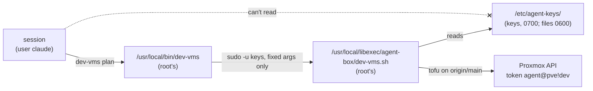

# Set up the agent box's users, keys, wrappers and guard rules

**Status:** draft, not yet run. Written 2026-11-10 from the code in `hosts/ansible/roles/agent_box`.

A deny rule can't stop a session from reading a file it is allowed to read, with `less`, `python` or anything else. So the keys are kept from sessions by file ownership, and the deny rules are a second floor for everything else:



| Piece | Where | Owner and mode |
|---|---|---|
| Session user | `claude`, no extra groups (no `wheel`) | |
| Keys user | `keys`, a system user with no login shell, home `/var/lib/agent-box` | |
| Keys | `/etc/agent-keys/` | `keys`, 0700; every file 0600 |
| Wrappers | `/usr/local/libexec/agent-box/<name>.sh` | root, 0755 |
| Front scripts sessions run | `/usr/local/bin/<name>` | root, 0755 |
| sudo | `/etc/sudoers.d/agent-box`, one line per wrapper | root, 0440, checked by `visudo` |
| Claude Code guard | `/etc/claude-code/managed-settings.json` | root, 0644 |
| Hostname kept across reboots | `/etc/cloud/cloud.cfg.d/99-keep-hostname.cfg` (`preserve_hostname: true`) | root, 0644 |
| Tailscale client | package `tailscale` from pkgs.tailscale.com, `tailscaled` on at boot | |

Today there is one wrapper, `dev-vms plan|apply|destroy`: OpenTofu on `hosts/terraform/home/k8s` for the dev rebuild VMs (250-257), with the agents' own token `agent@pve!dev` (`hosts/terraform/home/bootstrap/agent-access.sh`). It runs only the code on `main`: it moves the `keys` user's own checkout to `origin/main` first, so a session can't change what runs with the token.

## Before you start

- The VM is grown and its plan names it by STD-0001 ([grow-the-agent-jumpbox.md](grow-the-agent-jumpbox.md)).
- The filled-in inventory has group `agent_box` with the VM's address, its admin user, `agent_box_hostname` (the same name as the VM's name in `home/jumpbox`), and the Mac's allow rules and `autoMode` block in `agent_box_allow` and `agent_box_auto_mode`. Copy rules only, never secrets ([hosts.example.yml](../../hosts/ansible/inventories/home/hosts.example.yml)).

## Steps

1. Read the change first.
   why: the role replaces `/etc/claude-code/managed-settings.json` and takes `claude` out of any extra group, so the diff shows what the box loses.

   ```sh
   cd hosts/ansible
   ansible-playbook -i inventories/home/ playbooks/agent-box.yml --check --diff
   ```

   expect: the hostname change, the new users and folders, the sudoers file and the settings diff. Stop if `claude` loses a group the box needs.

2. Run it.

   ```sh
   ansible-playbook -i inventories/home/ playbooks/agent-box.yml
   ```

   expect: `failed=0`. The hostname is the STD-0001 name and stays so after a reboot (cloud-init keeps it). The last tasks are the proofs: user `claude` can't open `/etc/agent-keys`, and `sudo -l -U claude` lists only the wrappers, as `keys`.
   A backup of the old settings file stays beside it (`managed-settings.json.<date>~`).

3. Restart Remote Control so new sessions read the new hostname and settings.

   ```sh
   sudo systemctl restart claude-rc
   hostnamectl --static
   ```

   expect: the STD-0001 name. At claude.ai/code the box comes back under an entry with the new name. The old entry, under the rehearsal name, goes stale and can be ignored.

4. Join the tailnet as `tag:agent-box`, as the admin user.
   why: cloud sessions reach the box by Tailscale SSH as `claude` (the tailnet policy's SSH rule from `tag:agent` to `tag:agent-box`, `hosts/terraform/home/tailnet-policy`). The policy's OAuth client can't mint auth keys, so the join uses a login link.

   ```sh
   sudo tailscale up --advertise-tags=tag:agent-box --ssh
   ```

   It prints a login link. The owner opens it once, signed in as a tailnet admin. `--ssh` stays on: the policy's SSH rule needs Tailscale SSH on the box.
   expect: `tailscale status` shows the box with `tag:agent-box`, and `ssh claude@<box>` from a cloud session gets a shell, while `ssh root@<box>` is refused.

5. Put the dev rebuild keys in place, as the admin user. The files never pass through a session or a repository.
   why: `dev-vms` reads them, and only the `keys` user can.

   ```sh
   sudo install -o keys -g keys -m 0600 /dev/stdin /etc/agent-keys/proxmox-dev.env <<'EOF'
   PROXMOX_VE_ENDPOINT=<the host's API URL>
   PROXMOX_VE_API_TOKEN=agent@pve!dev=<secret>
   EOF
   sudo install -o keys -g keys -m 0600 <dev tfvars from the Mac> /etc/agent-keys/dev-vms.tfvars
   ```

   In `dev-vms.tfvars`, `vlans_file` points into the keys user's checkout: `/var/lib/agent-box/central-hub/hosts/ansible/inventories/home/group_vars/all/vlans.yml`.

6. Prove it as a session would, from a Remote Control session on the box.

   ```sh
   dev-vms plan
   cat /etc/agent-keys/proxmox-dev.env
   sudo -u keys cat /etc/agent-keys/proxmox-dev.env
   ```

   expect: `dev-vms plan` prints the central-hub commit and a plan; the `cat` fails with permission denied; the `sudo` line is refused by the deny rule `Bash(sudo:*)` before it runs.

7. Guard test: the owner sends each blocked line from their phone, as for the rehearsal (PLAN step 12). Each must be refused.

## If it fails

- `visudo` rejects the sudoers file: the task fails and the old file stays; nothing else in sudo changes.
- `dev-vms` says there is no saved plan: run `dev-vms plan` first; `apply` only applies the saved plan.
- After a dev teardown, `dev-vms plan` can't create VMs: Proxmox dropped the `/vms/<id>` ACLs when the VMs were destroyed (pick 18), so `agent-access.sh` must run again as root.

## Exit

Remove `/etc/sudoers.d/agent-box`, the front scripts and `/usr/local/libexec/agent-box/`, then delete `/etc/agent-keys/` and revoke the token `agent@pve!dev`. The VM itself goes with [grow-the-agent-jumpbox.md](grow-the-agent-jumpbox.md)'s exit.
