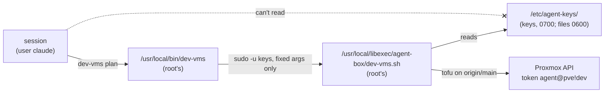

# Set up the agent box's users, keys, wrappers and guard rules

**Status:** draft, not yet run. Written 2026-11-10 from the code in `hosts/ansible/roles/agent_box`.

A deny rule can't stop a session from reading a file it is allowed to read, with `less`, `python` or anything else. So the keys are kept from sessions by file ownership, and the deny rules are a second floor for everything else:



| Piece | Where | Owner and mode |
|---|---|---|
| Session user | `claude`, no extra groups (no `wheel`) | |
| Keys user | `keys`, a system user with no login shell, home `/var/lib/agent-box` | |
| Keys | `/etc/agent-keys/` | `keys`, 0700; every file 0600 |
| Wrappers | `/usr/local/libexec/agent-box/<name>.sh` | root, 0755 |
| Front scripts sessions run | `/usr/local/bin/<name>` | root, 0755 |
| sudo | `/etc/sudoers.d/agent-box`, one line per wrapper | root, 0440, checked by `visudo` |
| Claude Code guard | `/etc/claude-code/managed-settings.json` | root, 0644 |
| Hostname kept across reboots | `/etc/cloud/cloud.cfg.d/99-keep-hostname.cfg` (`preserve_hostname: true`) | root, 0644 |
| Tailscale client | package `tailscale` from pkgs.tailscale.com, `tailscaled` on at boot | |

CT 259, the jumpbox rehearsal's container, is not the agent box. This runbook doesn't touch it. The owner chose to delete it (tap of 2026-11-18 00:00:40 UTC), and the steps are in [Grow the agent jumpbox](grow-the-agent-jumpbox.md#delete-the-rehearsals-container).

There are seventeen wrappers. `rebuild up|rebuild [<commit>]|teardown|identity` runs the dev one-command rebuild, of main's newest commit or of the commit on main it names ([below](#rebuild-dev-from-the-box); every dev run also ends with a dev CA stage and the identity stage, a sign-in proof for a dev test admin; `identity` runs that stage alone once the role has been applied with the subcommand), and `rebuild log` prints the newest run's stage lines and its `PASS` and `FAIL` lines, nothing else, so a session can read what a run proved without reading the raw log. `pr-merge check OWNER/REPO PR HEAD` reads one pull request as the GitHub App and prints its verdict; the keys user's timer runs `pr-merge sweep`, which squash-merges a PR whose head holds the reviewer's recorded pass, under D-0031 and D-0042 ([how it decides](#merge-pull-requests-from-the-box)). `pass-record add|show|halt|resume` writes the ledger of passes and the sweep's stop flag. `ci-runner plan|apply|configure|destroy|bump` builds the notebook's CI runner VM, registers it, and opens a pull request when a newer runner release is due; a weekly timer, `ci-runner-weekly.timer`, runs `configure` then `bump` as the keys user ([Set up the notebook's self-hosted CI runner](set-up-the-ci-runner.md)). `desktop plan|apply|configure|destroy` builds and sets up the owner's desktop VM, with the agents' Proxmox rights on its pool only while `DESKTOP_ACCESS` is on in `agent-access.sh` ([Set up the owner's desktop VM](set-up-the-desktop.md)). `secrets-store recovery|status|snapshot|restore|restore-rebuilt [raft-<time>.snap]|clear-hold|put c1/<path> <key>|compare|reseed` calls the lab's secrets store, OpenBao, inside the dev cluster (D-0058), and makes its admin AppRole IDs in `/etc/agent-keys/dev/` and never prints them; every action refuses unless the store's address is the dev store the dev inventory names, and each stops until the box's path to the store sets that address and its CA file; `put` writes one key (value on stdin) to its SOPS copy, then the store, `compare` names keys that differ, and `reseed` fills a fresh store from SOPS, all three only once the owner's tap sets `sops_copies`; `snapshot` copies a Raft snapshot into that folder, `restore` puts the newest of the same store back and proves it, `restore-rebuilt` puts the previous store's newest snapshot, or one named exactly, onto a rebuilt one, and `clear-hold` ends a rebuild's hold when no restore is wanted ([Set up the lab's secrets store (OpenBao) on dev and prod](set-up-the-secrets-store.md)). `secrets-store-prod` takes the same actions for the store inside prod's c1, with prod's keys folder, settings and inventory, and makes no recovery shares; `openbao-prod key|check|seal <tap id>|seal-copy <tap id>|gitops|handover|reset-failed-start <tap id>|log` turns that store on in prod's c1 with the box's own prod node key ([On prod](set-up-the-secrets-store.md#on-prod)). `rebuild-prod check|rebuild <tap id> <commit>|log` tears prod's Kubernetes layer down and builds it again with prod's data put back, under D-0035: `check` is read-only, and `rebuild` takes a fresh backup and its restore test, keeps each node's backup certificate, and needs dev to have passed at the same commit first ([Rebuild prod from the box](rebuild-k8s-layer-with-one-command.md#rebuild-prod-from-the-box)). `tailnet-cleanup plan` lists the old tailnet devices its daily timer would remove ([below](#remove-old-tailnet-devices)). `c1-read get|describe|logs|top|events|explain|api-resources|api-versions|version|auth can-i ...` reads c1 with the read-only kubeconfig from app `agent-read`, which sessions can't open; it passes read verbs only and refuses flags that pick other credentials or open a local file ([give-agents-read-access-to-c1.md](give-agents-read-access-to-c1.md) step 5). `tailnet-stack plan|apply <card> <hash>|log` plans and applies the tailnet's connector routes and split DNS as the keys user, through the `lab-tailnet` pipeline job: `plan` saves the plan with its commit and hash, and `apply` runs only that saved plan, and only when the owner has tapped a decision card that names the pull request and its head and the first 12 hex digits of the plan's hash, so a session can plan and read the log but can't apply; there is no Mac step and no typed line ([Change the tailnet stack through the pipeline job](run-the-tailnet-stack-as-a-pipeline-job.md)). `proxmox-host check|apply <pass> <hash>|log` runs `playbooks/proxmox-proxy.yml`, and nothing else, on the Proxmox host as root, through the `lab-proxmox-host` pipeline job; it runs as its own user, `hostops`, not `keys`, so no other wrapper can read its key in `/etc/agent-keys-host/`; a session can check and read the log, only the runner can apply, and an apply runs only when a fresh check gives the hash the agents passed ([Serve the Proxmox web UI on port 443](serve-proxmox-on-443.md)). The last is `dev-vms plan|apply|destroy`: OpenTofu on `hosts/terraform/home/k8s` for the dev rebuild VMs (250-257), with the agents' own token `agent@pve!dev` (`hosts/terraform/home/bootstrap/agent-access.sh`). It runs only the code on `main`: it moves the `keys` user's own checkout to `origin/main` first, so a session can't change what runs with the token. Each wrapper that runs the repository's code (`ci-runner`, `dev-vms`, `rebuild`, `rebuild-prod`, `tailnet-stack`) has its own checkout, `/var/lib/agent-box/checkouts/<wrapper>` (cloned on its first run), and takes a lock for the whole run, so one run can't move the code under another, and a second run of the same wrapper stops at once with `another <wrapper> run is going`.

## Before you start

- The VM is grown and its plan names it by STD-0001 ([grow-the-agent-jumpbox.md](grow-the-agent-jumpbox.md)).
- The filled-in inventory has group `agent_box` with the VM's address, its admin user, `agent_box_hostname` (the same name as the VM's name in `home/jumpbox`), and the Mac's allow rules and `autoMode` block in `agent_box_allow` and `agent_box_auto_mode`. Copy rules only, never secrets ([hosts.example.yml](../../hosts/ansible/inventories/home/hosts.example.yml)).
- The Proxmox API's certificate is issued by the lab CA, which the box doesn't trust yet. List only the public root certificate's file in `agent_box_ca_files`, by its full path: no folder, no pattern, never a file that holds a key. The role checks each file on the controller first, and stops unless it is a regular file that parses as a certificate and holds no `PRIVATE KEY` block. Set `agent_box_tls_check_url` to the API's version path on the name the wrappers use; that name must be in the certificate.

## Steps

1. Read the change first.
   why: the role replaces `/etc/claude-code/managed-settings.json` and takes `claude` out of any extra group, so the diff shows what the box loses.

   ```sh
   cd hosts/ansible
   ansible-playbook -i inventories/home/ playbooks/agent-box.yml --check --diff
   ```

   expect: the hostname change, the new users and folders, the sudoers file and the settings diff. Stop if `claude` loses a group the box needs.
   On a fresh box, the steps that write into a folder the run would create (the OpenTofu download and unpack, and the Tailscale package after its repository) show as skipped, and the proofs are skipped in check mode. A check never writes to the box.

2. Run it.

   ```sh
   ansible-playbook -i inventories/home/ playbooks/agent-box.yml
   ```

   expect: `failed=0`. The hostname is the STD-0001 name and stays so after a reboot (cloud-init keeps it), and cloud-init no longer runs its first boot again when the VM is renamed (`manual_cache_clean: true`). The last tasks are the proofs: user `claude` can't open `/etc/agent-keys`, `sudo -l -U claude` lists only the wrappers, as `keys`, and `/etc/hosts` names the box once per address with no repeated line. When `agent_box_tls_check_url` is set, the last proof fetches it with certificate checks on and gets 200 or 401: the box trusts the Proxmox CA, so tofu will too.
   A backup of the old settings file stays beside it (`managed-settings.json.<date>~`).

3. Restart Remote Control so new sessions read the new hostname and settings.

   ```sh
   sudo systemctl restart claude-rc
   hostnamectl --static
   ```

   expect: the STD-0001 name. At claude.ai/code the box comes back under an entry with the new name. The old entry, under the rehearsal name, goes stale and can be ignored.

4. Join the tailnet as `tag:agent-box`, as the admin user.
   why: cloud sessions reach the box by Tailscale SSH as `claude` (the tailnet policy's SSH rule from `tag:agent` to `tag:agent-box`, `hosts/terraform/home/tailnet-policy`). The policy's OAuth client can't mint auth keys, so the join uses a login link.

   ```sh
   sudo tailscale up --advertise-tags=tag:agent-box --ssh
   ```

   It prints a login link. The owner opens it once, signed in as a tailnet admin. `--ssh` stays on: the policy's SSH rule needs Tailscale SSH on the box.
   expect: `tailscale status` shows the box with `tag:agent-box`, and `ssh claude@<box>` from a cloud session gets a shell, while `ssh root@<box>` is refused.

5. Put the dev rebuild keys in place, as the admin user. The files never pass through a session or a repository.
   why: `dev-vms` reads them, and only the `keys` user can.

   ```sh
   sudo install -o keys -g keys -m 0600 /dev/stdin /etc/agent-keys/proxmox-dev.env <<'EOF'
   PROXMOX_VE_ENDPOINT=<the host's API URL>
   PROXMOX_VE_API_TOKEN=agent@pve!dev=<secret>
   EOF
   sudo install -o keys -g keys -m 0600 <dev tfvars from the Mac> /etc/agent-keys/dev-vms.tfvars
   ```

   `dev-vms.tfvars` needs no `vlans_file`: the wrapper passes the one in its own checkout, over any path the file gives.

6. Prove it as a session would, from a Remote Control session on the box.

   ```sh
   dev-vms plan
   cat /etc/agent-keys/proxmox-dev.env
   sudo -u keys cat /etc/agent-keys/proxmox-dev.env
   ```

   expect: `dev-vms plan` prints the central-hub commit and a plan; the `cat` fails with permission denied; the `sudo` line is refused by the deny rule `Bash(sudo:*)` before it runs.

7. Guard test: the owner sends each blocked line from their phone, as for the rehearsal (PLAN step 12). Each must be refused.

## The agents' GitHub App

The box holds the private key of the GitHub App "Central Hub Agents". Wrappers use it to mint one-hour installation tokens, so the agents act on GitHub under the App's own name instead of the owner's account. Two wrappers use it. `pr-merge` mints a token for one repository to read a pull request and merge it. `ci-runner configure` mints a runner registration token for agent-notebook, and `ci-runner bump` mints a central-hub token with Contents and Pull requests (write) to open the runner bump pull request ([Set up the notebook's self-hosted CI runner](set-up-the-ci-runner.md), tested 2026-11-10). Cloud sessions don't use the App.

The owner sets it up once, in GitHub's web UI:

1. Register the App on the owner's account. Turn off the webhook and OAuth, and allow installs only on that account.
   why: nothing listens for events, and the App acts only as itself, never on the owner's behalf.
2. Give it repository permissions only:
   - Contents: read and write.
   - Pull requests: read and write.
   - Checks: read.
   - Actions: read.
   - Metadata: read.
   - Administration: write. GitHub requires it to create runner registration tokens, and the wrapper narrows each token to one repository and that one permission.

   Leave out Workflows, so a push that changes `.github/workflows/` is refused (rule 5). Leave out Secrets, Environments and Deployments too.
   why: least privilege. A permission added later must be accepted again on the installation.
3. Install it on the owner's account with "Only select repositories": central-hub, inpara, agent-notebook and obsidian-graph-3d. Add the App to no ruleset bypass list.
   why: `main` stays protected, so the App merges and accepts nothing (rules 1 and 2).
4. Generate a private key, then put it on the box from the Mac with `agent-box-keys.sh put-github-app` ([allow-a-command-for-agents.md](allow-a-command-for-agents.md)). It lands as `/etc/agent-keys/github-app.pem`, owned by `keys`, mode 0600, and is never read, printed or copied anywhere else.
5. Put the App's ID in the private inventory, as `github_app_id` in `agent_box_ci_runner` ([hosts.example.yml](../../hosts/ansible/inventories/home/hosts.example.yml)), then run step 2 of the CI runner runbook.
   expect: `ci-runner configure` registers the runner. If the App is not installed on the repository, the wrapper says so by name ("If it fails" in the CI runner runbook).

Exit: uninstall the App and delete it in GitHub's settings, then delete `/etc/agent-keys/github-app.pem`.

## Prove a web sign-in from the box

The role installs headless Chromium through Playwright (pinned with hashes in `files/playwright-requirements.txt`, in its own virtual environment, browsers in a root-owned folder under the libexec folder) and the command `web-shot <url> <out.png> [--insecure]`. It loads the page as the session user, with no key, saves a full-page screenshot and prints the final address, the page title and the HTTP status. `--insecure` is for a dev cluster's throwaway CA only. It types nothing, so a sign-in that needs a form still goes through the proof scripts. Chromium's download comes from Playwright's own host at the first install, so the first run needs that outbound route. A bump of the pin is a change to the box's limits (D-0044).

## Render with Blender from the box

The role installs Blender 5.2.3 LTS (the newest release at least two weeks old on 2026-11-18, STD-0003) from the official Linux tarball, checked against the SHA-256 that download.blender.org publishes, into a root-owned folder under the libexec folder, links `blender` into `/usr/local/bin`, and installs the libraries it needs with no display or GPU: the X client libraries `ldd` found missing (`libSM`, `libICE`, `libXxf86vm`, `libX11-xcb`), and Mesa's software OpenGL, EGL and Vulkan. The tarball comes from an official mirror, because `download.blender.org` answers 403 to the box. A bump of the pin is a change to the box's limits (D-0044).

Sessions run it as themselves, always in background mode:

```sh
blender -b --factory-startup --python-exit-code 1 --python scene.py -- <args for the script>
blender -b file.blend -E CYCLES -o /tmp/out/frame_#### -f 1
```

why: `-b` runs with no window; the box has no display. `--factory-startup` skips any saved user startup file, so every run starts the same. `--python-exit-code 1` makes a script that raises end with exit code 1: without it Blender exits 0 even when the script failed (measured on the box on 2026-11-18, a script that raises returned 0 by default and 3 with `--python-exit-code 3`), so a failed render looks like a passed one. Arguments run in the order given, so `-f` or `-a` goes last.
expect: `Blender 5.2.3 LTS` from `blender -b --version`. Measured with the installed copy on the box on 2026-11-18 (2 vCPUs, 7.3 GB, no GPU), a 960x540 scene with three area lights and a subdivided mesh, peak memory read from `VmHWM`: Cycles on the CPU at 64 samples with denoising took 32 s and peaked at 850 MB; EEVEE took 52 s on Mesa's software renderer (llvmpipe) and peaked at 2.0 GB; Workbench took about 2 s and peaked at 740 MB. An earlier run of the same scene from a user-space copy took 48 s, 99 s and 1 s.

- Use Cycles with `cycles.device = "CPU"` for finished images. EEVEE works only through Mesa's software EGL, so it is slower than Cycles here.
- Check `free -m` before a render, and above all before EEVEE, which peaked at 2.0 to 2.5 GB on a small scene; the box shares the host with the dev rebuild.
- The Vulkan warning at start is expected: Blender falls back to OpenGL through EGL.
- docs.blender.org answers 403 to the box. The role keeps Blender Lab's MCP repository (projects.blender.org/lab/blender_mcp, pinned to commit dbbf836, 2026-09-29) under the libexec folder for the Python API reference and manual excerpts it bundles, about 4,500 RST files. Search them with `grep -rl <term> /usr/local/libexec/agent-box/blender-mcp/mcp/blmcp/data/`. Its MCP server is not installed, because sessions drive Blender directly with `blender -b --python`.

## Prove the lab's names from the box

`lab-proof` (a session runs it as itself, no key) reads c1's HTTPRoutes and the Gateway's address through `c1-read`, asks the box's resolver (the tailnet's, which hands lab names to Unbound) for each name with a short Python query, and opens a TLS connection to the Gateway with `openssl s_client`, checking the certificate against the box's trust store, where the lab root sits. It prints one line per route name and name number, with `dns=ok|FAIL` and the TLS verify result, then `PASS` or `FAIL`. It prints no host name, address or zone, so its output can go in a public record. It asks the question the `dns_proof` tag asks of the names c1 serves, but it is not that tag, and OPNsense's own name, which is not a c1 route, is not covered.

## Change c1 from the box

`c1-ansible` runs one named Ansible playbook against prod's c1 from the box, as the keys user, with the box's own prod node key (the one `openbao-prod key` makes), so the change leaves the Mac. `c1-ansible list` names what it runs (today `identity`, which is `k8s-identity.yml` with `k8s_identity_realm_replace=false`, fixed in the wrapper, so it never deletes and imports realm lab again on prod: that would end every sign-in; it runs with `--tags all,clients` and `k8s_identity_ensure_clients=[proxmox]`, so the role's clients task also adds or updates the proxmox client of realm lab in place; another client needs its own pull request that names it in the wrapper). Run `c1-ansible check identity` before the first apply: check mode skips the live client step, so it proves the play reaches the nodes and the client JSON builds, but shows no client diff. An in-place client update rewrites that client's secret from `identity.env`. `c1-ansible check <name>` is read-only (`--check --diff`). `c1-ansible apply <name> <clearance id>` runs it for real; the id is the reviewer's clearance message for the head that is on main, and it goes in the log (D-0042 rule 1). `c1-ansible log` prints the newest run's lines.

`opnsense-cert-check` reads the certificate the firewall's web UI serves and says how many days it has left (`check`, which the daily timer runs as the keys user, and `status`). It holds no key and writes nothing to the firewall; it needs `agent_box_opnsense_backup` for the firewall's name, and a failing run is a failed unit, not a push notification ([set-opnsense-gui-certificate.md](set-opnsense-gui-certificate.md), "Afterwards").

`signin-check` runs the three scripted sign-in checks (`jellyfin-signin-check.py`, `argocd-signin-check.py`, `proxmox-signin-check.py`) against prod with the test user, as the keys user, because the test user's password and TOTP seed are lines in `identity.env`, which a session cannot read. `sudo -n -u keys /usr/local/libexec/agent-box/signin-check.sh run` builds one private file per check from `<keys>/prod/signin-check.json` (the controller writes it and the prod-files run copies it: `base`, `realm`, `user`, `expect_admin`, `jellyfin_base`, `argocd_base`, and optionally `provider`, `pve_base`, `pve_realm`, `address`, `pve_address`, `digits`, `period`, `verify`, `admin_group`, `viewer_group`; no secret) and the user's `PASSWORD_<USER>` and `TOTP_<USER>` lines, runs the scripts from its own checkout of `main`, and prints only their numbered lines and `signin-check: PASS` or `FAIL`. Without a `pve_base` the Proxmox check does not run. `log` prints the newest run. It makes nothing in Keycloak or any app; the test user is an access right made by the owner's go, and how it is made is in [move-jellyfin-to-argo-cd.md](move-jellyfin-to-argo-cd.md). Not yet run on the box; the stand-in test is `.github/hosts-check/tests/test_signin_check_wrapper.sh`.

**`signin-check` needs the box to reach the apps' address on tcp 443, and the last read says it cannot.** The Jellyfin and Argo CD checks go through c1's Gateway. The dev VLAN's own rules pass nothing to prod, so the box needs the pass in role `opnsense_lab` (`tasks/app_access.yml`: the box and the desktop VM to the Gateway on 443, central-hub #491, applied on the owner's go, [set-up-lab-network-and-firewall.md](set-up-lab-network-and-firewall.md)). Measured from the box on 2026-11-18 at 22:51 UTC: `curl` to an app's short name ended "Connection timed out after 8002 milliseconds", http code 000, and at 04:36 UTC the same for all five names. The cause of the timeout was not read: either the #491 rules are not in effect, or something else blocks tcp 443 between the box and the Gateway. If the rules are the cause, `signin-check run` fails on a connection timeout before it tests any sign-in, whatever the test user's state; the timeout alone does not show that. Once the box's `curl` to an app name prints a status, the order is: the test account (an access-rights step), then `signin-check run`. Whether the #491 rules are applied is read by that `curl`, or from the firewall's rule list. Whether the Proxmox check reaches the web UI's name on 443 from the box is not measured.

The wrapper runs only code on `main`, in its own checkout, one run at a time, on its own copy of the prod inventory (the controller's ssh settings and proxmox group dropped, the box's key and plain ssh set; a host that sets a proxy, another key or another env than prod is refused). A name that needs a private values file stops with that file's name until the controller's prod-files run puts it on the box; `identity` needs `identity.env` in the keys folder's `prod` folder.

expect: `c1-ansible check identity` ends with the play recap and `c1-ansible: check identity done`. If it says no prod node key yet or the key is refused, the node key's public half is not on prod's nodes (`openbao-prod key`, then `openbao-prod check`).

## Merge pull requests from the box

The box merges by a sweep, not by a workflow: a cloud session cannot start a GitHub workflow here (403, measured 2026-11-14). The page [Merge a pull request with the box's sweep](merge-a-pr-through-the-merge-job.md) is the how-to; this section is the setup.

- `pass-record` (sudo for sessions: `add`, `show`, `halt`, `resume`; `owner-tap` and `resume` only with the recorder `orchestrator`) writes the ledger of passes in `/var/lib/agent-box/passes/<repo>/<head>.jsonl` and sets or clears the halt flag. `pr-merge check` (sudo for sessions) is read-only. `pr-merge merge` and `pr-merge sweep` have no sudo line; only the keys user runs them.
- `agent_box_merge_sweep: true` in the inventory installs `pr-merge-sweep.service` and `.timer` (every `agent_box_merge_sweep_interval`, default 5 minutes), which run `pr-merge.sh sweep` as the keys user. Installing it is a change to the box's limits, so it waits for the agents' pass of its digest, with no owner card (D-0042 rule 4).
- Green is [D-0031](../decisions/0031-let-agents-merge-green-prs.md) rule 1: open, not a draft, base `main`, GitHub's merge state `clean` or `has_hooks`, and every check on the head passed, none pending, and all of them read. On top of that the head's ledger must hold the reviewer's pass. A PR that changes a rule 11 file needs an `owner-tap` line as well, until D-0059 is accepted and its verdict installed; after that, none does.
- It squash-merges only, pinned to the head. It never deletes a branch, never passes `--admin` and never enables auto-merge. It reads the halt flag before everything and before each merge.
- The App needs Contents (write), Pull requests (write) and Checks (read). Commit statuses (read) are used when the installation has accepted them; without it the wrapper says so and checks only the check runs. If the other three are missing, it stops.
- It does not look for secrets or private names in the diff (rule 4 of `CLAUDE.md`); the reviewer does that before the head is named.

expect: `pr-merge check` prints `GREEN` or `NOT GREEN: <reasons>` and changes nothing; with the timer on, `systemctl list-timers pr-merge-sweep.timer` shows the next run.

## Rebuild dev from the box

`rebuild` runs `hosts/rebuild-k8s.sh` for the dev Kubernetes layer (VMs 250 to 257) from the box. It is for the proof that the Mac lane isn't needed; the Mac lane keeps running the rebuild until that proof passes.

```text
rebuild up          all stages, at main's newest commit
rebuild rebuild     tear the dev VMs down first, then all stages
rebuild up <commit>       the same, at that commit (7 to 40 hex digits; it must be on main, not older than the wrapper's floor)
rebuild rebuild <commit>
rebuild teardown    only the teardown
rebuild identity    only the stage identity-keycloak: the whole identity role for the dev test admin, then the sign-in proof (step names and HTTP codes only). Every `up` and `rebuild` on dev already ends with it, so this subcommand is for a re-run alone, once the role has been applied with it
rebuild log         the newest run's stage lines and PASS/FAIL lines; a newer teardown-only run is named in one line and skipped
rebuild diag        read-only look at the dev cluster after a failed apps stage: each dev VM's memory and CPU on Proxmox and the node's memory (GET with the dev token), each dev node's free -m, load average and pressure (with no dev VM running it prints `dev nodes: none running` and stops there, since every later section reaches a node over ssh), Argo CD app sync and health, the newest events in alerts and monitoring, pods not running, the monitoring pods and volume claims, each application that is not Synced and Healthy with its messages, conditions and unhealthy resources, and the last 30 log lines of each pod in Error (at most 6; secrets scrubbed by `hosts/diag-apps.py` from the box's checkout of main); runs while a rebuild is going
rebuild fit         read-only: would the dev memory preflight pass now (rebuild-k8s.sh --fit; nothing stopped, the desktop VM included, and no run log), on the box's checkout as it is (it prints that commit; one older than #635 says so), and the 12 running guests with the most memory the dev token can see; exits 0 if it fits, 3 if not
rebuild auto        the timer's run only (no sudo line): an `up` of main's newest, started only when no lab-test run holds its lock, its state holds no resource and its log is over 60 minutes old (so a tick cannot land between two proves), no run is going, dev is down, the newest full run did not already build that commit, a file under hosts/ changed since the newest full pass, and the memory preflight fits without stopping the desktop; otherwise one line says why
```

- The `rebuild-auto` timer (every `agent_box_rebuild_auto_interval`, 2 hours, on while `agent_box_rebuild_auto` is true) runs `rebuild auto` as the keys user. It builds main's newest commit only when all six hold: no lab-test run holds its lock, `lab-test.tfstate` holds no VM (an unreadable one counts as holding; the installer ISO that `lab-test destroy` keeps there does not count) and `lab-test.log` was written over 60 minutes ago (`LAB_TEST_QUIET_MIN` in `rebuild.sh`; any lab-test run but `log` writes it), so a tick cannot land between two proves; the run lock is free (a dev or prod run holds it otherwise); dev is down, no VM in the dev state (with dev up the preflight skips its memory check, so `--fit` would say yes; a state it can't read counts as up); the newest full run (a log with a `vms` stage) did not already build that commit, passed or not, so a failing head is not rebuilt every 2 hours; `git diff` from the newest full pass's commit to main's head names a file under `hosts/` (with no full pass on main, it builds); and `rebuild-k8s.sh --fit` says the memory preflight fits. A timer run never stops the owner's desktop VM: the fit check and the run both carry `PREFLIGHT_KEEP_DESKTOP=true`, so the preflight judges without it, and may still stop VM 300 under `ephemeral-dev`. Each check that stops it prints one `rebuild auto:` line (`journalctl -u rebuild-auto`) and exits 0; a run that starts is an `up`, logged like any other (`rebuild log`). Like a hand `up` after an `ephemeral-dev` teardown, a timer run on an empty state sets the secrets store's rebuild hold when the box holds snapshots ([set-up-the-secrets-store.md](set-up-the-secrets-store.md)) (`test_rebuild_auto.sh`).
- It runs only the code on `main`. There is no way to name another branch, because the keys never run code a session can edit. `up` and `rebuild` may name a commit, so dev can prove the same commit a prod go names (D-0035 rule 3(a)): the wrapper takes only 7 to 40 lowercase hex digits, fetches main, and refuses a commit the checkout does not hold, one that is not an ancestor of `origin/main` (`rebuild: commit <c> is not on main`), or one older than the floor `PIN_FLOOR` in the wrapper (main's merge of #573: a pin runs that commit's own `rebuild-k8s.sh`, and one below it lacks the refusal while VM 256 exists and the memory preflight), before anything is built (`test_rebuild_pin.sh`).
- It writes its own `rebuild.env`: dev, VM range 250 to 257, the box's `proxmox-dev.env`, and the same state file as `dev-vms`. `rebuild-k8s.sh` still refuses a tfvars with a VM ID outside that range or a `node_vnet` other than `dev`.
- The dev cluster's Secrets-at-rest key also belongs to the box: the wrapper makes it once (`rebuild-encryption.key` in the keys folder, mode 0600, never printed) and points `k8s_control_plane_encryption_key_file` at it, replacing the Mac path in the private inventory.
- The nodes get a login key that belongs to the box. On the first run the wrapper makes it (`rebuild-node-key` in the keys folder) and runs with a copy of `dev-vms.tfvars` whose `node_ssh_public_key` is that key's public half and whose `pool_id` is always `dev` and whose `template_vm_id` is always 9001, the template copy on the dev network that the agents' token may clone. `dev-vms` passes the same two values over its tfvars, because both wrappers share one state.
- The VMs go in pool `dev`, because the token's rights on them come from its ACL on `/pool/dev`, which a teardown leaves in place. Proxmox drops a VM's own `/vms/<id>` ACLs when the VM is destroyed. A clone that names a pool needs `VM.Allocate` on `/vms/<newid>` or on `/pool/<pool>`, and Proxmox adds the clone to the pool before the clone task ends, so the provider's next call, which sets the tags, CPU and disks, finds the VM already in the pool ([qemu-server `API2/Qemu.pm`](https://git.proxmox.com/?p=qemu-server.git;a=blob;f=src/PVE/API2/Qemu.pm;hb=HEAD), `clone_vm`). A pool's roles reach `/vms/<id>` of each VM in it ([pve-access-control `RPCEnvironment.pm`](https://git.proxmox.com/?p=pve-access-control.git;a=blob;f=src/PVE/RPCEnvironment.pm;hb=HEAD), `compile_acl_path`). The provider passes the pool in the clone call and sets the tags after it (bpg/proxmox 0.116.0, `vmCreateClone`). Clone also needs `VM.Clone` on template 9001, `Datastore.AllocateSpace` on the target storage and `SDN.Use` on VNet `dev`; `agent-access.sh` gives each on its own path, none of which a teardown removes. VMs made before pool `dev` was used sit outside it: tear them down, or run `agent-access.sh` once, which moves them in, because the token can't move a VM into a pool (`Pool.Allocate`).
- The inventory is built from the private one on the Mac, which a keys command put at `/etc/agent-keys/rebuild-dev/inventory/hosts.yml`. The Mac's inventory reaches the nodes through a jump over root SSH to the Proxmox host. The box never holds root on the hypervisor, and it sits on the dev network, so each run builds a copy: the `proxmox` group and every login, key and proxy setting are dropped, the box's own key and plain ssh are set, and the gateway and certificate smoke tests run from the box (`k8s_gateway_smoke_client` and `k8s_certs_smoke_client` are `localhost`, as the box user without become, with the lab root kept in the wrapper folder). The private values stay as they were, except the controller paths: the backup env file and the reader certificate point at the box's own files.
- The role installs Ansible 2.21.5 in its own virtual environment under the wrapper folder, and the collections pinned in `hosts/ansible/requirements.yml`. Run the role's `wrappers` tag to install them.
- What the wrapper does not make, and stops without if it is missing:
  - the private dev inventory at `/etc/agent-keys/rebuild-dev/inventory/hosts.yml`, which has to be put there through the keys wrapper;
  - a guard that runs before any stage: the node addresses in `dev-vms.tfvars` must sit in the dev VLAN (VLAN 30 in `vlans.yml`), and every inventory host must be one of them, reached by plain ssh to `ansible_host` with the box's own ssh arguments only, no proxy, jump or other connection type;
  - for the `restore` stage, the reader certificate (the wrapper stops early if it or `c1-backup.env` is missing, or if the certificate has expired): one PEM (key and certificate) the read-only backup app knows, put at `/etc/agent-keys/azure-reader.env` through the keys wrapper (`put-azure-reader`; the file is a PEM despite its name). The box has no Azure sign-in; the nodes copy that file, nothing is uploaded to the app, and its expiry is the one date to renew by hand;
  - the token's ACLs from `agent-access.sh` (pool `dev`, template 9001, VNet `dev`, storage, node), which a root step on the host gives once, and which a teardown doesn't remove.

expect: with those in place, `rebuild up` prints `rebuild: central-hub <commit>` and then the stage lines of `rebuild-k8s.sh`, and stops at the first stage that fails.

## Give the box's page cache back to the host

The box's VM has a balloon with free page reporting ([grow-the-agent-jumpbox.md](grow-the-agent-jumpbox.md), "Give the box a balloon"), but reporting returns only free pages, and the kernel keeps file cache while nothing else asks for memory. An hour after the balloon went on, on 2026-11-18 at 05:27 UTC, the box held 5947 MiB of cache of its 7935 MiB, and the node had 9829 MiB free with VM 300 stopped, 411 MiB under the dev rebuild's minimum. The role's root timer `box-drop-cache.timer` runs `sync` and then drops the clean page cache every 5 minutes (`vm.drop_caches=1`), and free page reporting hands the freed pages to the host. Measured once by hand: at 05:30 UTC an agent session dropped the cache of the files it can read (5307 to 5029 MiB, `free -m` on the box), and the node's free memory with VM 300 running went from 9083 MiB (dev preflight, 05:29:46 UTC) to 9423 MiB (05:30:42 UTC). Other guests move too, so the proof for the timer is the next dev preflight's `node free memory` line after the install. The cost: after each drop, the box reads files from disk again, so the first run of a tool or a sweep after a drop is slower.

## Remove old tailnet devices

Every finished cloud session and every rebuilt machine leaves a tailnet device behind. Once a day the box removes the tagged ones that have been offline a long time (owner's answer 2026-11-12 06:43 to 06:45 UTC; pick 214 in [AGENT-PICKS.md](../../hosts/AGENT-PICKS.md)). The `tailnet-cleanup.timer` runs `tailnet-cleanup run` as the `keys` user; sessions may only ask for the list:

```text
tailnet-cleanup plan    what run would remove, and why each other tagged device stays; removes nothing
```

A device goes only when all of these hold: it carries one of the settings' tags; it is not connected; its last contact is older than the settings' days (7 or more); and its name is not on the keep list. A device without tags, a person's own, is never touched. A run that would remove more than `max_deletes` devices removes none and fails, so a wrong answer from the API can't empty the tailnet.

1. In the Tailscale admin console, Settings, Trust credentials: add an OAuth credential with **Devices Core: Write** and nothing else.
   why: its own key that can only see and remove devices, not change the policy or make auth keys.
   expect: a client ID and a client secret, shown once.

2. Put them in a file on the Mac, `~/.config/central-hub/tailnet-cleanup.env`, mode 600, as two lines: `TS_OAUTH_CLIENT_ID=` and `TS_OAUTH_CLIENT_SECRET=`, each followed by its value. Then put it on the box through the keys wrapper (`put-tailnet-cleanup`).
   expect: `/etc/agent-keys/tailnet-cleanup.env`, owned by `keys`, mode 0600.

3. In the private inventory, set `agent_box_tailnet_cleanup`: `tags` (for example `[tag:agent]`), `keep` (every device name that must never go, at least one), `days` (7) and `max_deletes` (5). Run the role's `wrappers` tag.
   expect: the role writes `tailnet-cleanup.json` and starts `tailnet-cleanup.timer`; it stops if the keep list is empty, a tag isn't `tag:<name>`, days is under 7 or max_deletes isn't 1 to 20.

4. Run `tailnet-cleanup plan` and read the list before the first timer run.
   expect: `remove:` lines only for devices you expect to go, and a last line with the counts.

## Copy the controller's private files to the box

For the agent to tear down and rebuild layers beyond dev (D-0035), the box needs the private files the lab was built from. The role's `prod_files` tasks copy them from the controller into `/etc/agent-keys/prod/` (owned by `keys`, folders 0700, files 0600). They never run by default: they run only when `agent_box_copy_prod_files` is true for that run (a role variable, default false), so a wrapper that can't pass tags can still do it by a one-line change to the default, reverted after the run.

1. Run the role from the controller with `agent_box_copy_prod_files` true.
   why: the files only exist on the controller, and the role already runs from there.
   expect: no file content is printed. The last task lists names only: `copied`, `missing` and `state_files`.

2. If the controller runs the role from a pinned copy of the repo, set `agent_box_prod_files_clone` in the private inventory to the absolute path of its private clone, the one that holds `hosts/.env`, the filled-in inventory and the `home.tfvars` files. Empty means the checkout the playbook runs from.
   why: those files are git-ignored, so only the private clone has them.

3. Read the `missing` list. Anything on it is not on the controller under the path in `agent_box_prod_files` (role defaults, the same paths as the private-files table in [rebuild-home-lab-from-scratch.md](rebuild-home-lab-from-scratch.md)); make it there and run step 1 again.
   expect: a second run copies it and lists nothing missing that you meant to have.

The sign-in theme is a folder, not a file, so it has its own setting: `agent_box_prod_theme_src` in the private inventory is the folder's path on the controller (the same value as `k8s_identity_theme_dir`). Step 1 then copies it to `/etc/agent-keys/prod/identity-theme/<the folder's name>`, and `c1-ansible` points `k8s_identity_theme_dir` there, keeping the name (it is the theme's name in Keycloak). If the inventory names a theme folder with no `login/theme.properties` on the box, `c1-ansible` stops before any playbook and says so, so prod's current theme is never replaced by a missing one.

The list leaves out on purpose the Proxmox apply token, the Cloudflare bootstrap token, the nodes' SSH keys, the lab CA (the CA is put through the keys wrapper) and the Azure backup run folder's `azure.tfvars` (`hosts/terraform/azure/backup`, which isn't on Proxmox). Copying the files only stores them. A prod teardown and rebuild runs from the box only through `rebuild-prod`, under D-0035: dev passed the same layer at the same commit (rule 3(a)), the owner tapped a card naming the commit and the layer (rule 3(b), D-0042 rule 6) and a reviewing agent checked the tap (rule 3(c)), and the checks before a teardown passed (rule 5) ([Rebuild prod from the box](rebuild-k8s-layer-with-one-command.md#rebuild-prod-from-the-box)). The state files hold secrets (the certificates folder's state holds the Cloudflare token in plain text), so the box's `/etc/agent-keys` stays owner-only. The state files go to `prod/state/`; the box's copy is not a backup, so keep the off-box copy too.

## Apply the box's own setup from the box

D-0036 lets the box run this role on itself from reviewed main, through `box-apply plan` and `box-apply apply`, and stop for the owner on any change to its limits. It is off until `agent_box_self_apply` is set and the role runs in full from the controller. The steps are in [apply-the-agent-box-from-itself.md](apply-the-agent-box-from-itself.md).

## If it fails

- `visudo` rejects the sudoers file: the task fails and the old file stays; nothing else in sudo changes.
- `dev-vms` stops with `Failed to determine current working directory: stat .: permission denied`: it was started from a folder the `keys` user can't read, such as the admin user's home, on a box set up before the front script began with `cd /`. Run the role's `wrappers` tag again, or start `dev-vms` from `/` or the `claude` user's home.
- `dev-vms` says there is no saved plan: run `dev-vms plan` first; `apply` only applies the saved plan.
- `vms` fails with `403` and `Permission check failed` on `/pool/dev` or `/vms/<id>`: the token has no ACL on pool `dev`, because `agent-access.sh` ran before the token was made. Run `agent-access.sh` again as root. A teardown alone no longer causes this, because the rights sit on the pool.
- `vms` plans a pool change and fails on `Pool.Allocate`: a dev VM sits outside pool `dev`. Tear it down, or run `agent-access.sh` as root, which moves it in.
- The TLS proof fails with `CERTIFICATE_VERIFY_FAILED`: the CA file is the wrong one, or `update-ca-trust` didn't run. Fix the file and run again with `--tags ca,verify`; never turn certificate checks off.
- It fails with a hostname mismatch: the URL's name is not in the host's certificate. Use a name the certificate lists, or reissue the certificate with that name.
- `tailnet-cleanup` stops with `HTTP 401` or `403`: the OAuth credential is wrong, revoked, or lacks Devices Core write. With `more than max_deletes`: read `plan`; remove the extra devices by hand in the admin console, or raise the limit in the inventory. `journalctl -u tailnet-cleanup.service` shows each run.

## Exit

Stop `tailnet-cleanup.timer` and revoke its OAuth credential in the Tailscale admin console. Remove `/etc/sudoers.d/agent-box`, the front scripts and `/usr/local/libexec/agent-box/`, then delete `/etc/agent-keys/` and revoke the token `agent@pve!dev`. The VM itself goes with [grow-the-agent-jumpbox.md](grow-the-agent-jumpbox.md)'s exit.
