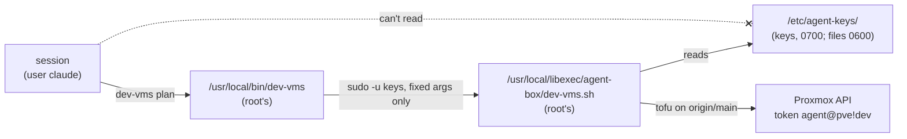

# Set up the agent box's users, keys, wrappers and guard rules

**Status:** draft, not yet run. Written 2026-11-10 from the code in `hosts/ansible/roles/agent_box`.

A deny rule can't stop a session from reading a file it is allowed to read, with `less`, `python` or anything else. So the keys are kept from sessions by file ownership, and the deny rules are a second floor for everything else:



| Piece | Where | Owner and mode |
|---|---|---|
| Session user | `claude`, no extra groups (no `wheel`) | |
| Keys user | `keys`, a system user with no login shell, home `/var/lib/agent-box` | |
| Keys | `/etc/agent-keys/` | `keys`, 0700; every file 0600 |
| Wrappers | `/usr/local/libexec/agent-box/<name>.sh` | root, 0755 |
| Front scripts sessions run | `/usr/local/bin/<name>` | root, 0755 |
| sudo | `/etc/sudoers.d/agent-box`, one line per wrapper | root, 0440, checked by `visudo` |
| Claude Code guard | `/etc/claude-code/managed-settings.json` | root, 0644 |
| Hostname kept across reboots | `/etc/cloud/cloud.cfg.d/99-keep-hostname.cfg` (`preserve_hostname: true`) | root, 0644 |
| Tailscale client | package `tailscale` from pkgs.tailscale.com, `tailscaled` on at boot | |

CT 259, the jumpbox rehearsal's container, is not the agent box. This runbook doesn't touch it. It stays up by the owner's call (2026-11-09 23:04 UTC) until the platform's architecture is settled, and it lives in the rehearsal kit's state ([Grow the agent jumpbox](grow-the-agent-jumpbox.md)).

There are three wrappers. `pr-merge check|merge OWNER/REPO PR HEAD` checks or squash-merges one pull request as the GitHub App, under D-0031 ([how it decides](#merge-pull-requests-from-the-box)). `ci-runner plan|apply|configure|destroy` builds the notebook's CI runner VM and registers it ([Set up the notebook's self-hosted CI runner](set-up-the-ci-runner.md)). The other is `dev-vms plan|apply|destroy`: OpenTofu on `hosts/terraform/home/k8s` for the dev rebuild VMs (250-257), with the agents' own token `agent@pve!dev` (`hosts/terraform/home/bootstrap/agent-access.sh`). It runs only the code on `main`: it moves the `keys` user's own checkout to `origin/main` first, so a session can't change what runs with the token.

## Before you start

- The VM is grown and its plan names it by STD-0001 ([grow-the-agent-jumpbox.md](grow-the-agent-jumpbox.md)).
- The filled-in inventory has group `agent_box` with the VM's address, its admin user, `agent_box_hostname` (the same name as the VM's name in `home/jumpbox`), and the Mac's allow rules and `autoMode` block in `agent_box_allow` and `agent_box_auto_mode`. Copy rules only, never secrets ([hosts.example.yml](../../hosts/ansible/inventories/home/hosts.example.yml)).
- The Proxmox API's certificate is issued by the lab CA, which the box doesn't trust yet. List only the public root certificate's file in `agent_box_ca_files`, by its full path: no folder, no pattern, never a file that holds a key. The role checks each file on the controller first, and stops unless it is a regular file that parses as a certificate and holds no `PRIVATE KEY` block. Set `agent_box_tls_check_url` to the API's version path on the name the wrappers use; that name must be in the certificate.

## Steps

1. Read the change first.
   why: the role replaces `/etc/claude-code/managed-settings.json` and takes `claude` out of any extra group, so the diff shows what the box loses.

   ```sh
   cd hosts/ansible
   ansible-playbook -i inventories/home/ playbooks/agent-box.yml --check --diff
   ```

   expect: the hostname change, the new users and folders, the sudoers file and the settings diff. Stop if `claude` loses a group the box needs.
   On a fresh box, the steps that write into a folder the run would create (the OpenTofu download and unpack, and the Tailscale package after its repository) show as skipped, and the proofs are skipped in check mode. A check never writes to the box.

2. Run it.

   ```sh
   ansible-playbook -i inventories/home/ playbooks/agent-box.yml
   ```

   expect: `failed=0`. The hostname is the STD-0001 name and stays so after a reboot (cloud-init keeps it), and cloud-init no longer runs its first boot again when the VM is renamed (`manual_cache_clean: true`). The last tasks are the proofs: user `claude` can't open `/etc/agent-keys`, `sudo -l -U claude` lists only the wrappers, as `keys`, and `/etc/hosts` names the box once per address with no repeated line. When `agent_box_tls_check_url` is set, the last proof fetches it with certificate checks on and gets 200 or 401: the box trusts the Proxmox CA, so tofu will too.
   A backup of the old settings file stays beside it (`managed-settings.json.<date>~`).

3. Restart Remote Control so new sessions read the new hostname and settings.

   ```sh
   sudo systemctl restart claude-rc
   hostnamectl --static
   ```

   expect: the STD-0001 name. At claude.ai/code the box comes back under an entry with the new name. The old entry, under the rehearsal name, goes stale and can be ignored.

4. Join the tailnet as `tag:agent-box`, as the admin user.
   why: cloud sessions reach the box by Tailscale SSH as `claude` (the tailnet policy's SSH rule from `tag:agent` to `tag:agent-box`, `hosts/terraform/home/tailnet-policy`). The policy's OAuth client can't mint auth keys, so the join uses a login link.

   ```sh
   sudo tailscale up --advertise-tags=tag:agent-box --ssh
   ```

   It prints a login link. The owner opens it once, signed in as a tailnet admin. `--ssh` stays on: the policy's SSH rule needs Tailscale SSH on the box.
   expect: `tailscale status` shows the box with `tag:agent-box`, and `ssh claude@<box>` from a cloud session gets a shell, while `ssh root@<box>` is refused.

5. Put the dev rebuild keys in place, as the admin user. The files never pass through a session or a repository.
   why: `dev-vms` reads them, and only the `keys` user can.

   ```sh
   sudo install -o keys -g keys -m 0600 /dev/stdin /etc/agent-keys/proxmox-dev.env <<'EOF'
   PROXMOX_VE_ENDPOINT=<the host's API URL>
   PROXMOX_VE_API_TOKEN=agent@pve!dev=<secret>
   EOF
   sudo install -o keys -g keys -m 0600 <dev tfvars from the Mac> /etc/agent-keys/dev-vms.tfvars
   ```

   In `dev-vms.tfvars`, `vlans_file` points into the keys user's checkout: `/var/lib/agent-box/central-hub/hosts/ansible/inventories/home/group_vars/all/vlans.yml`.

6. Prove it as a session would, from a Remote Control session on the box.

   ```sh
   dev-vms plan
   cat /etc/agent-keys/proxmox-dev.env
   sudo -u keys cat /etc/agent-keys/proxmox-dev.env
   ```

   expect: `dev-vms plan` prints the central-hub commit and a plan; the `cat` fails with permission denied; the `sudo` line is refused by the deny rule `Bash(sudo:*)` before it runs.

7. Guard test: the owner sends each blocked line from their phone, as for the rehearsal (PLAN step 12). Each must be refused.

## The agents' GitHub App

The box holds the private key of the GitHub App "Central Hub Agents". Wrappers use it to mint one-hour installation tokens, so the agents act on GitHub under the App's own name instead of the owner's account. Two wrappers use it. `pr-merge` mints a token for one repository to read a pull request and merge it. `ci-runner configure` mints a runner registration token for agent-notebook ([Set up the notebook's self-hosted CI runner](set-up-the-ci-runner.md), tested 2026-11-10). Cloud sessions don't use the App.

The owner sets it up once, in GitHub's web UI:

1. Register the App on the owner's account. Turn off the webhook and OAuth, and allow installs only on that account.
   why: nothing listens for events, and the App acts only as itself, never on the owner's behalf.
2. Give it repository permissions only:
   - Contents: read and write.
   - Pull requests: read and write.
   - Checks: read.
   - Actions: read.
   - Metadata: read.
   - Administration: write. GitHub requires it to create runner registration tokens, and the wrapper narrows each token to one repository and that one permission.

   Leave out Workflows, so a push that changes `.github/workflows/` is refused (rule 5). Leave out Secrets, Environments and Deployments too.
   why: least privilege. A permission added later must be accepted again on the installation.
3. Install it on the owner's account with "Only select repositories": central-hub, inpara, agent-notebook and obsidian-graph-3d. Add the App to no ruleset bypass list.
   why: `main` stays protected, so the App merges and accepts nothing (rules 1 and 2).
4. Generate a private key, then put it on the box from the Mac with `agent-box-keys.sh put-github-app` ([allow-a-command-for-agents.md](allow-a-command-for-agents.md)). It lands as `/etc/agent-keys/github-app.pem`, owned by `keys`, mode 0600, and is never read, printed or copied anywhere else.
5. Put the App's ID in the private inventory, as `github_app_id` in `agent_box_ci_runner` ([hosts.example.yml](../../hosts/ansible/inventories/home/hosts.example.yml)), then run step 2 of the CI runner runbook.
   expect: `ci-runner configure` registers the runner. If the App is not installed on the repository, the wrapper says so by name ("If it fails" in the CI runner runbook).

Exit: uninstall the App and delete it in GitHub's settings, then delete `/etc/agent-keys/github-app.pem`.

## Merge pull requests from the box

`pr-merge` is the box's version of the Mac lane's merge step, built to be tested on test pull requests first. The Mac lane keeps merging until that test passes.

```text
pr-merge check jonhill90/<repo> <pr number> <40-character head>
pr-merge merge jonhill90/<repo> <pr number> <40-character head>
```

- It works only on the project's four repositories, and only with the full 40-character head the reviewer named. GitHub refuses the merge if the head moved since the check.
- Green is [D-0031](../decisions/0031-let-agents-merge-green-prs.md) rule 1: the pull request is open and not a draft, GitHub reports a clean merge, and every check on the head has passed, none pending. A skipped or neutral check counts as passed.
- It refuses, with exit code 3, any pull request that touches `docs/decisions/`, `docs/standards/`, `CLAUDE.md` or `AGENTS.md`. Those need the owner's named approval (D-0031 rules 3 and 4), which the wrapper can't check, so the owner's lane merges them.
- It squash-merges only. It never deletes a branch and never enables auto-merge.
- The App needs the repository permissions Contents (write), Pull requests (write), Checks (read) and Commit statuses (read). If the installation has not accepted them, the wrapper says so and stops.
- It does not look for secrets or private names in the diff (rule 4 of `CLAUDE.md`); the reviewer does that before the head is named.

expect: `pr-merge check` prints `GREEN` or `NOT GREEN: <reasons>` and changes nothing.

## If it fails

- `visudo` rejects the sudoers file: the task fails and the old file stays; nothing else in sudo changes.
- `dev-vms` stops with `Failed to determine current working directory: stat .: permission denied`: it was started from a folder the `keys` user can't read, such as the admin user's home, on a box set up before the front script began with `cd /`. Run the role's `wrappers` tag again, or start `dev-vms` from `/` or the `claude` user's home.
- `dev-vms` says there is no saved plan: run `dev-vms plan` first; `apply` only applies the saved plan.
- After a dev teardown, `dev-vms plan` can't create VMs: Proxmox dropped the `/vms/<id>` ACLs when the VMs were destroyed (pick 18), so `agent-access.sh` must run again as root.
- The TLS proof fails with `CERTIFICATE_VERIFY_FAILED`: the CA file is the wrong one, or `update-ca-trust` didn't run. Fix the file and run again with `--tags ca,verify`; never turn certificate checks off.
- It fails with a hostname mismatch: the URL's name is not in the host's certificate. Use a name the certificate lists, or reissue the certificate with that name.

## Exit

Remove `/etc/sudoers.d/agent-box`, the front scripts and `/usr/local/libexec/agent-box/`, then delete `/etc/agent-keys/` and revoke the token `agent@pve!dev`. The VM itself goes with [grow-the-agent-jumpbox.md](grow-the-agent-jumpbox.md)'s exit.
