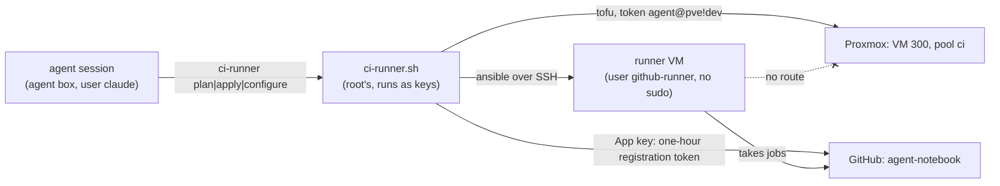

# Set up the notebook's self-hosted CI runner

**Status:** draft; first run 2026-11-10 (see `last-tested`), not yet replayed on a fresh VM. Written 2026-11-10, after the owner's go at 20:05 UTC to move the notebook's CI off GitHub-hosted minutes. GitHub-hosted minutes ran out: the notebook's org-check started about 400 runs in 18 hours (measured from the Actions runs API on 2026-11-10), and a self-hosted runner doesn't use the plan's included minutes ([GitHub Actions billing](https://docs.github.com/en/billing/concepts/product-billing/github-actions)).

CI runs the code in each pull request, so the runner gets its own VM, away from the agent box's keys and from the Proxmox API:

| Piece | Where |
|---|---|
| VM | `hosts/terraform/home/ci-runner`: VM 300 in pool `ci`, cloned from template 9001 (the agents' copy of 9000, on VNet dev), on VNet dev |
| Runner | role `ci_runner`: user `github-runner` (no sudo), `/var/lib/github-runner/runner`, unit `github-runner.service` |
| Wrapper | `ci-runner plan\|apply\|configure\|destroy` on the agent box, from role `agent_box` |
| Private values | `agent_box_ci_runner` in the inventory, written to `/var/lib/agent-box/ci-runner.json` (the keys user's, 0600) |
| Keys | `/etc/agent-keys/ci-runner-ssh` (made by the wrapper on its first run), `proxmox-dev.env`, `github-app.pem` |

The dev VLAN reaches the internet and no other lab network (role `opnsense_lab`, rule kinds 0 and 3), and the host firewall lets only the agent box reach 8006, so the runner needs no firewall change.

## Before you start

- The agent box is set up and its pin includes this runbook's code ([Set up the agent box](set-up-the-agent-box.md)).
- The private inventory has `agent_box_ci_runner` with the runner's STD-0001 name, ID 300, a free dev address below the DHCP pool, its size, the Proxmox node, the GitHub App's ID and the repository ([hosts.example.yml](../../hosts/ansible/inventories/home/hosts.example.yml)).
- The box's allow rules (`agent_box_allow`) include `Bash(ci-runner plan)`, `Bash(ci-runner apply)` and `Bash(ci-runner configure)`.
- The GitHub App "Central Hub Agents" has the repository permission Administration (write), accepted on its installation. GitHub requires it to create a registration token ([self-hosted runners API](https://docs.github.com/en/rest/actions/self-hosted-runners)). The wrapper asks for a token cut down to agent-notebook and that one permission.

## Steps

1. Give the agents' Proxmox user pool `ci`, VM 300 and template 9001, from the Mac: `proxmox-agent-access.sh run`. Then set `template_vm_id: 9001` in `agent_box_ci_runner`.
   why: the agents' token may create guests only in its pools, and Proxmox checks a new VM's `/vms/<id>` before the VM joins its pool. Proxmox also checks SDN.Use on the network of the VM being cloned, and template 9000 is on VNet prod, which the agents may not use; the script makes template 9001, a copy on VNet dev.
   expect: `agent-access: done`, and `qm config 9001` shows `template: 1` and `bridge=dev`.

2. Install the wrapper on the box, from the Mac: `ansible-agent-box.sh apply`.
   expect: `failed=0`; `ci-runner` is in `/usr/local/bin`, its sudoers line is in `/etc/sudoers.d/agent-box`, and `/var/lib/agent-box/ci-runner.json` exists.

3. Plan the VM, from a session on the box: `ci-runner plan`.
   expect: the central-hub commit, then `1 to add`: one VM, ID 300, pool `ci`, bridge `dev`.

4. Make it: `ci-runner apply`.
   expect: `Apply complete! Resources: 1 added`.

5. Install and register the runner: `ci-runner configure`.
   expect: `failed=0`. The last tasks prove the service is active and that `github-runner` has no sudo. On the repository's Settings, under Actions and Runners, the runner shows as Idle with label `notebook`.

6. Move the notebook's jobs onto it: in agent-notebook, `runs-on: [self-hosted, notebook]` for `org-check`, `access-expiry` and `daily-note` (a pull request there).
   expect: that pull request's checks run on the runner and pass.

## If it fails

- `ci-runner configure` says "the App's ID and key work, but the App is not installed on" the repository: add that repository to the App's installation (the App's settings, Install App, Configure, Repository access). "GitHub refused the App's ID or key" means `github_app_id` or `/etc/agent-keys/github-app.pem` is wrong.
- `ci-runner configure` warns "no registration token" and the role stops with "isn't registered yet": the App lacks Administration (write), or its installation hasn't accepted the new permission.
- The play stops on a changed host key after a rebuild: check the new key on the VM's console, then remove its line from `/var/lib/agent-box/.ssh/known_hosts`.
- `ci-runner apply` stops with 403 "Permission check failed (/sdn/zones/lab/prod, SDN.Use)": the settings still clone template 9000. Set `template_vm_id: 9001` and run `ansible-agent-box.sh apply` again (step 2).
- `ci-runner plan` can't create VM 300 after a destroy: Proxmox dropped the `/vms/300` ACL (as for 250-257), so run step 1 again.
- The proof "the runner service is running" fails: the message carries the service's last log lines and any SELinux denials. Exit status 203 means systemd could not start the program at all.
- A job fails for a missing tool: add the package to `ci_runner_packages`, then run `ci-runner configure` again.

## Exit

Remove the runner on the repository's runner page, run `ci-runner destroy`, put `runs-on: ubuntu-24.04` back in the notebook's workflows, delete `/etc/agent-keys/ci-runner-ssh`, and remove pool `ci`, template 9001 (`qm destroy 9001`, if no dev rebuild uses it) and the `/vms/300` lines from `agent-access.sh`.
