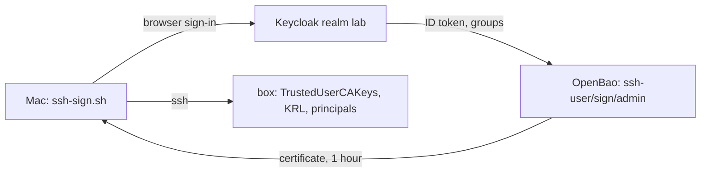

# Sign in to the lab's Linux boxes with SSH certificates from OpenBao

D-0064 is the decision. In short: the owner signs in at Keycloak, OpenBao signs a one-hour user certificate for principal `lab-admin`, and each box trusts only OpenBao's public key and a revocation list. The local key logins stay as the way in while c1 is down.

*In words:* the Mac signs in at Keycloak, OpenBao hands back a certificate, and the box checks it against one public key.

## Before you start

1. The store's admin login is on the box and `secrets-store-prod owner-login check-test` passes. If it does not, stop: the SSH login role is one more role on that login.
2. `secrets-store[-prod] ssh-ca plan` runs and names where each value comes from. It prints no name.
3. Realm lab's client `openbao` has the redirect `http://localhost:8250/oidc/callback` (the identity role's realm template). A client change reaches the live realm through the clients run, which is its own step.
4. For a box: a second ssh session is open on it, and a local key login works from the box (`ssh <box>` with the agent's own key).

## Steps

1. **Store.** `secrets-store[-prod] ssh-ca apply`, then `ssh-ca check`. Expect `PASS` lines for both mounts, both CA keys (kept, never replaced), role `admin`, role `hosts`, policy `ssh-sign` and login role `ssh-admin`, and a last line `ssh-ca set-up reads back as written`. Writing the roles and the login role is a change to who can sign in, so it is an access right under D-0042 rule 6: the standing go of D-0061, with the PR or the run's log naming the step and its commit.
2. **Public keys.** `secrets-store[-prod] ssh-ca public` writes `user-ca.pub` and `host-ca.pub` (public keys, not secrets) into `ssh-ca/` in the environment's keys folder on the box. It takes no path.
3. **One box.** `ansible-playbook -i <inventory>/ playbooks/ssh-ca-trust.yml -e ssh_ca_trust_hosts=<box> -e ssh_ca_trust_user_ca_file=<user-ca.pub> --check --diff`, read the diff, then run it without `--check`. The role stops if the box would lose local key logins, checks the drop-in with `sshd -t`, removes it if sshd refuses it, reloads (never restarts), and reads `sshd -T` back. Expect no failed task, then log in again from a new session with the local key.
4. **Mac.** `hosts/wrappers/mac/ssh-sign.sh`. A browser opens at Keycloak (password and one-time code). It prints the principal `lab-admin` and a one-hour end time. The key lives only in ssh-agent.
5. **Prove the box.** `ssh <account>@<box>` logs in with the certificate. Then each of: the same key without its certificate is refused; a certificate past its end time is refused; after a serial is added to `hosts/ssh-ca/revoked.txt` and a new list is built and pushed, that certificate is refused (**the step that builds the list from the file is not written yet**; until it is, build it by hand with `ssh-keygen -k -s user-ca.pub` and pass it as `ssh_ca_trust_krl_file`); the local key login still works with OpenBao stopped.
6. **Host certificates.** `ssh-ca sign-host <names>` with the box's `/etc/ssh/ssh_host_ed25519_key.pub` on stdin (it writes `ssh-ca/host-<first name>-cert.pub` in the keys folder) for each box, then run the playbook with `-e ssh_ca_trust_host_cert_file=<out>`. Clients trust the host CA with one `@cert-authority <zone pattern> <host-ca.pub>` line in `ssh_known_hosts`.

## If it fails

- A box refuses the certificate: `journalctl -u sshd` on the box shows the reason (an unlisted principal, an expired certificate, a revoked serial). Nothing else on the box changed.
- sshd refuses the drop-in: the role removes it and reloads nothing; the box is as before.
- Locked out: use the local key from the second session, then run the playbook with `-e ssh_ca_trust_remove=true`.
- OpenBao or c1 is down: no new certificates; use the local keys (D-0064 rule 5).
- `ssh-ca apply` says auth/oidc is not configured: run `owner-login owner` first.

## Afterwards

Record the run's `PASS` lines and the commit in the agent notebook's RB-0296 hub. Two clean dev runs in a row come before any prod box.

## Related

- D-0064 (this decision), D-0037 (the local ways in), D-0058 (OpenBao on c1), D-0061 (the standing go).
- [Set up the lab's secrets store](set-up-the-secrets-store.md)
