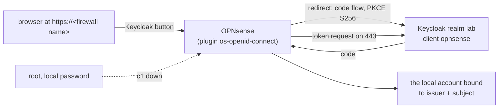

# Sign in to the OPNsense web GUI through Keycloak

OPNsense's own OpenID Connect sign-in is in its paid Business Edition. The community plugin **os-openid-connect** (BSD-2-Clause) adds it to the community edition the lab runs, so the GUI signs in at Keycloak like the lab's other apps (D-0037 rule 5). Local root stays the way in that doesn't need c1 (D-0037 rule 2).

**The plugin is a beta from one maintainer.** OPNsense has not reviewed it, it is installed by hand, and OPNsense's own updates never update it. So it goes on a throwaway test OPNsense first, and on the lab firewall only after that proof and the owner's tap.



*In words:* the login page's Keycloak button sends the browser to Keycloak. Keycloak sends it back with a code, and OPNsense swaps the code for a token itself, so the firewall must reach Keycloak too. The plugin looks up the local account bound to the token's issuer and subject, and that account's groups give the rights. An identity with no binding waits until an admin binds it. If c1 is down, sign in as root with its local password.

| Piece | Where |
|---|---|
| Client `opnsense` in realm `lab`: confidential, code flow with PKCE S256, redirects only to `https://<name>/api/openidconnect/auth/callback/keycloak`, and the lifecycle test's logout return `https://<name>/api/openidconnect/auth/logouttestcallback/keycloak` | `k8s_identity`: `templates/realm.yaml.j2`, inputs `k8s_identity_opnsense_hosts` and `k8s_identity_opnsense_app_code` |
| Its secret: `OPNSENSE_CLIENT_SECRET` in `~/.config/central-hub/identity.env` on the controller, made by k8s_identity like the other client secrets, only once a name is set | `k8s_identity/vars/main.yml` |
| The plugin: `os-openid-connect-1.0.0.beta5.pkg`, tag `v1.0.0-beta5` (commit `e7f5f7b3ed0dc6d71463bd7cbc08d65cbc794e12`), SHA-256 `4b222b0de4ff9523cf3c86b23e984507e21c9a92a02bafe7cc01e406a41b117c` | this runbook, step 1 |
| The plugin's settings on OPNsense | step 2 |

## Steps

Steps 1 to 4 run on the test OPNsense, which signs in at a throwaway Keycloak on the agent box, with DPoP on as in the lab. The `opnsense-test` wrapper on the agent box does all four (`apply`, `configure`, `prove`, `destroy`); [prove-opnsense-sign-in-on-dev.md](prove-opnsense-sign-in-on-dev.md) gives its commands and what each prints, and the steps below say what it checks. That Keycloak holds a minimal throwaway realm, not realm lab's template. Its one client `opnsense` has the lab client's settings: confidential, code flow with PKCE S256, application code `keycloak`, and the same callback and logout return paths on the test OPNsense's name. It has two users: one bound to a local admin account and one left unknown. The realm and its secrets are removed at the end. Realm lab on c1 is not touched until step 5.

1. **Check the package.** Download the package and its checksum from the `v1.0.0-beta5` release, then check both where `gh` is installed (the agent box has none, so the attestation check runs in CI), before the file goes to OPNsense:

   ```sh
   sha256sum os-openid-connect-1.0.0.beta5.pkg
   gh attestation verify os-openid-connect-1.0.0.beta5.pkg \
     -R jpawlowski/opnsense-openid-connect \
     --signer-workflow jpawlowski/opnsense-openid-connect/.github/workflows/build.yml \
     --deny-self-hosted-runners
   ```

   why: the SHA-256 pins the bytes that were read, and the attestation ties them to the repository's own build ([the plugin's install guide](https://github.com/jpawlowski/opnsense-openid-connect/blob/v1.0.0-beta5/docs/setup/install.md)).
   expect: the SHA-256 in the table above, and a verified attestation. On any other value, stop.

2. **Install and set it up on the test OPNsense.** Copy the checked file from the agent box and install it with `pkg add` of that local file; OPNsense never downloads the plugin. On the test OPNsense, `opnsense-test configure` copies it over SSH as root with the box's own key for that VM, and seeds the server settings below into `/conf/config.xml`. On the lab test copy's VM 100, the nano image the lab firewall runs, `lab-test signin` installs the same file over the copy's SSH and sets these settings on the running firewall with `hosts/ansible/bootstrap/opnsense-oidc-server.php`, which fixes D-0037 rule 5's settings in code ([build-the-lab-test-copy.md](build-the-lab-test-copy.md) step 8). How the box reaches the lab firewall is written here before step 5. On the lab firewall, under System > Access > Servers, add an OpenID Connect server with these settings:
   - provider profile Keycloak;
   - issuer: the throwaway Keycloak's realm; client `opnsense` and its secret;
   - application code `keycloak`;
   - admission policy **Administrator approval**;
   - create an account on first login **off**;
   - root **not** allowed;
   - PAR mode **Disabled**;
   - logout notifications **Off** (the Keycloak profile's default is back-channel);
   - shared signals **off**;
   - keep the Local Database as a login server.

   why: these are D-0037 rule 5's settings. With PAR and shared signals off, the plugin's every-minute root job only fetches Keycloak's discovery document and keys. DPoP has no setting: the plugin uses it because Keycloak offers it, and its code was read (D-0037 evidence finding 24).
   expect: the plugin's own test sign-in passes.

3. **Prove it on the test OPNsense.**
   - A Keycloak user bound to a local admin account signs in and lands on the dashboard with that account's rights.
   - The sign-in used DPoP: Keycloak's discovery lists ES256 under `dpop_signing_alg_values_supported`, and the plugin's test sign-in reports its DPoP sender constraint.
   - An unknown Keycloak user is refused or waits in the approval queue.
   - With the plugin's server disabled, root signs in with its local password through the Local Database.
   - With the plugin's server enabled and the throwaway Keycloak stopped, root signs in with its local password (D-0037 rule 5). The prover stops the container first and checks that the VM no longer reaches its issuer (`hosts/ansible/roles/agent_box/files/opnsense-test-prove.py`, item 10).

   expect: all five. Keep the run's log in the agent notebook's run records, with no secret in it.

4. **Clean up.** Destroy the test OPNsense, and stop the throwaway Keycloak and remove its data.
   expect: neither is left running.

5. **The lab firewall.** Only after step 3 passes, and with the owner's tap on a card that names this runbook's commit, the plugin version and its SHA-256, and says it changes the firewall (D-0036 rule 8) and who can sign in to it (D-0042 rule 6):
   1. **Add the client to realm lab on c1.** Set `k8s_identity_opnsense_hosts` in the private inventory to the GUI's names, and run the k8s_identity role twice, as for Proxmox ([sign-in-to-proxmox-through-keycloak.md](sign-in-to-proxmox-through-keycloak.md) step 2).
      why: the first run adds `OPNSENSE_CLIENT_SECRET` to `identity.env`, and the second imports the realm with the client. As with every realm import, open sign-ins end.
      expect: `identity.env` has an `OPNSENSE_CLIENT_SECRET` line, and the realm import shows `Done`.
      From the agent box, on live prod, the same step is `c1-ansible check clients` and then `apply clients <clearance id>` (tags `secrets,clients`, no realm replace: client `opnsense` is added in place, with `proxmox` and `openbao`, and every open sign-in stays). Order, because the realm's Secret reads every key from the store: `c1-ansible apply identity-values <clearance id>` (adds a random `OPNSENSE_CLIENT_SECRET` to the box's own `identity.env`, tags `always`, no cluster call, only the key's name printed), then `secrets-store-prod put-apps` (writes it to SOPS and the store), then `apply clients`. It needs no inventory value: the GUI names default to the firewall's `opnsense_cert_names` from the inventory the box already holds, else `opnsense.<zone>` (`k8s_identity_opnsense_hosts`; `k8s_identity_opnsense_client: false` turns the client off). A **rebuilt prod** needs no such run: its `identity` stage imports the whole realm, client `opnsense` included.
   2. Steps 1 and 2 on the lab firewall, with issuer `https://<sso name>/realms/lab`. The agent box does this without SSH on the firewall, through the Proxmox host's host job `opnsense-sso` (`proxmox-host.sh check|apply-recorded opnsense-sso`, playbook `playbooks/opnsense-sso.yml`, role `opnsense_sso`): VM 100's QEMU guest agent runs `fetch` of the pinned package, checks its SHA-256 on the firewall, runs `pkg add`, then sends `bootstrap/opnsense-oidc-server.php` and the settings (in pieces of 512 characters, as `opnsense-backup-user.sh` does) and runs it, which sets D-0037 rule 5's settings in code and deletes the settings file as it reads it. The client secret is the one line `OPNSENSE_CLIENT_SECRET` of the box's own prod `identity.env` (made by `c1-ansible identity-values`, step 5.1, the one Keycloak's realm reads). Only the keys user can read that file, so the job (as the host user) asks the keys user's fixed-argument wrapper `opnsense-sso-secret read`, on a pipe, and keeps the line in its own 0600 file `opnsense-sso.env`; it is never printed and the Mac is not involved. A check run lists the change it would make (install the package, set the server) as one changed task, because the changing tasks are skipped in a check. The issuer needs no inventory value: it is `https://sso.<zone>/realms/lab`, built from the zone on the `k8s_nodes` hosts (`k8s_identity_zone`, else `k8s_gateway_zone`) as the identity role builds it, and `agent_box_proxmox_host_opnsense_sso: {issuer: ...}` overrides it. A run changes the firewall only when the package is missing or the secret, issuer or script text changed (a marker file holds their SHA-256). The way back: `apply-recorded opnsense-sso` arms the host job's `guard` itself (a snapshot of VM 100 and a 15-minute timer), confirms it when the apply passed, and rolls the VM back when the apply fails or changes a task the check did not show; `pkg delete os-openid-connect` removes the package later; root's local login is never touched. The role's test, `tests/test_opnsense_sso.sh`, runs it against a stand-in guest; it has not run on the real firewall.
   3. Step 3's checks on the lab firewall, except that root's check is made with client `opnsense` disabled in Keycloak, so c1 keeps running.

## Undo

- Turn off the OPNsense server's "Offer on the login page" setting, or run `pkg delete os-openid-connect`. Local sign-in is unchanged either way, and the package's settings stay in `/conf/config.xml`.
- Empty `k8s_identity_opnsense_hosts` and run step 5.1 again to drop the client.

## When it goes wrong

| Symptom | Cause and fix |
|---|---|
| Keycloak says "Invalid parameter: redirect_uri" | The name in the browser isn't in `k8s_identity_opnsense_hosts`, or the plugin's application code isn't `keycloak`. Add the name and run step 5.1, or set the code. |
| The Keycloak button is gone after an OPNsense upgrade | The plugin hooks into core files that an upgrade can change. Sign in as root, and check the plugin's nightly check in the system log (`openid-connect-watch`). Try each upgrade on the test OPNsense first. |
| Sign-in through Keycloak fails while c1 is down | Expected: sign in as root with its local password. |
