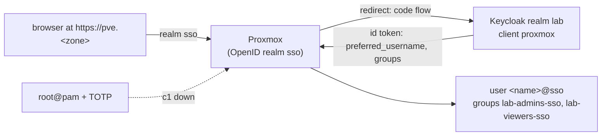

# Sign in to the Proxmox web UI through Keycloak

Proxmox VE has its own OpenID Connect realm type, so the web UI signs in to Keycloak's realm `lab` like any other lab app: OIDC only, no Keycloak API (D-0025 rule 1). `root@pam` with TOTP stays the way in that doesn't need c1 ([set-up-proxmox-host.md](set-up-proxmox-host.md) step 4).



*In words:* the login page sends the browser to Keycloak; Keycloak sends it back with a code; Proxmox swaps the code for a token and makes the user `<name>@sso` on the first sign-in. The `groups` claim puts the user in `lab-admins-sso` or `lab-viewers-sso`, which hold Administrator or PVEAuditor on `/`. If c1 is down, choose "Linux PAM standard authentication" and sign in as root@pam with TOTP.

| Piece | Where |
|---|---|
| Client `proxmox` in realm `lab`: confidential, code flow, redirects only to `https://<name>` for each of the web UI's names, the groups and roles claims | `k8s_identity`: `templates/realm.yaml.j2`, input `k8s_identity_proxmox_hosts` |
| Its secret: `PROXMOX_CLIENT_SECRET` in `~/.config/central-hub/identity.env` on the controller, made by k8s_identity like the other client secrets. Not copied to c1 | `k8s_identity/vars/main.yml` |
| A second factor for every member of `lab-admins`: a TOTP seed `TOTP_<USER NAME>` in `identity.env`, imported as the user's OTP credential, so Keycloak asks admins for a code at every sign-in (D-0037 rule 6) | `k8s_identity`: `k8s_identity_otp_group`, `templates/realm.yaml.j2` |
| Realm `sso` in Proxmox: issuer, client ID, the secret as client key, user names from `preferred_username`, users made on first sign-in, groups from the `groups` claim, overwritten at each sign-in, offered first | `proxmox_sso`, `tasks/main.yml` |
| Groups `lab-admins-sso` (Administrator on `/`) and `lab-viewers-sso` (PVEAuditor on `/`). Proxmox adds `-<realm>` to every claimed group name, so a claimed group can't land in `admins` itself | `proxmox_sso_groups` |
| One `/etc/hosts` line on the host for the issuer's name, because the host's resolver doesn't know lab names (pick 215) | `proxmox_sso_address` |

Why each setting is so:

- **Redirect `https://<name>` with no path.** The login page sends `location.origin` as the redirect [source: pve-manager `www/manager6/window/LoginWindow.js`, `'redirect-url': location.origin`]. A sign-in from `https://<name>:8006` is refused by Keycloak; 8006 is for root@pam.
- **`username-claim username`.** The wiki warns that a claim users can edit lets one user take another's account [source: <https://pve.proxmox.com/wiki/User_Management>, "OpenID Connect"], so realm lab sets `editUsernameAllowed: false`, and CI checks it. Proxmox fixes this claim when the realm is made [source: pve-access-control `src/PVE/Auth/OpenId.pm`, `"username-claim" => { optional => 1, fixed => 1 }`], so the role stops rather than change it.
- **Groups.** Names from the claim get `-<realm name>` added, and groups that don't exist in Proxmox are ignored unless groups-autocreate is on [source: same wiki page, "Groups mapping"]. The role makes the two groups itself and leaves groups-autocreate off, so a new Keycloak group grants nothing in Proxmox until it is in `proxmox_sso_groups`. With groups-overwrite on, leaving `lab-admins` in Keycloak removes the role at the next sign-in; an open session keeps it until its ticket ends.

## Steps

All from `hosts/ansible` in the lab clone, at the merge commit of the PR that added this runbook.

1. In the private inventory, set:
   - for c1 (next to `k8s_identity_zone`): `k8s_identity_proxmox_hosts: "{{ hostvars['proxmox_host'].proxmox_cert_names }}"`;
   - for the Proxmox host: `proxmox_sso_issuer: https://sso.<zone>/realms/lab` and `proxmox_sso_address: "{{ k8s_gateway_address }}"`.
   why: the client's redirects are the web UI's names, the same names the certificate and nginx use; the issuer is Keycloak's own (`k8s_identity_issuer`).
2. Add the client to realm lab:

   ```sh
   ansible-playbook -i inventories/home/ playbooks/k8s-identity.yml --tags secrets,keycloak --check --diff
   ansible-playbook -i inventories/home/ playbooks/k8s-identity.yml --tags secrets,keycloak
   ```

   why: the first run adds `PROXMOX_CLIENT_SECRET` to `identity.env` (even in check mode, as for every key); the second imports realm lab again with the client. Open sign-ins to Grafana, Argo CD and Jellyfin end ([set-up-lab-sign-in.md](set-up-lab-sign-in.md) step 2).
   expect: `identity.env` has a `PROXMOX_CLIENT_SECRET` line and a `TOTP_<USER NAME>` line for each admin; `kubectl -n identity get keycloakrealmimport realm-lab` shows `Done`.
3. Set the realm on the host:

   ```sh
   ansible-playbook -i inventories/home/ playbooks/proxmox-sso.yml --check --diff
   ansible-playbook -i inventories/home/ playbooks/proxmox-sso.yml
   ```

   why: the role checks the host can fetch Keycloak's discovery document with normal certificate checks before it makes anything, then makes the groups, their ACLs and the realm, then asks Proxmox for a sign-in link (the first half of a sign-in, with no user) and checks it goes to Keycloak for client `proxmox` and back to the web UI.
   expect: `failed=0`, `Realm sso: made.`; a second run shows `changed=0`.
4. Before the first sign-in, add your second factor to an authenticator app by scanning. On the controller, from `hosts/ansible`: `bootstrap/show-totp-qr.sh <user name>`. It opens a QR code of your `TOTP_<USER NAME>` seed on the controller's own screen for 120 seconds, then deletes the image; scan it with the app, which adds an entry named "Lab", then close the image window (on a Mac, Preview keeps showing an image after its file is deleted). Nothing is typed, pasted, printed or logged. Then open `https://<web UI name>/`, keep realm "sso" (the default), choose Login, and sign in at Keycloak with your lab user, the `PASSWORD_<USER NAME>` line, and the app's code.
   why: proves the redirect, the secret, the claims and the group mapping end to end.
   expect: Keycloak asks for the code after the password; the UI opens as `<name>@sso`, Datacenter → Permissions → Users lists you in `lab-admins-sso`, and you can open the host's Summary and Shell.
5. Prove the way in without c1: log out, choose "Linux PAM standard authentication", sign in as root@pam with TOTP.
   why: the break-glass path must not depend on Keycloak (D-0025 rule 6; D-0037).
   expect: root@pam signs in as before.

## If it fails

| Message or sign | Cause and fix |
|---|---|
| `Keycloak's discovery document, from the host` fails with a certificate error | The host doesn't trust the lab root: run `playbooks/proxmox-cert.yml` first. |
| The same task times out or can't resolve | No `/etc/hosts` line (`proxmox_sso_address` empty), or the host can't reach c1's Gateway on 443 from the mgmt VLAN. The second is a firewall change and needs the owner's words. |
| `has no PROXMOX_CLIENT_SECRET line` | Step 2 wasn't run on this controller. |
| `builds user names from another claim` | The realm was made with another claim. Changing it changes every user name: `pveum realm delete sso` on the host, then step 3; users sign in as new accounts. |
| Keycloak says "Invalid parameter: redirect_uri" | The name in the browser isn't in `k8s_identity_proxmox_hosts`, or the UI was opened on :8006. Use the name on 443, or add the name and run step 2. |
| Signed in, but no rights | The user isn't in `lab-admins` or `lab-viewers` in realm lab, or signed in before step 3 made the groups. Fix the user's groups in the inventory (`k8s_identity_extra_users`; the owner is in `lab-admins`), run step 2, sign in again. |

## Exit

Set `proxmox_sso_default: false` to put PAM first again, or remove the realm and its groups on the host: `pveum realm delete sso; pveum group delete lab-admins-sso; pveum group delete lab-viewers-sso`, and empty `k8s_identity_proxmox_hosts` and run step 2. root@pam is unchanged throughout.
