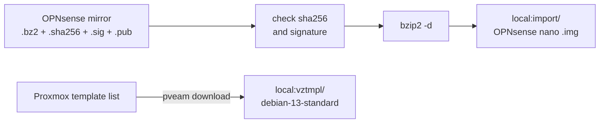

# Put the OPNsense image and the Debian 13 template on the Proxmox host

**Status:** draft, written on 2026-11-08 from the OPNsense and Proxmox docs named in each step; not yet run as written. The images on the running host were put there by hand in an earlier build session, and how was not recorded.

`hosts/terraform/home/firewall` makes VM 100 by importing a disk image (`opnsense_image_file_id`, for example `local:import/<image>.img`), and `hosts/terraform/home/remote-access` makes CT 900 from a container template (`connector_template_file_id`). Both files must be on the host before those run folders apply. Neither run folder downloads them, unlike `home/k8s`, which downloads its own cloud image.



## Before you start

- On the host, `pvesm status` lists storage `local` (a directory storage).
- Pick the OPNsense version. `oxlorg.opnsense` 26.1.11, pinned in `hosts/ansible/requirements.yml`, is tested on OPNsense 26.1, and no release for 26.7 had been seen on 2026-11-08 ([hosts/ansible/README.md, Still open](../../hosts/ansible/README.md#still-open)). Agent pick: the newest 26.1 nano image, until the collection supports 26.7.

## Steps

Run on the Proxmox host as root.

1. Let storage `local` hold importable disk images.

   ```sh
   grep -A5 '^dir: local$' /etc/pve/storage.cfg      # read the "content" line, for example iso,vztmpl,backup
   pvesm set local --content <that list>,import
   pvesm status --content import
   ```

   why: the `import` content type holds "OVAs and VM disk images that can be imported", and a directory storage keeps it in an `import/` subfolder (Proxmox `pvesm` manual, <https://pve.proxmox.com/pve-docs/pvesm.1.html>). Agent pick: `local`, the storage the example file ID already names. `--content` replaces the whole list, so keep every type already there.
   expect: `local` appears in the list.

2. Download the nano image with its checksum, signature and public key from an OPNsense mirror into the import folder.

   ```sh
   cd /var/lib/vz/import
   # from a mirror listed at https://opnsense.org/download/ : the four files for amd64, image type nano
   curl -fLO <mirror>/releases/<version>/OPNsense-<version>-nano-amd64.img.bz2
   curl -fLO <mirror>/releases/<version>/OPNsense-<version>-checksums-amd64.sha256
   curl -fLO <mirror>/releases/<version>/OPNsense-<version>-nano-amd64.img.sig
   curl -fLO <mirror>/releases/<version>/OPNsense-<version>.pub
   ```

   why: the nano image is the embedded image, preinstalled onto a disk, so the VM boots it without an installer; OPNsense ships it bzip2-compressed with these four files (OPNsense manual, "Installation", <https://docs.opnsense.org/manual/install.html>). The exact file names differ by release; copy them from the mirror's listing.
   expect: four files in `/var/lib/vz/import`.

3. Check the image before you use it.

   ```sh
   openssl sha256 OPNsense-<version>-nano-amd64.img.bz2      # compare with the line in the .sha256 file
   bzip2 -d OPNsense-<version>-nano-amd64.img.bz2
   openssl base64 -d -in OPNsense-<version>-nano-amd64.img.sig -out /tmp/image.sig
   openssl dgst -sha256 -verify OPNsense-<version>.pub -signature /tmp/image.sig OPNsense-<version>-nano-amd64.img
   ```

   why: the checksum proves the download is whole; the signature proves OPNsense made it. Compare the `.pub` key with an independent copy, such as <https://pkg.opnsense.org/releases/mirror/README>, because a mirror could change both. Signatures are made before compression, so the signature check runs on the unpacked image (same manual page).
   expect: the checksums match, and the last command prints `Verified OK`.

4. Put the file ID in the firewall run folder's `home.tfvars`, and tidy up.

   ```sh
   pvesm list local --content import          # shows local:import/OPNsense-<version>-nano-amd64.img
   rm OPNsense-<version>-nano-amd64.img.sig OPNsense-<version>-checksums-amd64.sha256 /tmp/image.sig
   ```

   On the controller set `opnsense_image_file_id = "local:import/OPNsense-<version>-nano-amd64.img"` in `hosts/terraform/home/firewall/home.tfvars`.
   why: the variable is "used only when the VM is first created" (`hosts/terraform/home/firewall/variables.tf`), so changing it later never touches a running firewall.
   expect: the file ID in `home.tfvars` matches the list.

5. Download the Debian 13 container template.

   ```sh
   pveam update
   pveam available --section system | grep debian-13
   pveam download local <debian-13-standard template name from that list>
   pveam list local
   ```

   why: CT 900 runs Debian 13 (`connector_template_file_id`, "the Debian 13 container template", `hosts/terraform/home/remote-access/variables.tf`); `pveam` downloads Proxmox's own signed templates (Proxmox `pveam` manual, <https://pve.proxmox.com/pve-docs/pveam.1.html>).
   expect: `pveam list local` shows `local:vztmpl/debian-13-standard_...`. Set that ID as `connector_template_file_id` in `hosts/terraform/home/remote-access/home.tfvars`.

## If it fails

- `Verified OK` doesn't print, or the checksum differs: delete the files and download them again from another mirror. Never import an image that failed either check.
- `pveam available` lists no Debian 13 template: run `pveam update` again; the list comes from Proxmox's servers.

## Afterwards

Set `last-tested`. Keep the image under `import/` while VM 100 exists: a rebuild of VM 100 imports it again.

## Related

- [Set up the lab network and firewall](set-up-lab-network-and-firewall.md): the run folders that use these files.
- [Rebuild the home lab from bare metal](rebuild-home-lab-from-scratch.md).
