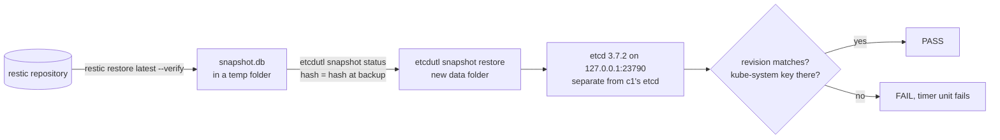

# Test the etcd restore

etcd holds everything the API server knows. c1 has one control plane, so losing that node can lose the cluster's data; Kubernetes' answer is "Regularly back up etcd" (create-cluster-kubeadm page). A backup counts only once a restore of it has worked, and c1's etcd went from 3.6.8 to 3.7.0 with the upgrade to Kubernetes 1.37 (runbook step 17), and the restore had only been tried with 3.6 tools (TASK-0094). This runbook proves the restore every week, without stopping c1.



## Before you start

- [Back up c1 off the box](back-up-c1-off-box.md) is done, and `restic snapshots --tag etcd` lists at least one snapshot.
- Ports 23790 and 23800 on the control plane's `127.0.0.1` are free (`ss -ltn | grep -E ':238[0-9]0'` prints nothing).

## Steps

1. Run the test now, from `hosts/ansible`:

   ```sh
   ansible-playbook -i inventories/home/ playbooks/k8s-backup.yml --tags drill -e k8s_backup_drill=true
   ```

   or on the control plane: `sudo systemctl start c1-restore-test.service && journalctl -u c1-restore-test -n 20 -o cat`.
   why: it takes a fresh backup first, then restores the newest one. The restored copy runs as its own one-member etcd on loopback ports, with its own name and data folder, so c1's etcd and its clients never see it.
   ※ [c1-restore-test-etcd.sh](../../hosts/ansible/roles/k8s_backup/files/c1-restore-test-etcd.sh), steps 1 to 5 in its header
   expect: `PASS: etcd restore test, revision <n>, <k> keys under /, key /registry/namespaces/kube-system present`. The revision is the one `etcdutl snapshot status` printed for the snapshot.

2. Check the timer is set for the next week: `systemctl list-timers c1-restore-test.timer`.
   expect: the next run is the coming Sunday at about 04:30, node time.

## A real etcd restore

The test proves the snapshot is good. To put c1's etcd back from it (the node's disk died, or etcd's data is broken), the steps are those of [build-kubeadm-cluster step 11](build-kubeadm-cluster.md#11-backup-and-restore), with the bundle from restic instead of a local file:

1. On the control plane: `restic restore latest --tag etcd --host <node> --target /root/etcd-restore` (env file loaded as in [Back up c1 off the box, step 4](back-up-c1-off-box.md#steps)).
2. Move `/etc/kubernetes/manifests/*.yaml` out of that folder; wait until `crictl ps` shows no etcd or kube-apiserver.
3. Move `/var/lib/etcd` aside, then `etcdutl snapshot restore /root/etcd-restore/etcd/snapshot.db --data-dir /var/lib/etcd --name <name from etcd.yaml> --initial-cluster <name>=<peer URL> --initial-advertise-peer-urls <peer URL>`. The name and peer URL are in the restored `kubernetes/manifests/etcd.yaml`.
4. Move the manifests back. `kubectl get nodes` shows `Ready` within a few minutes.

On a rebuilt node, restore the CA files from `kubernetes/pki/` first and add `--ignore-preflight-errors=DirAvailable--var-lib-etcd` to `kubeadm init` (step 11, "Restore onto a rebuilt VPS"). Secrets come back encrypted: the node needs the same key in `/etc/kubernetes/enc/encryption-config.yaml`, which the bundle leaves out on purpose ([hosts/ansible/README.md, "Secrets at rest on c1"](../../hosts/ansible/README.md#secrets-at-rest-on-c1)).

## If it fails

- `the snapshot has no etcd/snapshot.db` or a restic error: the backup itself failed. See [Back up c1 off the box, "If it fails"](back-up-c1-off-box.md#if-it-fails).
- `hash … differs`: the file changed after the backup. Run `restic check --read-data` and tell the owner.
- `the restored etcd did not answer`: the script prints etcd's last log lines. A version error means the tools' minor no longer matches c1's etcd: after a Kubernetes upgrade that moves etcd to a new minor, raise `k8s_backup_etcd_version` and its SHA-256 in the role's defaults, by PR, so CI tests the new pair.
- `revision … want …` or `key … is missing`: the snapshot is not the cluster's. Check `BACKUP_HOST` and the snapshot list, then tell the owner.
- Nothing on c1 needs undoing: the test only wrote to a temporary folder, which it removes.

## Afterwards

- Set `last-tested` here.
- Close TASK-0094 once step 1 passes on c1.

## Related

- [Back up c1 off the box](back-up-c1-off-box.md)
- CI job `backup` in [.github/workflows/hosts.yml](../../.github/workflows/hosts.yml): the same scripts against etcd 3.7.0, every PR.
