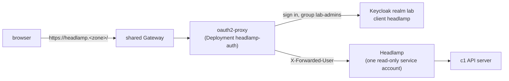

# View c1 in the browser with Headlamp, signed in through the lab's Keycloak

Headlamp is the Kubernetes project's web UI. The research (RB-0235) picked it as the way to look at c1 in a browser, read only. It runs as route 1 of that research: Headlamp behind oauth2-proxy, no change to the Kubernetes API server.

| What | Where it comes from |
|---|---|
| Headlamp and oauth2-proxy pods, Services, route (`headlamp.<zone>`, `headlamp.apps.c1.prod.<zone>`) | Argo CD app `headlamp` (`root/values.yaml`, chart `apps/headlamp`); both images are pinned by tag and digest |
| The client `headlamp` (confidential, code flow, PKCE S256, redirect `/oauth2/callback` on both names) | `realm.yaml.j2`, so it is in every realm import; on a live realm `c1-ansible apply clients` adds it in place |
| Its secret, key `HEADLAMP_CLIENT_SECRET` | the values file (`identity.env`), or `c1/identity` in OpenBao; copied to `headlamp/headlamp-sso`, key `client-secret`; `headlamp-auth` restarts when it changes |
| oauth2-proxy's cookie secret | made once inside the cluster (External Secrets generator), never in git or OpenBao; a new one only ends the open sessions |
| The lab CA's public root, so oauth2-proxy trusts Keycloak's certificate | a cert-manager Certificate on `lab-ca` (`templates/lab-ca.yaml`), passed as `--provider-ca-file` |
| Who gets in | realm group `lab-admins` (`--allowed-group`) |
| What Headlamp may read | its one service account, bound to the built-in `view` and the agents' `agent-read-cluster`: get, list and watch only, no Secrets, no exec, no writes (`templates/headlamp.yaml`) |

Everyone who signs in shares that one service account (`-unsafe-use-service-account-token`), so Headlamp shows the same read-only view to every person; the sign-in only decides who may open it. Headlamp trusts the user headers it is sent, so two guards keep them honest, as Headlamp's "Identity-Aware Proxy" page asks: oauth2-proxy overwrites the identity headers, and a NetworkPolicy (`templates/policy.yaml`) lets only oauth2-proxy's pods reach Headlamp.

Not done here, on purpose: per-person sign-in on the API server (route 2 of the research), which would let k9s and FreeLens on the Mac sign in too. It changes the API server and is its own record.

## Steps

1. On a rebuild, nothing to do: the `apps` stage makes the namespace, and the `identity` stage imports the realm with the client and makes the Secret.
2. On a live c1, from the agent box once the box has installed this change (`c1-ansible.sh` lists `headlamp` in its clients): `secrets-store-prod put-apps` (OpenBao must hold `HEADLAMP_CLIENT_SECRET`), then `secrets-store-prod compare`, then `c1-ansible check clients` and `c1-ansible apply clients <clearance id>` (tags `secrets,clients`, no realm replace).
   why: a realm replace ends every open sign-in; the clients tag adds the one client in place.
   expect: `failed=0`; `c1-read get secrets -n headlamp` lists `headlamp-sso`.
3. The same run sets the live realm's display name from the template (`files/ensure-realm-display-name.sh`, using the same admin sign-in as `ensure-client.sh`, with the `c1-admin` fallback), because a realm import never changes a live realm. `expect`: the task `The realm shows the template display name` is `changed` once, then `ok` on a second run.
4. `headlamp-auth` restarts by itself when the Secret first appears. `c1-read get pods -n headlamp` shows both pods `1/1 Running`.
5. Prove it from the agent box: `signin-check` (its browser part) signs the lab test user in through Keycloak, then asks Headlamp for the namespaces list and for the Secrets list. `expect`: the Headlamp line says `passed: Headlamp lists <n> namespaces for the test user and refuses to list Secrets (HTTP 403)`. The test user must be in group `lab-admins`; if not, the check fails at oauth2-proxy with 403.
6. A typed sign-in is the owner's: open `https://headlamp.<zone>/`, sign in with "Hub sign-in", and Headlamp shows c1.

## If it fails

- **A 403 from oauth2-proxy after a good Keycloak sign-in:** the account is not in `lab-admins`, or the client's `groups` claim mapper is missing; `c1-read logs -n headlamp deploy/headlamp-auth`.
- **oauth2-proxy says "x509" or "unable to verify":** `headlamp-lab-ca` is missing; `c1-read get certificate -n headlamp`.
- **Keycloak says "Invalid parameter: redirect_uri":** the client was not added yet (step 2) or the host is not one it lists.
- **Headlamp lists nothing or says "forbidden" for nodes, namespaces or CRDs:** app `agent-read` is not Synced, so `agent-read-cluster` does not exist.
- **The way back:** delete Argo CD app `headlamp` (it keeps no data), and the client `headlamp` and its two secrets with it.

## Related

- [Set up sign-in for lab apps on c1](set-up-lab-sign-in.md)
- [Give lab apps short names under the zone](set-up-short-app-names.md)
- [Give agents read access to c1](give-agents-read-access-to-c1.md)
