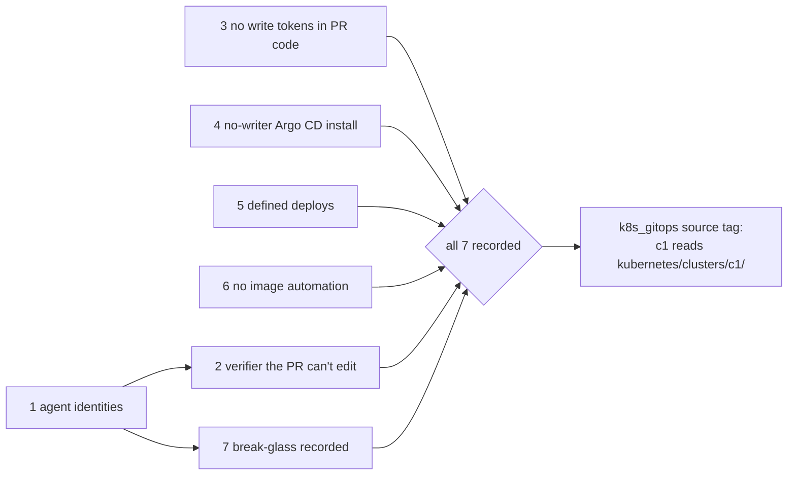

# Pass the Activation gate, so a cluster may read central-hub

## What and why

c1 runs Argo CD with no source: nothing on the cluster reads this repository (D-0023 rule 4). AGENTS.md lists 7 things that must be true and recorded before any cluster reads it, because a GitOps engine applies whatever lands on `main`. Today an agent acts on GitHub as the owner, so GitHub can't tell the owner's approval from an agent's, and an agent's merge could change a live cluster. On 2026-10-28 at 04:29 UTC the owner said yes to the proposed option on a decision card to keep the gate: Argo CD stays idle until all 7 items are recorded.

This change makes each item true, records the evidence for each, and only then lets c1 read `kubernetes/clusters/c1/`. It serves PRD goal 5 (every human and agent has its own identity) and goal 6 (everything controllable from this repo), and the success signal "The Activation gate holds before any cluster reads this repo". It spans several sessions and crosses GitHub, the agents' environment and c1, so it gets a spec (D-0007 rule 2).

*In words:* items 3, 4 and 6 are already true and get a check or evidence. Item 5 needs Argo CD limits, which this change adds. Items 2 and 7 depend on item 1, because a checker the PR can't edit and a break-glass path only the owner holds both need agents that are not the owner on GitHub.

The plan behind the items is the Foundation proposal's §6 (v0.4.3, accepted for the Foundation stage on 2026-10-12). The measured state on 2026-10-28 comes from research batch RB-0093, which builds on RB-0018 for item 1.

### Items and their state on 2026-10-28

| Item | State | What this change adds | The owner's part |
|---|---|---|---|
| 1. Per-agent GitHub identities, with the owner's approval required by GitHub | Not true. Every agent session acts as the owner's account, and the agents' environment replaces any other GitHub key an agent sends. `protect-main` asks for 0 approvals. | The ruleset change (below) and a test plan, once the identity route is chosen | Route chosen (D-0026); create the account, invite it, run the test, then switch |
| 2. A verifier the PR can't edit | Partly. The four docs checks are required and pinned to the GitHub Actions app. The hosts and gate checks are not required. Agents can push workflow files, so a PR can change the checks that judge it. On a public repository GitHub can't block pushes to workflow files with a ruleset. | Nothing yet: making checks required does not meet this item while the checks run from the PR's own files | Choose where the verifier lives (another repository, pinned by commit); add the checks to the ruleset |
| 3. No write tokens in PR code | True. Every workflow runs PR code only on `pull_request` (the docs workflow's weekly schedule checks out `main`), with a read-only token, no secrets and no persisted checkout credential. | `.github/gate-check/check_gate.py`, run by the `gate` workflow on every PR, with its own test cases | Read the three Actions settings agents can't read; accept |
| 4. A pinned, no-writer GitOps engine install | True. Argo CD v3.5.5 from the upstream manifest, checked by SHA-256, no git credential (D-0023). | Evidence only | Accept |
| 5. Defined deploys | Not true. The Application would use Argo CD's `default` project, which allows any repository, destination and kind, and the application controller's ClusterRole allows every verb on every resource. | AppProject `c1` (central-hub only, this cluster only, no `kube-system` or `argocd`, cluster-scoped kinds by allow list, the cluster's own Namespace objects denied by name); `default` emptied; a pause switch (`k8s_gitops_sync_paused`) | Choose how far to cut the controller's own rights; which namespaces the project may write; whether images are pinned by digest |
| 6. No image automation | True. The install has no Image Updater, and Flux's image controllers are deleted by the role's kustomization. | The same check as item 3 fails on any image automation | Accept |
| 7. Break-glass recorded outside agents' reach, ruleset history confirmed | Partly. Agents get 403 on ruleset history; whether their credential can change a ruleset is not known (Foundation V8). The admin kubeconfigs stay on the node (D-0022). | The runbook [Use break-glass access](../runbooks/use-break-glass-access.md) | Run the ruleset-history check once with the owner's own login; record each break-glass use in the project chat |

### Item 1: ruleset change, whichever identity route is chosen

Foundation proposal §6 AG1(d), unchanged: two rulesets, because a bypass skips every rule in its ruleset.

- `protect-main` keeps no bypass and keeps its rules, and the required checks move into it, so nobody merges red.
- A new ruleset `main-review` holds only the review rule: 1 approval, code-owner review on (CODEOWNERS `* @jonhill90`), approval of the last push on, and one bypass actor, the repository admin role in `pull_request` mode, so the owner's own PRs merge without self-approval.

That bypass is safe only when the owner's login is the only admin principal, so it is applied after item 1's identity works, never before.

### Item 5: what the Argo CD limits are

- **Project `c1`.** Source: central-hub only. Destination: this cluster, any namespace except `kube-system` and `argocd`, checked for every namespaced object, not only the Application's destination. Cluster-scoped kinds: `Namespace` only, and never the Namespace objects `kube-*` or `argocd`; each new kind is a PR.
- **`default` emptied.** As Argo CD's projects guide shows, so an Application without a project is refused.
- **Pause switch.** `k8s_gitops_sync_paused: true` adds a deny sync window that is always active, so Argo CD syncs nothing until it is false again. This is the suspend half of item 5's "a tested suspend and recovery", and the cluster half of break-glass.
- **Synced revision.** Each activation run and each sync test records the Application's synced commit and health in its run report, kept apart from `main`.
- **Not yet covered.** The Foundation plan's item 5 also asks for external inputs pinned by digest or version, render, schema and policy checks in item 2's verifier, and readiness evidence. Each is added here before this spec is `done`, or the owner defers it in the decision log.

## Out of scope

- Turning on the source (`k8s_gitops_source_enabled: true`). That is the step after this spec is `done`, and it has its own run with the owner's go-ahead.
- Moving add-ons that Ansible installs today under Argo CD.
- Identities for agents outside this project, such as a local coding agent. Each gets its own approval channel and identity before it gets write access (AGENTS.md rule 1).
- Secrets for apps (BUILD-PATH S14).

## Acceptance criteria

The criteria below were first written by the agent that wrote the gate check and the Argo CD limits, then rewritten from an independent agent's review on 2026-10-28 (RB-0093 CHECK.md, fix 5). The owner's review still applies (D-0007 rule 4).

### Automated

- [ ] `python3 .github/gate-check/check_gate.py .`: prints `gate: items 3 and 6 pass`.
- [ ] `bash .github/gate-check/tests/test_check_gate.sh`: every case prints `ok`. The cases include a `pull_request_target` trigger, write permissions at the top and in a job, a checkout that keeps its token, an action pinned to a tag, a secret read three ways, and Flux image automation and the Argo CD Image Updater.
- [ ] `.github/hosts-check/run.sh manifests`: AppProject `c1` and the emptied `default`, with and without the pause switch, pass kubeconform against the pinned AppProject schema.

### Manual (what the owner checks)

- [ ] Item 1: an agent's commit and PR show the agent's identity, not the owner's; a PR an agent opened can't merge until the owner approves its last push; a PR with a failing required check can't merge, even through the owner's bypass (Foundation V12). The Foundation-era token is revoked.
- [ ] Item 2: (a) the `gate`, `hosts` and docs checks are required on `main` and pinned to the GitHub Actions app; (b) a test PR that edits `check_gate.py` to always pass leaves the required check red or pending, because the check runs from a pinned revision outside the PR; (c) an agent's push that changes a file under `.github/workflows/` is refused by GitHub.
- [ ] Item 3: for each required job's latest run, the "Set up job" log lists only `read` scopes under `GITHUB_TOKEN Permissions`; in Settings, Actions, the owner reads: default workflow permissions Read, "Allow GitHub Actions to create and approve pull requests" off, approval required for fork PRs from all outside contributors.
- [ ] Item 4: the c1 install run shows `install.yaml`'s SHA-256 equal to the role's pin; no Secret in `argocd` has type label `repository` or `repo-creds`; every Argo CD pod is Ready.
- [ ] Item 5, on c1 after the source is on: a manifest with `metadata.namespace: kube-system` or `argocd` fails its sync as not permitted; a `ClusterRoleBinding`, and a Namespace named `argocd`, fail as not permitted in project `c1`; with the pause on, the project shows the deny window Active, a manual sync is refused and a hand edit to a managed object is not reverted; with the pause off, the project has no sync window and the run report's synced commit equals `main`'s head.
- [ ] Item 6: on c1, `kubectl get crd` lists nothing in `image.toolkit.fluxcd.io` and nothing from the Argo CD Image Updater.
- [ ] Item 7: the owner reads the ruleset history with their own login and it returns versions (Foundation V11); the owner confirms their login is the only admin on the repository and that no local agent can reach it; path B of the runbook is run once on c1 as a drill.

## Decision log

- 2026-10-28 04:29 UTC: the owner said yes to keeping the gate, on a decision card in the GitOps thread, so Argo CD on c1 stays with no source until all 7 items are recorded.
- 2026-10-28: in the agents' environment, a request sent with a made-up GitHub token still came back as the owner's account. A real App token was not tried; it is likely replaced the same way.
- 2026-10-28 05:12 UTC: the owner said yes to one GitHub account for the cloud agents, connected in place of the owner's, tested before the switch (D-0026, proposed).

## Points to (read when)

- [AGENTS.md](../../AGENTS.md) "Activation gate": read for the 7 items as written.
- [D-0023](../decisions/0023-use-argo-cd-as-the-gitops-engine.md): read for the Argo CD install and its rule 4, no source before the gate.
- [D-0022](../decisions/0022-reach-clusters-by-ssh-now-and-keep-admin-kubeconfigs-for-break-glass.md): read for the cluster's break-glass credential.
- [`hosts/ansible/roles/k8s_gitops`](../../hosts/ansible/roles/k8s_gitops/): read for the source switch, the projects and the pause switch.
- [Use break-glass access](../runbooks/use-break-glass-access.md): read before using any emergency path.
