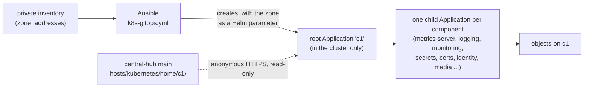

# Move c1's apps and add-ons under Argo CD, with a runbook for each

## What and why

Everything on c1 today was put there by Ansible: seven Helm releases and several sets of plain manifests. Argo CD v3.5.5 is installed but manages nothing: it has no Application and no repository. This was measured on c1 on 2026-11-08 at about 07:15 UTC, read-only. On 2026-11-08 at 07:06 UTC the owner asked to switch all of the Kubernetes work to GitOps as soon as possible, with runbooks written from doing it. At 07:09 UTC the owner asked that every piece be replaceable and documented, so it can be walked through later.

This change moves each component from "Ansible applies it" to "Argo CD reads it from `hosts/kubernetes/home/c1/` on `main`" (D-0023 rule 5, D-0011). It moves one component per PR, and each PR adds a runbook. It serves PRD goal 1 (upstream Kubernetes, starting with one home-lab cluster) and goal 6 (everything controllable from this repo). It crosses systems (Ansible, Argo CD, the cluster) and spans several sessions, so it gets a spec (D-0007 rule 2).

**What blocks it.** Under the Activation gate (AGENTS.md), no cluster may read this repository until all 7 checks pass. D-0023 leaves open whether c1 may read central-hub before then. This spec's PRs can merge before that question is answered, because nothing reads the folder until `k8s_gitops_source_enabled` is set to true. That one switch waits for the owner's answer and the decision record that follows it.



### Layout (agent pick)

```text
hosts/kubernetes/home/c1/
├── README.md              what each folder is, and the order the components moved
├── root/                  a small Helm chart: one Application template per component
│   ├── Chart.yaml
│   ├── values.yaml        component list, chart versions, no private names
│   └── templates/
└── apps/<component>/      Helm values or plain manifests for each component
```

- **One Application reads the repo** (D-0023 rule 5). Ansible creates the root Application `c1`, and the root's Helm chart creates the child Applications.
- **Private names stay out of git** (CLAUDE.md rule 4). The lab zone goes in only one place: the root Application's Helm parameter `zone`. Ansible sets it from the private inventory. The root chart passes it to each child that needs a hostname (HTTPRoutes, Keycloak, Grafana). Nothing in git holds the zone.
- **No repository credential and no image automation.** The repo is public and is read over anonymous HTTPS (D-0023 rules 2 and 5; gate items 3 and 6).

### Taking over a running component (agent pick)

For each component, in one PR:

1. Add `apps/<component>/` with the same chart, version and values that Ansible uses today. The values are rendered from the role's `vars/` and `defaults/`, with private values swapped for the `zone` parameter.
2. Add the child Application to the root chart with **automatic sync off**.
3. On c1, Argo CD shows the diff between git and the cluster. Change the files until the diff is empty or holds only Argo CD's own tracking annotations.
4. Sync once by hand, then turn on automatic sync with self-heal. Do not turn on prune until one cycle runs clean.
5. Remove the component's tasks from its Ansible role, or have the role skip them when `k8s_gitops_source_enabled` is true. Delete its old Helm release Secrets, because Argo CD renders charts with `helm template` (D-0023, Consequences).
6. Write `docs/runbooks/<component>.md`: what it is, where its files are, how to check it, how to change it, how to rebuild it from nothing, and the way back.

**Way back, for every step:** delete the child Application with the non-cascading (orphan) option. The objects stay on the cluster, and the Ansible role runs as before.

### Order (agent pick: lowest risk first)

| # | Component | Today | Why here |
|---|---|---|---|
| 1 | metrics-server | Helm, kube-system | stateless, smallest |
| 2 | local-path provisioner and StorageClass | manifests | no data moves; the claims stay |
| 3 | logging: Loki and Alloy | Helm ×2 | data lives on claims that are kept |
| 4 | monitoring: kube-prometheus-stack | Helm | has CRDs, so it shows how CRDs are handled |
| 5 | external-secrets and the `c1` store | Helm and manifests | the secret store that later steps need |
| 6 | cert-manager, plus a **certs** slot for the lab PKI work | Helm and manifests | the Gateway's certificate depends on it |
| 7 | identity: Keycloak operator, `sso` and the realm | manifests and operator | stateful, so it moves after the pattern is proven |
| 8 | media: Jellyfin, with its first-run setup as code (below) | manifests | the first app built for people to use |
| 9 | gateway: Gateway `apps` and the HTTPRoutes | manifests | every app's route depends on it |
| 10 | Cilium | Helm | the network itself; it moves last, or stays with Ansible, as the owner chooses |

Argo CD itself stays installed by Ansible (D-0023 rule 2).

### Jellyfin's first-run setup as code (agent pick)

Today Jellyfin's setup wizard has not run (measured: `StartupWizardCompleted: false`). If someone clicks through it, the admin account and settings exist only on the `/config` volume, and a rebuild loses them. Instead:

- A random admin password is made once and kept in the `c1` secret store (role `k8s_secrets`). It is never printed, and the owner reads it from the store.
- A Job that runs once calls Jellyfin's startup API (configuration, first user, complete) with that password, and then adds the media library at `/media`.
- A second run of the Job sees that the wizard is done and changes nothing.

## Out of scope

- Turning on the source before the owner answers the Activation gate question, and the decision record for that answer.
- Single sign-on for the Argo CD UI.
- New apps beyond those on c1 today. Each new app gets its own PR in this layout.
- Off-box backups of the claims (BL-0139) and the etcd restore test (BL-0094). Both are needed before "replaceable" fully holds for data, and both are tracked separately.
- The VPS and cloud clusters.

## Acceptance criteria

### Automated

- [ ] CI's manifest check (`.github/hosts-check/`) renders `hosts/kubernetes/home/c1/root` with `helm template` and validates every child Application against its schema.
- [ ] `grep -rE` for the private-name patterns over `kubernetes/` finds nothing.
- [ ] After each component's PR, on c1: `kubectl -n argocd get application <component>` shows `Synced` and `Healthy`.
- [ ] After each component's PR, a second run of that component's Ansible playbook reports `changed=0`, and it does not fight Argo CD.
- [ ] Argo CD holds no repository Secret (`kubectl -n argocd get secret -l argocd.argoproj.io/secret-type=repository` returns nothing).

### Manual (what the owner checks)

- [ ] In the Argo CD UI, each moved component appears under the root app `c1`, green.
- [ ] For each moved component, the runbook in `docs/runbooks/` reads clearly enough that the owner could rebuild that component from it.
- [ ] Jellyfin opens at its lab name, and the admin password from the secret store signs in.

## Points to (read when)

- `docs/decisions/0023-use-argo-cd-as-the-gitops-engine.md`: read when touching the engine, its install or its source.
- `docs/decisions/0011-keep-machine-code-in-hosts.md`: read when placing files.
- `hosts/ansible/roles/k8s_gitops/defaults/main.yml`: read when turning the source on.
- `hosts/AGENT-PICKS.md`: read when a pick here needs a row.
- `AGENTS.md`, Activation gate: read before setting `k8s_gitops_source_enabled: true`.

## Decision log

- 2026-11-08: The spec was drafted while the owner's answer on reading the repo before the gate was still pending. Merging it turns nothing on.
- 2026-11-08: The owner said yes to c1 reading central-hub before the Activation gate, for c1 only (card, 07:16 UTC); D-0027 records it.
- 2026-11-08: Jellyfin moved ahead of its place in the order, because it is the app people use and it holds no data that the move touches (the claims are kept, `Delete=false`). The root chart gained a `local` kind for charts kept in this repository. Agent pick, picks 127-131.
- 2026-11-08: Steps 2 to 6 and 9 are in git, each with a runbook, and CI checks that each renders the same objects as its Ansible role. Two private values reach the cluster through the root Application: the zone and the Gateway's address. Agent picks 132-143.
